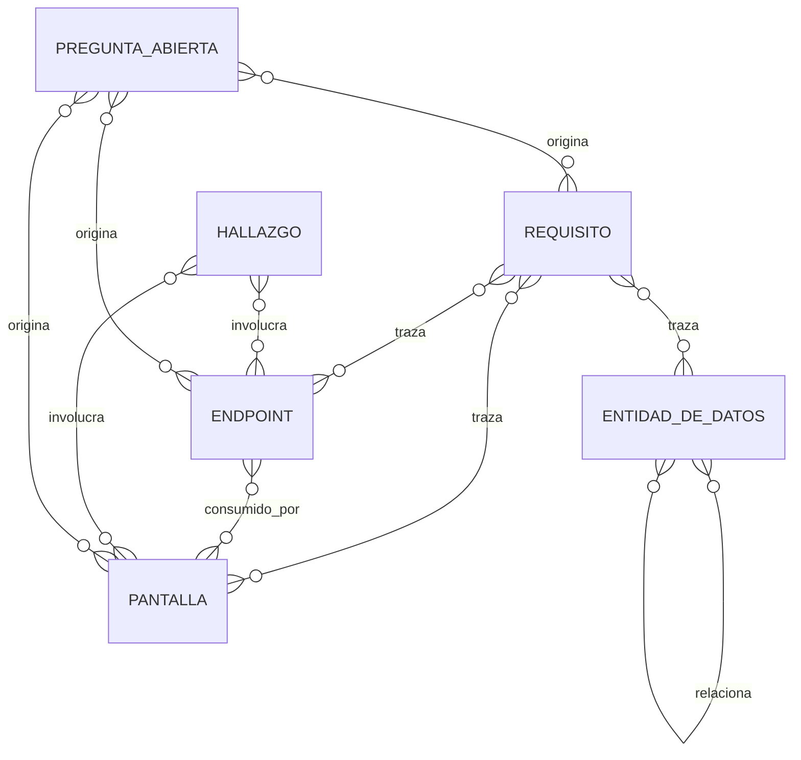

# Data Model: SRS por ingeniería inversa de SkeiloPOS (IEEE 830)

**Spec**: [spec.md](./spec.md) | **Fecha**: 2026-10-08

Esta función no modifica ningún modelo de datos de `pos-backend` (Principio VIII: no aplica,
porque no hay cambio de esquema de aplicación). Las entidades de este documento son entidades de
**contenido** — ya enumeradas en la sección "Key Entities" del spec — convertidas aquí en una
estructura verificable: qué campos tiene cada una, qué la relaciona con las demás, y qué regla de
validación debe cumplir antes de considerarse completa. Coinciden uno a uno con los siete tipos de
entidad del spec.

## 1. Requisito funcional (RF) / Requisito no funcional (RNF)

Unidad mínima del cuerpo del SRS (`srs/README.md`). FR-017 fija sus campos obligatorios.

| Campo | Obligatorio | Descripción | Regla de validación |
|---|---|---|---|
| Identificador | Sí | `RF-<módulo>-<secuencial>` o `RNF-<categoría>-<secuencial>`, único en todo el documento | No puede repetirse; debe aparecer también como fila en el Apéndice A |
| Enunciado | Sí | Frase "El sistema deberá…" | Una sola capacidad por requisito, sin conjunciones que mezclen dos capacidades distintas |
| Actor | Sí | Rol que ejecuta o se beneficia (ej. cajero, mesero, Super Admin) | Debe ser uno de los roles verificados en el inventario de auth/autorización, no uno inventado |
| Precondiciones | Sí | Estado previo necesario | Debe poder verificarse contra una validación real de código, o marcarse `[INFERIDO]` |
| Entradas/Salidas | Sí | Payload/esquema de entrada y salida cuando aplica | Cita el esquema Pydantic/DTO real cuando el requisito deriva de un endpoint |
| Reglas de negocio | Sí | Validaciones/cálculos asociados | Cada regla lleva su propia etiqueta de evidencia |
| Criterio de aceptación | Sí | Formato Dado/Cuando/Entonces | Debe ser verificable observando el comportamiento citado, no una aspiración |
| Prioridad | Sí | Alta/Media/Baja, heredada de la criticidad del flujo de negocio que describe | Justificada en una frase cuando no sea evidente |
| Evidencia | Sí | Etiqueta `[CÓDIGO]`/`[INFERIDO]`/`[PREGUNTA]` (formato exacto: Decisión 3 de `research.md`) | Exactamente una por afirmación atómica dentro del requisito |
| Trazabilidad | Sí | Endpoint(s)/pantalla(s)/entidad(es) relacionados | Cada referencia debe existir también como fila en el Apéndice A |
| Atributos IEEE 830 | Sí | Marca de cumplimiento de los 8 atributos de calidad (FR-018) | Cualquier atributo no cumplido se declara explícitamente, nunca se omite en silencio |

**Relaciones**: N a N con `Endpoint`, `Pantalla/ruta de frontend` y `Entidad de datos` (vía
Trazabilidad); 1 a 1 con su fila correspondiente en el Apéndice A.

**Transiciones de estado**: Draft (recién redactado durante US4) → Verificado (su evidencia fue
muestreada y confirmada contra el código citado) → Publicado (incluido en la versión final de
`srs/README.md` entregada). Un requisito no pasa a Publicado sin pasar por Verificado.

## 2. Endpoint

Ruta HTTP expuesta por `pos-backend`. Unidad mínima del inventario de backend
(`inventario-backend.md`, User Story 1) y de la columna "backend" del Apéndice A.

| Campo | Obligatorio | Descripción | Regla de validación |
|---|---|---|---|
| Método + ruta | Sí | Ej. `POST /api/v1/orders/{order_id}/checkout` | Citado literal del decorador `@router.*`, `[CÓDIGO]` |
| Módulo | Sí | Carpeta de `app/api/v1/` que lo contiene | Debe coincidir con la unidad de división de la Decisión 4 de `research.md` |
| Esquema de entrada/salida | Sí cuando exista | Nombre del esquema Pydantic | `[CÓDIGO]` con archivo:línea de la clase |
| Autenticación requerida | Sí | Dependencia de auth usada (`Depends(...)`) | `[CÓDIGO]`; si no hay dependencia de auth, se declara explícitamente "sin autenticación" |
| Roles/permisos | Sí cuando aplique | Rol(es) permitido(s) | `[CÓDIGO]` citando el chequeo de rol; si no hay chequeo propio del endpoint más allá de la autenticación, se declara así |
| Códigos de error | Sí cuando el código los declare | `HTTPException` con su `status_code` | `[CÓDIGO]` por cada código distinto que el handler pueda emitir |
| Consumido por frontend | Se llena en US3 | Sí/No/Parcial | Ver entidad "Hallazgo" cuando sea No o Parcial |

**Relaciones**: 1 a N con `Pantalla/ruta de frontend` (una pantalla puede llamar a varios
endpoints; un endpoint puede ser llamado por varias pantallas o por ninguna); 1 a N con
`Requisito funcional` vía trazabilidad.

## 3. Pantalla/ruta de frontend

Unidad de navegación de `pos-heladeria`. Unidad mínima del inventario de frontend
(`inventario-frontend.md`, User Story 2).

| Campo | Obligatorio | Descripción | Regla de validación |
|---|---|---|---|
| Ruta | Sí | Path Angular tal como aparece en el archivo de rutas | `[CÓDIGO]` con archivo:línea |
| Módulo | Sí | Carpeta de `src/app/modules/` que la contiene | — |
| Guarda de navegación por rol | Sí | `canActivate`/guard aplicado, o su ausencia explícita | `[CÓDIGO]` |
| Acciones de usuario | Sí cuando existan | Botones/formularios relevantes | `[CÓDIGO]` |
| Validaciones de cliente | Sí cuando existan | Validadores de formulario (`Validators.*`, custom) | `[CÓDIGO]`; nunca se inventa una validación que no esté en el código |
| Estados vacío/carga/error | Sí cuando existan en el código | Manejo explícito observado | `[CÓDIGO]`; si no existe manejo explícito, se declara así, no se asume uno |
| Llamadas a la API | Sí | Cliente HTTP + endpoint exacto consumido | `[CÓDIGO]` con archivo:línea del servicio que hace la llamada |
| Manejo de errores de la llamada | Sí cuando exista | Catch/interceptor observado | `[CÓDIGO]` |

**Relaciones**: N a N con `Endpoint` (vía llamadas a la API); 1 a N con `Requisito funcional` vía
trazabilidad.

## 4. Entidad de datos

Tabla o modelo de `pos-backend/app/models/`. Base del modelo entidad-relación del SRS (incluido en
`srs/README.md` como diagrama Mermaid, ver Asunciones del spec).

| Campo | Obligatorio | Descripción | Regla de validación |
|---|---|---|---|
| Nombre | Sí | Nombre de la clase/tabla | `[CÓDIGO]` |
| Atributos | Sí | Columnas con tipo, nulabilidad, default | `[CÓDIGO]` por columna o por grupo cuando sean homogéneas |
| Relaciones | Sí cuando existan | FK/relationship hacia otras entidades | `[CÓDIGO]` |
| Restricciones | Sí cuando existan | Unicidad, checks, enums | `[CÓDIGO]` |
| Migraciones relevantes | Sí cuando aporten contexto no evidente en el modelo actual | Revisión de Alembic relevante | `[CÓDIGO]` con el archivo de migración |

**Relaciones**: N a N con `Requisito funcional`/`Requisito no funcional` vía trazabilidad; N a N
consigo misma vía FK/relationship.

## 5. Etiqueta de evidencia

Metadato obligatorio de toda afirmación, no una entidad con instancias propias en un listado, sino
una clasificación aplicada a instancias de las demás entidades. Su sintaxis exacta es la fijada en
la Decisión 3 de `research.md`. No tiene campos propios más allá de su tipo (`CÓDIGO`/`INFERIDO`/
`PREGUNTA`) y su carga (cita de archivo:línea, motivo de inferencia, o referencia a la entrada del
Apéndice C).

**Regla de validación transversal**: ninguna oración o fila de tabla del SRS final puede carecer
de al menos una etiqueta; esto se verifica por muestreo en `quickstart.md`.

## 6. Hallazgo (Apéndice D)

Discrepancia, inconsistencia, riesgo de seguridad o código muerto detectado durante el cruce
front↔back (`cruce-front-back.md`, User Story 3) o durante cualquier fase del inventario.

| Campo | Obligatorio | Descripción | Regla de validación |
|---|---|---|---|
| Identificador | Sí | `H-<secuencial>` | Único |
| Categoría | Sí | Una de: endpoint no consumido / contrato distinto / validación solo-frontend / validación inconsistente / rol inconsistente / código muerto / otro | FR-013 fija las primeras cinco categorías obligatorias a cubrir |
| Descripción | Sí | Qué discrepancia existe exactamente | Cita ambos lados (backend y frontend) con su propia etiqueta de evidencia cada uno |
| Severidad | Sí | Alta (riesgo de seguridad o dato incorrecto) / Media / Baja | Justificada en una frase |
| Entidades afectadas | Sí | Endpoint(s) y/o pantalla(s) involucrados | Debe existir también en el Apéndice A |

**Regla de validación crítica (FR-016)**: un Hallazgo **nunca** se reclasifica como Requisito
funcional o no funcional. Esta regla se verifica en `quickstart.md` como paso explícito antes de
dar por cerrada la User Story 4.

**Relaciones**: N a N con `Endpoint` y `Pantalla/ruta de frontend`.

## 7. Pregunta abierta (Apéndice C)

Aspecto no determinable desde el código disponible, dirigido al Product Owner.

| Campo | Obligatorio | Descripción | Regla de validación |
|---|---|---|---|
| Identificador | Sí | `C-<secuencial>` | Único; es el destino de toda etiqueta `[PREGUNTA → C-xx]` del documento |
| Pregunta | Sí | Formulada de forma que admita una respuesta concreta del Product Owner | No puede ser una pregunta cuya respuesta ya esté en el código (verificado en `quickstart.md`, SC-006) |
| Impacto si no se resuelve | Sí | Qué parte del documento queda incompleta o como suposición no verificada | — |
| Prioridad | Sí | Alta/Media/Baja según impacto | — |

**Relaciones**: 1 a N con cualquier entidad cuyo campo haya quedado sin evidencia verificable
(Requisito, Endpoint, Pantalla, Entidad de datos).

## Diagrama de relaciones (resumen)

