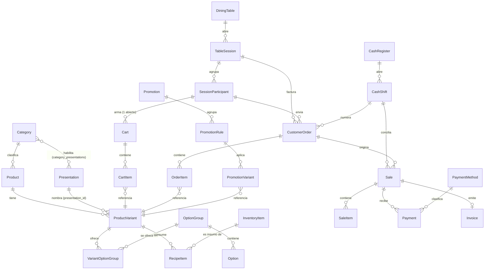

# Inventario verificable del backend — SkeiloPOS (`pos-backend`)

**Spec**: [spec.md](./spec.md) | **Fecha de análisis**: 2026-10-08 | **Commit analizado**: `pos-backend` rama `develop`, `7a356c920dedf4318cc3439d15930869f0a22948`

Toda afirmación de este documento lleva una etiqueta de evidencia (`[CÓDIGO]`/`[INFERIDO]`/`[PREGUNTA → C-xx]`), sintaxis exacta en [contracts/formato-etiqueta-evidencia.md](./contracts/formato-etiqueta-evidencia.md). Análisis de solo lectura — ningún archivo de `pos-backend` fue modificado, ejecutado ni alterado (FR-024).

## Stack verificado

- **Lenguaje**: Python 3.12 [CÓDIGO: pos-backend/Dockerfile:1]
- **Framework web**: FastAPI 0.136.3, con `fastapi-cli` 0.0.24 y `fastapi-cloud-cli` 0.18.0 como herramientas de desarrollo/despliegue [CÓDIGO: pos-backend/requirements.txt:28-30]
- **ORM**: SQLAlchemy 2.0.50, con drivers `psycopg` 3.3.4 y `psycopg2-binary` 2.9.12 para PostgreSQL [CÓDIGO: pos-backend/requirements.txt:51-53,77]
- **Validación de esquemas**: Pydantic 2.13.4, con `pydantic-settings` 2.14.1 y `pydantic-extra-types` 2.11.1 [CÓDIGO: pos-backend/requirements.txt:55-57]
- **Migraciones**: Alembic 1.18.4 [CÓDIGO: pos-backend/requirements.txt:2]
- **Servidor ASGI**: Uvicorn 0.48.0 (con `uvloop` 0.22.1 y `watchfiles` 1.2.0 para desarrollo) [CÓDIGO: pos-backend/requirements.txt:86,104,88]
- **Tareas asíncronas/colas**: Celery 5.6.3 con `kombu` 5.6.2 y `redis` 8.0.0 como broker/backend [CÓDIGO: pos-backend/requirements.txt:14,42,65]
- **Tareas programadas**: APScheduler 3.11.3 [CÓDIGO: pos-backend/requirements.txt:66]
- **Autenticación/tokens**: PyJWT 2.13.0, `passlib` 1.7.4 y `bcrypt` 5.0.0 para hashing de contraseñas [CÓDIGO: pos-backend/requirements.txt:60,49,9]
- **Almacenamiento de objetos**: `boto3` 1.43.48/`botocore` 1.43.48/`s3transfer` 0.19.1 (cliente S3-compatible, usado para Cloudflare R2 — ver § Integraciones externas) [CÓDIGO: pos-backend/requirements.txt:12-13,73]
- **Correo transaccional**: `resend` 2.30.1 y `fastapi-mail` 1.6.4/`aiosmtplib` 5.1.1 [CÓDIGO: pos-backend/requirements.txt:69,31,1]
- **Notificaciones push web**: `pywebpush` 2.5.0, `py-vapid` 1.9.4, `http_ece` 1.2.1 [CÓDIGO: pos-backend/requirements.txt:93-95]
- **WebSockets**: `websockets` 16.0 [CÓDIGO: pos-backend/requirements.txt:90]
- **Observabilidad de errores**: `sentry-sdk` 2.61.0 [CÓDIGO: pos-backend/requirements.txt:74]
- **Exportación de archivos**: `openpyxl` 3.1.5 (generación de Excel) [CÓDIGO: pos-backend/requirements.txt:47]
- **Base de datos**: PostgreSQL (vía `psycopg`/`psycopg2`, sin driver de otro motor presente en el manifiesto) [CÓDIGO: pos-backend/requirements.txt:51-53]

## Endpoints y reglas de negocio

### Grupo G1 — Identidad y acceso (`admin`, `auth`, `bootstrap`, `invitations`, `super_admin`, `tenant`, `users`)

#### `admin`

Este módulo **no expone ningún endpoint activo**. El directorio `pos-backend/app/api/v1/admin/` solo contiene una carpeta `__pycache__/` con bytecode compilado de un `router.py` y un `schema.py` que ya no existen como código fuente [CÓDIGO: pos-backend/app/api/v1/admin/__pycache__/router.cpython-314.pyc]. `app/main.py` no importa ni registra ningún router bajo `app.api.v1.admin` — la lista completa de imports y `include_router(...)` del archivo no menciona `admin` en ningún punto [CÓDIGO: pos-backend/app/main.py:19-45,142-168]. El historial de git confirma que el contenido fue movido, no solo borrado: el commit `3c026080` ("feat(tenants): implement tenant creation endpoint with email notification") borra `app/api/v1/admin/router.py` y `app/api/v1/admin/schema.py` en el mismo cambio que agrega el endpoint de creación de tenant a `app/api/v1/super_admin/router.py` y `app/api/v1/super_admin/schemas.py` [INFERIDO: `git log --diff-filter=D -- app/api/v1/admin/router.py` señala el commit `3c026080`, cuyo `git show --stat` muestra -57/-19 líneas en `admin/router.py` y `admin/schema.py` y +55/+16 líneas en `super_admin/router.py` y `super_admin/schemas.py` el mismo commit].

No hay endpoints que documentar ni reglas de negocio propias: toda la funcionalidad que alguna vez vivió aquí (alta de tenant con usuario admin y correo de bienvenida) está hoy en `super_admin` (ver más abajo). Esta pasada no cubre nada adicional de `admin` porque no queda código fuente que leer.

---

#### `auth`

##### `POST /api/v1/auth/login`
- **Esquema de entrada**: `LoginRequest` (`email: EmailStr`, `password: str`) [CÓDIGO: pos-backend/app/api/v1/auth/schemas.py:4-6]
- **Esquema de salida**: sin `response_model`; `JSONResponse` manual con `message`, `access_token`, `refresh_token`, `user` (dict ad-hoc) [CÓDIGO: pos-backend/app/api/v1/auth/routes.py:158-249]
- **Autenticación**: sin autenticación (endpoint de login) [CÓDIGO: pos-backend/app/api/v1/auth/routes.py:158-159]
- **Roles/permisos**: ninguno — el ámbito (plataforma vs. tenant) lo decide la cabecera `x-tenant-host`, no un rol [CÓDIGO: pos-backend/app/api/v1/auth/routes.py:160-182]
- **Códigos de error**: `401` (host ausente/desconocido, credenciales inválidas) [CÓDIGO: pos-backend/app/api/v1/auth/routes.py:184-187,208-211]; `403` (`User account is inactive`) [CÓDIGO: pos-backend/app/api/v1/auth/routes.py:213-216]; `503` (`OperationalError` de BD) [CÓDIGO: pos-backend/app/api/v1/auth/routes.py:226-231]; `500` (`SQLAlchemyError` genérico) [CÓDIGO: pos-backend/app/api/v1/auth/routes.py:232-237]

##### `POST /api/v1/auth/forgot-password`
- **Esquema de entrada**: `ForgotPasswordRequest` (`email: EmailStr`) [CÓDIGO: pos-backend/app/api/v1/auth/schemas.py:16-17]
- **Esquema de salida**: sin `response_model`; `JSONResponse` con mensaje genérico fijo [CÓDIGO: pos-backend/app/api/v1/auth/routes.py:37-42,330]
- **Autenticación**: sin autenticación de usuario; requiere `Depends(get_tenant)` (resuelve el tenant por `x-tenant-host`) y `Depends(get_shared_db)` [CÓDIGO: pos-backend/app/api/v1/auth/routes.py:253-257]
- **Roles/permisos**: ninguno más allá de resolver el tenant por host [CÓDIGO: pos-backend/app/api/v1/auth/routes.py:254-256]
- **Códigos de error**: `429` (`enforce_sliding_window` excede el límite) [CÓDIGO: pos-backend/app/api/v1/auth/routes.py:264-268]; `400` indirecto si falta `x-tenant-host` (vía `get_tenant`) [CÓDIGO: pos-backend/app/core/db.py:199-205]; `404` indirecto si el host no resuelve a ningún tenant (vía `get_tenant`) [CÓDIGO: pos-backend/app/core/db.py:210-211]

##### `GET /api/v1/auth/reset-password/validate`
- **Esquema de entrada**: query param `token: str`; sin clase Pydantic [CÓDIGO: pos-backend/app/api/v1/auth/routes.py:333-334]
- **Esquema de salida**: sin `response_model`; `JSONResponse` con `{"valid": bool, "reason"?: str}` [CÓDIGO: pos-backend/app/api/v1/auth/routes.py:338-345]
- **Autenticación**: sin autenticación; solo `Depends(get_shared_db)` [CÓDIGO: pos-backend/app/api/v1/auth/routes.py:333-334]
- **Roles/permisos**: ninguno [CÓDIGO: pos-backend/app/api/v1/auth/routes.py:333-345]
- **Códigos de error**: `404` si el token no existe (`row is None`) o `400` si existe pero no es válido (usado/invalidado/expirado), ambos devueltos como `JSONResponse` con `status_code` explícito, no como `HTTPException` [CÓDIGO: pos-backend/app/api/v1/auth/routes.py:340-345]

##### `POST /api/v1/auth/reset-password`
- **Esquema de entrada**: `ResetPasswordRequest` (`token: str`, `new_password: str` 8-12 caracteres) [CÓDIGO: pos-backend/app/api/v1/auth/schemas.py:20-23]
- **Esquema de salida**: sin `response_model`; `JSONResponse` con mensaje de éxito [CÓDIGO: pos-backend/app/api/v1/auth/routes.py:373]
- **Autenticación**: sin autenticación de usuario (el propio token de un solo uso hace de credencial); solo `Depends(get_shared_db)` [CÓDIGO: pos-backend/app/api/v1/auth/routes.py:348-349]
- **Roles/permisos**: ninguno [CÓDIGO: pos-backend/app/api/v1/auth/routes.py:348-373]
- **Códigos de error**: `404`/`400` según `reason` del token (igual que `.../validate`, pero como `HTTPException`) [CÓDIGO: pos-backend/app/api/v1/auth/routes.py:352-356]; `400` si la nueva contraseña es igual a la actual [CÓDIGO: pos-backend/app/api/v1/auth/routes.py:358-362]

##### `POST /api/v1/auth/change-password`
- **Esquema de entrada**: `ChangePasswordRequest` (`current_password: str` mín. 1 char, `new_password: str` 8-12 caracteres) [CÓDIGO: pos-backend/app/api/v1/auth/schemas.py:9-13]
- **Esquema de salida**: sin `response_model`; `JSONResponse` con mensaje de éxito [CÓDIGO: pos-backend/app/api/v1/auth/routes.py:406]
- **Autenticación**: `Depends(get_authenticated_user)` (JWT de acceso válido, contra schema `shared`, sirve tanto para Super Admin como para usuario de tenant) [CÓDIGO: pos-backend/app/api/v1/auth/routes.py:379; pos-backend/app/core/dependencies.py:301-327]
- **Roles/permisos**: ninguno propio más allá de estar autenticado [CÓDIGO: pos-backend/app/api/v1/auth/routes.py:376-381]
- **Códigos de error**: `400` si la contraseña actual es incorrecta [CÓDIGO: pos-backend/app/api/v1/auth/routes.py:382-386]; `400` si la nueva es igual a la actual [CÓDIGO: pos-backend/app/api/v1/auth/routes.py:388-392]; `401` indirecto si el token es inválido/expirado/revocado (vía `get_authenticated_user`/`get_valid_token_data`) [CÓDIGO: pos-backend/app/core/dependencies.py:311-327]

##### `GET /api/v1/auth/refresh-token`
- **Esquema de entrada**: sin body; `Depends(RefreshTokenBearer())` extrae el token del header `Authorization` [CÓDIGO: pos-backend/app/api/v1/auth/routes.py:409-411]
- **Esquema de salida**: sin `response_model`; `JSONResponse` con `{"access_token": str}` [CÓDIGO: pos-backend/app/api/v1/auth/routes.py:450]
- **Autenticación**: `Depends(RefreshTokenBearer())` — exige específicamente un refresh token (no un access token) [CÓDIGO: pos-backend/app/api/v1/auth/routes.py:410-411; pos-backend/app/core/dependencies.py:73-76]
- **Roles/permisos**: ninguno propio [CÓDIGO: pos-backend/app/api/v1/auth/routes.py:409-450]
- **Códigos de error**: `401` si el `uid` del payload no es un UUID válido [CÓDIGO: pos-backend/app/api/v1/auth/routes.py:418-422]; `401` si el usuario no existe o está inactivo [CÓDIGO: pos-backend/app/api/v1/auth/routes.py:433-437]; `401` si la sesión fue revocada (`_reject_if_session_revoked`) [CÓDIGO: pos-backend/app/api/v1/auth/routes.py:439; pos-backend/app/core/dependencies.py:125-129]; `401` indirecto si el refresh token está revocado/en blocklist (vía `TokenBearer.__call__`) [CÓDIGO: pos-backend/app/core/dependencies.py:45-57]

##### `GET /api/v1/auth/logout`
- **Esquema de entrada**: sin body; `Depends(AccessTokenBearer())` [CÓDIGO: pos-backend/app/api/v1/auth/routes.py:452-453]
- **Esquema de salida**: sin `response_model`; `JSONResponse` con mensaje de éxito [CÓDIGO: pos-backend/app/api/v1/auth/routes.py:458-460]
- **Autenticación**: `Depends(AccessTokenBearer())` — exige un access token (no un refresh token) [CÓDIGO: pos-backend/app/api/v1/auth/routes.py:453; pos-backend/app/core/dependencies.py:67-70]
- **Roles/permisos**: ninguno propio [CÓDIGO: pos-backend/app/api/v1/auth/routes.py:452-460]
- **Códigos de error**: `401` indirecto si el token ya está inválido/expirado/revocado (vía `TokenBearer.__call__`) [CÓDIGO: pos-backend/app/core/dependencies.py:38-57]

**Reglas de negocio de `auth`**:
- El ámbito de una petición de login es único y lo decide exclusivamente la cabecera `x-tenant-host`: `"admin"` exacto abre la plataforma (Super Admin, `tenant_id IS NULL`), el slug de un negocio registrado abre solo ese negocio, y host ausente/vacío/desconocido no abre ningún ámbito, devolviendo el mismo `401` que unas credenciales inválidas (sin revelar el motivo) [CÓDIGO: pos-backend/app/api/v1/auth/routes.py:160-187]. Confirmado por `test_auth_login_platform_isolation.py` [CÓDIGO: pos-backend/app/characterization_tests/test_auth_login_platform_isolation.py:37].
- Si no existe un `User` con ese correo en el tenant pero sí una `UserInvitation` con `status="pending"` cuya contraseña coincide, el login crea la cuenta y consume la invitación en el mismo intento (nunca en el ámbito de plataforma) [CÓDIGO: pos-backend/app/api/v1/auth/routes.py:119-155,203-204]. Confirmado por `test_auth_login_invitation_consumption.py` [CÓDIGO: pos-backend/app/characterization_tests/test_auth_login_invitation_consumption.py:31].
- La consumición de invitación usa `WITH FOR UPDATE` sobre la fila de `UserInvitation` para que dos logins casi simultáneos con la misma contraseña temporal no consuman la misma invitación dos veces [CÓDIGO: pos-backend/app/api/v1/auth/routes.py:119-135].
- `forgot-password` aplica un límite de peticiones por tenant+correo normalizado: `PASSWORD_RESET_MAX_REQUESTS` (default `3`) peticiones por `PASSWORD_RESET_WINDOW_SECONDS` (default `900`) segundos [CÓDIGO: pos-backend/app/api/v1/auth/routes.py:259-263; pos-backend/app/core/config.py:81-82].
- `forgot-password` responde siempre el mismo mensaje genérico exista o no la cuenta (correo inexistente, inactivo o de otro tenant recibe idéntica respuesta, sin crear fila ni enviar correo) — anti enumeración de usuarios [CÓDIGO: pos-backend/app/api/v1/auth/routes.py:37-42,278-281].
- Un nuevo enlace de restablecimiento invalida de inmediato cualquier enlace vigente anterior de la misma cuenta: a lo sumo un token "vigente" por cuenta [CÓDIGO: pos-backend/app/api/v1/auth/routes.py:285-295].
- El token de restablecimiento expira a los `PASSWORD_RESET_TOKEN_EXPIRY_MINUTES` (default `30`) minutos de emitido [CÓDIGO: pos-backend/app/api/v1/auth/routes.py:297-306; pos-backend/app/core/config.py:84].
- `GET .../validate` no tiene efecto secundario (no consume el token); `POST /reset-password` vuelve a resolver y validar el token con las mismas reglas antes de aplicar cualquier cambio, sin confiar en una validación previa del cliente, y bloquea la fila (`WITH FOR UPDATE`) para evitar doble consumo concurrente [CÓDIGO: pos-backend/app/api/v1/auth/routes.py:90-116,335-356].
- Tanto `reset-password` como `change-password` rechazan que la nueva contraseña sea igual a la actual [CÓDIGO: pos-backend/app/api/v1/auth/routes.py:358-362,388-392].
- Un restablecimiento o cambio de contraseña exitoso pone `must_change_password=False` y actualiza `tokens_valid_after=now`, lo que cierra todas las sesiones (JWT) emitidas antes de ese instante para la cuenta [CÓDIGO: pos-backend/app/api/v1/auth/routes.py:364-368,394-401; pos-backend/app/core/dependencies.py:105-129]. Confirmado por `test_auth_session_revocation.py` [CÓDIGO: pos-backend/app/characterization_tests/test_auth_session_revocation.py:24] y por `test_auth_reset_password.py`/`test_auth_change_password.py`.
- `change-password` cierra todas las sesiones de la cuenta, incluida la de origen a nivel de corte por tiempo: el frontend debe volver a loguearse justo después del `200` para obtener tokens acuñados tras el corte, ya que el backend distingue por tiempo (`iat` vs. `tokens_valid_after`), no por `jti` [CÓDIGO: pos-backend/app/api/v1/auth/routes.py:397-401].
- Todo cambio de contraseña exitoso (reset o change) encola un correo de aviso de forma asíncrona (Celery); un fallo al construir o encolar ese correo queda en `warning` en el log y nunca rompe la respuesta `200` [CÓDIGO: pos-backend/app/api/v1/auth/routes.py:57-81].
- `refresh-token` relee el usuario desde la base de datos en vez de reciclar los claims del refresh token: una cuenta desactivada o con rol cambiado deja de emitir access tokens válidos con datos obsoletos durante la vida del refresh [CÓDIGO: pos-backend/app/api/v1/auth/routes.py:424-437].
- `logout` añade el `jti` del access token vigente a una blocklist en Redis, revocando esa sesión concreta [CÓDIGO: pos-backend/app/api/v1/auth/routes.py:452-460].
- Las contraseñas (`ChangePasswordRequest.new_password`, `ResetPasswordRequest.new_password`) están acotadas a 8-12 caracteres [CÓDIGO: pos-backend/app/api/v1/auth/schemas.py:13,22].

---

#### `bootstrap`

##### `GET /api/v1/bootstrap`
- **Esquema de entrada**: sin body ni query params propios [CÓDIGO: pos-backend/app/api/v1/bootstrap/router.py:14-30]
- **Esquema de salida**: `BootstrapResponse` (`tenant: Optional[TenantInfoResponse]`, `plan: Optional[PlanSummaryResponse]`, `notifications: Optional[NotificationListResponse]`) [CÓDIGO: pos-backend/app/api/v1/bootstrap/schemas.py:10-18]
- **Autenticación**: `Depends(get_authenticated_user)` — JWT válido contra schema `shared`, sin exigir que el tenant exista [CÓDIGO: pos-backend/app/api/v1/bootstrap/router.py:28; pos-backend/app/core/dependencies.py:301-327]; además `Depends(get_optional_db)` y `Depends(get_optional_tenant)`, que exigen la cabecera `x-tenant-host` pero toleran que no resuelva a ningún tenant [CÓDIGO: pos-backend/app/api/v1/bootstrap/router.py:26-27; pos-backend/app/core/dependencies.py:273-298]
- **Roles/permisos**: ninguno propio — el Super Admin recibe `200` con los 3 bloques en `null` en vez de un error [CÓDIGO: pos-backend/app/api/v1/bootstrap/router.py:22-23; pos-backend/app/api/v1/bootstrap/service.py:17-22]
- **Códigos de error**: `400` indirecto si falta `x-tenant-host` (vía `get_optional_tenant`) [CÓDIGO: pos-backend/app/core/dependencies.py:279-283]; `401` indirecto si el JWT es inválido/expirado/revocado o el usuario no existe/está inactivo (vía `get_authenticated_user`) [CÓDIGO: pos-backend/app/core/dependencies.py:311-327]; sin ningún otro `HTTPException` propio — los fallos internos de cada bloque se absorben (ver reglas de negocio)

**Reglas de negocio de `bootstrap`**:
- Compone en una sola respuesta lo que separadamente entregan `GET /tenant`, `GET /plan` y `GET /notifications?page=1&size=20`, reutilizando sin duplicar la lógica de esos tres módulos [CÓDIGO: pos-backend/app/api/v1/bootstrap/service.py:13-16].
- Si no hay tenant resuelto (Super Admin o cualquier host sin tenant), los 3 bloques —incluido `notifications`— se devuelven en `null` sin intentar ninguna consulta contra un schema que no existe [CÓDIGO: pos-backend/app/api/v1/bootstrap/service.py:17-22]. Confirmado por `TestBootstrapSuperAdmin` [CÓDIGO: pos-backend/app/characterization_tests/test_bootstrap.py:54].
- Cada uno de los 3 bloques (`tenant`, `plan`, `notifications`) se resuelve en su propio `try/except` independiente: un fallo en uno no interrumpe a los otros dos, el bloque que falla queda `None` y la respuesta siempre es `200` [CÓDIGO: pos-backend/app/api/v1/bootstrap/service.py:26-51]. Confirmado por `TestBootstrapDegradacionGranular` [CÓDIGO: pos-backend/app/characterization_tests/test_bootstrap.py:78].
- El bloque `notifications` llama directamente a la función `list_notifications` del router de notificaciones (no vía HTTP), por lo que debe pasarle explícitos los defaults que normalmente resuelve FastAPI (`page=1, size=20, after_id=None, limit=100, only_pending=False`) — de lo contrario llegarían como objetos `Query` sin resolver [CÓDIGO: pos-backend/app/api/v1/bootstrap/service.py:39-48].

---

#### `invitations`

##### `GET /api/v1/invitations`
- **Esquema de entrada**: query params `page: int` (default 1, ≥1), `size: int` (default 20, 1-100); sin clase Pydantic de body [CÓDIGO: pos-backend/app/api/v1/invitations/router.py:46-51]
- **Esquema de salida**: `Page[InvitationResponse]` (paginación genérica) [CÓDIGO: pos-backend/app/api/v1/invitations/router.py:34]
- **Autenticación**: `Depends(require_tenant_admin)` (implica `get_current_user` → JWT + `x-tenant-host`) [CÓDIGO: pos-backend/app/api/v1/invitations/router.py:50; pos-backend/app/core/dependencies.py:366-373]
- **Roles/permisos**: exige rol `ADMIN` del tenant (`require_tenant_admin`) [CÓDIGO: pos-backend/app/core/dependencies.py:366-373]
- **Códigos de error**: `401` (no autenticado/token inválido, declarado en `responses`) [CÓDIGO: pos-backend/app/api/v1/invitations/router.py:42]; `403` (no es ADMIN del tenant, declarado en `responses`) [CÓDIGO: pos-backend/app/api/v1/invitations/router.py:43]

##### `POST /api/v1/invitations`
- **Esquema de entrada**: `InvitationCreate` (`name: Optional[str]` obligatorio vía `validate_default=True`, `email: EmailStr`, `role: RoleName`) [CÓDIGO: pos-backend/app/api/v1/invitations/schemas.py:11-33]
- **Esquema de salida**: `InvitationResponse`, `status_code=201` [CÓDIGO: pos-backend/app/api/v1/invitations/router.py:61-64]
- **Autenticación**: `Depends(get_tenant)` + `Depends(require_tenant_admin)` [CÓDIGO: pos-backend/app/api/v1/invitations/router.py:81-85]
- **Roles/permisos**: rol `ADMIN` del tenant (`require_tenant_admin`) [CÓDIGO: pos-backend/app/core/dependencies.py:366-373]
- **Códigos de error**: `401`/`403` (declarados en `responses`) [CÓDIGO: pos-backend/app/api/v1/invitations/router.py:73-74]; `403` real si el plan venció o alcanzó el límite de "usuarios" (vía `enforce_plan_limit`) [CÓDIGO: pos-backend/app/api/v1/invitations/router.py:91; pos-backend/app/core/plan_limits.py:82-94,97-123]; `409` si ya existe un `User` con ese correo en el tenant [CÓDIGO: pos-backend/app/api/v1/invitations/router.py:95-102]; `404` si el rol indicado no existe [CÓDIGO: pos-backend/app/api/v1/invitations/router.py:104-111]; `409` si ya existe una invitación pendiente para ese correo (índice único violado) [CÓDIGO: pos-backend/app/api/v1/invitations/router.py:126-133]; `502` si no se pudo generar o enviar el correo de invitación [CÓDIGO: pos-backend/app/api/v1/invitations/router.py:154-164]; `422` (validación Pydantic, declarado en `responses`) [CÓDIGO: pos-backend/app/api/v1/invitations/router.py:77]

##### `POST /api/v1/invitations/{invitation_id}/resend`
- **Esquema de entrada**: path param `invitation_id: UUID`; sin body [CÓDIGO: pos-backend/app/api/v1/invitations/router.py:207-211]
- **Esquema de salida**: `InvitationResponse` [CÓDIGO: pos-backend/app/api/v1/invitations/router.py:192]
- **Autenticación**: `Depends(get_tenant)` + `Depends(require_tenant_admin)` [CÓDIGO: pos-backend/app/api/v1/invitations/router.py:208-211]
- **Roles/permisos**: rol `ADMIN` del tenant [CÓDIGO: pos-backend/app/core/dependencies.py:366-373]
- **Códigos de error**: `401`/`403` (declarados) [CÓDIGO: pos-backend/app/api/v1/invitations/router.py:200-201]; `404` si la invitación no existe en el tenant del admin [CÓDIGO: pos-backend/app/api/v1/invitations/router.py:177-181]; `409` si ya no está `pending` [CÓDIGO: pos-backend/app/api/v1/invitations/router.py:182-186]; `502` si falla el envío del correo [CÓDIGO: pos-backend/app/api/v1/invitations/router.py:235-244]

##### `POST /api/v1/invitations/{invitation_id}/cancel`
- **Esquema de entrada**: path param `invitation_id: UUID`; sin body [CÓDIGO: pos-backend/app/api/v1/invitations/router.py:266-269]
- **Esquema de salida**: `InvitationResponse` [CÓDIGO: pos-backend/app/api/v1/invitations/router.py:255]
- **Autenticación**: `Depends(require_tenant_admin)` [CÓDIGO: pos-backend/app/api/v1/invitations/router.py:268]
- **Roles/permisos**: rol `ADMIN` del tenant [CÓDIGO: pos-backend/app/core/dependencies.py:366-373]
- **Códigos de error**: `401`/`403` (declarados) [CÓDIGO: pos-backend/app/api/v1/invitations/router.py:260-261]; `404` si la invitación no existe en el tenant del admin [CÓDIGO: pos-backend/app/api/v1/invitations/router.py:177-181]; `409` si ya no está `pending` [CÓDIGO: pos-backend/app/api/v1/invitations/router.py:182-186]

**Reglas de negocio de `invitations`**:
- `GET` solo devuelve invitaciones con `status='pending'` del tenant del admin autenticado, nunca de otro tenant ni las ya consumidas/canceladas, ordenadas por `sent_at` descendente [CÓDIGO: pos-backend/app/api/v1/invitations/router.py:52-58]. Confirmado por `test_invitations_list.py` [CÓDIGO: pos-backend/app/characterization_tests/test_invitations_list.py:26].
- `POST` nunca crea un `User` directamente: solo crea una `UserInvitation` pendiente con una contraseña temporal generada aleatoriamente, cuyo hash se guarda pero cuyo valor en claro nunca se expone en la respuesta (`InvitationResponse` no tiene campo de contraseña) [CÓDIGO: pos-backend/app/api/v1/invitations/router.py:67-69,113-121,41-50]. Confirmado por `test_invitations_create.py` [CÓDIGO: pos-backend/app/characterization_tests/test_invitations_create.py:38].
- El correo ya usado por un `User` del tenant (activo o inactivo) bloquea la invitación: no se libera el correo de una cuenta desactivada [CÓDIGO: pos-backend/app/api/v1/invitations/router.py:93-102].
- A lo sumo una invitación `pending` por correo+tenant, garantizado por un índice único parcial a nivel de base de datos (no solo por chequeo de aplicación): dos `ADMIN` invitando casi al mismo tiempo dejan una sola fila viva [CÓDIGO: pos-backend/app/api/v1/invitations/router.py:123-133].
- El envío del correo de invitación es síncrono y ocurre antes del `commit()`: si falla, se hace `rollback()` y la invitación nunca queda persistida — nunca se confirma un envío que no salió [CÓDIGO: pos-backend/app/api/v1/invitations/router.py:135-168].
- En el reenvío, el nuevo correo se despacha **antes** de sobrescribir la fila: si el envío falla, la contraseña temporal anterior sigue intacta y funcional (nunca queda la invitación sin ninguna contraseña válida conocida por nadie) [CÓDIGO: pos-backend/app/api/v1/invitations/router.py:213-250].
- Cancelar una invitación solo es posible si sigue `pending`; la cancelación invalida de inmediato su contraseña temporal (deja de poder usarse para login) y la invitación deja de aparecer como pendiente [CÓDIGO: pos-backend/app/api/v1/invitations/router.py:171-187,266-277]. Confirmado por `test_invitations_resend_cancel.py` [CÓDIGO: pos-backend/app/characterization_tests/test_invitations_resend_cancel.py:26].
- El nombre de la persona invitada es obligatorio (omitirlo, enviarlo vacío o solo espacios da el mismo error "El nombre es obligatorio"), se normaliza a NFC y debe tener entre 2 y 100 caracteres, solo letras latinas/espacios/apóstrofes/guiones, con al menos 2 letras — validado por `normalize_full_name` [CÓDIGO: pos-backend/app/api/v1/invitations/schemas.py:15-38; pos-backend/app/core/person_name.py:10-41].
- La creación de invitación cuenta también las invitaciones pendientes (no solo los `User` existentes) contra el límite de "usuarios" del plan del tenant, y bloquea si el plan venció [CÓDIGO: pos-backend/app/api/v1/invitations/router.py:89-91; pos-backend/app/core/plan_limits.py:82-123].

---

#### `super_admin`

Este módulo está repartido en 3 archivos montados bajo el mismo router raíz: `router.py` (usuarios/tenants, prefijo `/super-admin`), `payment_methods_router.py` (prefijo `/super-admin/payment-methods-catalog`) y `plans_router.py` (prefijo `/super-admin/plans`), ambos incluidos vía `router.include_router(...)` [CÓDIGO: pos-backend/app/api/v1/super_admin/router.py:28-35]. Los 3 comparten la misma dependencia de autenticación a nivel de router raíz: `dependencies=[Depends(get_current_super_admin)]` [CÓDIGO: pos-backend/app/api/v1/super_admin/router.py:28-32] — no se re-declara en cada sub-router, pero aplica igual porque Starlette/FastAPI propaga las `dependencies` del router padre a los incluidos.

##### `GET /api/v1/super-admin/users`
- **Esquema de entrada**: query params `page: int` (default 1, ≥1), `size: int` (default 20, 1-100), `tenant_id: int | None` [CÓDIGO: pos-backend/app/api/v1/super_admin/router.py:49-54]
- **Esquema de salida**: `Page[UserResponse]` [CÓDIGO: pos-backend/app/api/v1/super_admin/router.py:40]
- **Autenticación**: `Depends(get_current_super_admin)` (heredada del router raíz) [CÓDIGO: pos-backend/app/api/v1/super_admin/router.py:28-32]
- **Roles/permisos**: exige `is_super_admin=True` en el JWT y que el usuario exista con `tenant_id IS NULL` (`get_current_super_admin`) [CÓDIGO: pos-backend/app/core/dependencies.py:330-363]
- **Códigos de error**: `401`/`403` (declarados en `responses`) [CÓDIGO: pos-backend/app/api/v1/super_admin/router.py:45-46]

##### `GET /api/v1/super-admin/tenants`
- **Esquema de entrada**: query params `page: int` (default 1, ≥1), `size: int` (default 20, 1-100) [CÓDIGO: pos-backend/app/api/v1/super_admin/router.py:76-79]
- **Esquema de salida**: `Page[TenantResponse]` [CÓDIGO: pos-backend/app/api/v1/super_admin/router.py:67]
- **Autenticación**: `Depends(get_current_super_admin)` (heredada) [CÓDIGO: pos-backend/app/api/v1/super_admin/router.py:28-32]
- **Roles/permisos**: igual que el endpoint anterior [CÓDIGO: pos-backend/app/core/dependencies.py:330-363]
- **Códigos de error**: `401`/`403` (declarados) [CÓDIGO: pos-backend/app/api/v1/super_admin/router.py:72-73]

##### `PATCH /api/v1/super-admin/tenants/{tenant_id}`
- **Esquema de entrada**: path `tenant_id: int`, body `TenantPlanUpdate` (`plan_id: UUID`, `ciclo_facturacion: Optional[Literal["mensual","anual"]]`, sin default — obligatorio) [CÓDIGO: pos-backend/app/api/v1/super_admin/router.py:103-104; pos-backend/app/api/v1/super_admin/schemas.py:108-117]
- **Esquema de salida**: `TenantResponse` [CÓDIGO: pos-backend/app/api/v1/super_admin/router.py:91]
- **Autenticación**: `Depends(get_current_super_admin)` (heredada) [CÓDIGO: pos-backend/app/api/v1/super_admin/router.py:28-32]
- **Roles/permisos**: igual que arriba [CÓDIGO: pos-backend/app/core/dependencies.py:330-363]
- **Códigos de error**: `404` si no existe el tenant o el plan indicado (declarado y real vía `get_or_404`) [CÓDIGO: pos-backend/app/api/v1/super_admin/router.py:99,106-107; pos-backend/app/core/crud.py:9-14]; `409` si el ciclo de facturación elegido no tiene precio definido en ese plan [CÓDIGO: pos-backend/app/api/v1/super_admin/router.py:100,108; pos-backend/app/core/plan_limits.py:177-189]

##### `POST /api/v1/super-admin/tenants`
- **Esquema de entrada**: `TenantCreateWithUser` (`tenant_name`, `schema_name`, `host` — validado contra subdominios reservados —, `name`, `email: str` sin tipo `EmailStr`, `plan_id: UUID`, `ciclo_facturacion` obligatorio) [CÓDIGO: pos-backend/app/api/v1/super_admin/schemas.py:192-218]
- **Esquema de salida**: sin `response_model`; dict literal `{"status": "ok", "tenant": body.tenant_name}` [CÓDIGO: pos-backend/app/api/v1/super_admin/router.py:125-173]
- **Autenticación**: `Depends(get_current_super_admin)` declarada dos veces — a nivel de router raíz y explícita en el propio decorador (`dependencies=[Depends(get_current_super_admin)]`) [CÓDIGO: pos-backend/app/api/v1/super_admin/router.py:125]
- **Roles/permisos**: igual que el resto del módulo [CÓDIGO: pos-backend/app/core/dependencies.py:330-363]
- **Códigos de error**: sin `HTTPException` propio en el `happy path`; errores de `tenant_create` (p. ej. `RuntimeError` si las migraciones no están al día, `404` si el plan no existe) se propagan sin captura adicional en este endpoint [CÓDIGO: pos-backend/app/core/db.py:56-80]; un fallo al encolar el correo de bienvenida se captura, se registra en `warning` y se reporta a Sentry, pero **no** afecta la respuesta (sigue devolviendo `200` con `tenant` ya creado) [CÓDIGO: pos-backend/app/api/v1/super_admin/router.py:160-171]

##### `GET /api/v1/super-admin/payment-methods-catalog`
- **Esquema de entrada**: sin query params ni body [CÓDIGO: pos-backend/app/api/v1/super_admin/payment_methods_router.py:19-28]
- **Esquema de salida**: `list[PaymentMethodCatalogResponse]` [CÓDIGO: pos-backend/app/api/v1/super_admin/payment_methods_router.py:21]
- **Autenticación**: heredada del router raíz (`get_current_super_admin`) [CÓDIGO: pos-backend/app/api/v1/super_admin/router.py:28-32,34]
- **Roles/permisos**: igual que el resto del módulo [CÓDIGO: pos-backend/app/core/dependencies.py:330-363]
- **Códigos de error**: ninguno propio declarado; `401`/`403` solo por la dependencia heredada [CÓDIGO: pos-backend/app/api/v1/super_admin/payment_methods_router.py:19-28]

##### `POST /api/v1/super-admin/payment-methods-catalog`
- **Esquema de entrada**: `PaymentMethodCatalogCreate` (`name`, `type: PaymentMethodType`, `fields: list[PaymentMethodFieldDefinition]`) [CÓDIGO: pos-backend/app/api/v1/super_admin/schemas.py:47-55]
- **Esquema de salida**: `PaymentMethodCatalogResponse`, `status_code=201` [CÓDIGO: pos-backend/app/api/v1/super_admin/payment_methods_router.py:31-34]
- **Autenticación**: heredada [CÓDIGO: pos-backend/app/api/v1/super_admin/router.py:28-32,34]
- **Roles/permisos**: igual que el resto del módulo [CÓDIGO: pos-backend/app/core/dependencies.py:330-363]
- **Códigos de error**: `409` si ya existe un método de catálogo con ese nombre (`ensure_unique`) [CÓDIGO: pos-backend/app/api/v1/super_admin/payment_methods_router.py:37,42-45; pos-backend/app/core/crud.py:17-33]

##### `PATCH /api/v1/super-admin/payment-methods-catalog/{catalog_id}`
- **Esquema de entrada**: path `catalog_id: UUID`, body `PaymentMethodCatalogUpdate` (todos opcionales) [CÓDIGO: pos-backend/app/api/v1/super_admin/payment_methods_router.py:67-69; pos-backend/app/api/v1/super_admin/schemas.py:58-68]
- **Esquema de salida**: `PaymentMethodCatalogResponse` [CÓDIGO: pos-backend/app/api/v1/super_admin/payment_methods_router.py:59]
- **Autenticación**: heredada [CÓDIGO: pos-backend/app/api/v1/super_admin/router.py:28-32,34]
- **Roles/permisos**: igual que el resto del módulo [CÓDIGO: pos-backend/app/core/dependencies.py:330-363]
- **Códigos de error**: `404` si la entrada de catálogo no existe (`get_or_404`) [CÓDIGO: pos-backend/app/api/v1/super_admin/payment_methods_router.py:63,70]; `409` si el nuevo nombre colisiona con otra entrada (`ensure_unique`) [CÓDIGO: pos-backend/app/api/v1/super_admin/payment_methods_router.py:64,72-77]

##### `GET /api/v1/super-admin/plans`
- **Esquema de entrada**: sin query params ni body [CÓDIGO: pos-backend/app/api/v1/super_admin/plans_router.py:15-22]
- **Esquema de salida**: `list[PlanResponse]` [CÓDIGO: pos-backend/app/api/v1/super_admin/plans_router.py:17]
- **Autenticación**: heredada [CÓDIGO: pos-backend/app/api/v1/super_admin/router.py:28-32,35]
- **Roles/permisos**: igual que el resto del módulo [CÓDIGO: pos-backend/app/core/dependencies.py:330-363]
- **Códigos de error**: ninguno propio declarado [CÓDIGO: pos-backend/app/api/v1/super_admin/plans_router.py:15-22]

##### `POST /api/v1/super-admin/plans`
- **Esquema de entrada**: `PlanCreate` (`name`, `description?`, 5 límites numéricos opcionales default 0, 3 accesos booleanos default `False`, 2 precios opcionales) [CÓDIGO: pos-backend/app/api/v1/super_admin/schemas.py:119-142]
- **Esquema de salida**: `PlanResponse`, `status_code=201` [CÓDIGO: pos-backend/app/api/v1/super_admin/plans_router.py:25-28]
- **Autenticación**: heredada [CÓDIGO: pos-backend/app/api/v1/super_admin/router.py:28-32,35]
- **Roles/permisos**: igual que el resto del módulo [CÓDIGO: pos-backend/app/core/dependencies.py:330-363]
- **Códigos de error**: `409` si ya existe un plan con ese nombre (`ensure_unique`) [CÓDIGO: pos-backend/app/api/v1/super_admin/plans_router.py:34,37]

##### `PATCH /api/v1/super-admin/plans/{plan_id}`
- **Esquema de entrada**: path `plan_id: UUID`, body `PlanUpdate` (todos opcionales) [CÓDIGO: pos-backend/app/api/v1/super_admin/plans_router.py:58; pos-backend/app/api/v1/super_admin/schemas.py:145-165]
- **Esquema de salida**: `PlanResponse` [CÓDIGO: pos-backend/app/api/v1/super_admin/plans_router.py:46]
- **Autenticación**: heredada [CÓDIGO: pos-backend/app/api/v1/super_admin/router.py:28-32,35]
- **Roles/permisos**: igual que el resto del módulo [CÓDIGO: pos-backend/app/core/dependencies.py:330-363]
- **Códigos de error**: `404` si el plan no existe (`get_or_404`) [CÓDIGO: pos-backend/app/api/v1/super_admin/plans_router.py:53,59]; `409` si el nuevo nombre colisiona con otro plan (`ensure_unique`) [CÓDIGO: pos-backend/app/api/v1/super_admin/plans_router.py:54,62-65]

**Reglas de negocio de `super_admin`**:
- Toda la autenticación del módulo exige dos condiciones a la vez: el JWT trae `is_super_admin=True` y existe un `User` con ese correo, `tenant_id IS NULL` y `active=True` [CÓDIGO: pos-backend/app/core/dependencies.py:330-363].
- Reasignar, cambiar o renovar el plan de un tenant (`PATCH /tenants/{id}`) es la misma operación en los tres casos: siempre recalcula el período desde el momento de la petición; si `ciclo_facturacion` es `None` el tenant queda sin fecha de vencimiento (`plan_iniciado_en`/`plan_vence_en` en `null`) [CÓDIGO: pos-backend/app/api/v1/super_admin/router.py:103-121]. Confirmado por `TestUpdateTenantPlan` [CÓDIGO: pos-backend/app/characterization_tests/test_tenant_plan_assignment.py:68].
- Un plan nuevo o editado no puede dejar un ciclo de facturación sin precio definido: `validate_billing_cycle_price` exige `precio_mensual`/`precio_anual` según el ciclo elegido, salvo que el ciclo sea `None` (sin vencimiento, nunca requiere precio) [CÓDIGO: pos-backend/app/core/plan_limits.py:177-189].
- La creación de un tenant (`POST /tenants`) nunca se completa sin elegir explícitamente un `plan_id` y su `ciclo_facturacion` — ambos son obligatorios sin default en `TenantCreateWithUser`, y `ciclo_facturacion: null` es una elección válida de "sin vencimiento", no un valor implícito [CÓDIGO: pos-backend/app/api/v1/super_admin/schemas.py:212-217]. Confirmado por `TestTenantCreationRequiresPlanAndCiclo` [CÓDIGO: pos-backend/app/characterization_tests/test_tenant_plan_assignment.py:35].
- `TenantCreateWithUser.host` rechaza subdominios reservados de la plataforma (p. ej. `admin`, `assets`, `api`, `docs`, `www`, `app`), comparando recortado y en minúsculas pero conservando el valor original si pasa [CÓDIGO: pos-backend/app/api/v1/super_admin/schemas.py:200-210].
- `tenant_create` (invocado por `POST /tenants`) rechaza la creación si las migraciones de Alembic no están al día (`RuntimeError`) y exige que el `plan_id` recibido exista [CÓDIGO: pos-backend/app/core/db.py:56-81].
- `POST /tenants` genera una contraseña temporal aleatoria para el usuario admin del nuevo tenant y reutiliza tal cual la plantilla de correo de invitación (mismos campos, mismo asunto) para el correo de alta [CÓDIGO: pos-backend/app/api/v1/super_admin/router.py:127-159].
- Un fallo al encolar el correo de bienvenida de un tenant nuevo (p. ej. Redis/worker no disponible) no revierte la creación del tenant, ya comprometida y commiteada: solo se registra en log y se reporta a Sentry (no-op fuera de `prod` porque ahí `sentry_sdk` nunca se inicializa) [CÓDIGO: pos-backend/app/api/v1/super_admin/router.py:160-171; pos-backend/app/main.py:104-105]. Confirmado por `SuperAdminSentryIntegrationTests` [CÓDIGO: pos-backend/app/characterization_tests/test_super_admin_sentry_integration.py:33].
- En el catálogo de métodos de pago, un campo de integración (`PaymentMethodFieldDefinition`) con `format="image"` no puede declarar `length` [CÓDIGO: pos-backend/app/api/v1/super_admin/schemas.py:33-37], y las claves (`key`) de los campos de un mismo método deben ser únicas [CÓDIGO: pos-backend/app/api/v1/super_admin/schemas.py:40-44,52-55,64-68]. Confirmado por `TestSuperAdminPaymentCatalog` [CÓDIGO: pos-backend/app/characterization_tests/test_super_admin_payment_catalog.py:31].
- En un plan, cualquier característica omitida al crearlo queda en su valor por defecto (límite `0`, acceso bloqueado `False`); un `null` explícito en un límite numérico significa "ilimitado", no "omitido" — distinción que solo es posible porque el router siempre pasa un valor explícito al construir el modelo [CÓDIGO: pos-backend/app/api/v1/super_admin/schemas.py:119-142]. Confirmado por `TestSuperAdminPlans` [CÓDIGO: pos-backend/app/characterization_tests/test_super_admin_plans.py:28].
- Editar un plan (`PATCH /plans/{id}`) solo aplica los campos que el request incluyó explícitamente (`model_dump(exclude_unset=True)`), distinguiendo "no lo toqué" de "lo puse en null" en los 5 límites numéricos; el cambio aplica de inmediato a todos los tenants con ese plan [CÓDIGO: pos-backend/app/api/v1/super_admin/plans_router.py:58-71].
- Las rutas de `super-admin` tienen un manejo de errores estandarizado propio (`RequestIdMiddleware`/`register_error_handlers` con `path_prefix="/api/v1/super-admin"`), distinto del resto de la API [CÓDIGO: pos-backend/app/main.py:97,126-127]. Confirmado por `SuperAdminErrorEnvelopeTests` [CÓDIGO: pos-backend/app/characterization_tests/test_super_admin_error_envelope.py:50].

---

#### `tenant`

##### `GET /api/v1/tenant`
- **Esquema de entrada**: sin body ni query params [CÓDIGO: pos-backend/app/api/v1/tenant/router.py:35-39]
- **Esquema de salida**: `TenantInfoResponse` (incluye `logo_url: AssetUrl` ensamblado contra `ASSETS_BASE_URL` al serializar, `timezone` solo lectura) [CÓDIGO: pos-backend/app/api/v1/tenant/schemas.py:6-21]
- **Autenticación**: `Depends(get_tenant)` (requiere `x-tenant-host`) + `Depends(get_current_user)` (JWT de usuario del tenant) [CÓDIGO: pos-backend/app/api/v1/tenant/router.py:36-37]
- **Roles/permisos**: ninguno propio más allá de estar autenticado como usuario de ese tenant [CÓDIGO: pos-backend/app/api/v1/tenant/router.py:35-39]
- **Códigos de error**: `401` (declarado) [CÓDIGO: pos-backend/app/api/v1/tenant/router.py:31]; `404` (declarado — tenant no encontrado para el host, real vía `get_tenant`) [CÓDIGO: pos-backend/app/api/v1/tenant/router.py:32; pos-backend/app/core/db.py:210-211]

##### `PATCH /api/v1/tenant`
- **Esquema de entrada**: `TenantUpdate` (`logo_url: AssetRefIn`, `logo_url_base: AssetRefIn`, `receipt_message: str | None` máx. 255, `invoice_prefix: str | None` máx. 20) [CÓDIGO: pos-backend/app/api/v1/tenant/schemas.py:24-36]
- **Esquema de salida**: `TenantInfoResponse` [CÓDIGO: pos-backend/app/api/v1/tenant/router.py:44]
- **Autenticación**: `Depends(get_tenant)` + `Depends(require_tenant_admin)` + `Depends(get_shared_db)` [CÓDIGO: pos-backend/app/api/v1/tenant/router.py:51-55]
- **Roles/permisos**: rol `ADMIN` del tenant (`require_tenant_admin`) [CÓDIGO: pos-backend/app/core/dependencies.py:366-373]
- **Códigos de error**: `401` (declarado) [CÓDIGO: pos-backend/app/api/v1/tenant/router.py:47]; `403` (declarado — no es admin del tenant) [CÓDIGO: pos-backend/app/api/v1/tenant/router.py:48]

**Reglas de negocio de `tenant`**:
- El logo del negocio se guarda en base de datos solo como `key` relativa (nunca como URL absoluta); una URL absoluta del bucket gestionado que llegue en el request se normaliza a `key` antes de persistir, y la URL de visualización se ensambla contra `ASSETS_BASE_URL` recién al responder [CÓDIGO: pos-backend/app/api/v1/tenant/router.py:1-8,59-71; pos-backend/app/api/v1/tenant/schemas.py:13-14,25-28]. Confirmado por `TestLogoUrlPersistsAsKey`/`TestLogoUrlResponseAssembling` [CÓDIGO: pos-backend/app/characterization_tests/test_tenant_logo_key.py:56,94].
- Un logo enviado solo cuenta como cambio real si `logo_url_base` coincide con el valor vigente al momento de abrir el formulario; si el formulario está desactualizado el logo no cambia, pero `receipt_message` e `invoice_prefix` se guardan igual [CÓDIGO: pos-backend/app/api/v1/tenant/router.py:59-71]. Confirmado por `TestUS1FormularioDesactualizado` [CÓDIGO: pos-backend/app/characterization_tests/test_tenant_logo_integrity.py:76].
- El logo anterior solo se borra del almacenamiento tras confirmar el `commit()` (nunca antes) y solo si ninguna otra fila sigue referenciando ese archivo; si la referencia anterior es de otro origen o está fuera de la convención esperada, no se borra [CÓDIGO: pos-backend/app/api/v1/tenant/router.py:73-77,93-100]. Confirmado por `TestLogoPreviousObjectDeletion`/`TestUS4BorradoSoloSiNadieLoUsa` [CÓDIGO: pos-backend/app/characterization_tests/test_tenant_logo_key.py:131; pos-backend/app/characterization_tests/test_tenant_logo_integrity.py:210].
- Vaciar `receipt_message` (cadena vacía tras `.strip()`) lo borra (`NULL`); omitirlo lo deja como está [CÓDIGO: pos-backend/app/api/v1/tenant/router.py:84-86; pos-backend/app/api/v1/tenant/schemas.py:32-34].
- Cambiar `invoice_prefix` arranca una numeración nueva de facturación: cada prefijo lleva su propio consecutivo, y el anterior se conserva (no se reinicia ni se pierde) [CÓDIGO: pos-backend/app/api/v1/tenant/router.py:88-91].
- `timezone` es de solo lectura desde este endpoint — no existe en `TenantUpdate`, solo en `TenantInfoResponse` [CÓDIGO: pos-backend/app/api/v1/tenant/schemas.py:17-19,24-36]. Confirmado por `test_tenant_timezone.py` [CÓDIGO: pos-backend/app/characterization_tests/test_tenant_timezone.py:27,47].
- El aislamiento entre negocios en la integridad de referencias de logo se verifica explícitamente (un tenant no puede afectar el logo de otro) [CÓDIGO: pos-backend/app/characterization_tests/test_tenant_logo_integrity.py:170] — `TestUS3AislamientoEntreNegocios`.

---

#### `users`

##### `GET /api/v1/users`
- **Esquema de entrada**: query params `page: int` (default 1, ≥1), `size: int` (default 20, 1-100) [CÓDIGO: pos-backend/app/api/v1/users/router.py:27-29]
- **Esquema de salida**: `Page[UserResponse]` [CÓDIGO: pos-backend/app/api/v1/users/router.py:18]
- **Autenticación**: `Depends(require_tenant_admin)` [CÓDIGO: pos-backend/app/api/v1/users/router.py:31]
- **Roles/permisos**: rol `ADMIN` del tenant [CÓDIGO: pos-backend/app/core/dependencies.py:366-373]
- **Códigos de error**: `401`/`403` (declarados) [CÓDIGO: pos-backend/app/api/v1/users/router.py:23-24]

##### `GET /api/v1/users/{user_id}`
- **Esquema de entrada**: path `user_id: UUID` [CÓDIGO: pos-backend/app/api/v1/users/router.py:57-58]
- **Esquema de salida**: `UserResponse` [CÓDIGO: pos-backend/app/api/v1/users/router.py:44]
- **Autenticación**: `Depends(require_tenant_admin)` [CÓDIGO: pos-backend/app/api/v1/users/router.py:60]
- **Roles/permisos**: rol `ADMIN` del tenant [CÓDIGO: pos-backend/app/core/dependencies.py:366-373]
- **Códigos de error**: `401`/`403` (declarados) [CÓDIGO: pos-backend/app/api/v1/users/router.py:52-53]; `404` real si el usuario no existe en el tenant del admin [CÓDIGO: pos-backend/app/api/v1/users/router.py:67-71]

##### `PATCH /api/v1/users/{user_id}/role`
- **Esquema de entrada**: path `user_id: UUID`, body `UserRoleUpdate` (`role: RoleName`) [CÓDIGO: pos-backend/app/api/v1/users/router.py:91-93; pos-backend/app/api/v1/users/schemas.py:15-20]
- **Esquema de salida**: `UserResponse` [CÓDIGO: pos-backend/app/api/v1/users/router.py:77]
- **Autenticación**: `Depends(require_tenant_admin)` [CÓDIGO: pos-backend/app/api/v1/users/router.py:95]
- **Roles/permisos**: rol `ADMIN` del tenant; además, un `ADMIN` no puede cambiar su propio rol [CÓDIGO: pos-backend/app/core/dependencies.py:366-373; pos-backend/app/api/v1/users/router.py:97-101]
- **Códigos de error**: `401` (declarado) [CÓDIGO: pos-backend/app/api/v1/users/router.py:85]; `403` real — no es admin, o intenta cambiar su propio rol [CÓDIGO: pos-backend/app/api/v1/users/router.py:86,97-101]; `404` si el usuario no existe en el tenant, o si el rol indicado no existe [CÓDIGO: pos-backend/app/api/v1/users/router.py:87,108-121]; `422` (declarado, validación Pydantic) [CÓDIGO: pos-backend/app/api/v1/users/router.py:88]

##### `PATCH /api/v1/users/{user_id}/status`
- **Esquema de entrada**: path `user_id: UUID`, body `UserStatusUpdate` (`active: bool`) [CÓDIGO: pos-backend/app/api/v1/users/router.py:145-147; pos-backend/app/api/v1/users/schemas.py:23-28]
- **Esquema de salida**: `UserResponse` [CÓDIGO: pos-backend/app/api/v1/users/router.py:131]
- **Autenticación**: `Depends(require_tenant_admin)` [CÓDIGO: pos-backend/app/api/v1/users/router.py:149]
- **Roles/permisos**: rol `ADMIN` del tenant; además, un `ADMIN` no puede desactivar su propia cuenta [CÓDIGO: pos-backend/app/core/dependencies.py:366-373; pos-backend/app/api/v1/users/router.py:151-155]
- **Códigos de error**: `401` (declarado) [CÓDIGO: pos-backend/app/api/v1/users/router.py:139]; `403` real — no es admin, o intenta desactivarse a sí mismo [CÓDIGO: pos-backend/app/api/v1/users/router.py:140,151-155]; `404` si el usuario no existe en el tenant [CÓDIGO: pos-backend/app/api/v1/users/router.py:141,162-166]; `422` (declarado) [CÓDIGO: pos-backend/app/api/v1/users/router.py:142]

**Reglas de negocio de `users`**:
- No existe ningún endpoint `POST /users` (creación directa con contraseña): fue removido por completo sin vía alterna — el único mecanismo para dar de alta un usuario interno del tenant es `POST /invitations` [CÓDIGO: pos-backend/app/api/v1/users/router.py:1-172 (ausencia de handler/ruta POST en la raíz)]. Confirmado explícitamente por `test_users_create_removed.py`, que verifica que no hay ninguna ruta `POST /users`, que `create_user` ya no existe como handler y que `UserCreate` ya no existe como schema [CÓDIGO: pos-backend/app/characterization_tests/test_users_create_removed.py:16-27].
- Todas las consultas y mutaciones de este módulo están siempre acotadas al `tenant_id` del admin autenticado — nunca se puede leer ni modificar un usuario de otro tenant (filtro `User.tenant_id == admin.tenant_id` en las 4 rutas) [CÓDIGO: pos-backend/app/api/v1/users/router.py:36,65,106,160].
- Un `ADMIN` no puede cambiar su propio rol (`PATCH .../role`) [CÓDIGO: pos-backend/app/api/v1/users/router.py:97-101] ni desactivar su propia cuenta (`PATCH .../status` con `active=False`) [CÓDIGO: pos-backend/app/api/v1/users/router.py:151-155] — en ambos casos antes de siquiera buscar el usuario objetivo.
- `UserRoleUpdate.role` solo acepta `ADMIN`, `CASHIER` o `MESERO` (`RoleName`), y si ese rol no existe como fila en `shared.roles` el cambio falla con `404` [CÓDIGO: pos-backend/app/api/v1/users/schemas.py:8-12; pos-backend/app/api/v1/users/router.py:114-121].
- `UserResponse` nunca expone la contraseña ni su hash — el schema no declara ese campo [CÓDIGO: pos-backend/app/api/v1/users/schemas.py:31-43].

### Grupo G2 — Catálogo (`catalog`, `categories`, `products`, `unit_measures`, `menu`)

#### `catalog`

##### `GET /api/v1/products/{product_id}/variants`
- **Esquema de entrada**: sin body; query opcional `active: bool | None` [CÓDIGO: pos-backend/app/api/v1/catalog/router.py:71-76]
- **Esquema de salida**: `list[VariantResponse]` [CÓDIGO: pos-backend/app/api/v1/catalog/router.py:66-67]
- **Autenticación**: `Depends(get_current_user)` (cualquier usuario autenticado del tenant) [CÓDIGO: pos-backend/app/api/v1/catalog/router.py:75]
- **Roles/permisos**: ninguno más allá de estar autenticado [CÓDIGO: pos-backend/app/api/v1/catalog/router.py:75]
- **Códigos de error**: 404 si el producto no existe (`get_or_404`) [CÓDIGO: pos-backend/app/api/v1/catalog/router.py:69,77]

##### `POST /api/v1/products/{product_id}/variants`
- **Esquema de entrada**: `VariantCreate` [CÓDIGO: pos-backend/app/api/v1/catalog/router.py:97-99]
- **Esquema de salida**: `VariantResponse`, `201` [CÓDIGO: pos-backend/app/api/v1/catalog/router.py:87-89]
- **Autenticación**: `Depends(require_tenant_admin)` [CÓDIGO: pos-backend/app/api/v1/catalog/router.py:101]
- **Roles/permisos**: exige rol `ADMIN` (`require_tenant_admin` compara `user.role.name != "ADMIN"`, 403 si no) [CÓDIGO: pos-backend/app/core/dependencies.py:366-373]
- **Códigos de error**: 404 producto inexistente; 409 presentación ya usada (activa o desactivada) o SKU duplicado; 422 presentación inexistente/inactiva [CÓDIGO: pos-backend/app/api/v1/catalog/router.py:91-95]

##### `PATCH /api/v1/variants/{variant_id}`
- **Esquema de entrada**: `VariantUpdate` [CÓDIGO: pos-backend/app/api/v1/catalog/router.py:137-139]
- **Esquema de salida**: `VariantResponse` [CÓDIGO: pos-backend/app/api/v1/catalog/router.py:128-129]
- **Autenticación**: `Depends(require_tenant_admin)` [CÓDIGO: pos-backend/app/api/v1/catalog/router.py:141]
- **Roles/permisos**: rol `ADMIN` únicamente [CÓDIGO: pos-backend/app/core/dependencies.py:366-373]
- **Códigos de error**: 404 variante inexistente; 409 presentación/SKU en conflicto (incluido el choque de carrera atrapado en `_commit_variante`, que traduce un `IntegrityError` de commit a 409); 422 presentación inexistente/inactiva [CÓDIGO: pos-backend/app/api/v1/catalog/router.py:48-62,131-135]

##### `DELETE /api/v1/variants/{variant_id}`
- **Esquema de entrada**: sin body [CÓDIGO: pos-backend/app/api/v1/catalog/router.py:176-180]
- **Esquema de salida**: `VariantResponse` (soft-delete: devuelve la fila con `active=False`) [CÓDIGO: pos-backend/app/api/v1/catalog/router.py:172-173,182]
- **Autenticación**: `Depends(require_tenant_admin)` [CÓDIGO: pos-backend/app/api/v1/catalog/router.py:179]
- **Roles/permisos**: rol `ADMIN` únicamente [CÓDIGO: pos-backend/app/core/dependencies.py:366-373]
- **Códigos de error**: 404 variante inexistente [CÓDIGO: pos-backend/app/api/v1/catalog/router.py:174,181]

##### `GET /api/v1/variants/{variant_id}/recipe`
- **Esquema de entrada**: sin body [CÓDIGO: pos-backend/app/api/v1/catalog/router.py:195-199]
- **Esquema de salida**: `list[RecipeItemResponse]` [CÓDIGO: pos-backend/app/api/v1/catalog/router.py:190-191]
- **Autenticación**: `Depends(forbid_cashier)` (que a su vez depende de `get_current_user`) [CÓDIGO: pos-backend/app/api/v1/catalog/router.py:198]
- **Roles/permisos**: bloquea exclusivamente el rol `CASHIER` (403); cualquier otro rol autenticado pasa [CÓDIGO: pos-backend/app/core/dependencies.py:389-400]. Caracterización: `RecipeRoleRestrictionTests.test_cashier_403`/`test_admin_sigue_con_acceso` [CÓDIGO: pos-backend/app/characterization_tests/test_recipe_role_restriction.py:18-35]
- **Códigos de error**: 403 si el usuario es Cajero; 404 variante inexistente [CÓDIGO: pos-backend/app/api/v1/catalog/router.py:193,200]

##### `GET /api/v1/variants/{variant_id}/option-groups`
- **Esquema de entrada**: sin body [CÓDIGO: pos-backend/app/api/v1/catalog/router.py:212-216]
- **Esquema de salida**: `list[VariantOptionGroupResponse]` [CÓDIGO: pos-backend/app/api/v1/catalog/router.py:207-209]
- **Autenticación**: `Depends(get_current_user)` [CÓDIGO: pos-backend/app/api/v1/catalog/router.py:215]
- **Roles/permisos**: ninguno más allá de estar autenticado; el comentario del código aclara que el Cajero sí puede usarlo desde la Terminal de mesas [CÓDIGO: pos-backend/app/core/dependencies.py:392-394]
- **Códigos de error**: 404 variante inexistente [CÓDIGO: pos-backend/app/api/v1/catalog/router.py:217]

##### `GET /api/v1/option-groups`
- **Esquema de entrada**: query opcional `active: bool | None` [CÓDIGO: pos-backend/app/api/v1/catalog/router.py:264-268]
- **Esquema de salida**: `list[OptionGroupResponse]` (con `options` embebidas vía `selectinload`) [CÓDIGO: pos-backend/app/api/v1/catalog/router.py:261,269]
- **Autenticación**: `Depends(get_current_user)` [CÓDIGO: pos-backend/app/api/v1/catalog/router.py:267]
- **Roles/permisos**: ninguno más allá de estar autenticado [CÓDIGO: pos-backend/app/api/v1/catalog/router.py:267]
- **Códigos de error**: ninguno declarado explícitamente (no hay `responses=` ni `HTTPException` en este handler) [CÓDIGO: pos-backend/app/api/v1/catalog/router.py:259-272]

##### `POST /api/v1/option-groups`
- **Esquema de entrada**: `OptionGroupCreate` [CÓDIGO: pos-backend/app/api/v1/catalog/router.py:281-283]
- **Esquema de salida**: `OptionGroupResponse`, `201` [CÓDIGO: pos-backend/app/api/v1/catalog/router.py:276-278]
- **Autenticación**: `Depends(require_tenant_admin)` [CÓDIGO: pos-backend/app/api/v1/catalog/router.py:284]
- **Roles/permisos**: rol `ADMIN` únicamente [CÓDIGO: pos-backend/app/core/dependencies.py:366-373]
- **Códigos de error**: 422 si `max_select < min_select`; 409 si el nombre del grupo ya existe (`ensure_unique`) [CÓDIGO: pos-backend/app/api/v1/catalog/router.py:286-288]

##### `PATCH /api/v1/option-groups/{group_id}`
- **Esquema de entrada**: `OptionGroupUpdate` [CÓDIGO: pos-backend/app/api/v1/catalog/router.py:309-311]
- **Esquema de salida**: `OptionGroupResponse` [CÓDIGO: pos-backend/app/api/v1/catalog/router.py:304-306]
- **Autenticación**: `Depends(require_tenant_admin)` [CÓDIGO: pos-backend/app/api/v1/catalog/router.py:313]
- **Roles/permisos**: rol `ADMIN` únicamente [CÓDIGO: pos-backend/app/core/dependencies.py:366-373]
- **Códigos de error**: 404 grupo inexistente; 409 nombre duplicado o grupo en uso al desactivarlo (`_bloquear_si_esta_en_uso`); 422 si `max_select < min_select` [CÓDIGO: pos-backend/app/api/v1/catalog/router.py:315-330]

##### `DELETE /api/v1/option-groups/{group_id}`
- **Esquema de entrada**: sin body [CÓDIGO: pos-backend/app/api/v1/catalog/router.py:359-363]
- **Esquema de salida**: `OptionGroupResponse` (soft-delete) [CÓDIGO: pos-backend/app/api/v1/catalog/router.py:356-357]
- **Autenticación**: `Depends(require_tenant_admin)` [CÓDIGO: pos-backend/app/api/v1/catalog/router.py:362]
- **Roles/permisos**: rol `ADMIN` únicamente [CÓDIGO: pos-backend/app/core/dependencies.py:366-373]
- **Códigos de error**: 404 grupo inexistente; 409 si alguna variante activa lo sigue usando (`_bloquear_si_esta_en_uso`, bloquea en vez de borrar en cascada) [CÓDIGO: pos-backend/app/api/v1/catalog/router.py:242-256,364-365]

##### `POST /api/v1/option-groups/{group_id}/options`
- **Esquema de entrada**: `OptionCreate` [CÓDIGO: pos-backend/app/api/v1/catalog/router.py:378-381]
- **Esquema de salida**: `OptionResponse`, `201` [CÓDIGO: pos-backend/app/api/v1/catalog/router.py:373-375]
- **Autenticación**: `Depends(require_tenant_admin)` (también declara `Depends(get_tenant)`) [CÓDIGO: pos-backend/app/api/v1/catalog/router.py:382-383]
- **Roles/permisos**: rol `ADMIN` únicamente [CÓDIGO: pos-backend/app/core/dependencies.py:366-373]
- **Códigos de error**: 422 si el grupo es `"incluido"` y llega `extra_price != 0`; 403 si se intenta ligar insumo/cantidad > 0 sin el módulo "inventario" en el plan (`ensure_module_access`); 404 si el insumo no existe; 409 si el nombre de la opción ya existe en el grupo [CÓDIGO: pos-backend/app/api/v1/catalog/router.py:385-410]

##### `PATCH /api/v1/options/{option_id}`
- **Esquema de entrada**: `OptionUpdate` [CÓDIGO: pos-backend/app/api/v1/catalog/router.py:422-425]
- **Esquema de salida**: `OptionResponse` [CÓDIGO: pos-backend/app/api/v1/catalog/router.py:417-419]
- **Autenticación**: `Depends(require_tenant_admin)` (también `Depends(get_tenant)`) [CÓDIGO: pos-backend/app/api/v1/catalog/router.py:426-427]
- **Roles/permisos**: rol `ADMIN` únicamente [CÓDIGO: pos-backend/app/core/dependencies.py:366-373]
- **Códigos de error**: 409 nombre de opción duplicado en el grupo; 422 precio distinto de 0 en grupo `"incluido"`; 404 si se intenta ligar un insumo inexistente; 403 si intenta enlazar insumo o subir `item_quantity` sin el módulo "inventario" (`ensure_module_access`) [CÓDIGO: pos-backend/app/api/v1/catalog/router.py:429-477]

##### `DELETE /api/v1/options/{option_id}`
- **Esquema de entrada**: sin body [CÓDIGO: pos-backend/app/api/v1/catalog/router.py:487-491]
- **Esquema de salida**: `OptionResponse` (soft-delete, conserva histórico de ventas) [CÓDIGO: pos-backend/app/api/v1/catalog/router.py:484-485]
- **Autenticación**: `Depends(require_tenant_admin)` [CÓDIGO: pos-backend/app/api/v1/catalog/router.py:490]
- **Roles/permisos**: rol `ADMIN` únicamente [CÓDIGO: pos-backend/app/core/dependencies.py:366-373]
- **Códigos de error**: 404 opción inexistente [CÓDIGO: pos-backend/app/api/v1/catalog/router.py:486,492]

**Nota de alcance (FR-021)**: las reglas de negocio de `catalog` están repartidas en 5 archivos (`catalog/router.py`, `catalog/service.py`, y el motor `app/catalog_engine/{core,consumption,pricing}.py`, al que `catalog/consumption_plan.py` y `catalog/line_pricing.py` solo reexportan sin lógica propia — declarado en sus propios docstrings) [CÓDIGO: pos-backend/app/api/v1/catalog/consumption_plan.py:1-9][CÓDIGO: pos-backend/app/api/v1/catalog/line_pricing.py:1-9]. Se agrupan a continuación por archivo fuente; no se revisó el resto de los ~7 "ficheros consumidores de producción" del motor que el docstring de `line_pricing.py` menciona fuera de este grupo (p. ej. `cart/service.py`, `orders/consumption.py`) — quedan fuera de esta pasada de G2.

**Reglas de negocio de `catalog` — `catalog/service.py`**:
- Un producto sin presentaciones propias usa la presentación del sistema `"Presentación única"` (`DEFAULT_PRESENTATION_NAME`, get-or-create por nombre exacto, sin filtrar `active`) [CÓDIGO: pos-backend/app/api/v1/catalog/service.py:57-80]
- Dos variantes del mismo producto no pueden compartir presentación, esté la otra activa o desactivada (`UNIQUE(product_id, presentation_id)`); el 409 distingue si la que choca está activa o desactivada [CÓDIGO: pos-backend/app/api/v1/catalog/service.py:83-108,149-160]
- El `display_name` resultante de una variante (nombre propio o, en su defecto, el de la presentación) no puede coincidir, sin distinguir mayúsculas, con el de otra variante **activa** del mismo producto (spec 099, FR-008) [CÓDIGO: pos-backend/app/api/v1/catalog/service.py:176-205]
- El siguiente `display_order` de una presentación nueva es `max(display_order) + 1` contando también las inactivas, nunca el conteo de filas [CÓDIGO: pos-backend/app/api/v1/catalog/service.py:42-54]
- El guardado consolidado de un producto (`_save_variant_entry`/`_assign_display_orders`, usado por `POST`/`PATCH /products`) reasigna `display_order = 1..N` en dos pasadas (negativos primero) para no violar la constraint única en ningún estado intermedio, y reacomoda también las presentaciones que ese guardado no tocó [CÓDIGO: pos-backend/app/api/v1/catalog/service.py:387-421]
- Dentro de un guardado consolidado, reemplazar la receta o los grupos de opciones de una presentación es un reemplazo total (se borra todo lo existente y se reinserta); un insumo o un grupo repetido en el mismo payload es 422, un insumo/grupo inexistente es 404, y un grupo inactivo es 422 [CÓDIGO: pos-backend/app/api/v1/catalog/service.py:208-272]
- Caracterización: `EnsureDefaultVariantTests`, `VarianteDuplicadaTests`, `UniqueSkuTests`, `SlugTests` [CÓDIGO: pos-backend/app/characterization_tests/test_catalog_service_sku.py:12-63]; `DuplicadoDisplayNameTests` [CÓDIGO: pos-backend/app/characterization_tests/test_variant_display_name.py:167-198]

**Reglas de negocio de `catalog` — `app/catalog_engine/core.py`**:
- El precio de una unidad = precio de la variante + extras de las opciones elegidas marcadas `per_line=False`, cada uno multiplicado por la cantidad elegida de esa opción; los adicionales `per_line=True` (Menú QR, spec 089) se cobran aparte, una sola vez por línea, vía `compute_addons_total` [CÓDIGO: pos-backend/app/catalog_engine/core.py:54-79]
- `line_total = unit_price × quantity + addons_total`, y `compute_line_price` (usado por los llamadores que no distinguen `per_line`) es exactamente `compute_unit_price + compute_addons_total` [CÓDIGO: pos-backend/app/catalog_engine/core.py:75-90]
- La descripción de una línea vendida omite la etiqueta de presentación cuando esta es `"Presentación única"`, y si la variante ya fue borrada (`None`) no hay nada que describir (`""`) [CÓDIGO: pos-backend/app/catalog_engine/core.py:93-108]
- Un grupo de opciones que descuenta inventario **y** es obligatorio (`min_select > 0`) exige elegir el máximo (`max_select`), no el mínimo — un grupo opcional que descuenta se queda en el mínimo de siempre [CÓDIGO: pos-backend/app/catalog_engine/core.py:111-123]

**Reglas de negocio de `catalog` — `app/catalog_engine/consumption.py`**:
- El consumo de inventario de una línea vendida combina (a) la receta fija de la variante × cantidad de la línea, y (b) por cada opción elegida con insumo ligado, la cantidad que define el **tamaño** (`VariantOptionGroup.quantity_per_option`) si es mayor que 0, o si no, la cantidad propia de la opción (`Option.item_quantity`) — nunca se suman ambas [CÓDIGO: pos-backend/app/catalog_engine/consumption.py:10-33,94-149]
- Una opción marcada `per_line` (adicional del Menú QR, spec 089) consume una vez por línea elegida, sin multiplicar por la cantidad de unidades de producto [CÓDIGO: pos-backend/app/catalog_engine/consumption.py:14-17,139-140]
- Un producto con `tracks_inventory=False` no genera ningún movimiento de inventario por esta vía, sin importar su receta/grupos configurados [CÓDIGO: pos-backend/app/catalog_engine/consumption.py:105-111,194-202]
- `ensure_lines_consume_inventory` rechaza con 409 cualquier línea que termine consumiendo cero inventario: distingue "sin receta ni grupo configurado" (`variantes_sin_receta`) de "configurado pero el cliente no eligió nada" (`variantes_sin_opcion`) [CÓDIGO: pos-backend/app/catalog_engine/consumption.py:205-271]
- `sold_out_detail` compone el mensaje de agotado nombrando el producto (`"«Producto · Variante» está agotado: falta <insumo>"`) a partir del insumo que lanzó el error de stock [CÓDIGO: pos-backend/app/catalog_engine/consumption.py:175-191]
- Caracterización: `PlanLineConsumptionTests`, `GroupDiscountsCriteriaTests`, `EnsureLinesConsumeInventoryTests`, `AddonsPerLineConsumptionTests` [CÓDIGO: pos-backend/app/characterization_tests/test_catalog_consumption_plan.py:31-313]

**Reglas de negocio de `catalog` — `app/catalog_engine/pricing.py`**:
- `load_valid_options` rechaza (422) una opción repetida en la misma selección o una opción inactiva; si se le pasa la variante, valida además la selección contra los grupos que esa variante ofrece [CÓDIGO: pos-backend/app/catalog_engine/pricing.py:37-64]
- Un grupo "descuenta inventario" si el tamaño le asigna `quantity_per_option > 0` **o** si alguna de sus opciones activas tiene insumo ligado con `item_quantity > 0` (mismo criterio de tres condiciones que `group_discounts`, unificado en spec 064 FR-009 para corregir una discrepancia previa) [CÓDIGO: pos-backend/app/catalog_engine/pricing.py:67-102]
- La validación de selección (`validate_option_selection`) exige `min_select`/`max_select` por grupo "conteo", o los topes `max_quantity_per_option`/`max_total_quantity` por grupo "cantidad" (spec 065); un grupo "cantidad" nunca es obligatorio, sin importar su `min_select` heredado [CÓDIGO: pos-backend/app/catalog_engine/pricing.py:105-216]
- El rodaje es asimétrico: `settings.STRICT_OPTION_SELECTION` tolera (solo loguea) una selección inválida en un grupo que **no** descuenta inventario; un problema en un grupo que sí descuenta, o cualquier "hard problem" (cantidad repetida en "conteo", tope de "cantidad" excedido), es siempre bloqueante (422) sin importar ese flag [CÓDIGO: pos-backend/app/catalog_engine/pricing.py:217-244]
- `check_availability` es un chequeo preventivo sin lock/reserva: 409 "Stock insuficiente" si `current_stock` del insumo es menor que lo requerido [CÓDIGO: pos-backend/app/catalog_engine/pricing.py:247-268]
- `ensure_product_available`/`ensure_products_available` rechazan (409) agregar al pedido un producto marcado `available=False` ("Agotado"), independientemente de `active` (spec 093); la variante de varios ítems nombra **todos** los productos agotados en un solo error [CÓDIGO: pos-backend/app/catalog_engine/pricing.py:271-301]
- Caracterización: `ComputeLinePriceTests`, `CheckAvailabilityTests`, `ValidateOptionSelectionTests`, `AddonsPerLineTests` [CÓDIGO: pos-backend/app/characterization_tests/test_catalog_line_pricing.py:40-265]; `LoadValidOptionsQuantityTests`, `ValidateOptionSelectionQuantityTests`, `QuantityCapsTests`, `SelectionModeChangeIsNotRetroactiveTests` [CÓDIGO: pos-backend/app/characterization_tests/test_catalog_option_groups_quantity.py:47-331]; `CreateOptionGroupPricingTypeTests`, `AddOptionPricingTypeTests`, `UpdateOptionGroupPricingTypeTests` [CÓDIGO: pos-backend/app/characterization_tests/test_catalog_option_groups_pricing_type.py:31-112]; `CreateOptionGroupSelectionModeTests`, `UpdateOptionGroupSelectionModeTests` [CÓDIGO: pos-backend/app/characterization_tests/test_catalog_option_groups_selection_mode.py:17-56]

#### `categories`

##### `GET /api/v1/categories`
- **Esquema de entrada**: sin body; query `page`, `size`, `active: bool | None`, `search: str | None` [CÓDIGO: pos-backend/app/api/v1/categories/router.py:51-62]
- **Esquema de salida**: `Page[CategoryResponse]` (paginado) [CÓDIGO: pos-backend/app/api/v1/categories/router.py:43]
- **Autenticación**: declara **dos** dependencias de token: `Depends(AccessTokenBearer())` y `Depends(get_current_user)` — ambas validan el mismo access token por separado [CÓDIGO: pos-backend/app/api/v1/categories/router.py:39,58-60]
- **Roles/permisos**: ninguno más allá de estar autenticado [CÓDIGO: pos-backend/app/api/v1/categories/router.py:58-60]
- **Códigos de error**: 401 no autenticado/token inválido (documentado en `responses=`) [CÓDIGO: pos-backend/app/api/v1/categories/router.py:47-49]

##### `GET /api/v1/categories/{id}`
- **Esquema de entrada**: sin body [CÓDIGO: pos-backend/app/api/v1/categories/router.py:82-86]
- **Esquema de salida**: `CategoryResponse` [CÓDIGO: pos-backend/app/api/v1/categories/router.py:73-75]
- **Autenticación**: `Depends(get_current_user)` únicamente (sin `AccessTokenBearer` aquí) [CÓDIGO: pos-backend/app/api/v1/categories/router.py:85]
- **Roles/permisos**: ninguno más allá de estar autenticado [CÓDIGO: pos-backend/app/api/v1/categories/router.py:85]
- **Códigos de error**: 401 no autenticado; 404 categoría inexistente (`get_or_404`) [CÓDIGO: pos-backend/app/api/v1/categories/router.py:77-80,87]

##### `POST /api/v1/categories`
- **Esquema de entrada**: `CategoryCreate` [CÓDIGO: pos-backend/app/api/v1/categories/router.py:103-105]
- **Esquema de salida**: `CategoryResponse`, `201` [CÓDIGO: pos-backend/app/api/v1/categories/router.py:91-93]
- **Autenticación**: `Depends(get_current_user)` [CÓDIGO: pos-backend/app/api/v1/categories/router.py:106]
- **Roles/permisos**: **sin chequeo de rol propio** — cualquier usuario autenticado (Cajero, Mesero, Admin) puede crear una categoría; no hay `require_tenant_admin` en este router [CÓDIGO: pos-backend/app/api/v1/categories/router.py:103-107]
- **Códigos de error**: 401 no autenticado; 409 nombre de categoría duplicado (`ensure_unique`); 422 datos inválidos [CÓDIGO: pos-backend/app/api/v1/categories/router.py:97-101,108]

##### `PATCH /api/v1/categories/{id}`
- **Esquema de entrada**: `CategoryUpdate` [CÓDIGO: pos-backend/app/api/v1/categories/router.py:139-141]
- **Esquema de salida**: `CategoryResponse` [CÓDIGO: pos-backend/app/api/v1/categories/router.py:127-129]
- **Autenticación**: `Depends(get_current_user)` [CÓDIGO: pos-backend/app/api/v1/categories/router.py:143]
- **Roles/permisos**: sin chequeo de rol propio, igual que `POST` [CÓDIGO: pos-backend/app/api/v1/categories/router.py:139-144]
- **Códigos de error**: 401 no autenticado; 404 categoría inexistente; 409 nombre duplicado; 422 datos inválidos (incluida una `presentation_id` inexistente dentro de `presentation_ids`, que lanza 404 desde `_replace_category_presentations`, no 422 — el `responses=` del decorador documenta 422 pero el código real para ese caso lanza 404) [CÓDIGO: pos-backend/app/api/v1/categories/router.py:18-36,132-137]
- **Nota**: `_replace_category_presentations` es reemplazo total y no exige que la presentación esté activa [CÓDIGO: pos-backend/app/api/v1/categories/router.py:18-36]

##### `DELETE /api/v1/categories/{id}`
- **Esquema de entrada**: sin body [CÓDIGO: pos-backend/app/api/v1/categories/router.py:179-183]
- **Esquema de salida**: `CategoryResponse` (soft-delete: `active=False`) [CÓDIGO: pos-backend/app/api/v1/categories/router.py:170-173]
- **Autenticación**: `Depends(get_current_user)` [CÓDIGO: pos-backend/app/api/v1/categories/router.py:182]
- **Roles/permisos**: sin chequeo de rol propio [CÓDIGO: pos-backend/app/api/v1/categories/router.py:179-184]
- **Códigos de error**: 401 no autenticado; 404 categoría inexistente [CÓDIGO: pos-backend/app/api/v1/categories/router.py:175-177,184]

**Reglas de negocio de `categories`**:
- El nombre de la categoría es único en todo el tenant (`ensure_unique` contra `Category.name`) [CÓDIGO: pos-backend/app/api/v1/categories/router.py:108,148-149]
- `display_order` por defecto es `max(display_order) + 1` si no se envía explícito al crear; el listado del Menú QR ordena por `display_order` descendente y desempata alfabéticamente (`_build_menu`) [CÓDIGO: pos-backend/app/api/v1/categories/router.py:110-116][CÓDIGO: pos-backend/app/api/v1/menu/router.py:96-99]. Caracterización: `CreateCategoryDisplayOrderTests`, `MenuOrderingTests`, `BackfillFormulaTests` [CÓDIGO: pos-backend/app/characterization_tests/test_category_display_order.py:34-179]
- Ninguna de las cuatro mutaciones (`POST`/`PATCH`/`DELETE`) exige un rol específico más allá de `get_current_user`: a diferencia de `catalog`/`products`, este router no usa `require_tenant_admin` en ningún endpoint [INFERIDO: ausencia de cualquier `Depends(require_tenant_admin*)` en el archivo, a diferencia de los routers `catalog`/`products`/`unit_measures` del mismo grupo]
- `presentation_ids` en `CategoryCreate`/`CategoryUpdate` es reemplazo total de la asociación categoría↔presentación; ausente en el `PATCH` no toca nada, `[]` desasocia todas (spec 083, FR-004) [CÓDIGO: pos-backend/app/api/v1/categories/schemas.py:58-61]

#### `products`

##### `GET /api/v1/products`
- **Esquema de entrada**: sin body; query `page`, `size`, `active: bool | None`, `available: bool | None`, `search: str | None` [CÓDIGO: pos-backend/app/api/v1/products/router.py:38-48]
- **Esquema de salida**: `Page[ProductListResponse]` [CÓDIGO: pos-backend/app/api/v1/products/router.py:33]
- **Autenticación**: `Depends(get_current_user)` [CÓDIGO: pos-backend/app/api/v1/products/router.py:47]
- **Roles/permisos**: ninguno más allá de estar autenticado [CÓDIGO: pos-backend/app/api/v1/products/router.py:47]
- **Códigos de error**: 401 no autenticado [CÓDIGO: pos-backend/app/api/v1/products/router.py:36]

##### `GET /api/v1/products/{id}`
- **Esquema de entrada**: sin body [CÓDIGO: pos-backend/app/api/v1/products/router.py:61-65]
- **Esquema de salida**: `ProductDetailResponse` (incluye `variants` activas con precio, sin receta ni grupos de opciones) [CÓDIGO: pos-backend/app/api/v1/products/router.py:54][CÓDIGO: pos-backend/app/api/v1/products/schemas.py:114-120]
- **Autenticación**: `Depends(get_current_user)` [CÓDIGO: pos-backend/app/api/v1/products/router.py:64]
- **Roles/permisos**: ninguno más allá de estar autenticado [CÓDIGO: pos-backend/app/api/v1/products/router.py:64]
- **Códigos de error**: 401 no autenticado; 404 producto inexistente [CÓDIGO: pos-backend/app/api/v1/products/router.py:56-59]

##### `PATCH /api/v1/products/{id}/availability`
- **Esquema de entrada**: `ProductAvailabilityUpdate` (único campo: `available: bool`) [CÓDIGO: pos-backend/app/api/v1/products/router.py:84-86][CÓDIGO: pos-backend/app/api/v1/products/schemas.py:76-81]
- **Esquema de salida**: `ProductResponse` [CÓDIGO: pos-backend/app/api/v1/products/router.py:71]
- **Autenticación**: `Depends(require_tenant_admin_or_cashier)` [CÓDIGO: pos-backend/app/api/v1/products/router.py:88]
- **Roles/permisos**: exige rol `ADMIN` o `CASHIER` (único endpoint de escritura sobre `Product` que un Cajero puede alcanzar, spec 093) [CÓDIGO: pos-backend/app/core/dependencies.py:376-386]
- **Códigos de error**: 401 no autenticado; 403 rol distinto de Admin/Cajero; 404 producto inexistente; 409 el producto está inactivo [CÓDIGO: pos-backend/app/api/v1/products/router.py:77-82][CÓDIGO: pos-backend/app/api/v1/products/service.py:108-113]

##### `POST /api/v1/products`
- **Esquema de entrada**: `ProductCreate` [CÓDIGO: pos-backend/app/api/v1/products/router.py:109-111]
- **Esquema de salida**: `ProductSaveResponse`, `201` (árbol completo: producto + presentaciones con receta y grupos) [CÓDIGO: pos-backend/app/api/v1/products/router.py:95-96]
- **Autenticación**: `Depends(require_tenant_admin)`, además `Depends(get_tenant)` [CÓDIGO: pos-backend/app/api/v1/products/router.py:112-113]
- **Roles/permisos**: rol `ADMIN` únicamente [CÓDIGO: pos-backend/app/core/dependencies.py:366-373]
- **Códigos de error**: 401 no autenticado; 403 límite de plan de "productos" alcanzado o plan vencido (`enforce_plan_limit`), o 403 si `tracks_inventory=True` sin el módulo "inventario" en el plan (`ensure_module_access`); 404 categoría/insumo/grupo de opciones inexistente; 409 nombre de presentación o SKU en uso; 422 datos inválidos [CÓDIGO: pos-backend/app/api/v1/products/router.py:102-107,115][CÓDIGO: pos-backend/app/core/plan_limits.py:97-121,126-144]

##### `PATCH /api/v1/products/{id}`
- **Esquema de entrada**: `ProductUpdate` [CÓDIGO: pos-backend/app/api/v1/products/router.py:136-138]
- **Esquema de salida**: `ProductSaveResponse` [CÓDIGO: pos-backend/app/api/v1/products/router.py:122]
- **Autenticación**: `Depends(require_tenant_admin)`, además `Depends(get_tenant)` [CÓDIGO: pos-backend/app/api/v1/products/router.py:140-141]
- **Roles/permisos**: rol `ADMIN` únicamente [CÓDIGO: pos-backend/app/core/dependencies.py:366-373]
- **Códigos de error**: 401 no autenticado; 404 producto/categoría/insumo/grupo inexistente; 409 nombre de presentación o SKU en uso; 422 datos inválidos; 403 si se activa `tracks_inventory` sin el módulo "inventario" (solo cuando el valor realmente cambia a `True`) [CÓDIGO: pos-backend/app/api/v1/products/router.py:129-134][CÓDIGO: pos-backend/app/api/v1/products/service.py:219-225]
- **Nota**: gatea la actualización de imagen (`resolve_image_change`) antes de tocar cualquier otro campo, para que un 422/503 por imagen deje el registro intacto [CÓDIGO: pos-backend/app/api/v1/products/service.py:181-194]

##### `PUT /api/v1/products/{id}`
- **Esquema de entrada**: `ProductUpdate` — alias explícito de `PATCH /products/{id}`, misma función de servicio [CÓDIGO: pos-backend/app/api/v1/products/router.py:147-150,158-166]
- **Esquema de salida**: `ProductSaveResponse` [CÓDIGO: pos-backend/app/api/v1/products/router.py:149]
- **Autenticación**: `Depends(require_tenant_admin)`, además `Depends(get_tenant)` [CÓDIGO: pos-backend/app/api/v1/products/router.py:162-163]
- **Roles/permisos**: rol `ADMIN` únicamente [CÓDIGO: pos-backend/app/core/dependencies.py:366-373]
- **Códigos de error**: idénticos a `PATCH /products/{id}` (misma implementación) [CÓDIGO: pos-backend/app/api/v1/products/router.py:151-156]

##### `DELETE /api/v1/products/{id}`
- **Esquema de entrada**: sin body [CÓDIGO: pos-backend/app/api/v1/products/router.py:179-183]
- **Esquema de salida**: `ProductResponse` (soft-delete: `active=False`) [CÓDIGO: pos-backend/app/api/v1/products/router.py:171-173]
- **Autenticación**: `Depends(require_tenant_admin)` [CÓDIGO: pos-backend/app/api/v1/products/router.py:182]
- **Roles/permisos**: rol `ADMIN` únicamente [CÓDIGO: pos-backend/app/core/dependencies.py:366-373]
- **Códigos de error**: 401 no autenticado; 404 producto inexistente [CÓDIGO: pos-backend/app/api/v1/products/router.py:175-177]

**Reglas de negocio de `products`**:
- Al crear un producto sin `variants` explícitas, hereda una `ProductVariant` por cada presentación **activa** asociada a su categoría (precio 0); si la categoría no tiene ninguna, nace con la variante default `"Presentación única"` (spec 083/084) [CÓDIGO: pos-backend/app/api/v1/products/service.py:258-283]. Caracterización: `InheritPresentationsOnCreateTests` [CÓDIGO: pos-backend/app/characterization_tests/test_products_presentations_inheritance.py:20]
- `PATCH`/`PUT /products/{id}` con `variants` **ausente** del body no toca ninguna presentación (back-compat); **presente** (incluida `[]`) dispara una reconciliación total: crea las entradas sin `id`, actualiza las que traen `id` (reactivando si estaban inactivas, RN-CAT-09), y desactiva cualquier presentación activa que `entries` no mencione (RN-CAT-10) [CÓDIGO: pos-backend/app/api/v1/products/service.py:228-233,296-320]
- Activar `tracks_inventory` (al crear, o al pasar de `False` a `True` al actualizar) exige el módulo "inventario" del plan del tenant; dejarlo en `False`, o un `PATCH` que no toca el campo, nunca lo exige [CÓDIGO: pos-backend/app/api/v1/products/service.py:135-136,219-225]
- `PATCH /{id}/availability` es el único camino por el que Cajero (y Admin) tocan `available`; bloquea el cambio si el producto está inactivo, y registra quién y cuándo (`available_changed_at`/`available_changed_by_name`) más una entrada de auditoría (`record_audit`) (spec 093) [CÓDIGO: pos-backend/app/api/v1/products/service.py:99-128]. Caracterización: `SetAvailabilityTests` [CÓDIGO: pos-backend/app/characterization_tests/test_product_availability_toggle.py:18][CÓDIGO: pos-backend/app/characterization_tests/test_products_cashier_forbidden.py:20]
- Una imagen nueva (`image_url`) en `PATCH`/`PUT` solo se aplica como cambio real si `image_url_base` coincide con la imagen vigente del producto; si no coincide, el resto de los campos se guarda igual pero la imagen se ignora en silencio (spec 088, FR-002) [CÓDIGO: pos-backend/app/api/v1/products/service.py:181-214]
- Al reemplazar una imagen, la key anterior solo se borra del almacenamiento si ninguna otra fila la sigue referenciando (`delete_if_unreferenced`), y solo después de confirmar el commit (A-44/spec 021) [CÓDIGO: pos-backend/app/api/v1/products/service.py:242-245]
- `ProductDetailResponse`/`ProductSaveResponse` excluyen receta/insumo/costos de cualquier respuesta de catálogo que llegue a este router (FR-018 de spec 093, citado en el docstring del schema) [CÓDIGO: pos-backend/app/api/v1/products/schemas.py:114-120]
- `POST /products` cuenta contra el límite de plan `"productos"` (`enforce_plan_limit`, bloqueo con `FOR UPDATE` para evitar que dos altas concurrentes excedan el cupo a la vez) [CÓDIGO: pos-backend/app/api/v1/products/router.py:115][CÓDIGO: pos-backend/app/core/plan_limits.py:97-121]
- La creación/actualización de presentaciones reutiliza las mismas funciones de `catalog/service.py` (`_save_variant_entry`, `_assign_display_orders`, `ensure_default_variant`) — comparten, por tanto, las reglas de unicidad de presentación/SKU y de `display_name` documentadas en el módulo `catalog` de este mismo grupo [CÓDIGO: pos-backend/app/api/v1/products/service.py:33-38,285-294]
- **Nota sobre código muerto**: la carpeta `app/api/v1/products/strategies/` y los archivos `dependencies.py`/`factory.py`/`repositories.py` de este módulo ya no existen como código fuente (solo queda bytecode cacheado en `__pycache__`); `git log` los ubica eliminados en el commit `ac932f0` ("rediseño del módulo de productos e inventario") [INFERIDO: `find`/`ls` del directorio muestran únicamente `__pycache__` para esos nombres de módulo, sin `.py` correspondiente, y `git log --oneline -- app/api/v1/products/strategies/` solo lista el commit que los introdujo y los retiró en el mismo cambio]

#### `unit_measures`

Todas las rutas de este router comparten, además de su propia dependencia de autenticación, una dependencia de **router completo**: `dependencies=[Depends(require_module_access("inventario"))]`, que a su vez exige `get_current_user` internamente [CÓDIGO: pos-backend/app/api/v1/unit_measures/router.py:15-18][CÓDIGO: pos-backend/app/core/plan_limits.py:147-161].

##### `GET /api/v1/unit-measures`
- **Esquema de entrada**: sin body; query `active: bool | None` [CÓDIGO: pos-backend/app/api/v1/unit_measures/router.py:31-37]
- **Esquema de salida**: `list[UnitMeasureResponse]` [CÓDIGO: pos-backend/app/api/v1/unit_measures/router.py:23]
- **Autenticación**: `Depends(get_current_user)` por ruta, más `require_module_access("inventario")` a nivel de router (que exige también estar autenticado) [CÓDIGO: pos-backend/app/api/v1/unit_measures/router.py:16-18,36]
- **Roles/permisos**: sin chequeo de rol propio — cualquier rol autenticado con el módulo "inventario" habilitado en el plan [CÓDIGO: pos-backend/app/api/v1/unit_measures/router.py:36]
- **Códigos de error**: 401 no autenticado; 403 si el plan del tenant no incluye "inventario" o venció (`ensure_module_access`/`ensure_plan_not_expired`) [CÓDIGO: pos-backend/app/api/v1/unit_measures/router.py:28][CÓDIGO: pos-backend/app/core/plan_limits.py:126-144]

##### `GET /api/v1/unit-measures/{id}`
- **Esquema de entrada**: sin body [CÓDIGO: pos-backend/app/api/v1/unit_measures/router.py:55-59]
- **Esquema de salida**: `UnitMeasureResponse` [CÓDIGO: pos-backend/app/api/v1/unit_measures/router.py:46]
- **Autenticación**: igual que el endpoint anterior [CÓDIGO: pos-backend/app/api/v1/unit_measures/router.py:58]
- **Roles/permisos**: sin chequeo de rol propio [CÓDIGO: pos-backend/app/api/v1/unit_measures/router.py:58]
- **Códigos de error**: 401 no autenticado; 403 sin módulo "inventario"; 404 unidad de medida inexistente [CÓDIGO: pos-backend/app/api/v1/unit_measures/router.py:51-53,60]

##### `POST /api/v1/unit-measures`
- **Esquema de entrada**: `UnitMeasureCreate` [CÓDIGO: pos-backend/app/api/v1/unit_measures/router.py:76-79]
- **Esquema de salida**: `UnitMeasureResponse`, `201` [CÓDIGO: pos-backend/app/api/v1/unit_measures/router.py:65-66]
- **Autenticación**: igual patrón (ruta + router) [CÓDIGO: pos-backend/app/api/v1/unit_measures/router.py:79]
- **Roles/permisos**: sin chequeo de rol propio — cualquier usuario autenticado con acceso al módulo puede crear unidades de medida [CÓDIGO: pos-backend/app/api/v1/unit_measures/router.py:76-80]
- **Códigos de error**: 401 no autenticado; 403 sin módulo "inventario"; 409 abreviatura duplicada (`ensure_unique`); 422 datos inválidos [CÓDIGO: pos-backend/app/api/v1/unit_measures/router.py:70-74,81]

##### `PATCH /api/v1/unit-measures/{id}`
- **Esquema de entrada**: `UnitMeasureUpdate` [CÓDIGO: pos-backend/app/api/v1/unit_measures/router.py:106-109]
- **Esquema de salida**: `UnitMeasureResponse` [CÓDIGO: pos-backend/app/api/v1/unit_measures/router.py:95-96]
- **Autenticación**: igual patrón [CÓDIGO: pos-backend/app/api/v1/unit_measures/router.py:109]
- **Roles/permisos**: sin chequeo de rol propio [CÓDIGO: pos-backend/app/api/v1/unit_measures/router.py:106-111]
- **Códigos de error**: 401 no autenticado; 403 sin módulo "inventario"; 404 unidad inexistente; 409 abreviatura duplicada; 422 datos inválidos [CÓDIGO: pos-backend/app/api/v1/unit_measures/router.py:99-104,112]

##### `DELETE /api/v1/unit-measures/{id}`
- **Esquema de entrada**: sin body [CÓDIGO: pos-backend/app/api/v1/unit_measures/router.py:140-144]
- **Esquema de salida**: `UnitMeasureResponse` (soft-delete: `active=False`) [CÓDIGO: pos-backend/app/api/v1/unit_measures/router.py:131-133]
- **Autenticación**: igual patrón [CÓDIGO: pos-backend/app/api/v1/unit_measures/router.py:143]
- **Roles/permisos**: sin chequeo de rol propio [CÓDIGO: pos-backend/app/api/v1/unit_measures/router.py:140-145]
- **Códigos de error**: 401 no autenticado; 403 sin módulo "inventario"; 404 unidad inexistente [CÓDIGO: pos-backend/app/api/v1/unit_measures/router.py:135-137]

**Reglas de negocio de `unit_measures`**:
- El gating de este módulo es por **router completo** (todas las rutas exigen el módulo "inventario" del plan), a diferencia de `catalog`/`products`, donde el gating por plan es por campo (`tracks_inventory`, `inventory_item_id`) — así lo documenta explícitamente el docstring de `ensure_module_access` [CÓDIGO: pos-backend/app/core/plan_limits.py:126-137][CÓDIGO: pos-backend/app/api/v1/unit_measures/router.py:15-18]
- La abreviatura (`abbreviation`) es única en todo el tenant; el nombre (`name`) no tiene esa restricción [CÓDIGO: pos-backend/app/api/v1/unit_measures/router.py:81,114-116]
- Ningún endpoint de este router exige un rol distinto de estar autenticado: Cajero, Mesero y Admin pueden crear/editar/desactivar unidades de medida por igual, mientras el plan tenga el módulo "inventario" [INFERIDO: ausencia de `require_tenant_admin`/`require_tenant_admin_or_cashier` en cualquier endpoint del archivo]

#### `menu`

Ninguno de los tres endpoints usa `Depends(get_current_user)` ni ninguna otra dependencia del sistema de autenticación de usuarios — es, según su propio docstring, "el front-end del QR" [CÓDIGO: pos-backend/app/api/v1/menu/router.py:1-5].

##### `GET /api/v1/menu`
- **Esquema de entrada**: sin body ni query; el tenant se resuelve en `get_db`→`get_tenant` a partir del header `x-tenant-host` [CÓDIGO: pos-backend/app/api/v1/menu/router.py:274-276][CÓDIGO: pos-backend/app/core/db.py:199-204,232]
- **Esquema de salida**: `list[MenuCategoryResponse]` [CÓDIGO: pos-backend/app/api/v1/menu/router.py:274]
- **Autenticación**: sin autenticación de usuario (literal: solo `Depends(get_db)`) [CÓDIGO: pos-backend/app/api/v1/menu/router.py:275]
- **Roles/permisos**: ninguno — endpoint público [CÓDIGO: pos-backend/app/api/v1/menu/router.py:275]
- **Códigos de error**: 400 "Falta la cabecera 'x-tenant-host'" si no se envía ese header (lo lanza `get_tenant`, no el handler) [CÓDIGO: pos-backend/app/core/db.py:202-205]

##### `GET /api/v1/menu/promotions`
- **Esquema de entrada**: sin body ni query; mismo mecanismo de tenant por header [CÓDIGO: pos-backend/app/api/v1/menu/router.py:279-282]
- **Esquema de salida**: `list[MenuPromotionAnnouncement]` [CÓDIGO: pos-backend/app/api/v1/menu/router.py:279-280]
- **Autenticación**: sin autenticación de usuario [CÓDIGO: pos-backend/app/api/v1/menu/router.py:281]
- **Roles/permisos**: ninguno — endpoint público [CÓDIGO: pos-backend/app/api/v1/menu/router.py:281]
- **Códigos de error**: 400 falta `x-tenant-host` (igual que arriba) [CÓDIGO: pos-backend/app/core/db.py:202-205]

##### `GET /api/v1/menu/qr-token/{token}`
- **Esquema de entrada**: sin body; `token` en la ruta (token QR firmado) [CÓDIGO: pos-backend/app/api/v1/menu/router.py:291-292]
- **Esquema de salida**: `dict` sin `response_model` declarado, con claves `table` (`MenuTableResponse`), `business` (`MenuBusinessResponse`), `menu` (`list[MenuCategoryResponse]`) y `promotions` (`list[MenuPromotionAnnouncement]`) [CÓDIGO: pos-backend/app/api/v1/menu/router.py:291,307-313]
- **Autenticación**: no usa el sistema de auth de usuarios; se autentica por el propio token QR firmado, verificado en `open_qr_context` (`verify_qr_token`) [CÓDIGO: pos-backend/app/api/v1/menu/router.py:298][CÓDIGO: pos-backend/app/core/qr_context.py:40-51]
- **Roles/permisos**: ninguno — identidad resuelta por el token, no por rol de usuario [CÓDIGO: pos-backend/app/api/v1/menu/router.py:291-313]
- **Códigos de error**: 401 token de QR inválido o manipulado (`open_qr_context`); 429 "Demasiadas peticiones" por IP y luego por mesa (`rate_limit.enforce`, bucket `"menu_qr"`), con header `Retry-After`; 404 "Mesa no encontrada o inactiva" si la mesa del token no existe o está inactiva [CÓDIGO: pos-backend/app/core/qr_context.py:42-48][CÓDIGO: pos-backend/app/core/rate_limit.py:46-67][CÓDIGO: pos-backend/app/api/v1/menu/router.py:296-306]

**Reglas de negocio de `menu`**:
- `_build_menu` ya no oculta un producto marcado "Agotado" (`Product.available=False`); lo sigue devolviendo con `sold_out=True`, independiente del campo `available` del `MenuProductResponse` ("pedible por stock") — `sold_out` manda sobre `available` a la hora de agregar al pedido (spec 093) [CÓDIGO: pos-backend/app/api/v1/menu/router.py:200-213]. Caracterización: `MenuSoldOutTests` [CÓDIGO: pos-backend/app/characterization_tests/test_menu_sold_out.py:18]
- La disponibilidad de una opción (`avail[option_id]`) se calcula contra el **peor caso** del catálogo: la mayor cantidad que cualquier presentación le exige a esa opción, comparada contra `current_stock` del insumo — es deliberadamente una aproximación (puede marcar disponible una opción que en realidad falla para un tamaño grande), con `check_availability` como red fina al agregar al carrito [CÓDIGO: pos-backend/app/api/v1/menu/router.py:39-80]
- Una presentación (`MenuVariantResponse.available`) se marca no pedible (`v_pedible=False`) si tiene un grupo obligatorio (`min_select>0`, modo distinto de "cantidad") sin ninguna opción con stock [CÓDIGO: pos-backend/app/api/v1/menu/router.py:146-156]
- Los descuentos/anuncios de promoción que expone el menú (`discounted_price`, `discount_kind`, `promotion`, `GET /menu/promotions`) se calculan llamando a `app/api/v1/promotions/service.py` (`active_variant_set_rules`, `menu_unit_discount`, `menu_variant_promotion`, `variant_display_names`, `variant_set_condition_text`); las reglas de negocio propias de esos cálculos pertenecen al módulo `promotions`, fuera de este grupo G2, y no se repiten aquí [CÓDIGO: pos-backend/app/api/v1/menu/router.py:26-29]
- `GET /menu/qr-token/{token}` aplica rate limit dos veces en la misma petición: primero por IP (antes de verificar la firma del token, para no regalar verificación gratis a tokens basura) y luego por mesa, ya con el `table_id` de confianza extraído del token [CÓDIGO: pos-backend/app/api/v1/menu/router.py:296-299]
- El endpoint retirado `GET /menu/qr/{qr_token}` (UUID plano + header `x-tenant-host`) ya no existe: exponía un `table_id` editable por el cliente; lo reemplazó `qr-token/{token}`, donde tenant y mesa viajan firmados dentro del token [CÓDIGO: pos-backend/app/api/v1/menu/router.py:285-289]

### Grupo G3 — Presentaciones, promociones e inventario (`presentations`, `promotions`, `inventory`)

#### `presentations`

##### `GET /api/v1/presentations`
- **Esquema de entrada**: query params `page` (int, ≥1, default 1), `size` (int, 1-100, default 20), `active` (bool, opcional), `search` (str, opcional, búsqueda "contiene" sin distinguir mayúsculas sobre `name`) [CÓDIGO: pos-backend/app/api/v1/presentations/router.py:33-39]
- **Esquema de salida**: `Page[PresentationResponse]` (paginado): `id`, `name`, `active`, `created_at`, `updated_at` [CÓDIGO: pos-backend/app/api/v1/presentations/schemas.py:27-34]
- **Autenticación**: `AccessTokenBearer` (valida JWT de acceso) + `get_current_user` (resuelve el usuario del tenant) [CÓDIGO: pos-backend/app/api/v1/presentations/router.py:40-42]
- **Roles/permisos**: ninguno más allá de estar autenticado — cualquier rol del tenant puede listar [CÓDIGO: pos-backend/app/api/v1/presentations/router.py:33-49]
- **Códigos de error**: `401` no autenticado o token inválido [CÓDIGO: pos-backend/app/api/v1/presentations/router.py:30-31]

##### `GET /api/v1/presentations/{id}`
- **Esquema de entrada**: `id` (UUID, path) [CÓDIGO: pos-backend/app/api/v1/presentations/router.py:63-64]
- **Esquema de salida**: `PresentationResponse` [CÓDIGO: pos-backend/app/api/v1/presentations/router.py:54]
- **Autenticación**: `get_current_user` (sin `AccessTokenBearer` explícito aquí, a diferencia del listado) [CÓDIGO: pos-backend/app/api/v1/presentations/router.py:66]
- **Roles/permisos**: ninguno más allá de estar autenticado [CÓDIGO: pos-backend/app/api/v1/presentations/router.py:63-68]
- **Códigos de error**: `401` no autenticado; `404` si la presentación no existe (`get_or_404`) [CÓDIGO: pos-backend/app/api/v1/presentations/router.py:58-61,68] [CÓDIGO: pos-backend/app/core/crud.py:9-14]

##### `POST /api/v1/presentations`
- **Esquema de entrada**: `PresentationCreate` = `{ name: str (1-255) }` [CÓDIGO: pos-backend/app/api/v1/presentations/schemas.py:6-11]
- **Esquema de salida**: `PresentationResponse`, HTTP 201 [CÓDIGO: pos-backend/app/api/v1/presentations/router.py:73-74]
- **Autenticación**: `get_current_user` [CÓDIGO: pos-backend/app/api/v1/presentations/router.py:87]
- **Roles/permisos**: ninguno más allá de estar autenticado — no exige `require_tenant_admin` [INFERIDO: la dependencia declarada es `get_current_user`, no `require_tenant_admin` ni ningún `RoleChecker`, a diferencia de `promotions`/`inventory` que sí exigen rol ADMIN para sus mutaciones — pos-backend/app/api/v1/presentations/router.py:84-88]
- **Códigos de error**: `401` no autenticado; `409` nombre duplicado (`ensure_unique`); `422` datos inválidos [CÓDIGO: pos-backend/app/api/v1/presentations/router.py:78-82,89] [CÓDIGO: pos-backend/app/core/crud.py:17-32]

##### `PATCH /api/v1/presentations/{id}`
- **Esquema de entrada**: `PresentationUpdate` = `{ name?: str (1-255), active?: bool }` [CÓDIGO: pos-backend/app/api/v1/presentations/schemas.py:14-24]
- **Esquema de salida**: `PresentationResponse` [CÓDIGO: pos-backend/app/api/v1/presentations/router.py:100]
- **Autenticación**: `get_current_user` [CÓDIGO: pos-backend/app/api/v1/presentations/router.py:115]
- **Roles/permisos**: ninguno más allá de estar autenticado — mismo patrón sin `require_tenant_admin` [INFERIDO: igual que `create_presentation`, la única dependencia es `get_current_user` — pos-backend/app/api/v1/presentations/router.py:111-116]
- **Códigos de error**: `401` no autenticado; `404` si no existe; `409` nombre duplicado; `422` datos inválidos [CÓDIGO: pos-backend/app/api/v1/presentations/router.py:104-109,117]

**Reglas de negocio de `presentations`**:
- Una presentación nace siempre `active=True`; no hay forma de crearla inactiva (`PresentationCreate` no acepta `active`) [CÓDIGO: pos-backend/app/api/v1/presentations/router.py:91] [CÓDIGO: pos-backend/app/api/v1/presentations/schemas.py:6-11]
- `name` es único a nivel de catálogo, reforzado tanto por `ensure_unique` en el servicio como por una restricción `UNIQUE` en la columna de base de datos [CÓDIGO: pos-backend/app/api/v1/presentations/router.py:89] [CÓDIGO: pos-backend/app/models/presentation.py:13]
- No existe endpoint de borrado físico: el único ciclo de vida es renombrar y/o alternar `active` en cualquier sentido (activar e inactivar están ambos permitidos sin restricción de estado previo) [CÓDIGO: pos-backend/app/api/v1/presentations/router.py:98-134]
- Las variantes de producto no guardan el nombre de su presentación: leen de esta fila, así que renombrar una presentación se refleja de inmediato en todas las variantes que la usan, sin cascada de escritura ni posibilidad de choque de unicidad entre variantes (spec 084, A-79) [CÓDIGO: pos-backend/app/api/v1/presentations/router.py:119-127]
- Renombrar al mismo nombre que ya tiene (`body.name == presentation.name`) es un no-op que **no** dispara la validación de unicidad [CÓDIGO: pos-backend/app/api/v1/presentations/router.py:119] — confirmado por characterization test `test_renombrar_al_mismo_nombre_no_lanza_409` [CÓDIGO: pos-backend/app/characterization_tests/test_presentations_service.py:113]
- El listado (`GET /presentations`) ordena siempre por `name` [CÓDIGO: pos-backend/app/api/v1/presentations/router.py:44]

#### `promotions`

> El router entero cuelga de `dependencies=[Depends(require_module_access("promociones"))]`: todo endpoint del módulo exige además que el plan del tenant incluya el módulo "promociones" y que el plan no esté vencido (`ensure_plan_not_expired`, evaluada primero) — si no, `403` antes de llegar al handler [CÓDIGO: pos-backend/app/api/v1/promotions/router.py:27-30] [CÓDIGO: pos-backend/app/core/plan_limits.py:126-161].

##### `GET /api/v1/promotions`
- **Esquema de entrada**: query params `page` (int, ≥1), `size` (int, 1-100), `status` (alias de `status_filter`, str libre: `draft|active|paused|finished`), `search` (str), `closed_by_refactor` (bool, filtra por si la migración de spec 063 cerró la promoción) [CÓDIGO: pos-backend/app/api/v1/promotions/router.py:34-49]
- **Esquema de salida**: `Page[PromotionResponse]`; además la respuesta lleva la cabecera `X-Server-Time` (hora UTC del servidor, A-09) [CÓDIGO: pos-backend/app/api/v1/promotions/router.py:50-62]
- **Autenticación**: `get_current_user` [CÓDIGO: pos-backend/app/api/v1/promotions/router.py:48]
- **Roles/permisos**: ninguno adicional al módulo-por-plan — cualquier rol autenticado puede listar [CÓDIGO: pos-backend/app/api/v1/promotions/router.py:33-49]
- **Códigos de error**: `401` no autenticado; `403` si el plan no incluye "promociones" o está vencido [CÓDIGO: pos-backend/app/core/plan_limits.py:140-143,91-94]

##### `POST /api/v1/promotions`
- **Esquema de entrada**: `PromotionCreate` — `name`, `description?`, `status` (default `draft`), `starts_at` (obligatoria), `ends_at?`, `days_of_week?` (CSV "0,1,...,6"), `start_time?`/`end_time?` (deben ir juntos), `rules: list[PromotionRuleIn]` (puede ir vacía solo si `status=draft`) [CÓDIGO: pos-backend/app/api/v1/promotions/schemas.py:135-161]
- **Esquema de salida**: `PromotionResponse`, HTTP 201 [CÓDIGO: pos-backend/app/api/v1/promotions/router.py:65-66]
- **Autenticación**: `require_tenant_admin` (que a su vez exige `get_current_user`) [CÓDIGO: pos-backend/app/api/v1/promotions/router.py:68]
- **Roles/permisos**: rol `ADMIN` del tenant [CÓDIGO: pos-backend/app/core/dependencies.py:366-373]
- **Códigos de error**: `401` no autenticado; `403` sin rol ADMIN o plan sin módulo; `409` nombre duplicado, conjunto de variantes repetido entre reglas del payload (FR-001a), precio de paquete sin descuento real (FR-016/FR-026), o solape real con otra promoción/producto vigente (FR-014, FR-021-025); `422` datos inválidos (incluye "una promoción no puede crearse finalizada" y "una promoción activa necesita al menos una regla") [CÓDIGO: pos-backend/app/api/v1/promotions/router.py:69] [CÓDIGO: pos-backend/app/api/v1/promotions/service.py:585-601,712-749,604-657,660-709] [CÓDIGO: pos-backend/app/api/v1/promotions/schemas.py:155-161]
- **Efecto secundario**: registra auditoría (`record_audit`, acción `create`) con nombre, estado y tipos/cantidad de reglas [CÓDIGO: pos-backend/app/api/v1/promotions/router.py:70-76]

##### `PATCH /api/v1/promotions/{promotion_id}`
- **Esquema de entrada**: `PromotionUpdate` — solo campos escalares de la promoción: `name?`, `description?`, `ends_at?`, `days_of_week?`, `start_time?`/`end_time?`. `starts_at` no es editable tras crear; `type`/`value`/`min_qty`/`variant_ids` no viven aquí (van por `/shape`) [CÓDIGO: pos-backend/app/api/v1/promotions/schemas.py:164-179]
- **Esquema de salida**: `PromotionResponse` [CÓDIGO: pos-backend/app/api/v1/promotions/router.py:82-83]
- **Autenticación**: `require_tenant_admin` [CÓDIGO: pos-backend/app/api/v1/promotions/router.py:85]
- **Roles/permisos**: rol `ADMIN` del tenant [CÓDIGO: pos-backend/app/core/dependencies.py:366-373]
- **Códigos de error**: `401`; `403`; `404` promoción no encontrada; `409` nombre duplicado o promoción en estado `active` (spec 084 A-76: debe pausarse antes de editar estos campos); `422` si `start_time`/`end_time` quedan incompletos [CÓDIGO: pos-backend/app/api/v1/promotions/router.py:86-89] [CÓDIGO: pos-backend/app/api/v1/promotions/service.py:840-868]
- **Efecto secundario**: auditoría `update` con `before`/`after` de los campos tocados [CÓDIGO: pos-backend/app/api/v1/promotions/router.py:90-94]

##### `PATCH /api/v1/promotions/{promotion_id}/shape`
- **Esquema de entrada**: `PromotionShapeUpdate` = `{ rules: list[PromotionRuleIn] }` (mínimo 1), donde cada regla es `{ type: percent|package_price, value: Decimal≥0, min_qty: int≥1, variant_ids: list[UUID]≥1 sin repetidos }` — reemplaza la lista **completa** de reglas [CÓDIGO: pos-backend/app/api/v1/promotions/schemas.py:115-132,182-189]
- **Esquema de salida**: `PromotionResponse` [CÓDIGO: pos-backend/app/api/v1/promotions/router.py:100-101]
- **Autenticación**: `require_tenant_admin` [CÓDIGO: pos-backend/app/api/v1/promotions/router.py:103]
- **Roles/permisos**: rol `ADMIN` del tenant [CÓDIGO: pos-backend/app/core/dependencies.py:366-373]
- **Códigos de error**: `401`; `403`; `404`; `409` si la promoción no está en `draft`/`paused` (solo esos dos estados permiten cambiar reglas — spec 071 A-69), variante repetida entre reglas del payload, precio de paquete sin descuento, o solape con otra promoción/producto; `422` datos de entrada inválidos [CÓDIGO: pos-backend/app/api/v1/promotions/service.py:871-894]
- **Efecto secundario**: auditoría `update_shape` con conteo y tipos de reglas resultantes [CÓDIGO: pos-backend/app/api/v1/promotions/router.py:107-111]

##### `PATCH /api/v1/promotions/{promotion_id}/status`
- **Esquema de entrada**: `PromotionStatusUpdate` = `{ status: draft|active|paused|finished }` [CÓDIGO: pos-backend/app/api/v1/promotions/schemas.py:192-193]
- **Esquema de salida**: `PromotionResponse` [CÓDIGO: pos-backend/app/api/v1/promotions/router.py:117-118]
- **Autenticación**: `require_tenant_admin` [CÓDIGO: pos-backend/app/api/v1/promotions/router.py:120]
- **Roles/permisos**: rol `ADMIN` del tenant [CÓDIGO: pos-backend/app/core/dependencies.py:366-373]
- **Códigos de error**: `401`; `403`; `404`; `409` transición no permitida por la máquina de estados, o conflicto de solape al activar; `422` si se intenta activar sin reglas o con alguna regla sin variantes [CÓDIGO: pos-backend/app/api/v1/promotions/service.py:897-927]
- **Efecto secundario**: auditoría `status` con `from`/`to` [CÓDIGO: pos-backend/app/api/v1/promotions/router.py:124-126]

##### `POST /api/v1/promotions/{promotion_id}/duplicate`
- **Esquema de entrada**: `PromotionDuplicate` = `{ name: str (1-255), replace_existing: bool = False }` [CÓDIGO: pos-backend/app/api/v1/promotions/schemas.py:196-201]
- **Esquema de salida**: `PromotionResponse`, HTTP 201 [CÓDIGO: pos-backend/app/api/v1/promotions/router.py:132-133]
- **Autenticación**: `require_tenant_admin` [CÓDIGO: pos-backend/app/api/v1/promotions/router.py:135]
- **Roles/permisos**: rol `ADMIN` del tenant [CÓDIGO: pos-backend/app/core/dependencies.py:366-373]
- **Códigos de error**: `401`; `403`; `404` promoción origen no encontrada; `409` si ya existe otra promoción con `name` y `replace_existing=false`, o si la que se reemplazaría está `active` [CÓDIGO: pos-backend/app/api/v1/promotions/router.py:144-145] [CÓDIGO: pos-backend/app/api/v1/promotions/service.py:972-977]
- **Efecto secundario**: la copia nace siempre en `draft`; si `replace_existing=true` y hay choque de nombre, elimina la promoción anterior (con sus reglas, por cascada) y la copia toma su nombre; registra auditoría `delete` de la reemplazada (si aplica) y `duplicate` de la copia [CÓDIGO: pos-backend/app/api/v1/promotions/router.py:141-157] [CÓDIGO: pos-backend/app/api/v1/promotions/service.py:961-984]

##### `DELETE /api/v1/promotions/{promotion_id}`
- **Esquema de entrada**: `promotion_id` (UUID, path) [CÓDIGO: pos-backend/app/api/v1/promotions/router.py:161]
- **Esquema de salida**: sin cuerpo, HTTP 204 [CÓDIGO: pos-backend/app/api/v1/promotions/router.py:160]
- **Autenticación**: `require_tenant_admin` [CÓDIGO: pos-backend/app/api/v1/promotions/router.py:162]
- **Roles/permisos**: rol `ADMIN` del tenant [CÓDIGO: pos-backend/app/core/dependencies.py:366-373]
- **Códigos de error**: `401`; `403`; `404` promoción no encontrada [CÓDIGO: pos-backend/app/api/v1/promotions/router.py:163]
- **Efecto secundario**: borra la promoción y, por cascada ORM (`cascade="all, delete-orphan"`), todas sus reglas y conjuntos de variantes; registra auditoría `delete` con el nombre [CÓDIGO: pos-backend/app/api/v1/promotions/router.py:164-167] [CÓDIGO: pos-backend/app/models/promotion.py:82-84]
- Sin guarda de estado: se puede borrar una promoción `active` [INFERIDO: `delete_promotion` no comprueba `promo.status` antes de `db.delete(promo)`, a diferencia de `update`/`update_shape` que sí lo hacen — pos-backend/app/api/v1/promotions/router.py:160-167]

**Reglas de negocio de `promotions`**:
- Máquina de estados: `draft → {active, finished}`, `active → {paused, finished}`, `paused → {active, finished}`, `finished` es terminal (sin transiciones salientes); una promoción vencida/finalizada no revive, se duplica [CÓDIGO: pos-backend/app/models/promotion.py:24-29] [CÓDIGO: pos-backend/app/api/v1/promotions/service.py:897-904]
- Reactivar una promoción `finished` responde `409` (confirmado por `test_ca3_reactivar_finalizada_409`) [CÓDIGO: pos-backend/app/characterization_tests/test_promotions_rules_admin.py:353]
- Motor de evaluación único `evaluate_variant_sets` (reemplaza a los motores de specs 012/040): por cada regla vigente se reúnen las unidades del pedido cuya variante está en su conjunto, se arman `total // min_qty` grupos completos por consumo codicioso **descendente de precio** (mayor precio primero), y solo esos grupos completos reciben descuento — el remanente queda a precio normal [CÓDIGO: pos-backend/app/api/v1/promotions/service.py:1-20,178-186,225-243]
- Tipos vivos de regla: solo `percent` y `package_price`. Los tipos históricos (`fixed`, `combo`, `qty_price`, `qty_price_presentation`) solo existen en reglas migradas de promociones `finished` por la migración `063c`/`063a`, nunca se crean de nuevo — `PromotionResponse.type` es `str` libre precisamente para poder serializarlos (FR-025) [CÓDIGO: pos-backend/app/api/v1/promotions/service.py:44-46] [CÓDIGO: pos-backend/app/api/v1/promotions/schemas.py:1-22] [CÓDIGO: pos-backend/app/models/promotion.py:32-38]
- `percent`: el `%` se aplica solo sobre `base_unit_price` (precio sin toppings), nunca sobre `unit_price` completo — así el precio de cada adicional se cobra íntegro (FR-027, spec 083) [CÓDIGO: pos-backend/app/api/v1/promotions/service.py:231-241,280-284] — confirmado por `test_15_percent_excluye_toppings_de_la_base_min_qty_1` y `test_16_...no_por_precio_total` [CÓDIGO: pos-backend/app/characterization_tests/test_promotions_service.py:264,279]
- `package_price`: mismo criterio, descuenta sobre `base_unit_price` del grupo (FR-011, spec 087/A-84) [CÓDIGO: pos-backend/app/api/v1/promotions/service.py:236-241,273-279] — confirmado por `test_17_package_price_excluye_toppings_de_la_base_min_qty_1` [CÓDIGO: pos-backend/app/characterization_tests/test_promotions_service.py:305]
- El descuento del grupo se reparte entre las líneas repartiendo el **importe cobrado** (no el descuento) con `floor` por línea; el residuo de redondeo se asigna a la variante de `product_variant_id` más alto (desempate `line_id` más alto) — nunca a la posición de la línea [CÓDIGO: pos-backend/app/api/v1/promotions/service.py:189-222]
- Una variante desactivada (`_variant_active=False`) no es unidad elegible para ninguna regla [CÓDIGO: pos-backend/app/api/v1/promotions/service.py:261] — confirmado por `test_10_variante_desactivada_no_es_unidad_elegible` [CÓDIGO: pos-backend/app/characterization_tests/test_promotions_service.py:159]
- Vigencia evaluada en hora local del tenant (`local_now`/`_tz`, A-57 intacto desde spec anterior); `starts_at`/`ends_at` por fecha, `days_of_week` (CSV 0=lunes..6=domingo) y ventana `start_time`/`end_time` con soporte de cruce de medianoche [CÓDIGO: pos-backend/app/api/v1/promotions/service.py:60-107]
- `starts_at` es obligatoria al crear y no editable después (`PromotionUpdate` no la incluye) [CÓDIGO: pos-backend/app/api/v1/promotions/schemas.py:141,164-179]
- Una promoción `draft` puede crearse **sin reglas** (spec 083, FR-020); pasar a `status=active` exige al menos una regla, y cada regla exige al menos una variante [CÓDIGO: pos-backend/app/api/v1/promotions/schemas.py:146-161] [CÓDIGO: pos-backend/app/api/v1/promotions/service.py:905-918]
- Chequeo 1 (FR-001a, intra-promoción): dentro del mismo payload de creación o de `/shape`, ninguna variante puede repetirse entre dos reglas de la misma promoción → `409` con `rule_index_a`/`rule_index_b`/`variant_ids` — se valida **antes** de tocar la base de datos porque el `UNIQUE(promotion_id, product_variant_id)` histórico de `promotion_variants` no distingue entre reglas de una misma promoción [CÓDIGO: pos-backend/app/api/v1/promotions/service.py:571-601]
- Chequeo 2 (FR-014, inter-promoción): el conjunto de variantes de una promoción no puede compartir ninguna variante con una regla de **otra** promoción en `draft`/`active`/`paused` cuyos rangos de fecha ∧ días ∧ horas se intersecten simultáneamente → `409` con el detalle de conflictos; una dimensión no definida (fecha/días/horas) cubre todo su dominio [CÓDIGO: pos-backend/app/api/v1/promotions/service.py:604-657]
- Guarda adicional por producto (spec 084, FR-021 a FR-025): un producto completo (cualquiera de sus variantes) no puede quedar cubierto por dos promociones `active` a la vez, sin importar si la variante es la misma u otra del mismo producto; compara solo contra `status == "active"` (no `draft`/`paused`) y no evalúa vigencia por fecha/hora — es una guarda independiente de la de FR-014, no la sustituye; dentro de la **misma** promoción sí se permite elegir varias variantes del mismo producto (FR-024); no es retroactiva (FR-025) [CÓDIGO: pos-backend/app/api/v1/promotions/service.py:660-709]
- Esta guarda por producto también cubre la condición de carrera de dos promociones activándose casi simultáneamente: la primera activación gana, la segunda es rechazada (FR-023) [CÓDIGO: pos-backend/app/api/v1/promotions/service.py:919-924] — confirmado por `test_fr023_condicion_de_carrera_al_activar_la_segunda_rechaza` [CÓDIGO: pos-backend/app/characterization_tests/test_promotions_product_overlap.py:107]
- Guarda de precio de paquete (FR-016/FR-026): en una regla `package_price`, `value` debe ser **menor** que `min_qty × precio_regular_de_la_variante_más_barata_del_conjunto` (activa o no) — si no, `409` con ambos montos explícitos (`value` y `regular_price_sum`) [CÓDIGO: pos-backend/app/api/v1/promotions/service.py:712-749]
- `package_price` exige `min_qty ≥ 2` para reglas nuevas o editadas (FR-025, spec 083): el patrón `min_qty=1` ("precio unitario especial" de spec 063) se retiró para reglas nuevas, pero no retroactivamente — una regla ya guardada con `min_qty=1` sigue vigente hasta que se edite [CÓDIGO: pos-backend/app/api/v1/promotions/schemas.py:95-104]
- Un descuento `percent` no puede superar 100; un `package_price` debe tener `value > 0` [CÓDIGO: pos-backend/app/api/v1/promotions/schemas.py:77-93]
- Una ventana horaria a medias (`start_time` sin `end_time` o viceversa) se rechaza tanto al crear/actualizar la promoción como al actualizar escalares [CÓDIGO: pos-backend/app/api/v1/promotions/schemas.py:57-63] [CÓDIGO: pos-backend/app/api/v1/promotions/service.py:862-866]
- `update()` (campos escalares) bloquea una promoción `active`: debe pausarse primero (spec 084, A-76); en cambio sigue editable en `draft`, `paused` y `finished` — deliberadamente no se reutiliza la condición más estricta de `update_shape` porque esta sí debe permitir editar una `finished` [CÓDIGO: pos-backend/app/api/v1/promotions/service.py:840-855]
- `update_shape()` (reglas) solo se permite en `draft` o `paused` (desde spec 071, antes solo `draft`); editar la forma de una promoción `active` o `finished` da `409` indicando "actívala y páusala, o duplícala" [CÓDIGO: pos-backend/app/api/v1/promotions/service.py:871-881]
- Pausar o editar la vigencia de una promoción con varias reglas es **una sola acción** (`PATCH /{id}/status` o `/{id}`) que afecta a las seis reglas a la vez, porque la vigencia/estado viven en la `Promotion`, no en cada `PromotionRule` [CÓDIGO: pos-backend/app/api/v1/promotions/service.py:897-927] — confirmado por `test_pausar_promocion_de_seis_reglas_con_una_sola_llamada_deja_las_seis_sin_efecto` [CÓDIGO: pos-backend/app/characterization_tests/test_promotions_rules_admin.py:456]
- Duplicar copia la promoción completa en `draft` con todas sus reglas, conjuntos de variantes y la misma vigencia; el solape (FR-014) se revalida solo al **activar** la copia, no al duplicar [CÓDIGO: pos-backend/app/api/v1/promotions/service.py:930-958]
- `duplicate_replacing` nunca reemplaza una promoción `active` que ya use ese nombre: debe pausarse antes [CÓDIGO: pos-backend/app/api/v1/promotions/service.py:972-977]
- El bloqueo de rol (solo ADMIN gestiona promociones, FR-019) vive exclusivamente en `require_tenant_admin` a nivel de router; la capa de servicio no vuelve a comprobar el rol [CÓDIGO: pos-backend/app/characterization_tests/test_promotions_rules_admin.py:404-410]
- `GET /promotions` expone la hora del servidor en UTC vía la cabecera `X-Server-Time` para que el POS de staff previsualice vigencia sin depender del reloj del dispositivo (A-09) — confirmado por `test_expone_x_server_time_en_utc` [CÓDIGO: pos-backend/app/api/v1/promotions/router.py:50-52] [CÓDIGO: pos-backend/app/characterization_tests/test_promotions_router.py:37]
- El menú público (`menu_unit_discount`/`menu_variant_promotion`) solo refleja precio rebajado para reglas con `min_qty == 1` (`percent` o `package_price`); con `min_qty > 1` el menú sin carrito no puede saber cuántas unidades combinadas habrá, y no se muestra descuento [CÓDIGO: pos-backend/app/api/v1/promotions/service.py:326-362]

#### `inventory`

> El router entero cuelga de `dependencies=[Depends(require_module_access("inventario"))]`: todo endpoint exige que el plan del tenant incluya "inventario" y no esté vencido [CÓDIGO: pos-backend/app/api/v1/inventory/router.py:30-33]. Los endpoints bajo `/purchases` llevan además su propio `dependencies=[Depends(require_module_access("compras"))]` por ruta, es decir exigen **ambos** módulos activos [CÓDIGO: pos-backend/app/api/v1/inventory/router.py:202-205,216-220,229-234,242-247]. La lógica de cálculo de stock vive en `app/inventory_engine/stock.py`, extraída en specs/018; `app/api/v1/inventory/stock.py` es solo una fachada que reexporta esos tres símbolos sin lógica propia [CÓDIGO: pos-backend/app/api/v1/inventory/stock.py:1-9] [CÓDIGO: pos-backend/app/inventory_engine/__init__.py:1-10].

##### `GET /api/v1/inventory/items`
- **Esquema de entrada**: `page`, `size`, `search?`, `type?` (`raw_material|packaged`), `active?`, `low_stock?` (bool) [CÓDIGO: pos-backend/app/api/v1/inventory/router.py:38-47]
- **Esquema de salida**: `Page[InventoryItemResponse]`: `id`, `name`, `unit_measure_id`, `type`, `current_stock`, `min_stock`, `unit_cost`, `active` [CÓDIGO: pos-backend/app/api/v1/inventory/schemas.py:34-44]
- **Autenticación**: `get_current_user` [CÓDIGO: pos-backend/app/api/v1/inventory/router.py:46]
- **Roles/permisos**: ninguno adicional [CÓDIGO: pos-backend/app/api/v1/inventory/router.py:37-54]
- **Códigos de error**: `401`; `403` si falta el módulo "inventario" o el plan venció

##### `GET /api/v1/inventory/items/low-stock`
- **Esquema de entrada**: sin parámetros [CÓDIGO: pos-backend/app/api/v1/inventory/router.py:57-61]
- **Esquema de salida**: `list[LowStockResponse]` (`id`, `name`, `current_stock`, `min_stock`), insumos activos con `current_stock <= min_stock`, ordenados por nombre [CÓDIGO: pos-backend/app/api/v1/inventory/router.py:62-67] [CÓDIGO: pos-backend/app/api/v1/inventory/schemas.py:142-148]
- **Autenticación**: `get_current_user` [CÓDIGO: pos-backend/app/api/v1/inventory/router.py:60]
- **Roles/permisos**: ninguno adicional
- **Códigos de error**: `401`; `403` por módulo/plan

##### `GET /api/v1/inventory/items/export`
- **Esquema de entrada**: sin parámetros [CÓDIGO: pos-backend/app/api/v1/inventory/router.py:70-74]
- **Esquema de salida**: no es JSON — `Response` binaria `.xlsx` (`application/vnd.openxmlformats-officedocument.spreadsheetml.sheet`), `Content-Disposition: attachment; filename="inventario_<fecha-ISO>.xlsx"`; todas las filas del tenant (activas e inactivas), sin paginar [CÓDIGO: pos-backend/app/api/v1/inventory/router.py:75-83] [CÓDIGO: pos-backend/app/api/v1/inventory/service.py:46-52]
- **Autenticación**: `require_tenant_admin` [CÓDIGO: pos-backend/app/api/v1/inventory/router.py:73]
- **Roles/permisos**: rol `ADMIN` del tenant [CÓDIGO: pos-backend/app/core/dependencies.py:366-373] — confirmado por `test_usuario_sin_rol_admin_recibe_403_sin_archivo` [CÓDIGO: pos-backend/app/characterization_tests/test_inventory_export.py:117]
- **Códigos de error**: `401`; `403` sin rol ADMIN o sin módulo/plan; `500` si la generación del workbook falla a mitad de camino — sin devolver un archivo parcial, porque se arma completo en memoria antes de responder (confirmado por `test_fallo_a_mitad_de_generacion_responde_500_sin_archivo_parcial`) [CÓDIGO: pos-backend/app/api/v1/inventory/export.py:1-6] [CÓDIGO: pos-backend/app/characterization_tests/test_inventory_export.py:127]

##### `GET /api/v1/inventory/items/{item_id}`
- **Esquema de entrada**: `item_id` (UUID, path) [CÓDIGO: pos-backend/app/api/v1/inventory/router.py:86-87]
- **Esquema de salida**: `InventoryItemResponse` [CÓDIGO: pos-backend/app/api/v1/inventory/router.py:86]
- **Autenticación**: `get_current_user` [CÓDIGO: pos-backend/app/api/v1/inventory/router.py:87]
- **Roles/permisos**: ninguno adicional
- **Códigos de error**: `401`; `403` módulo/plan; `404` insumo no encontrado [CÓDIGO: pos-backend/app/api/v1/inventory/router.py:88]

##### `POST /api/v1/inventory/items`
- **Esquema de entrada**: `InventoryItemCreate` = `{ name: str(1-255), unit_measure_id: UUID, type: raw_material|packaged = raw_material, current_stock: Decimal≥0 = 0, min_stock: Decimal≥0 = 0, unit_cost: Decimal≥0 = 0 }` [CÓDIGO: pos-backend/app/api/v1/inventory/schemas.py:16-22]
- **Esquema de salida**: `InventoryItemResponse`, HTTP 201 [CÓDIGO: pos-backend/app/api/v1/inventory/router.py:91]
- **Autenticación**: `require_tenant_admin` [CÓDIGO: pos-backend/app/api/v1/inventory/router.py:95]
- **Roles/permisos**: rol `ADMIN` del tenant [CÓDIGO: pos-backend/app/core/dependencies.py:366-373]
- **Códigos de error**: `401`; `403`; `404` si `unit_measure_id` no existe; `409` nombre duplicado; `422` datos inválidos [CÓDIGO: pos-backend/app/api/v1/inventory/router.py:97-98]

##### `PATCH /api/v1/inventory/items/{item_id}`
- **Esquema de entrada**: `InventoryItemUpdate` = `{ name?, unit_measure_id?, type?, min_stock?, unit_cost?, active? }` — **no** incluye `current_stock`: el stock nunca se escribe directo por esta vía [CÓDIGO: pos-backend/app/api/v1/inventory/schemas.py:25-32] [INFERIDO: la ausencia de `current_stock` en el schema de update, junto con la existencia de un endpoint dedicado `/adjust`, indica que el stock solo se mueve por movimientos de kardex, nunca por sobrescritura directa]
- **Esquema de salida**: `InventoryItemResponse` [CÓDIGO: pos-backend/app/api/v1/inventory/router.py:113]
- **Autenticación**: `require_tenant_admin` [CÓDIGO: pos-backend/app/api/v1/inventory/router.py:118]
- **Roles/permisos**: rol `ADMIN` del tenant
- **Códigos de error**: `401`; `403`; `404` insumo o `unit_measure_id` nuevo no encontrados; `409` nombre duplicado; `422` datos inválidos [CÓDIGO: pos-backend/app/api/v1/inventory/router.py:120-134]

##### `POST /api/v1/inventory/items/{item_id}/adjust`
- **Esquema de entrada**: `AdjustmentIn` = `{ signed_delta: Decimal (≠0, puede ser negativo), reason?: str(≤255) }` [CÓDIGO: pos-backend/app/api/v1/inventory/schemas.py:48-54]
- **Esquema de salida**: `MovementResponse` (`id`, `inventory_item_id`, `type`, `quantity`, `reason`, `reference_type`, `reference_id`, `moved_at`) [CÓDIGO: pos-backend/app/api/v1/inventory/schemas.py:57-67]
- **Autenticación**: `require_tenant_admin` [CÓDIGO: pos-backend/app/api/v1/inventory/router.py:145]
- **Roles/permisos**: rol `ADMIN` del tenant
- **Códigos de error**: `401`; `403`; `404` insumo no encontrado; `500` si `signed_delta=0` (`ValueError`, no `HTTPException` — ver regla de negocio) o si el ajuste dejaría el stock negativo (`InsufficientStockError`) [CÓDIGO: pos-backend/app/api/v1/inventory/router.py:140-151] [CÓDIGO: pos-backend/app/inventory_engine/stock.py:93-122] [PREGUNTA: no se encontró un manejador de excepción global para `InsufficientStockError`/`ValueError` en el router de inventory ni en los archivos revisados — no queda claro si devuelven 500 genérico o si un middleware los traduce a un código más específico]

##### `GET /api/v1/inventory/items/{item_id}/movements`
- **Esquema de entrada**: `item_id` (path), `page`, `size` [CÓDIGO: pos-backend/app/api/v1/inventory/router.py:155-159]
- **Esquema de salida**: `Page[MovementResponse]`, ordenado por `moved_at` descendente (kardex) [CÓDIGO: pos-backend/app/api/v1/inventory/router.py:163-168]
- **Autenticación**: `get_current_user` [CÓDIGO: pos-backend/app/api/v1/inventory/router.py:160]
- **Roles/permisos**: ninguno adicional
- **Códigos de error**: `401`; `403`; `404` insumo no encontrado [CÓDIGO: pos-backend/app/api/v1/inventory/router.py:162]

##### `GET /api/v1/inventory/suppliers`
- **Esquema de entrada**: sin parámetros [CÓDIGO: pos-backend/app/api/v1/inventory/router.py:172-174]
- **Esquema de salida**: `list[SupplierResponse]` (sin paginar), ordenado por nombre [CÓDIGO: pos-backend/app/api/v1/inventory/router.py:173-174]
- **Autenticación**: `get_current_user` [CÓDIGO: pos-backend/app/api/v1/inventory/router.py:173]
- **Roles/permisos**: ninguno adicional
- **Códigos de error**: `401`; `403` módulo/plan

##### `POST /api/v1/inventory/suppliers`
- **Esquema de entrada**: `SupplierCreate` = `{ name: str(1-255), tax_id?: str(≤50), phone?: str(≤50), email?: str(≤255) }` — `email` es `str`, sin validación de formato de correo [CÓDIGO: pos-backend/app/api/v1/inventory/schemas.py:71-75] [INFERIDO: el campo usa `str`, no `EmailStr` ni ningún validador de formato]
- **Esquema de salida**: `SupplierResponse`, HTTP 201 [CÓDIGO: pos-backend/app/api/v1/inventory/router.py:177]
- **Autenticación**: `require_tenant_admin` [CÓDIGO: pos-backend/app/api/v1/inventory/router.py:178]
- **Roles/permisos**: rol `ADMIN` del tenant
- **Códigos de error**: `401`; `403`; `422` datos inválidos. Sin validación de unicidad de nombre (no hay `ensure_unique` en este endpoint, a diferencia de `InventoryItem`/`Presentation`/`Promotion`) [CÓDIGO: pos-backend/app/api/v1/inventory/router.py:177-183] [INFERIDO: ausencia de `ensure_unique(...)` en `create_supplier`, a diferencia del patrón repetido en los demás `create_*` del grupo]

##### `PATCH /api/v1/inventory/suppliers/{supplier_id}`
- **Esquema de entrada**: `SupplierUpdate` = `{ name?, tax_id?, phone?, email?, active? }`, aplicado con `model_dump(exclude_unset=True)` [CÓDIGO: pos-backend/app/api/v1/inventory/schemas.py:78-83] [CÓDIGO: pos-backend/app/api/v1/inventory/router.py:194]
- **Esquema de salida**: `SupplierResponse` [CÓDIGO: pos-backend/app/api/v1/inventory/router.py:186]
- **Autenticación**: `require_tenant_admin` [CÓDIGO: pos-backend/app/api/v1/inventory/router.py:191]
- **Roles/permisos**: rol `ADMIN` del tenant
- **Códigos de error**: `401`; `403`; `404` proveedor no encontrado; `422` datos inválidos [CÓDIGO: pos-backend/app/api/v1/inventory/router.py:193]

##### `GET /api/v1/inventory/purchases`
- **Esquema de entrada**: `page`, `size` [CÓDIGO: pos-backend/app/api/v1/inventory/router.py:206-210]
- **Esquema de salida**: `Page[PurchaseResponse]` (incluye `items: list[PurchaseItemResponse]`), ordenado por `purchased_at` descendente [CÓDIGO: pos-backend/app/api/v1/inventory/router.py:212-213] [CÓDIGO: pos-backend/app/api/v1/inventory/schemas.py:110-129]
- **Autenticación**: `get_current_user` [CÓDIGO: pos-backend/app/api/v1/inventory/router.py:210]
- **Roles/permisos**: ninguno adicional al módulo
- **Códigos de error**: `401`; `403` sin módulo "inventario" **y** "compras"

##### `POST /api/v1/inventory/purchases`
- **Esquema de entrada**: `PurchaseCreate` = `{ supplier_id?: UUID, invoice_number?: str(≤100), items: list[PurchaseItemIn]≥1 }`, cada ítem `{ inventory_item_id: UUID, quantity: Decimal>0, unit_cost: Decimal≥0 }` [CÓDIGO: pos-backend/app/api/v1/inventory/schemas.py:98-107]
- **Esquema de salida**: `PurchaseResponse`, HTTP 201 — "da alta de stock total" [CÓDIGO: pos-backend/app/api/v1/inventory/router.py:216-219]
- **Autenticación**: `require_tenant_admin` [CÓDIGO: pos-backend/app/api/v1/inventory/router.py:224]
- **Roles/permisos**: rol `ADMIN` del tenant
- **Códigos de error**: `401`; `403`; `404` proveedor o insumo no encontrados; `422` payload inválido (`items` vacío, cantidades ≤0) [CÓDIGO: pos-backend/app/api/v1/inventory/service.py:55-99]

##### `POST /api/v1/inventory/purchases/order`
- **Esquema de entrada**: `PurchaseCreate` (mismo esquema que la compra directa) [CÓDIGO: pos-backend/app/api/v1/inventory/schemas.py:104-107]
- **Esquema de salida**: `PurchaseResponse`, HTTP 201 — "orden de compra (draft, sin alta de stock)" (RF-022) [CÓDIGO: pos-backend/app/api/v1/inventory/router.py:229-233]
- **Autenticación**: `require_tenant_admin` [CÓDIGO: pos-backend/app/api/v1/inventory/router.py:237]
- **Roles/permisos**: rol `ADMIN` del tenant
- **Códigos de error**: `401`; `403`; `404` proveedor o insumo no encontrados; `422` payload inválido [CÓDIGO: pos-backend/app/api/v1/inventory/service.py:102-129]

##### `POST /api/v1/inventory/purchases/{purchase_id}/receive`
- **Esquema de entrada**: `PurchaseReceiveIn` = `{ items: list[PurchaseReceiveItemIn]≥1 }`, cada ítem `{ purchase_item_id: UUID, quantity: Decimal>0 }` — recepción parcial o total (RF-022) [CÓDIGO: pos-backend/app/api/v1/inventory/schemas.py:133-139]
- **Esquema de salida**: `PurchaseResponse` [CÓDIGO: pos-backend/app/api/v1/inventory/router.py:242-245]
- **Autenticación**: `require_tenant_admin` [CÓDIGO: pos-backend/app/api/v1/inventory/router.py:251]
- **Roles/permisos**: rol `ADMIN` del tenant
- **Códigos de error**: `401`; `403`; `404` compra o ítem de compra no encontrados; `409` si la compra ya fue recibida por completo; `422` si la cantidad a recibir excede lo pendiente del ítem [CÓDIGO: pos-backend/app/api/v1/inventory/service.py:132-171]

**Reglas de negocio de `inventory`** (`app/api/v1/inventory/service.py`, `app/api/v1/inventory/export.py`, `app/inventory_engine/stock.py`):
- Todo movimiento de stock pasa por `record_movement`/`apply_adjustment`, que bloquean la fila del insumo (`SELECT ... FOR UPDATE`) antes de leer/escribir `current_stock`, evitando condiciones de carrera [CÓDIGO: pos-backend/app/inventory_engine/stock.py:39-68,93-107]
- `record_movement` solo acepta `type` `"in"` (suma) o `"out"` (resta); `quantity` siempre debe ser `>0` — el signo lo decide `type`, nunca el valor de `quantity`. Pasar `type="adjustment"` aquí lanza `ValueError` explícito (antes se colaba y se comportaba silenciosamente como una salida) [CÓDIGO: pos-backend/app/inventory_engine/stock.py:51-64] — confirmado por `test_rn_inv_01_...` y `test_rn_inv_03_no_acepta_type_adjustment` [CÓDIGO: pos-backend/app/characterization_tests/test_inventory_stock.py:18,33]
- Una salida (`type="out"`) que dejaría el stock negativo se rechaza con `InsufficientStockError`, salvo que se pase `allow_negative=True` explícitamente; dejar el stock exactamente en cero sí se acepta [CÓDIGO: pos-backend/app/inventory_engine/stock.py:70-77] — confirmado por `test_rn_inv_04_*` y `test_rn_inv_05_allow_negative_true_permite_dejar_stock_negativo` [CÓDIGO: pos-backend/app/characterization_tests/test_inventory_stock.py:39,44,50]
- `apply_adjustment` (el único camino de `signed_delta` con signo) no admite `allow_negative`: un ajuste que dejaría el stock negativo siempre se rechaza, sin bandera para forzarlo [CÓDIGO: pos-backend/app/inventory_engine/stock.py:93-113] — confirmado por `test_rn_inv_09_ajuste_que_dejaria_negativo_se_rechaza_sin_bandera_para_forzarlo` [CÓDIGO: pos-backend/app/characterization_tests/test_inventory_stock.py:86]
- `signed_delta == 0` lanza `ValueError` (no `HTTPException`) — confirmado explícitamente por `test_rn_inv_10_delta_cero_lanza_valueerror_no_http_exception`, es decir el endpoint `POST /adjust` no traduce este caso a un `422`/`400` controlado sino que deja propagar el error de Python [CÓDIGO: pos-backend/app/inventory_engine/stock.py:103-104] [CÓDIGO: pos-backend/app/characterization_tests/test_inventory_stock.py:97]
- El kardex de un ajuste siempre guarda la **magnitud positiva** (`abs(signed_delta)`) en `quantity`, independientemente del signo del delta; el `type` del movimiento queda fijo como `"adjustment"` [CÓDIGO: pos-backend/app/inventory_engine/stock.py:114-121] — confirmado por `test_rn_inv_08_ajuste_con_delta_negativo_resta_y_kardex_guarda_magnitud_positiva` [CÓDIGO: pos-backend/app/characterization_tests/test_inventory_stock.py:73]
- El `reason` de un ajuste es opcional (`reason?: str`), no obligatorio [CÓDIGO: pos-backend/app/api/v1/inventory/schemas.py:54] — confirmado por `test_rn_inv_11_motivo_no_es_obligatorio` [CÓDIGO: pos-backend/app/characterization_tests/test_inventory_stock.py:109]
- `lock_items` bloquea varios insumos en **una sola query y en orden ascendente de id** — ese orden fijo es lo que evita deadlocks cuando dos transacciones (p. ej. dos confirmaciones de mesa con recetas que comparten insumos) toman los mismos insumos en orden distinto [CÓDIGO: pos-backend/app/inventory_engine/stock.py:17-36] — confirmado por `test_rn_inv_07_bloqueo_multiple_en_orden_canonico_por_id` y `test_lock_items_deduplica_ids_repetidos` [CÓDIGO: pos-backend/app/characterization_tests/test_inventory_stock.py:119,128]
- "En o bajo el mínimo" (`low_stock`) se define como `current_stock <= min_stock` (operador `<=`, no `<`) [CÓDIGO: pos-backend/app/api/v1/inventory/router.py:64-65] [CÓDIGO: pos-backend/app/api/v1/inventory/service.py:41-42]
- Registrar una compra (`POST /purchases`) da de alta el stock de **inmediato y completo**: cada ítem crea un movimiento `"in"` con `received_quantity = quantity` desde el inicio, y actualiza `InventoryItem.unit_cost` al costo unitario de la compra (sin promediar con el costo anterior) [CÓDIGO: pos-backend/app/api/v1/inventory/service.py:55-99] [INFERIDO: `item.unit_cost = it.unit_cost` sobrescribe directamente, sin ningún cálculo de costo promedio ponderado]
- Crear una orden de compra (`POST /purchases/order`, RF-022) **no** da de alta stock: nace `status="draft"` con `received_quantity=0` en cada ítem; el stock solo se mueve al recibir [CÓDIGO: pos-backend/app/api/v1/inventory/service.py:102-129]
- La recepción (`POST /purchases/{id}/receive`) es idempotente por ítem respecto del remanente: rechaza con `422` si `quantity > (pi.quantity - pi.received_quantity)`; una compra ya `"received"` por completo rechaza cualquier recepción adicional con `409` [CÓDIGO: pos-backend/app/api/v1/inventory/service.py:132-151]
- El estado de la compra tras recibir se deriva automáticamente: `"received"` si todos los ítems están completos, `"partial"` si alguno recibió algo sin estar todos completos, `"draft"` si ninguno recibió nada todavía [CÓDIGO: pos-backend/app/api/v1/inventory/service.py:162-164]
- Cada recepción también actualiza `InventoryItem.unit_cost` al `unit_cost` del ítem de compra recibido (igual criterio que la compra directa, sin promediar) [CÓDIGO: pos-backend/app/api/v1/inventory/service.py:158-160]
- El export a Excel (`GET /items/export`) incluye **todos** los insumos del tenant, activos e inactivos, sin filtrar ni paginar — es un respaldo completo (FR-003) [CÓDIGO: pos-backend/app/api/v1/inventory/service.py:46-52]
- El workbook se construye íntegramente en memoria antes de responder, a propósito: así un error a mitad de la generación nunca deja un archivo corrupto o incompleto en la respuesta [CÓDIGO: pos-backend/app/api/v1/inventory/export.py:1-6]
- Columnas numéricas del export (Stock, Mínimo, Costo) se escriben como valores numéricos nativos de Excel, nunca como texto ni con símbolo de moneda, y sin redondear ni truncar [CÓDIGO: pos-backend/app/api/v1/inventory/export.py:33-35] — confirmado por `test_celdas_stock_minimo_costo_son_numericas_no_texto` y `test_costo_15_exporta_numero_15_no_texto_con_simbolo_de_moneda` [CÓDIGO: pos-backend/app/characterization_tests/test_inventory_export.py:166,178]
- Columna "Estado" del export: `"Bajo mínimo"` solo si el insumo está **activo** y `current_stock <= min_stock`; un insumo inactivo exporta siempre `"OK"` aunque esté por debajo de su mínimo [CÓDIGO: pos-backend/app/api/v1/inventory/export.py:23-26] — confirmado por `test_activo_bajo_minimo_exporta_bajo_minimo_inactivo_igual_exporta_ok` [CÓDIGO: pos-backend/app/characterization_tests/test_inventory_export.py:216]
- El export replica deliberadamente la lógica de etiquetas del frontend (`typeLabel()`/`isLow()` de `inventory-page.component.ts`), para que el `.xlsx` coincida con lo que la pantalla muestra [CÓDIGO: pos-backend/app/api/v1/inventory/export.py:18-26]
- El nombre del archivo exportado sigue el patrón `inventario_<fecha-ISO-de-hoy>.xlsx` [CÓDIGO: pos-backend/app/api/v1/inventory/router.py:78]

---

**Nota de cobertura (FR-021)**: ningún módulo de este grupo superó el umbral de subdivisión. `presentations` (4 endpoints, 1 archivo de servicio inexistente — lógica en el router) y `promotions` (7 endpoints, lógica concentrada en un único `service.py`) quedan muy por debajo. `inventory` llega a 15 endpoints exactos (el límite es "más de ~15") y su lógica vive en 3 archivos (`service.py`, `export.py`, `app/inventory_engine/stock.py`; la fachada `app/api/v1/inventory/stock.py` no cuenta porque no tiene lógica propia), también en el límite — se documentó completo sin subdividir.

### Grupo G4 — Pedidos y mesas (`orders`, `table_sessions`, `tables`, `cart`, `business_hours`)

#### `orders` — nota general de subdivisión (FR-021)

El módulo `orders` es el más grande del sistema. El directorio `pos-backend/app/api/v1/orders/` contiene `__init__.py`, `router.py`, `schemas.py`, `service.py`, `checkout.py`, `consolidation.py`, `consumption.py`, `kitchen.py` y `tables_advanced.py` [CÓDIGO: pos-backend/app/api/v1/orders (listado de directorio, 9 archivos .py además de `__init__.py`)]. **Todos los endpoints HTTP de `orders` están declarados en un único `router.py`** [CÓDIGO: pos-backend/app/api/v1/orders/router.py:1-700]; los demás archivos (`service.py`, `checkout.py`, `consolidation.py`, `consumption.py`, `kitchen.py`, `tables_advanced.py`) son capas de servicio sin decoradores `@router.*` propios [INFERIDO: ninguno de esos archivos importa `APIRouter` ni define decoradores `@router`, solo funciones que `router.py` invoca]. Por eso la subdivisión de esta sección es temática, no por archivo de router: cada bloque de endpoints indica el/los archivo(s) de servicio que implementan su lógica. Las subdivisiones son: **Mesas**, **Comandas**, **Intentos de pago (cajero)**, **Preparación/cocina**, **Cobro y cierre**, y **Consumo de inventario** (sin endpoints propios). Las 100% de las rutas de `router.py` quedan cubiertas en alguna de las seis subdivisiones siguientes; nada de `orders` queda excluido.

---

#### `orders` — Mesas (router.py + tables_advanced.py)

##### `GET /api/v1/orders/tables`
- **Esquema de entrada**: query params opcionales `page: int >= 1`, `size: int` entre 1 y 100 [CÓDIGO: pos-backend/app/api/v1/orders/router.py:81-85].
- **Esquema de salida**: `list[TableResponse]` si no se envían `page`/`size` (array completo `ORDER BY number`); `Page[TableResponse]` si se envía alguno de los dos [CÓDIGO: pos-backend/app/api/v1/orders/router.py:76-97]. `TableResponse` = `{id, number, name, qr_token, active, status}` [CÓDIGO: pos-backend/app/api/v1/orders/schemas.py:63-71].
- **Autenticación**: `Depends(get_current_user)` — cualquier usuario de staff autenticado [CÓDIGO: pos-backend/app/api/v1/orders/router.py:84-85].
- **Roles/permisos**: cualquier rol; MESERO explícitamente permitido en el allowlist de `_enforce_mesero_scope` [CÓDIGO: pos-backend/app/core/dependencies.py:155].
- **Códigos de error**: ninguno propio más allá de 401 (token inválido/revocado) — sin `HTTPException` en esta rama [CÓDIGO: pos-backend/app/api/v1/orders/router.py:81-97].

##### `POST /api/v1/orders/tables`
- **Esquema de entrada**: `TableCreate = {number: int >= 1, name?: str}` [CÓDIGO: pos-backend/app/api/v1/orders/schemas.py:53-55].
- **Esquema de salida**: `TableResponse`, `201 Created` [CÓDIGO: pos-backend/app/api/v1/orders/router.py:100].
- **Autenticación**: `Depends(require_tenant_admin)` [CÓDIGO: pos-backend/app/api/v1/orders/router.py:105].
- **Roles/permisos**: exclusivo rol `ADMIN` del tenant [CÓDIGO: pos-backend/app/core/dependencies.py:366-373]. No está en el allowlist de MESERO, por lo que además queda bloqueado para ese rol [CÓDIGO: pos-backend/app/core/dependencies.py:141-191].
- **Códigos de error**: `409` si ya existe una mesa con ese `number` [CÓDIGO: pos-backend/app/api/v1/orders/router.py:107-109]; `403` si el plan del tenant venció o si ya alcanzó su límite de mesas (`enforce_plan_limit`, spec 033) [CÓDIGO: pos-backend/app/core/plan_limits.py:91-93,120-123].

##### `PATCH /api/v1/orders/tables/{table_id}`
- **Esquema de entrada**: `TableUpdate = {name?: str, active?: bool}`, aplicado con `exclude_unset=True` [CÓDIGO: pos-backend/app/api/v1/orders/schemas.py:58-60; pos-backend/app/api/v1/orders/router.py:119-128].
- **Esquema de salida**: `TableResponse`.
- **Autenticación**: `Depends(require_tenant_admin)` [CÓDIGO: pos-backend/app/api/v1/orders/router.py:121].
- **Roles/permisos**: exclusivo `ADMIN`; no permitido para MESERO.
- **Códigos de error**: `404` si la mesa no existe (`get_or_404`) [CÓDIGO: pos-backend/app/api/v1/orders/router.py:123].

##### `PATCH /api/v1/orders/tables/{table_id}/status` (RF-051)
- **Esquema de entrada**: `TableStatusUpdate = {status: "libre"|"ocupada"|"reservada"|"pendiente_pago"}` [CÓDIGO: pos-backend/app/api/v1/orders/schemas.py:75-76].
- **Esquema de salida**: `TableResponse`.
- **Autenticación**: `Depends(get_current_user)` [CÓDIGO: pos-backend/app/api/v1/orders/router.py:136].
- **Roles/permisos**: cualquier rol autenticado; MESERO permitido explícitamente [CÓDIGO: pos-backend/app/core/dependencies.py:156].
- **Códigos de error**: `404` si la mesa no existe [CÓDIGO: pos-backend/app/api/v1/orders/tables_advanced.py:71]; `409` si se intenta pasar a `"libre"`/`"reservada"` con órdenes activas en la mesa [CÓDIGO: pos-backend/app/api/v1/orders/tables_advanced.py:72-78]. Test: `test_set_table_status_409_con_ordenes_activas_y_ok_sin_ellas` [CÓDIGO: pos-backend/app/characterization_tests/test_orders_tables_advanced.py:56].

##### `POST /api/v1/orders/{order_id}/move` (RF-052)
- **Esquema de entrada**: `MoveOrderIn = {dining_table_id: UUID}` [CÓDIGO: pos-backend/app/api/v1/orders/schemas.py:79-80].
- **Esquema de salida**: `OrderResponse`.
- **Autenticación**: `Depends(get_current_user)`. **Roles/permisos**: cualquier rol; MESERO permitido [CÓDIGO: pos-backend/app/core/dependencies.py:157].
- **Códigos de error**: `404` orden o mesa destino inexistente [CÓDIGO: pos-backend/app/api/v1/orders/tables_advanced.py:86,90]; `409` si la orden ya está cerrada/bloqueada para mover (`cancelada`, o `pagada` con ítems en curso) [CÓDIGO: pos-backend/app/api/v1/orders/tables_advanced.py:45-58,87-88]; `409` si la mesa destino ya tiene una orden activa [CÓDIGO: pos-backend/app/api/v1/orders/tables_advanced.py:93-94]; `409` traducido desde `IntegrityError` ante una carrera de dos movimientos simultáneos [CÓDIGO: pos-backend/app/api/v1/orders/tables_advanced.py:99-103]. Test: `test_move_order_409_si_mesa_destino_tiene_orden_activa_rn_ord_58` y `test_move_order_integrity_error_forzado_sigue_traduciendo_a_409_rn_ord_60` [CÓDIGO: pos-backend/app/characterization_tests/test_orders_tables_advanced.py:75,90].

##### `POST /api/v1/orders/merge` (RF-053)
- **Esquema de entrada**: `MergeOrdersIn = {order_ids: list[UUID], min_length=2}` [CÓDIGO: pos-backend/app/api/v1/orders/schemas.py:83-84].
- **Esquema de salida**: `MergeResponse = {merged_group_id, order_ids}` [CÓDIGO: pos-backend/app/api/v1/orders/schemas.py:87-89].
- **Autenticación**: `Depends(get_current_user)`. **Roles/permisos**: cualquier rol; MESERO permitido [CÓDIGO: pos-backend/app/core/dependencies.py:158].
- **Códigos de error**: `404` si alguna orden no existe [CÓDIGO: pos-backend/app/api/v1/orders/tables_advanced.py:119-120]; `409` si alguna ya está cerrada [CÓDIGO: pos-backend/app/api/v1/orders/tables_advanced.py:121-122]. Test: `test_merge_orders_no_determinista_entre_grupos_preexistentes_rn_ord_63` [CÓDIGO: pos-backend/app/characterization_tests/test_orders_tables_advanced.py:109].

##### `GET /api/v1/orders/group/{group_id}/bill` (RF-053)
- **Esquema de salida**: `GroupBillResponse = {merged_group_id, total, orders: [GroupBillOrderLine]}` [CÓDIGO: pos-backend/app/api/v1/orders/schemas.py:92-102].
- **Autenticación**: `Depends(get_current_user)`. **Roles/permisos**: MESERO permitido [CÓDIGO: pos-backend/app/core/dependencies.py:159].
- **Códigos de error**: `404` si el grupo fusionado no tiene ninguna orden [CÓDIGO: pos-backend/app/api/v1/orders/tables_advanced.py:142-143].

##### `GET /api/v1/orders/tables/{table_id}/qr-token`
- **Esquema de salida**: `TableQrTokenResponse = {table_id, number, qr_token, menu_path}` [CÓDIGO: pos-backend/app/api/v1/orders/schemas.py:105-111].
- **Autenticación**: `Depends(require_tenant_admin)` [CÓDIGO: pos-backend/app/api/v1/orders/router.py:193].
- **Roles/permisos**: exclusivo `ADMIN`; no está en el allowlist de MESERO.
- **Códigos de error**: `404` si la mesa no existe [CÓDIGO: pos-backend/app/api/v1/orders/router.py:195].

##### `POST /api/v1/orders/tables/{table_id}/release`
- **Esquema de salida**: `TableResponse`.
- **Autenticación**: `Depends(get_current_user)`. **Roles/permisos**: MESERO permitido [CÓDIGO: pos-backend/app/core/dependencies.py:177].
- **Códigos de error**: `404` mesa inexistente [CÓDIGO: pos-backend/app/api/v1/orders/checkout.py:1034]; `409` con detalle de las órdenes no-terminales que lo bloquean (regla dura: cero órdenes `status not in (pagada, cancelada)`) [CÓDIGO: pos-backend/app/api/v1/orders/checkout.py:1036-1058].

**Reglas de negocio de `orders` — Mesas**:
- Una mesa solo puede pasar a `"libre"`/`"reservada"` si no tiene ninguna orden que cuente como "ocupando" la mesa; una orden `"cancelada"` nunca ocupa, una `"pagada"` deja de ocupar solo si ya no le quedan ítems `pendiente`/`en_preparacion` en cocina, y cualquier otro estado no terminal siempre ocupa [CÓDIGO: pos-backend/app/api/v1/orders/tables_advanced.py:27-42].
- Mover una orden de mesa está bloqueado si la orden está `"cancelada"`, o `"pagada"` con ítems todavía en curso de cocina; en cambio no está bloqueado por ningún otro estado no terminal [CÓDIGO: pos-backend/app/api/v1/orders/tables_advanced.py:45-58]. Esta regla cambió con la spec 035 (A-52): antes de ella, `"pagada"` siempre bloqueaba sin mirar cocina [CÓDIGO: pos-backend/app/api/v1/orders/tables_advanced.py:30-37,46-53].
- Mover una orden libera la mesa de origen automáticamente si, tras el movimiento, ya no le queda ninguna orden activa [CÓDIGO: pos-backend/app/api/v1/orders/tables_advanced.py:105-109].
- Fusionar mesas (`merge_orders`) reutiliza el `merged_group_id` existente entre las órdenes dadas si alguna ya pertenecía a un grupo, en vez de crear siempre uno nuevo [CÓDIGO: pos-backend/app/api/v1/orders/tables_advanced.py:124-128].
- La cuenta consolidada de un grupo fusionado (`group_bill`) excluye las órdenes `"pagada"`/`"cancelada"` del total y evalúa descuentos/promociones vigentes por cada orden contra **su propio** instante congelado de vigencia (`promotion_evaluated_at`), nunca contra un mínimo del grupo — porque cada orden del grupo se cobra individualmente, no en bloque [CÓDIGO: pos-backend/app/api/v1/orders/tables_advanced.py:132-168]. Tests: `test_group_bill_excluye_orden_pagada_del_total_historia_1_escenario_1`, `test_cada_pedido_contra_su_propio_instante_no_el_min_del_grupo` [CÓDIGO: pos-backend/app/characterization_tests/test_orders_tables_advanced.py:131,406].
- Liberar una mesa (`release_table`) exige **cero** órdenes no-terminales (`status not in (pagada, cancelada)`); si hay alguna, responde `409` con el detalle de cada orden bloqueante (id, status, cantidad de ítems no anulados) [CÓDIGO: pos-backend/app/api/v1/orders/checkout.py:1036-1058].
- Al liberar la mesa se cierran en cascada todas las `TableSession` activas de esa mesa, se cierran sus comensales (`SessionParticipant.status = "closed"`), se abandonan sus carritos (`status = "abandonado"`) y se eliminan físicamente los carritos huérfanos de esos participantes [CÓDIGO: pos-backend/app/api/v1/orders/checkout.py:947-1023,1060-1064].
- Después de liberar la mesa (spec 089, A-95), el comensal recibe su aviso de "sesión cerrada" vía evento en tiempo real, emitido **siempre después del commit**, nunca antes, para no anunciar un cierre que pudo revertirse [CÓDIGO: pos-backend/app/api/v1/orders/router.py:579-587].
- Crear una mesa está sujeto al límite de plan del tenant (`enforce_plan_limit`, recurso `"mesas"`, spec 033): si el plan venció o ya alcanzó su cupo, se rechaza con `403` antes de insertar la fila [CÓDIGO: pos-backend/app/core/plan_limits.py:82-123; pos-backend/app/api/v1/orders/router.py:110].
- **Inconsistencia detectada en el allowlist de MESERO**: `_MESERO_ALLOWED_ROUTES` declara permitido `("POST", "/orders/tables/{table_id}/items")` [CÓDIGO: pos-backend/app/core/dependencies.py:166], pero el único endpoint de agregar ítem a una orden existente está registrado como `POST /{order_id}/items` bajo el prefijo `/orders` — es decir, su ruta real es `/orders/{order_id}/items`, no `/orders/tables/{table_id}/items` [CÓDIGO: pos-backend/app/api/v1/orders/router.py:41,214-215]. Como el chequeo compara contra `route.path_format` exacto [CÓDIGO: pos-backend/app/core/dependencies.py:208-214], la entrada del allowlist nunca hace match con ninguna ruta real: un usuario MESERO que intente `POST /orders/{order_id}/items` recibe `403` a pesar de que el comentario del propio archivo lo describe como una ruta que la Terminal de Mesas necesita [CÓDIGO: pos-backend/app/core/dependencies.py:152-154,165-166].

---

#### `orders` — Comandas (router.py + service.py + consolidation.py)

##### `POST /api/v1/orders` (crear comanda, staff)
- **Esquema de entrada**: `OrderCreate` — `channel` (`POS`|`QR_MENU`|`WHATSAPP`|`API`, default `POS`), `order_type` (`DINE_IN`|`TAKEAWAY`|`DELIVERY`, default `DINE_IN`), `participant_id?`, `dining_table_id?`, `customer_name?`, `delivery_address?`, `delivery_phone?`, `delivery_fee?`, `notes?`, `items: list[OrderItemIn]` (mínimo 1), `hold_for_payment: bool = False` [CÓDIGO: pos-backend/app/api/v1/orders/schemas.py:125-148].
- **Esquema de salida**: `OrderResponse`, `201 Created` [CÓDIGO: pos-backend/app/api/v1/orders/router.py:603].
- **Autenticación**: `Depends(get_current_user)` [CÓDIGO: pos-backend/app/api/v1/orders/router.py:608].
- **Roles/permisos**: cualquier rol de staff; MESERO permitido [CÓDIGO: pos-backend/app/core/dependencies.py:178]. **No es ruta pública**: el comensal anónimo entra por `/cart`, no por aquí [CÓDIGO: pos-backend/app/api/v1/orders/router.py:610-615].
- **Códigos de error**: `400` si `hold_for_payment=True` con `channel=QR_MENU` [CÓDIGO: pos-backend/app/api/v1/orders/service.py:467-471]; `422` si `order_type` es `TAKEAWAY`/`DELIVERY` con `dining_table_id` presente [CÓDIGO: pos-backend/app/api/v1/orders/service.py:475-479]; `400` si la combinación `channel`×`order_type` no es válida [CÓDIGO: pos-backend/app/api/v1/orders/service.py:482-487]; `422` si `order_type=DELIVERY` sin nombre/dirección/valor del domicilio [CÓDIGO: pos-backend/app/api/v1/orders/service.py:492-501]; `409` si el `participant_id` dado ya no está `"open"` [CÓDIGO: pos-backend/app/api/v1/orders/service.py:511-512]; `422` si falta `customer_name` en `DINE_IN`/`TAKEAWAY` y el canal no es `POS` [CÓDIGO: pos-backend/app/api/v1/orders/service.py:528-535]; `404` mesa inexistente [CÓDIGO: pos-backend/app/api/v1/orders/service.py:538]; `409` si la mesa ya tiene un pedido QR activo y el nuevo canal no es QR [CÓDIGO: pos-backend/app/api/v1/orders/service.py:552-565]; `404`/`422` variante inexistente/inactiva [CÓDIGO: pos-backend/app/api/v1/orders/service.py:602-607]; error de producto agotado (`ensure_products_available`) y de stock insuficiente al descontar (salvo `hold_for_payment`) [CÓDIGO: pos-backend/app/api/v1/orders/service.py:608-611,638-649].

##### `GET /api/v1/orders` (listar comandas, staff)
- **Esquema de entrada**: query params `status` (string crudo sin paginar, o uno de los 5 valores cerrados con paginación), `order_type?`, `active_sessions_only: bool = False`, `page?`, `size?` [CÓDIGO: pos-backend/app/api/v1/orders/router.py:638-646].
- **Esquema de salida**: sin `page`/`size`, `list[OrderResponse]` con `ETag`/`304` [CÓDIGO: pos-backend/app/api/v1/orders/router.py:662-665]; con `page`/`size`, `Page[OrderResponse]` sin `ETag` [CÓDIGO: pos-backend/app/api/v1/orders/router.py:674-682].
- **Autenticación**: `Depends(get_current_user)`. **Roles/permisos**: MESERO permitido [CÓDIGO: pos-backend/app/core/dependencies.py:179].
- **Códigos de error**: `422` si en la rama paginada `status` no es uno de `ESTADOS_MOSTRADOS_ORDENES = ("recibida","abierta","bloqueada","pagada","cancelada")` [CÓDIGO: pos-backend/app/api/v1/orders/router.py:669-673; pos-backend/app/api/v1/orders/service.py:368].

##### `GET /api/v1/orders/{order_id}` (obtener una comanda)
- **Esquema de salida**: `OrderResponse` con `billing` (desglose económico) solo rellenado aquí, nunca en el listado [CÓDIGO: pos-backend/app/api/v1/orders/router.py:65-72,685-687].
- **Autenticación**: `Depends(get_current_user)`. **Roles/permisos**: MESERO permitido [CÓDIGO: pos-backend/app/core/dependencies.py:180].
- **Códigos de error**: `404` si no existe [CÓDIGO: pos-backend/app/api/v1/orders/router.py:58-59].

##### `POST /api/v1/orders/tables/{table_id}/consolidate` (mesero)
- **Esquema de salida**: `OrderResponse`, `201 Created` [CÓDIGO: pos-backend/app/api/v1/orders/router.py:311-323].
- **Autenticación**: `Depends(get_current_user)`. **Roles/permisos**: MESERO permitido [CÓDIGO: pos-backend/app/core/dependencies.py:165].
- **Códigos de error**: `404` mesa inexistente [CÓDIGO: pos-backend/app/api/v1/orders/consolidation.py:114]; `409` si no hay carritos con ítems para consolidar [CÓDIGO: pos-backend/app/api/v1/orders/consolidation.py:128-131]; error de stock insuficiente al descontar en bloque [CÓDIGO: pos-backend/app/api/v1/orders/consolidation.py:179].

##### `POST /api/v1/orders/{order_id}/items` (agregar ítem directo, mesero)
- **Esquema de entrada**: `OrderItemIn = {product_variant_id, quantity>=1, options: [OptionSelectionIn], notes?}` [CÓDIGO: pos-backend/app/api/v1/orders/schemas.py:115-122].
- **Esquema de salida**: `OrderResponse`, `201 Created` [CÓDIGO: pos-backend/app/api/v1/orders/router.py:214-227].
- **Autenticación**: `Depends(get_current_user)`. **Roles/permisos**: nominalmente destinado a MESERO (summary "mesero") pero, por la inconsistencia de ruta documentada arriba, **bloqueado en la práctica** para ese rol [CÓDIGO: pos-backend/app/api/v1/orders/router.py:218; pos-backend/app/core/dependencies.py:166].
- **Códigos de error**: `404` orden inexistente [CÓDIGO: pos-backend/app/api/v1/orders/consolidation.py:212]; `409` si ya está `"pagada"`/`"cancelada"` [CÓDIGO: pos-backend/app/api/v1/orders/consolidation.py:213-217]; `404`/`422` variante inexistente/inactiva [CÓDIGO: pos-backend/app/api/v1/orders/consolidation.py:219-221]; error de stock insuficiente (nombrando el producto) [CÓDIGO: pos-backend/app/api/v1/orders/consolidation.py:247-248].

##### `POST /api/v1/orders/{order_id}/confirm` (confirmar pedido del QR)
- **Esquema de salida**: `OrderResponse`.
- **Autenticación**: `Depends(get_current_user)`. **Roles/permisos**: MESERO permitido [CÓDIGO: pos-backend/app/core/dependencies.py:160].
- **Códigos de error**: `404` orden inexistente [CÓDIGO: pos-backend/app/api/v1/orders/checkout.py:580-581]; `409` si no está en `"recibida"` [CÓDIGO: pos-backend/app/api/v1/orders/checkout.py:582-586]; `409` si no hay ningún intento de pago `"confirmado"` [CÓDIGO: pos-backend/app/api/v1/orders/checkout.py:592-601]; error de stock insuficiente al descontar [CÓDIGO: pos-backend/app/api/v1/orders/consumption.py:71-86].

**Reglas de negocio de `orders` — Comandas**:
- Una comanda creada por staff **descuenta inventario inmediatamente al crearse** (nace `"abierta"`), salvo que `hold_for_payment=True`, en cuyo caso nace `"recibida"` sin tocar stock y el descuento se traslada a `checkout_and_send` — es, por diseño, el único punto de descuento en cada uno de los dos caminos [CÓDIGO: pos-backend/app/api/v1/orders/service.py:1-16,588-649].
- El pedido anónimo por QR nunca pasa por `create_order`: entra como `"recibida"` vía `POST /cart/submit` y el staff lo descuenta al confirmarlo (`POST /orders/{id}/confirm`) [CÓDIGO: pos-backend/app/api/v1/orders/service.py:15-16; pos-backend/app/api/v1/orders/router.py:243-245].
- Una mesa no mezcla orígenes de pedido a la vez: si ya hay un pedido `QR_MENU` activo en la sesión, no se puede abrir encima una comanda de mostrador/mesero, y viceversa (`cart.service.submit_cart` aplica la regla simétrica) [CÓDIGO: pos-backend/app/api/v1/orders/service.py:548-565; pos-backend/app/api/v1/cart/service.py:643-660].
- El nombre del cliente es obligatorio para `DINE_IN`/`TAKEAWAY` salvo que el canal sea `POS` y no se haya escrito ninguno, caso en el que se usa el valor por defecto `"Consumidor final"` (spec 091, A-99) — cualquier otro canal que admita esos tipos (`WHATSAPP`/`API` para `TAKEAWAY`) sigue exigiendo el nombre [CÓDIGO: pos-backend/app/api/v1/orders/service.py:85-88,516-535].
- La numeración de pedido de mesa (`table_order_number`) se asigna una sola vez al crear, es estable dentro del turno de caja vigente y nunca se recalcula [CÓDIGO: pos-backend/app/api/v1/orders/service.py:567-571].
- La consolidación agrupa los carritos abiertos de los comensales de una mesa en un único pedido del mesero (`is_consolidation_order=True`), trazando cada línea por `participant_id`, e inserta todas las líneas antes de descontar inventario en bloque (los locks de insumo se toman en orden canónico para evitar deadlocks entre consolidaciones concurrentes) [CÓDIGO: pos-backend/app/api/v1/orders/consolidation.py:113-189].
- `GET /orders` sin paginar usa `status` crudo y conserva exactamente el comportamiento histórico; la rama paginada traduce `status` al "estado que ve la persona" — por ejemplo, una orden cuenta como `"pagada"` si tiene una `Sale` asociada **o** si su columna `status` ya es `'pagada'`, lo que sea que ocurra primero, porque en los flujos QR/mostrador vigentes el `status` casi nunca llega a `'pagada'` aunque ya exista la venta [CÓDIGO: pos-backend/app/api/v1/orders/service.py:371-423].
- `active_sessions_only=True` en el listado sin paginar excluye un pedido ya pagado cuya `TableSession` ya cerró, salvo que ese pedido siga sin cobrar (caso "huérfano", que se conserva a propósito para que el frontend lo señale) [CÓDIGO: pos-backend/app/api/v1/orders/service.py:326-361].

---

#### `orders` — Intentos de pago del cajero (router.py + checkout.py)

##### `GET /api/v1/orders/{order_id}/payment-attempts`
- **Esquema de salida**: `list[PaymentAttemptResponse]` (incluye `rejection_reason`, a diferencia de la vista del comensal) [CÓDIGO: pos-backend/app/api/v1/orders/schemas.py:316-336].
- **Autenticación**: `Depends(get_current_user)`. **Roles/permisos**: cajero/back-office; MESERO permitido [CÓDIGO: pos-backend/app/core/dependencies.py:161].
- **Códigos de error**: `404` orden inexistente [CÓDIGO: pos-backend/app/api/v1/orders/checkout.py:1105].

##### `POST /api/v1/orders/payment-attempts/{attempt_id}/approve`
- **Esquema de entrada**: `PaymentAttemptApproveIn = {cash_shift_id: UUID}` [CÓDIGO: pos-backend/app/api/v1/orders/schemas.py:342-346].
- **Esquema de salida**: `PaymentAttemptResponse`.
- **Autenticación**: `Depends(get_current_user)`. **Roles/permisos**: cajero; MESERO permitido [CÓDIGO: pos-backend/app/core/dependencies.py:162].
- **Códigos de error**: `404`/`409` por intento ya resuelto (`_load_pending_attempt_for_update`) [CÓDIGO: pos-backend/app/api/v1/orders/checkout.py:1082-1099]; `409` si el método es efectivo (debe ir por `confirm-cash`) [CÓDIGO: pos-backend/app/api/v1/orders/checkout.py:1139-1143]; `409` si todavía no tiene comprobante [CÓDIGO: pos-backend/app/api/v1/orders/checkout.py:1144-1145]; error de turno de caja cerrado (`ensure_open_shift`); error de stock insuficiente al confirmar la orden dentro de la misma transacción.

##### `POST /api/v1/orders/payment-attempts/{attempt_id}/reject`
- **Esquema de entrada**: `PaymentAttemptRejectIn = {reason: str, 1-500 chars}` [CÓDIGO: pos-backend/app/api/v1/orders/schemas.py:338-339].
- **Autenticación**: `Depends(get_current_user)`. **Roles/permisos**: MESERO permitido [CÓDIGO: pos-backend/app/core/dependencies.py:163].
- **Códigos de error**: `404`/`409` intento no pendiente; `409` si el método es efectivo [CÓDIGO: pos-backend/app/api/v1/orders/checkout.py:1245-1249].

##### `POST /api/v1/orders/payment-attempts/{attempt_id}/confirm-cash`
- **Esquema de entrada**: `PaymentAttemptConfirmCashIn = {amount_received: Decimal > 0, cash_shift_id: UUID}` [CÓDIGO: pos-backend/app/api/v1/orders/schemas.py:349-352].
- **Autenticación**: `Depends(get_current_user)`. **Roles/permisos**: MESERO permitido [CÓDIGO: pos-backend/app/core/dependencies.py:164].
- **Códigos de error**: `404`/`409` intento no pendiente; `409` si el método no es efectivo [CÓDIGO: pos-backend/app/api/v1/orders/checkout.py:1320-1324]; `422` si `amount_received < total` (calculado con el mismo motor autoritativo del preview de cobro) [CÓDIGO: pos-backend/app/api/v1/orders/checkout.py:1326-1334].

**Reglas de negocio de `orders` — Intentos de pago**:
- Aprobar un comprobante de transferencia, o confirmar un pago en efectivo, hace tres cosas en una sola transacción: confirma el intento de pago, dispara `_confirm_order_impl` (que descuenta inventario y abre la orden a cocina) y genera la `Sale`/factura — si falta stock, ninguna de las tres queda registrada [CÓDIGO: pos-backend/app/api/v1/orders/checkout.py:1121-1229,1295-1411].
- Tras aprobar/confirmar, la orden queda directamente en `"pagada"` dentro de la misma transacción (no `"abierta"`), porque la `Sale` ya existe cuando ocurre — distinto del camino de `confirm_order` manual, que solo abre a `"abierta"` [CÓDIGO: pos-backend/app/api/v1/orders/checkout.py:1199-1203].
- El motivo de rechazo (`rejection_reason`) solo lo ve el cajero vía `PaymentAttemptResponse`; nunca se serializa en la vista del comensal (`CurrentPaymentAttemptSummary`) [CÓDIGO: pos-backend/app/api/v1/orders/schemas.py:198-209,316-336].
- Solo puede haber un intento de pago `"pendiente"` por orden; el índice único parcial `idx_pending_payment_attempt_per_order` es la garantía última, reforzada por un chequeo de aplicación que da `409` con mensaje claro [CÓDIGO: pos-backend/app/api/v1/cart/service.py:891-914].
- Cada resolución de intento (`approve`/`reject`/`confirm-cash`) toma un lock pesimista (`FOR UPDATE`) sobre la fila y solo opera si sigue `"pendiente"`, para que una segunda resolución casi simultánea del mismo intento no tenga efecto [CÓDIGO: pos-backend/app/api/v1/orders/checkout.py:1082-1099].

---

#### `orders` — Preparación / cocina (router.py + kitchen.py)

##### `PATCH /api/v1/orders/items/{item_id}/kitchen`
- **Esquema de entrada**: `KitchenTransitionIn = {estado_cocina: "pendiente"|"en_preparacion"|"listo"|"anulado"}` [CÓDIGO: pos-backend/app/api/v1/orders/schemas.py:44-49,356-357].
- **Esquema de salida**: `OrderItemResponse` con `rt_v` (versión del evento de tiempo real recién emitido) [CÓDIGO: pos-backend/app/api/v1/orders/router.py:329,346-358].
- **Autenticación**: `Depends(get_current_user)`. **Roles/permisos**: MESERO permitido [CÓDIGO: pos-backend/app/core/dependencies.py:167].
- **Códigos de error**: `404` ítem inexistente [CÓDIGO: pos-backend/app/api/v1/orders/kitchen.py:42]; `409` si la transición no es legal (detalle con `desde`/`hacia`) [CÓDIGO: pos-backend/app/api/v1/orders/kitchen.py:44-52].

##### `POST /api/v1/orders/{order_id}/ready`
- **Esquema de salida**: `OrderResponse`.
- **Autenticación**: `Depends(get_current_user)`. **Roles/permisos**: MESERO permitido [CÓDIGO: pos-backend/app/core/dependencies.py:168].
- **Códigos de error**: `404` orden inexistente [CÓDIGO: pos-backend/app/api/v1/orders/kitchen.py:70-71]; `409` si la orden ya es terminal [CÓDIGO: pos-backend/app/api/v1/orders/kitchen.py:72-76].

##### `POST /api/v1/orders/items/{item_id}/void`
- **Esquema de entrada**: `VoidItemIn = {motivo: str 1-500, replacement?: OrderItemIn}` [CÓDIGO: pos-backend/app/api/v1/orders/schemas.py:361-363].
- **Esquema de salida**: `OrderResponse`.
- **Autenticación**: `Depends(get_current_user)`. **Roles/permisos**: MESERO permitido [CÓDIGO: pos-backend/app/core/dependencies.py:169].
- **Códigos de error**: `404` ítem inexistente [CÓDIGO: pos-backend/app/api/v1/orders/kitchen.py:95-96]; `409` si ya está `"anulado"` [CÓDIGO: pos-backend/app/api/v1/orders/kitchen.py:98-99]; `409` si el pedido ya está pagado (por `status` o por tener ya una `Sale`) [CÓDIGO: pos-backend/app/api/v1/orders/kitchen.py:105-114]; `404`/`422` variante de reemplazo inexistente/inactiva [CÓDIGO: pos-backend/app/api/v1/orders/kitchen.py:122-128]; error de stock insuficiente al descontar el reemplazo.

**Reglas de negocio de `orders` — Cocina**:
- Las únicas transiciones legales de `estado_cocina` son `pendiente → en_preparacion`, `pendiente → listo` (salto directo de un toque: quien toma el pedido es quien lo prepara) y `en_preparacion → listo`; cualquier otra combinación es `409` [CÓDIGO: pos-backend/app/api/v1/orders/kitchen.py:30-52].
- `estado_cocina` es independiente del `status` de pago de la orden [CÓDIGO: pos-backend/app/api/v1/orders/kitchen.py:1-6].
- Anular un ítem `"pendiente"` revierte su inventario (cocina no llegó a consumirlo); anular uno en `"en_preparacion"`/`"listo"` no lo revierte, porque el descuento ya representa una pérdida física [CÓDIGO: pos-backend/app/api/v1/orders/kitchen.py:116-141].
- Editar un ítem ya en preparación o listo no es un `UPDATE` silencioso: se anula y se crea uno nuevo enlazado por `void_de`, copiando el ítem original salvo lo reemplazado [CÓDIGO: pos-backend/app/api/v1/orders/kitchen.py:1-6,147-168].
- Un pedido ya pagado (por `status` o por tener ya una `Sale` emitida) se asume entregado y ya no admite anular ítems (spec 029, Historia 1, A-16) [CÓDIGO: pos-backend/app/api/v1/orders/kitchen.py:105-114].
- Cada transición de cocina emite un evento de tiempo real versionado (`rt_v`) que el KDS/terminal usa para descartar eventos en vuelo que revertirían una escritura optimista local [CÓDIGO: pos-backend/app/api/v1/orders/router.py:337-358].

---

#### `orders` — Cobro y cierre (router.py + checkout.py)

##### `GET /api/v1/orders/tables/{table_id}/bill`
- **Esquema de salida**: `BillResponse = {dining_table_id, total, orders: [BillOrderLine], split: [BillSessionLine]}` [CÓDIGO: pos-backend/app/api/v1/orders/schemas.py:406-433].
- **Autenticación**: `Depends(get_current_user)`. **Roles/permisos**: MESERO permitido [CÓDIGO: pos-backend/app/core/dependencies.py:170].
- **Códigos de error**: `404` mesa inexistente [CÓDIGO: pos-backend/app/api/v1/orders/checkout.py:201].

##### `GET /api/v1/orders/{order_id}/checkout-preview`
- **Esquema de salida**: `CheckoutPreviewResponse = {subtotal, discount, delivery_fee, total, promotion_evaluated_at}` [CÓDIGO: pos-backend/app/api/v1/orders/schemas.py:437-457].
- **Autenticación**: `Depends(get_current_user)`. **Roles/permisos**: MESERO permitido [CÓDIGO: pos-backend/app/core/dependencies.py:171].
- **Códigos de error**: `404` orden inexistente; `409` si ya está pagada/cancelada [CÓDIGO: pos-backend/app/api/v1/orders/checkout.py:390-395]. Solo lectura: sin `commit`, sin lock, sin exigir turno de caja [CÓDIGO: pos-backend/app/api/v1/orders/checkout.py:379-384].

##### `POST /api/v1/orders/draft-preview`
- **Esquema de entrada**: `DraftPreviewIn = {items: [OrderItemIn], delivery_fee?}` [CÓDIGO: pos-backend/app/api/v1/orders/schemas.py:460-467].
- **Esquema de salida**: `CheckoutPreviewResponse`.
- **Autenticación**: `Depends(get_current_user)`. **Roles/permisos**: MESERO permitido [CÓDIGO: pos-backend/app/core/dependencies.py:172].
- **Códigos de error**: `422` variante inexistente/inactiva [CÓDIGO: pos-backend/app/api/v1/orders/checkout.py:434-438]. Nunca `404`/`409`: no hay recurso persistido [CÓDIGO: pos-backend/app/api/v1/orders/checkout.py:449-452].

##### `POST /api/v1/orders/{order_id}/block`
- **Esquema de entrada**: `BlockIn = {version: int >= 0}` (lock optimista) [CÓDIGO: pos-backend/app/api/v1/orders/schemas.py:367-368].
- **Esquema de salida**: `OrderResponse`.
- **Autenticación**: `Depends(get_current_user)`. **Roles/permisos**: MESERO permitido [CÓDIGO: pos-backend/app/core/dependencies.py:173].
- **Códigos de error**: `404` orden inexistente [CÓDIGO: pos-backend/app/api/v1/orders/checkout.py:149-150]; `409` si no está `"abierta"` [CÓDIGO: pos-backend/app/api/v1/orders/checkout.py:151-154]; `409` conflicto de versión [CÓDIGO: pos-backend/app/api/v1/orders/checkout.py:155-159]; `409` con detalle de ítems sin terminar en cocina [CÓDIGO: pos-backend/app/api/v1/orders/checkout.py:161-182].

##### `POST /api/v1/orders/{order_id}/pay`
- **Esquema de entrada**: `PayIn = {cash_shift_id, discount=0, tax=0, tip=0, payments: [PaymentIn] min 1}` [CÓDIGO: pos-backend/app/api/v1/orders/schemas.py:375-380].
- **Esquema de salida**: `SaleResponse`, `201 Created` [CÓDIGO: pos-backend/app/api/v1/orders/router.py:469-480].
- **Autenticación**: `Depends(get_current_user)`. **Roles/permisos**: MESERO permitido [CÓDIGO: pos-backend/app/core/dependencies.py:174].
- **Códigos de error**: `404` orden inexistente [CÓDIGO: pos-backend/app/api/v1/orders/checkout.py:473]; `409` si no está `"bloqueada"` [CÓDIGO: pos-backend/app/api/v1/orders/checkout.py:474-478]; error de turno de caja cerrado (`ensure_open_shift`); error de `build_sale` si el pago no cubre el total.

##### `POST /api/v1/orders/{order_id}/checkout-and-send`
- **Esquema de entrada**: `CheckoutAndSendIn = {version, cash_shift_id, discount=0 (fijo en 0, le=0), tax=0, tip=0, payments, billing_customer_name?}` [CÓDIGO: pos-backend/app/api/v1/orders/schemas.py:383-403].
- **Esquema de salida**: `SaleResponse`, `201 Created`.
- **Autenticación**: `Depends(get_current_user)`. **Roles/permisos**: MESERO permitido [CÓDIGO: pos-backend/app/core/dependencies.py:175].
- **Códigos de error**: solo para comandas `hold_for_payment=True` (status `"recibida"`) [CÓDIGO: pos-backend/app/api/v1/orders/checkout.py:651-667]; `404` orden inexistente; `409` si no está `"recibida"` [CÓDIGO: pos-backend/app/api/v1/orders/checkout.py:677-681]; `409` conflicto de versión [CÓDIGO: pos-backend/app/api/v1/orders/checkout.py:682-686]; error de turno de caja; error de stock insuficiente al enviar a cocina (revierte también la venta ya construida) [CÓDIGO: pos-backend/app/api/v1/orders/checkout.py:719-723].

##### `POST /api/v1/orders/{order_id}/cancel`
- **Esquema de entrada**: `CancelIn = {motivo: str 1-500}` [CÓDIGO: pos-backend/app/api/v1/orders/schemas.py:371-372].
- **Esquema de salida**: `OrderResponse`.
- **Autenticación**: `Depends(get_current_user)`. **Roles/permisos**: MESERO permitido [CÓDIGO: pos-backend/app/core/dependencies.py:176].
- **Códigos de error**: `404` orden inexistente [CÓDIGO: pos-backend/app/api/v1/orders/checkout.py:817-818]; `409` si ya es terminal [CÓDIGO: pos-backend/app/api/v1/orders/checkout.py:819-822]; `409` si ya tiene una `Sale` emitida [CÓDIGO: pos-backend/app/api/v1/orders/checkout.py:826-829].

**Reglas de negocio de `orders` — Cobro y cierre**:
- La reversa de inventario al cancelar **no es simétrica**: depende del `estado_cocina` de cada ítem — `"recibida"` (orden entera) nunca descontó nada y no genera movimientos; un ítem `"pendiente"` genera un `"in"` real; un ítem `"en_preparacion"`/`"listo"` ya consumió el insumo físicamente y **no vuelve al stock** (se registra como pérdida en `audit_logs`, acción `order.cancel.loss`); un ítem `"anulado"` ya se resolvió al anularlo [CÓDIGO: pos-backend/app/api/v1/orders/checkout.py:1-7,57-67,789-909].
- Cancelar un pedido con un intento de pago `"pendiente"` también lo resuelve, pasándolo a `"rechazado"` con el mismo motivo — sin esto quedaría pendiente para siempre sobre una orden ya cancelada [CÓDIGO: pos-backend/app/api/v1/orders/checkout.py:866-887].
- El bloqueo para cobro (`block_order`) usa lock optimista por `version` y exige que no queden ítems en curso de cocina [CÓDIGO: pos-backend/app/api/v1/orders/checkout.py:144-195].
- El monto mínimo exigido para confirmar un pago en efectivo (`confirm_cash_payment_attempt`) se valida contra el `Total` autoritativo de `compute_checkout_preview` (subtotal − descuento por promoción con instante congelado + domicilio), no contra la suma cruda de líneas — antes de la spec 073 comparaba contra la suma sin descuento, lo que rechazaba pagos que sí cubrían la venta con promoción aplicada [CÓDIGO: pos-backend/app/api/v1/orders/checkout.py:1309-1334].
- El instante contra el que se evalúa la vigencia temporal de una promoción (`promotion_evaluation_instant`) es siempre el `promotion_evaluated_at` más antiguo entre las órdenes de la cuenta (o "ahora" si ninguna lo tiene congelado) — así, rondas sucesivas de la misma cuenta usan un único instante de referencia [CÓDIGO: pos-backend/app/api/v1/orders/checkout.py:346-376]. Tests: `TestVigenciaCongelada`, `TestPromotionEvaluationInstant` [CÓDIGO: pos-backend/app/characterization_tests/test_orders_checkout.py:1108,1282].
- `checkout_and_send`/`approve_payment_attempt`/`confirm_cash_payment_attempt` dejan la orden en `"pagada"` dentro de la misma transacción donde nace la `Sale` (no en `"abierta"`), a diferencia de `pay_order`, que ya partía de una orden `"bloqueada"` [CÓDIGO: pos-backend/app/api/v1/orders/checkout.py:725-733,1199-1203,1378-1382].
- El total nunca se publica negativo: `max(total, 0)` en el preview de cobro y en el desglose de facturación [CÓDIGO: pos-backend/app/api/v1/orders/checkout.py:403-407; pos-backend/app/api/v1/orders/service.py:273-276].
- El desglose económico de un pedido (`build_billing_summary`, `GET /orders/{id}`) se resuelve en un orden de evaluación fijo: (1) si existe una `Sale` propia del pedido, el desglose sale de la factura (`"factura_propia"`); (2) si no, pero el pedido no está cancelado y su `table_session_id` tiene alguna `Sale` (cierre de sesión con otros pedidos), el desglose sale del propio pedido pero etiquetado `"factura_agrupada"`; (3) en cualquier otro caso, `"sin_factura"` con descuento `0` (el descuento se calcula solo al cobrar) [CÓDIGO: pos-backend/app/api/v1/orders/service.py:192-284].
- La etiqueta de descuento (`discount_label`) solo nombra una promoción cuando exactamente una promoción distinta explica el descuento agregado; con dos o más, queda `None` para no prorratear un agregado entre varias filas [CÓDIGO: pos-backend/app/api/v1/orders/service.py:165-189].

---

#### `orders` — Consumo de inventario (consumption.py)

`consumption.py` no define ningún endpoint: es la capa de descuento/reversa de inventario compartida por `confirm_order`, `consolidate_table`, `add_item_to_order`, `void_item` y `cancel_order` [CÓDIGO: pos-backend/app/api/v1/orders/consumption.py:1-10]. Queda documentada aquí solo por sus reglas de negocio, en cumplimiento de FR-021 (nada queda fuera: este archivo no tiene rutas que documentar).

**Reglas de negocio de `orders` — Consumo de inventario**:
- Antes de descontar, se rechaza el lote completo si alguna línea no consumiría **ningún** insumo (`ensure_lines_consume_inventory`) — mejor fallar y arreglar la receta que emitir una venta que descuadra el inventario [CÓDIGO: pos-backend/app/api/v1/orders/consumption.py:45-53].
- Los locks de insumo de todas las líneas de un lote se toman **antes** de la primera mutación de stock, siempre en el mismo orden canónico de id, para que dos transacciones concurrentes nunca deadlockeen entre sí [CÓDIGO: pos-backend/app/api/v1/orders/consumption.py:56-68].
- `deduct_order_items_naming_product` (usada al crear una orden, agregar un ítem o reemplazar una línea) traduce un `InsufficientStockError` a un `HTTPException` cuyo `detail` nombra el **producto** agotado, no solo el insumo interno (spec 089, A-96) [CÓDIGO: pos-backend/app/api/v1/orders/consumption.py:89-109].
- La reversa (`reverse_order_item`) es el inverso exacto del descuento: comparte `plan_line_consumption` con `deduct_order_item` a propósito, porque una reversa que calculara distinto descuadraría el inventario para siempre (nadie concilia los `'in'` contra los `'out'`) [CÓDIGO: pos-backend/app/api/v1/orders/consumption.py:147-169].
- Qué consume cada línea (receta fija + slots resueltos por las opciones elegidas) lo decide `catalog/consumption_plan.py`, compartido con la venta de mostrador; este archivo solo decide la dirección del movimiento (`'out'` al descontar, `'in'` al revertir) [CÓDIGO: pos-backend/app/api/v1/orders/consumption.py:1-10,126-169].
- Las opciones de una línea se reconstruyen siempre leyendo la marca `per_line` de cada fila `OrderItemOption` (no el `pricing_type` vigente del grupo de opciones), para que descuento, reversa, anulación y cobro sigan aplicando la regla con la que la línea se creó aunque el administrador cambie después la configuración del grupo [CÓDIGO: pos-backend/app/api/v1/orders/consumption.py:31-42].

---

#### `table_sessions`

##### `GET /api/v1/table-sessions`
- **Esquema de entrada**: query param `only_active: bool = True` [CÓDIGO: pos-backend/app/api/v1/table_sessions/router.py:32].
- **Esquema de salida**: `list[TableSessionResponse]` [CÓDIGO: pos-backend/app/api/v1/table_sessions/schemas.py:33-43].
- **Autenticación**: `Depends(get_current_user)` [CÓDIGO: pos-backend/app/api/v1/table_sessions/router.py:34].
- **Roles/permisos**: cualquier rol de staff; MESERO permitido explícitamente [CÓDIGO: pos-backend/app/core/dependencies.py:144].
- **Códigos de error**: ninguno propio.

##### `GET /api/v1/table-sessions/{table_session_id}`
- **Esquema de salida**: `TableSessionResponse` (incluye `participants`).
- **Autenticación**: `Depends(get_current_user)`. **Roles/permisos**: MESERO permitido [CÓDIGO: pos-backend/app/core/dependencies.py:145].
- **Códigos de error**: `404` si la sesión no existe [CÓDIGO: pos-backend/app/api/v1/table_sessions/service.py:54-56].

##### `POST /api/v1/table-sessions/{table_session_id}/participants`
- **Esquema de entrada**: `ParticipantCreateIn = {display_name: str 1-255}` [CÓDIGO: pos-backend/app/api/v1/table_sessions/schemas.py:46-53].
- **Esquema de salida**: `ParticipantResponse`, `201` [CÓDIGO: pos-backend/app/api/v1/table_sessions/router.py:56-57].
- **Autenticación**: `Depends(get_current_user)`. **Roles/permisos**: MESERO permitido [CÓDIGO: pos-backend/app/core/dependencies.py:146].
- **Códigos de error**: `409` si la sesión ya no está `"active"` [CÓDIGO: pos-backend/app/api/v1/table_sessions/service.py:489-493]; `422` si el nombre queda vacío tras recortar espacios [CÓDIGO: pos-backend/app/api/v1/table_sessions/service.py:496-497].

##### `DELETE /api/v1/table-sessions/{table_session_id}/participants/{participant_id}`
- **Esquema de salida**: `204 No Content`.
- **Autenticación**: `Depends(get_current_user)`. **Roles/permisos**: MESERO permitido [CÓDIGO: pos-backend/app/core/dependencies.py:147].
- **Códigos de error**: `404` si el comensal no existe o no es de esa sesión [CÓDIGO: pos-backend/app/api/v1/table_sessions/service.py:525-526]; `409` con detalle si tiene productos asignados (exige reasignarlos primero) [CÓDIGO: pos-backend/app/api/v1/table_sessions/service.py:528-541].

##### `PUT /api/v1/table-sessions/{table_session_id}/assignments`
- **Esquema de entrada**: `AssignmentsIn = {assignments: [ItemAssignmentIn] min 1}`, cada una `{order_item_id, participant_id?, quantity?}` [CÓDIGO: pos-backend/app/api/v1/table_sessions/schemas.py:56-76].
- **Esquema de salida**: `SessionBillResponse` (la cuenta ya recalculada) [CÓDIGO: pos-backend/app/api/v1/table_sessions/router.py:90,100-103].
- **Autenticación**: `Depends(get_current_user)`. **Roles/permisos**: MESERO **no** está en el allowlist para esta ruta — no aparece en `_MESERO_ALLOWED_ROUTES` [CÓDIGO: pos-backend/app/core/dependencies.py:141-191] [INFERIDO: la lista cubre `participants` (POST/DELETE), `bill`, `close` y `release` de este router, pero no `PUT .../assignments`; por el default-deny, MESERO recibe 403 en este endpoint].
- **Códigos de error**: `409` si la sesión no está `"active"` [CÓDIGO: pos-backend/app/api/v1/table_sessions/service.py:557-561]; `422` si un `order_item_id` no pertenece a la cuenta de la mesa [CÓDIGO: pos-backend/app/api/v1/table_sessions/service.py:583-587]; `422` si el ítem está `"anulado"` [CÓDIGO: pos-backend/app/api/v1/table_sessions/service.py:588-592]; `422` si el `participant_id` no es de esa mesa [CÓDIGO: pos-backend/app/api/v1/table_sessions/service.py:593-597]; `422` si la suma de cantidades repartidas no coincide con la cantidad de la línea [CÓDIGO: pos-backend/app/api/v1/table_sessions/service.py:608-613]; `422` si se intenta repartir por unidades un ítem que cocina aún no terminó [CÓDIGO: pos-backend/app/api/v1/table_sessions/service.py:619-626].

##### `GET /api/v1/table-sessions/{table_session_id}/bill`
- **Esquema de salida**: `SessionBillResponse = {table_session_id, dining_table_id, total, order_ids, split: [SessionBillLine]}` [CÓDIGO: pos-backend/app/api/v1/table_sessions/schemas.py:102-107].
- **Autenticación**: `Depends(get_current_user)`. **Roles/permisos**: MESERO permitido [CÓDIGO: pos-backend/app/core/dependencies.py:149].
- **Códigos de error**: `404` si la sesión no existe.

##### `POST /api/v1/table-sessions/{table_session_id}/close`
- **Esquema de entrada**: `CloseSessionIn` — `cash_shift_id`, `billing_mode` (`unified`|`split`), y según el modo: `payments`/`discount`/`tax`/`tip`/`customer_name` (unified) o `splits: [SplitPaymentIn]` (split) [CÓDIGO: pos-backend/app/api/v1/table_sessions/schemas.py:110-149].
- **Esquema de salida**: `CloseSessionResponse = {table_session, sale_ids}` [CÓDIGO: pos-backend/app/api/v1/table_sessions/schemas.py:151-154].
- **Autenticación**: `Depends(get_current_user)`. **Roles/permisos**: solo staff (el comensal anónimo no puede) [CÓDIGO: pos-backend/app/api/v1/table_sessions/service.py:281]; MESERO permitido [CÓDIGO: pos-backend/app/core/dependencies.py:150].
- **Códigos de error**: `409` si la sesión ya no está `"active"` [CÓDIGO: pos-backend/app/api/v1/table_sessions/service.py:294-297]; `409` si no hay pedidos que cobrar [CÓDIGO: pos-backend/app/api/v1/table_sessions/service.py:301-304]; `409` con pedidos sin confirmar o ítems en curso de cocina (`_assert_closable`) [CÓDIGO: pos-backend/app/api/v1/table_sessions/service.py:249-275]; `422` `unified` sin `payments` [CÓDIGO: pos-backend/app/api/v1/table_sessions/service.py:706-710]; `422` `split` sin `splits`, o con `discount`/`tax`/`tip`/`payments` en la raíz [CÓDIGO: pos-backend/app/api/v1/table_sessions/service.py:754-767]; `422` comensal repetido en el split [CÓDIGO: pos-backend/app/api/v1/table_sessions/service.py:772-781]; `422` comensales con consumo sin cubrir, o cubiertos sin consumo [CÓDIGO: pos-backend/app/api/v1/table_sessions/service.py:783-802]; error de turno de caja cerrado.

##### `POST /api/v1/table-sessions/{table_session_id}/release`
- **Esquema de salida**: `ReleaseSessionResponse = {dining_table_id, status}` [CÓDIGO: pos-backend/app/api/v1/table_sessions/schemas.py:156-163].
- **Autenticación**: `Depends(get_current_user)`. **Roles/permisos**: MESERO permitido [CÓDIGO: pos-backend/app/core/dependencies.py:151].
- **Códigos de error**: `409` si la sesión ya no está `"active"` [CÓDIGO: pos-backend/app/api/v1/table_sessions/service.py:405-408]; `409` si todavía queda algo por cobrar [CÓDIGO: pos-backend/app/api/v1/table_sessions/service.py:410-414]; `409` con pedidos sin confirmar/ítems en curso (mismo `_assert_closable`, evaluado sobre todos los pedidos no cancelados de la sesión) [CÓDIGO: pos-backend/app/api/v1/table_sessions/service.py:390-424].

**Reglas de negocio de `table_sessions`**:
- La apertura de sesión **no tiene endpoint propio**: nace cuando el primer comensal escanea el QR (`POST /cart/sessions`); este router solo consulta, cobra y cierra [CÓDIGO: pos-backend/app/api/v1/table_sessions/router.py:1-6].
- `close_session` toma un lock `FOR UPDATE` sobre la fila de la sesión antes de revisar su `status`, porque sin ese lock dos cierres concurrentes leerían ambos `"active"` y cobrarían la mesa dos veces [CÓDIGO: pos-backend/app/api/v1/table_sessions/service.py:39-56,291-297].
- `has_billable_orders`/`_billable_orders` excluyen de "lo que falta cobrar" tanto los pedidos `"cancelada"`/`"pagada"` como cualquier pedido que **ya tenga una `Sale` asociada**, aunque su `status` siga en `"abierta"` — esto es necesario porque, desde spec 028, aprobar/confirmar un pago QR factura en el mismo paso pero deja el pedido visible como consumo activo mientras cocina lo termina [CÓDIGO: pos-backend/app/api/v1/table_sessions/service.py:65-85,168-184].
- La mesa solo se libera automáticamente (`try_release_if_empty`) cuando se cumplen **dos** condiciones a la vez: no queda ningún comensal `"open"` y no hay nada por cobrar; si hay pedidos vivos, la mesa no se libera aunque no quede nadie — es un descuadre real que debe ver el personal [CÓDIGO: pos-backend/app/api/v1/table_sessions/service.py:88-136].
- El aviso al comensal de que su sesión se cerró (`session.closed`) se emite **siempre después del commit** que la cerró, nunca antes, porque es el punto en que el cierre ya es irreversible [CÓDIGO: pos-backend/app/api/v1/table_sessions/service.py:139-158].
- El cierre `unified` emite una sola venta con las líneas de todos los pedidos de la sesión; el nombre de la factura sigue la prioridad: lo que escriba el cajero → los comensales con consumo de la sesión → `"Mesa {number}"` [CÓDIGO: pos-backend/app/api/v1/table_sessions/service.py:675-745].
- El cierre `split` exige exactamente un bloque de pago por cada comensal **con consumo**: ni de más (comensal sin consumo incluido) ni de menos (comensal con consumo faltante), y un comensal no puede aparecer dos veces (evita doble cobro/doble factura del mismo consumo) [CÓDIGO: pos-backend/app/api/v1/table_sessions/service.py:748-848].
- En `split`, cada comensal evalúa promociones automáticas **sobre sus propias líneas únicamente** — nunca se mezclan líneas entre comensales al evaluar el descuento [CÓDIGO: pos-backend/app/api/v1/table_sessions/service.py:822-830].
- `set_assignments` valida una invariante dura: repartir una línea de cantidad N entre varias personas debe sumar exactamente N — ni más (inventaría unidades no pedidas) ni menos (las haría desaparecer de la cuenta); además, un ítem con cocina todavía `EN_CURSO` no se puede partir en varias filas (solo reasignar de un comensal a otro, no fraccionar) [CÓDIGO: pos-backend/app/api/v1/table_sessions/service.py:600-657].
- `close_session` nunca escribe en `cash_movements`: esos movimientos son solo para ingresos/egresos manuales; las ventas del turno se derivan de `Payment` vía reconciliación, y duplicarlas ahí contaría el dinero dos veces [CÓDIGO: pos-backend/app/api/v1/table_sessions/service.py:277-290].
- `release_paid_session` es la inversa de `close_session`: existe para el modo híbrido donde cada comanda ya se cobró por separado (`checkout_and_send`) y no queda ninguna venta pendiente; se rechaza si queda algo por cobrar, en vez de exigirlo [CÓDIGO: pos-backend/app/api/v1/table_sessions/service.py:379-424].

---

#### `cart`

Flujo público del QR, **sin autenticación de negocio de staff**: `POST /cart/sessions` autentica por el token de QR firmado (`x-qr-token` vía `open_qr_context`), y todas las demás operaciones por el token de sesión firmado del comensal (`x-session-token` vía `get_session_context`/`open_session_context`) [CÓDIGO: pos-backend/app/api/v1/cart/router.py:1-6; pos-backend/app/core/qr_context.py:39-58,135-240]. **Ningún endpoint de `cart` exige un `User` de staff** [INFERIDO: ninguna función de `cart/router.py` usa `Depends(get_current_user)`; todas usan `SessionContext`/`Header` crudo o no requieren auth — coherente con que `cart` no aparezca en `_MESERO_ALLOWED_ROUTES`, ya que ese allowlist solo restringe rutas que exigen un `User` autenticado].

##### `POST /api/v1/cart/sessions`
- **Esquema de entrada**: `SessionOpenIn = {qr_token: str, display_name: str 1-255}` [CÓDIGO: pos-backend/app/api/v1/cart/schemas.py:13-19].
- **Esquema de salida**: `SessionOpenResponse = {participant_id, table_session_id, display_name, display_label, expires_at, table, cart_id, session_token}`, `201` [CÓDIGO: pos-backend/app/api/v1/cart/schemas.py:30-40].
- **Autenticación**: ninguna de usuario; el `qr_token` del body se verifica dentro del handler (`open_qr_context`) [CÓDIGO: pos-backend/app/api/v1/cart/router.py:58-72].
- **Roles/permisos**: ninguno (comensal anónimo).
- **Códigos de error**: `429` por límite de tasa, evaluado primero por IP y luego por mesa (antes de verificar el token, para frenar ráfagas de tokens basura) [CÓDIGO: pos-backend/app/api/v1/cart/router.py:59-64; pos-backend/app/core/rate_limit.py:63-64]; `401` token de QR inválido [CÓDIGO: pos-backend/app/core/qr_context.py:44-48]; `404` mesa inexistente o inactiva [CÓDIGO: pos-backend/app/api/v1/cart/router.py:70-71].

##### `GET /api/v1/cart`
- **Esquema de salida**: `CartResponse` [CÓDIGO: pos-backend/app/api/v1/cart/schemas.py:92-107].
- **Autenticación**: `Depends(get_session_context)` (token `x-session-token`) [CÓDIGO: pos-backend/app/api/v1/cart/router.py:76].
- **Roles/permisos**: ninguno (comensal).
- **Códigos de error**: `401` token de sesión inválido/vencido/mesa cerrada [CÓDIGO: pos-backend/app/core/qr_context.py:159-208]; `404` comensal no encontrado [CÓDIGO: pos-backend/app/api/v1/cart/service.py:378].

##### `POST /api/v1/cart/items`
- **Esquema de entrada**: `CartItemIn = {product_variant_id, quantity>=1, options: [OptionSelectionIn], notes?}` [CÓDIGO: pos-backend/app/api/v1/cart/schemas.py:44-51].
- **Esquema de salida**: `CartResponse`, `201`.
- **Autenticación**: `Depends(get_session_context)`.
- **Códigos de error**: `429` límite de tasa por mesa [CÓDIGO: pos-backend/app/api/v1/cart/router.py:90]; `404` variante inexistente [CÓDIGO: pos-backend/app/api/v1/cart/service.py:387]; `422` variante inactiva [CÓDIGO: pos-backend/app/api/v1/cart/service.py:388-389]; error de producto agotado/disponibilidad insuficiente [CÓDIGO: pos-backend/app/api/v1/cart/service.py:390-398].

##### `PATCH /api/v1/cart/items/{item_id}`
- **Esquema de entrada**: `CartItemUpdate = {quantity?, options?, notes?}` [CÓDIGO: pos-backend/app/api/v1/cart/schemas.py:54-57].
- **Esquema de salida**: `CartResponse`.
- **Autenticación**: `Depends(get_session_context)`.
- **Códigos de error**: `404` línea de carrito inexistente [CÓDIGO: pos-backend/app/api/v1/cart/service.py:431-432]; `404` variante inexistente; error de disponibilidad.

##### `DELETE /api/v1/cart/items/{item_id}`
- **Esquema de salida**: `CartResponse`.
- **Autenticación**: `Depends(get_session_context)`.
- **Códigos de error**: `404` línea de carrito inexistente [CÓDIGO: pos-backend/app/api/v1/cart/service.py:830-832].

##### `POST /api/v1/cart/leave`
- **Esquema de salida**: `204 No Content`.
- **Autenticación**: header opcional `x-session-token` leído crudo, sin `Depends` obligatorio [CÓDIGO: pos-backend/app/api/v1/cart/router.py:116].
- **Códigos de error**: ninguno — **nunca falla con 401**, es idempotente a propósito: si el token ya venció o la mesa se cobró, el resultado deseado ya se cumplió [CÓDIGO: pos-backend/app/api/v1/cart/router.py:117-134].

##### `POST /api/v1/cart/submit`
- **Esquema de entrada**: `SubmitCartIn = {payment_method_id: UUID, receipt_file_url?: str}` [CÓDIGO: pos-backend/app/api/v1/cart/schemas.py:186-190].
- **Esquema de salida**: `OrderResponse`, `201`.
- **Autenticación**: `Depends(get_session_context)`.
- **Códigos de error**: `429` límite de tasa por mesa [CÓDIGO: pos-backend/app/api/v1/cart/router.py:153]; `409` pedido ya enviado (activo) o carrito vacío [CÓDIGO: pos-backend/app/api/v1/cart/service.py:625-641]; `404` no hay carrito abierto [CÓDIGO: pos-backend/app/api/v1/cart/service.py:631-634]; `409` ya hay una orden activa del comensal [CÓDIGO: pos-backend/app/api/v1/cart/service.py:637-641]; `409` la mesa ya tiene una comanda de mostrador/mesero activa [CÓDIGO: pos-backend/app/api/v1/cart/service.py:648-660]; `404` método de pago inexistente; `409` método inactivo [CÓDIGO: pos-backend/app/api/v1/cart/service.py:663-664]; `422` efectivo con comprobante, o no-efectivo sin comprobante [CÓDIGO: pos-backend/app/api/v1/cart/service.py:665-675]; error de validación de comprobante contra R2 (spec 088); error de productos agotados/disponibilidad [CÓDIGO: pos-backend/app/api/v1/cart/service.py:682-689]; `409` traducido desde `IntegrityError` en una carrera de doble envío casi simultáneo [CÓDIGO: pos-backend/app/api/v1/cart/service.py:768-777].

##### `GET /api/v1/cart/orders`
- **Esquema de salida**: `list[OrderResponse]` con `ETag`/`304` [CÓDIGO: pos-backend/app/api/v1/cart/router.py:188-198].
- **Autenticación**: `Depends(get_session_context)`.
- **Códigos de error**: ninguno propio.

##### `POST /api/v1/cart/orders/{order_id}/cancel`
- **Esquema de entrada**: `MyOrderCancelIn = {motivo: str 1-500}` [CÓDIGO: pos-backend/app/api/v1/cart/schemas.py:111-113].
- **Esquema de salida**: `OrderResponse`.
- **Autenticación**: `Depends(get_session_context)`.
- **Códigos de error**: `404` pedido inexistente o de otro comensal [CÓDIGO: pos-backend/app/api/v1/cart/service.py:518-519]; `409` si ya es terminal [CÓDIGO: pos-backend/app/api/v1/cart/service.py:521-524]; `409` si ya está en preparación (más allá de `"pendiente"`/`"anulado"`) o si no está en `"recibida"`/`"abierta"` [CÓDIGO: pos-backend/app/api/v1/cart/service.py:525-534].

##### `GET /api/v1/cart/payment-methods`
- **Esquema de salida**: `list[DinerPaymentMethod]` [CÓDIGO: pos-backend/app/api/v1/cart/schemas.py:117-148].
- **Autenticación**: `Depends(get_session_context)`.
- **Códigos de error**: ninguno.

##### `POST /api/v1/cart/payment-receipt/presign`
- **Esquema de entrada**: `PaymentReceiptPresignIn = {content_type: str}` [CÓDIGO: pos-backend/app/api/v1/cart/schemas.py:193-197].
- **Esquema de salida**: `ReceiptPresignOut = {upload_url, key, public_url, expires_in}` [CÓDIGO: pos-backend/app/api/v1/cart/schemas.py:174-178].
- **Autenticación**: `Depends(get_session_context)`.
- **Códigos de error**: `422` `content_type` no soportado [CÓDIGO: pos-backend/app/api/v1/cart/service.py:863-868].

##### `POST /api/v1/cart/orders/{order_id}/payment-attempts`
- **Esquema de entrada**: `PaymentAttemptCreateIn = {payment_method_id: UUID}` [CÓDIGO: pos-backend/app/api/v1/cart/schemas.py:151-152].
- **Esquema de salida**: `DinerPaymentAttempt`, `201` (sin `rejection_reason`) [CÓDIGO: pos-backend/app/api/v1/cart/schemas.py:155-167].
- **Autenticación**: `Depends(get_session_context)`.
- **Códigos de error**: `404`/`409` pedido no propio o no en `"recibida"` [CÓDIGO: pos-backend/app/api/v1/cart/service.py:896-901]; `404` método de pago inexistente; `409` ya hay un intento `"pendiente"` [CÓDIGO: pos-backend/app/api/v1/cart/service.py:904-914].

##### `POST /api/v1/cart/payment-attempts/{attempt_id}/receipt/presign`
- **Esquema de entrada**: `ReceiptPresignIn = {content_type: str}` [CÓDIGO: pos-backend/app/api/v1/cart/schemas.py:170-171].
- **Esquema de salida**: `ReceiptPresignOut`.
- **Autenticación**: `Depends(get_session_context)`.
- **Códigos de error**: `404`/`409` intento no propio o no pendiente [CÓDIGO: pos-backend/app/api/v1/cart/service.py:945-959]; `409` si el método es efectivo [CÓDIGO: pos-backend/app/api/v1/cart/service.py:972-973]; `422` `content_type` no soportado.

##### `POST /api/v1/cart/payment-attempts/{attempt_id}/receipt`
- **Esquema de entrada**: `ReceiptAttachIn = {file_url: str 1-500}` [CÓDIGO: pos-backend/app/api/v1/cart/schemas.py:181-182].
- **Esquema de salida**: `DinerPaymentAttempt`.
- **Autenticación**: `Depends(get_session_context)`.
- **Códigos de error**: `404`/`409` intento no propio o no pendiente; `409` método efectivo [CÓDIGO: pos-backend/app/api/v1/cart/service.py:1012-1013]; `409` ya tiene comprobante adjunto [CÓDIGO: pos-backend/app/api/v1/cart/service.py:1014-1015]; error de validación del comprobante contra R2.

**Reglas de negocio de `cart`**:
- El carrito **nunca descuenta inventario**; su chequeo de disponibilidad es preventivo (sin lock ni reserva) — el único descuento real y atómico ocurre al confirmar el pedido (`POST /orders/{id}/confirm`) [CÓDIGO: pos-backend/app/api/v1/cart/service.py:1-4,584-587].
- El tenant y la mesa de toda operación de carrito salen siempre del token firmado, nunca de un id del body — ni el `qr_token` ni el `x-session-token` exponen el id plano de tenant/mesa [CÓDIGO: pos-backend/app/api/v1/cart/router.py:1-6; pos-backend/app/core/qr_context.py:1-6].
- Escanear el QR de una mesa ya ocupada **une** al comensal a la sesión activa en curso; nunca abre una segunda sesión para la misma mesa (garantizado también por el índice parcial `idx_active_session_per_table`) [CÓDIGO: pos-backend/app/api/v1/cart/service.py:88-106].
- El nombre del comensal no es único: si ya hay una "Ana" en la mesa, la siguiente se etiqueta "Ana (2)" para cocina/staff (`display_label`) [CÓDIGO: pos-backend/app/api/v1/cart/service.py:109-122].
- Un comensal no puede tener dos órdenes activas (no terminales) a la vez; enviar el carrito con una orden activa existente es `409` [CÓDIGO: pos-backend/app/api/v1/cart/service.py:75-79,604-660].
- Al enviar el carrito (`submit_cart`), este nace como `CustomerOrder` en `"recibida"` **junto con** su primer `OrderPaymentAttempt`, en una sola transacción — no existe ningún estado intermedio "pedido sin pago" visible para el staff [CÓDIGO: pos-backend/app/api/v1/cart/service.py:568-601].
- Al enviar el carrito, la fila `Cart` se elimina físicamente (no se archiva) en la misma transacción, vía cascada declarada en el modelo; el comensal puede enviar varios pedidos en la misma sesión, porque `_get_or_create_open_cart` le abre uno nuevo para la siguiente ronda [CÓDIGO: pos-backend/app/api/v1/cart/service.py:757-764,589-591].
- Si todos los productos del carrito se marcan agotados **después** de haberlos agregado, el envío completo se rechaza nombrando todos los agotados a la vez, sin tocar el carrito, para que el comensal pueda ajustarlo [CÓDIGO: pos-backend/app/api/v1/cart/service.py:682-689]. Tests: `test_submit_cart_con_un_producto_agotado_rechaza_todo_sin_crear_orden`, `test_submit_cart_nombra_varios_productos_agotados_a_la_vez` [CÓDIGO: pos-backend/app/characterization_tests/test_cart_sold_out.py:85,113].
- El comensal solo puede cancelar su propio pedido mientras cocina no lo haya empezado: siempre si está `"recibida"`; si está `"abierta"`, solo si **todos** sus ítems siguen `"pendiente"` — a partir de `"en_preparacion"` la cancelación pasa a ser decisión del staff [CÓDIGO: pos-backend/app/api/v1/cart/service.py:499-534].
- Si al cancelar su pedido (o al salir de la mesa) el comensal era el último y no queda nada que cobrar, la mesa se libera de inmediato sin esperar al barrido periódico [CÓDIGO: pos-backend/app/api/v1/cart/service.py:541-549,552-566].
- `POST /cart/leave` es deliberadamente **idempotente y nunca falla con 401**: el comensal ya se está yendo, y un error ahí no beneficia a nadie [CÓDIGO: pos-backend/app/api/v1/cart/router.py:117-134].
- Las claves de `payment_info` marcadas `format:"image"` se traducen a URL de visualización contra `ASSETS_BASE_URL` solo al serializar la respuesta al comensal; la columna en base de datos nunca cambia (spec 080) [CÓDIGO: pos-backend/app/api/v1/cart/schemas.py:132-148].
- El token de sesión del comensal tiene una ventana deslizante (`SESSION_TTL_MINUTES`, se corre con cada actividad REST real, no con el handshake SSE) y un tope absoluto independiente contra `TableSession.opened_at` (`SESSION_ABS_MAX_MINUTES`) como red de seguridad [CÓDIGO: pos-backend/app/core/qr_context.py:136-153,194-214].
- Las operaciones de carrito más sensibles a abuso (`POST /cart/sessions`, `POST /cart/items`, `POST /cart/submit`) están sujetas a límite de tasa (`rate_limit.enforce`, `429`), evaluado primero por IP y luego por mesa [CÓDIGO: pos-backend/app/api/v1/cart/router.py:59-64,90,153; pos-backend/app/core/rate_limit.py:63-64].

---

#### `tables`

El directorio `pos-backend/app/api/v1/tables/` existe en el checkout local, pero **no contiene ningún archivo Python rastreado por git**: solo quedan artefactos de bytecode obsoletos (`__init__.cpython-314.pyc`, `router.cpython-314.pyc`, `schemas.cpython-314.pyc`) [CÓDIGO: pos-backend/app/api/v1/tables (listado de directorio: solo subcarpeta `__pycache__`)]. `app/main.py` no importa ni registra ningún router de `tables` entre sus 27 `include_router` [CÓDIGO: pos-backend/app/main.py:19-45,142-168]. El historial de git confirma que `app/api/v1/tables/router.py` (y `schemas.py`, `__init__.py`) existieron y fueron eliminados en el commit `be3d49f` ("feat: implement inventory management module with supplies, recipes, and sales"), posterior a su alta en `6a07849` ("Add core models, exceptions, and email functionality") [INFERIDO: `git log --all --diff-filter=D -- app/api/v1/tables/router.py` señala `be3d49f` como el commit que borró esos tres archivos; no es una línea del árbol de trabajo actual, sino un hallazgo del historial de versiones]. **Conclusión**: `tables` no es un módulo activo del sistema — toda la funcionalidad de gestión de mesas (`DiningTable`) que hoy existe en producción vive en `orders/router.py` (endpoints `GET/POST /orders/tables`, `PATCH /orders/tables/{id}`, `PATCH /orders/tables/{id}/status`, `GET /orders/tables/{id}/qr-token`, `GET /orders/tables/{id}/bill`, `POST /orders/tables/{id}/release`, `POST /orders/tables/{id}/consolidate`) y en `orders/tables_advanced.py` (mover/fusionar mesas, cuenta de grupo) — ya documentados en la sección **`orders` — Mesas** de más arriba [CÓDIGO: pos-backend/app/api/v1/orders/router.py:76-202,568-587; pos-backend/app/api/v1/orders/tables_advanced.py:1-169]. No queda ningún endpoint ni regla de negocio adicional que documentar bajo `tables` en sí.

---

#### `business_hours`

El directorio `pos-backend/app/api/v1/business_hours/` también carece de archivos Python rastreados por git: solo contiene `__pycache__` con `__init__.cpython-314.pyc` y `router.cpython-314.pyc` obsoletos [CÓDIGO: pos-backend/app/api/v1/business_hours (listado de directorio: solo subcarpeta `__pycache__`)]. `app/main.py` no importa ni registra ningún router de `business_hours` [CÓDIGO: pos-backend/app/main.py:19-45,142-168]. El commit `1db62bd` ("refactor: remove business hours module and update changelog") eliminó explícitamente `app/api/v1/business_hours/router.py` y sus dos líneas de registro en `app/main.py` [CÓDIGO: pos-backend/app/main.py (diff del commit 1db62bd: elimina las líneas de import/`include_router` de `business_hours_router`)].

El modelo `BusinessHours` (tabla `tenant.business_hours`, horario de atención por día de semana 0=lunes..6=domingo, con `open_time`/`close_time`/`closed`) **sigue existiendo** en `app/models/business_hours.py` [CÓDIGO: pos-backend/app/models/business_hours.py:1-25], pero no tiene ningún endpoint que lo exponga ni ninguna lógica de servicio que lo lea o escriba: una búsqueda en todo `app/` solo encuentra la clase declarada en su propio archivo de modelo y su registro en `app/models/__init__.py` [INFERIDO: `grep -rln "business_hours\|BusinessHours" app --include="*.py"` (excluyendo `__pycache__`) solo devuelve `app/models/business_hours.py` y `app/models/__init__.py`; ninguna validación de horario de atención se aplica hoy en la creación de pedidos ni en ningún otro flujo de `orders`/`cart`/`table_sessions`]. **Conclusión**: `business_hours` es un módulo completamente huérfano — la tabla existe en el esquema de base de datos pero ningún código de aplicación la usa; no hay endpoints ni reglas de negocio que documentar.

### Grupo G5 — Caja, ventas y facturación (`cash`, `sales`, `invoices`, `reports`, `audit`, `plan`)

#### `cash`

##### `GET /api/v1/cash/registers`
- **Esquema de entrada**: sin cuerpo ni parámetros de consulta [CÓDIGO: pos-backend/app/api/v1/cash/router.py:33-35]
- **Esquema de salida**: `list[RegisterResponse]` — `{id, name, active}`, ordenada por `name` [CÓDIGO: pos-backend/app/api/v1/cash/router.py:34-35][CÓDIGO: pos-backend/app/api/v1/cash/schemas.py:21-26]
- **Autenticación**: `Depends(get_current_user)` — cualquier usuario autenticado del tenant [CÓDIGO: pos-backend/app/api/v1/cash/router.py:34]
- **Roles/permisos**: ninguno más allá de estar autenticado [CÓDIGO: pos-backend/app/api/v1/cash/router.py:34]
- **Códigos de error**: 401 si el token es inválido/caducado (dependencia compartida, no propia del endpoint) [CÓDIGO: pos-backend/app/core/dependencies.py:242-246]

##### `POST /api/v1/cash/registers`
- **Esquema de entrada**: `RegisterCreate` — `{name: str, 1-255 chars}` [CÓDIGO: pos-backend/app/api/v1/cash/schemas.py:17-18]
- **Esquema de salida**: `RegisterResponse`, HTTP 201 [CÓDIGO: pos-backend/app/api/v1/cash/router.py:38]
- **Autenticación**: `Depends(get_current_user)` vía `require_tenant_admin`, más `Depends(get_tenant)` [CÓDIGO: pos-backend/app/api/v1/cash/router.py:39-44]
- **Roles/permisos**: exige rol `ADMIN` del tenant (`require_tenant_admin`) [CÓDIGO: pos-backend/app/core/dependencies.py:366-373]
- **Códigos de error**: 409 si ya existe una caja con ese `name` (`ensure_unique`) [CÓDIGO: pos-backend/app/api/v1/cash/router.py:45][CÓDIGO: pos-backend/app/core/crud.py:17-33]. 403 si el plan del tenant alcanzó el límite de `cajas` o si el plan venció (`enforce_plan_limit`) [CÓDIGO: pos-backend/app/api/v1/cash/router.py:46][CÓDIGO: pos-backend/app/core/plan_limits.py:97-123]

##### `GET /api/v1/cash/shifts`
- **Esquema de entrada**: query `status` (default `"closed"`), `cash_register_id?`, `page` (≥1, default 1), `size` (1-100, default 20) [CÓDIGO: pos-backend/app/api/v1/cash/router.py:57-61]
- **Esquema de salida**: `Page[ShiftSummaryResponse]` — incluye `register_name`, `expected` y `difference` ya calculados [CÓDIGO: pos-backend/app/api/v1/cash/router.py:55-56][CÓDIGO: pos-backend/app/api/v1/cash/schemas.py:127-141]
- **Autenticación**: `Depends(get_current_user)` vía `require_tenant_admin` [CÓDIGO: pos-backend/app/api/v1/cash/router.py:63]
- **Roles/permisos**: exige rol `ADMIN` [CÓDIGO: pos-backend/app/core/dependencies.py:366-373]
- **Códigos de error**: ninguno propio más allá del 403 por rol insuficiente [CÓDIGO: pos-backend/app/api/v1/cash/router.py:55-65]

##### `POST /api/v1/cash/shifts/open`
- **Esquema de entrada**: `ShiftOpen` — `{cash_register_id: UUID, opening_amount: Decimal ≥0, default 0}` [CÓDIGO: pos-backend/app/api/v1/cash/schemas.py:30-32]
- **Esquema de salida**: `ShiftResponse`, HTTP 201 [CÓDIGO: pos-backend/app/api/v1/cash/router.py:68]
- **Autenticación**: `Depends(get_current_user)` [CÓDIGO: pos-backend/app/api/v1/cash/router.py:69]
- **Roles/permisos**: ninguno más allá de estar autenticado [CÓDIGO: pos-backend/app/api/v1/cash/router.py:69]
- **Códigos de error**: 404 si la caja no existe (`get_or_404`) [CÓDIGO: pos-backend/app/api/v1/cash/router.py:70]. 409 "La caja ya tiene un turno abierto" al capturar `IntegrityError` del índice único parcial `idx_open_shift_per_register` (solo un turno `open` por caja) [CÓDIGO: pos-backend/app/api/v1/cash/router.py:79-83][CÓDIGO: pos-backend/app/models/cash_shift.py:50-56]

##### `GET /api/v1/cash/shifts/current`
- **Esquema de entrada**: query `cash_register_id: UUID` (obligatorio) [CÓDIGO: pos-backend/app/api/v1/cash/router.py:89]
- **Esquema de salida**: `ShiftResponse` [CÓDIGO: pos-backend/app/api/v1/cash/router.py:88]
- **Autenticación**: `Depends(get_current_user)` [CÓDIGO: pos-backend/app/api/v1/cash/router.py:89]
- **Roles/permisos**: ninguno más allá de estar autenticado [CÓDIGO: pos-backend/app/api/v1/cash/router.py:89]
- **Códigos de error**: 404 "La caja no tiene un turno abierto" si `service.get_open_shift` devuelve `None` [CÓDIGO: pos-backend/app/api/v1/cash/router.py:90-93][CÓDIGO: pos-backend/app/api/v1/cash/service.py:23-29]

##### `POST /api/v1/cash/shifts/{shift_id}/close`
- **Esquema de entrada**: `ShiftClose` — `{counted_amount?: Decimal≥0, denominations: list[DenominationIn], close_note?: str≤500}` [CÓDIGO: pos-backend/app/api/v1/cash/schemas.py:40-44]
- **Esquema de salida**: `ShiftResponse` [CÓDIGO: pos-backend/app/api/v1/cash/router.py:96]
- **Autenticación**: `Depends(get_current_user)` [CÓDIGO: pos-backend/app/api/v1/cash/router.py:97]
- **Roles/permisos**: ninguno más allá de estar autenticado [CÓDIGO: pos-backend/app/api/v1/cash/router.py:97]
- **Códigos de error**: 404 si el turno no existe [CÓDIGO: pos-backend/app/api/v1/cash/router.py:98]. 409 si el turno ya está cerrado [CÓDIGO: pos-backend/app/api/v1/cash/router.py:99-100]. 422 "El arqueo no cuadra: la observación (close_note) es obligatoria" cuando la diferencia del arqueo es distinta de 0 y no se envía `close_note` no vacío [CÓDIGO: pos-backend/app/api/v1/cash/router.py:110-117]

##### `GET /api/v1/cash/shifts/{shift_id}/reconciliation`
- **Esquema de entrada**: path `shift_id: UUID` [CÓDIGO: pos-backend/app/api/v1/cash/router.py:133-134]
- **Esquema de salida**: `ReconciliationResponse` (desglose por método de pago, `expected`, `difference`) [CÓDIGO: pos-backend/app/api/v1/cash/schemas.py:92-115]
- **Autenticación**: `Depends(get_current_user)` [CÓDIGO: pos-backend/app/api/v1/cash/router.py:134]
- **Roles/permisos**: ninguno más allá de estar autenticado [CÓDIGO: pos-backend/app/api/v1/cash/router.py:134]
- **Códigos de error**: 404 si el turno no existe [CÓDIGO: pos-backend/app/api/v1/cash/router.py:135]

##### `GET /api/v1/cash/shifts/{shift_id}/report`
- **Esquema de entrada**: path `shift_id: UUID` [CÓDIGO: pos-backend/app/api/v1/cash/router.py:139-140]
- **Esquema de salida**: `ShiftReportResponse` — `{shift, reconciliation, movements[], denominations[], close_note}` [CÓDIGO: pos-backend/app/api/v1/cash/router.py:152-161][CÓDIGO: pos-backend/app/api/v1/cash/schemas.py:118-123]
- **Autenticación**: `Depends(get_current_user)` [CÓDIGO: pos-backend/app/api/v1/cash/router.py:140]
- **Roles/permisos**: ninguno más allá de estar autenticado [CÓDIGO: pos-backend/app/api/v1/cash/router.py:140]
- **Códigos de error**: 404 si el turno no existe [CÓDIGO: pos-backend/app/api/v1/cash/router.py:141]

##### `GET /api/v1/cash/shifts/{shift_id}/movements`
- **Esquema de entrada**: path `shift_id: UUID` [CÓDIGO: pos-backend/app/api/v1/cash/router.py:165-166]
- **Esquema de salida**: `list[CashMovementResponse]`, más recientes primero [CÓDIGO: pos-backend/app/api/v1/cash/router.py:165,170-172]
- **Autenticación**: `Depends(get_current_user)` [CÓDIGO: pos-backend/app/api/v1/cash/router.py:166]
- **Roles/permisos**: ninguno más allá de estar autenticado [CÓDIGO: pos-backend/app/api/v1/cash/router.py:166]
- **Códigos de error**: 404 si el turno no existe [CÓDIGO: pos-backend/app/api/v1/cash/router.py:167]

##### `POST /api/v1/cash/shifts/{shift_id}/movements`
- **Esquema de entrada**: `CashMovementIn` — `{kind: ingreso|egreso|retiro, amount: Decimal>0, category: str 1-100, description?: str≤255}` [CÓDIGO: pos-backend/app/api/v1/cash/schemas.py:10-13,63-67]
- **Esquema de salida**: `CashMovementResponse`, HTTP 201 [CÓDIGO: pos-backend/app/api/v1/cash/router.py:175]
- **Autenticación**: `Depends(get_current_user)` [CÓDIGO: pos-backend/app/api/v1/cash/router.py:176]
- **Roles/permisos**: ninguno más allá de estar autenticado [CÓDIGO: pos-backend/app/api/v1/cash/router.py:176]
- **Códigos de error**: 404 si el turno no existe [CÓDIGO: pos-backend/app/api/v1/cash/router.py:177]. 409 "El turno está cerrado" si `shift.status != "open"` [CÓDIGO: pos-backend/app/api/v1/cash/router.py:178-179]

**Reglas de negocio de `cash`**:
- Las ventas **no** se guardan como filas en `cash_movements`: el efectivo esperado se deriva en caliente de `Sale → Payment → PaymentMethod` filtrando `Sale.cash_shift_id` y `Sale.status == 'paid'`, agrupado por `PaymentMethod.type` [CÓDIGO: pos-backend/app/api/v1/cash/service.py:1-7,106-124].
- Solo las ventas cuyo método de pago es de tipo `cash` suman al efectivo esperado del cajón; tarjeta y transferencia son meramente informativas en el arqueo [CÓDIGO: pos-backend/app/api/v1/cash/service.py:126-171][CÓDIGO: pos-backend/app/api/v1/cash/schemas.py:96-99].
- El cambio entregado (`Sale.change_given`) se descuenta del efectivo bruto: `ventas_efectivo = Σ pagos en efectivo − Σ change_given` [CÓDIGO: pos-backend/app/api/v1/cash/service.py:161-171].
- El desglose `sales_by_method` incluye una fila por **cada** método de pago activo aunque no haya vendido nada en el turno (se agregan en cero tras el `JOIN`), con el efectivo siempre primero y el resto ordenado por nombre [CÓDIGO: pos-backend/app/api/v1/cash/service.py:140-159].
- `expected = opening_amount + ventas_efectivo + ingresos − egresos − retiros`; `difference = counted_amount − expected` solo si se contó el cajón [CÓDIGO: pos-backend/app/api/v1/cash/service.py:184-190].
- Al cerrar el turno, el valor contado (`counted_amount`) se calcula a partir de las denominaciones enviadas (`Σ denominación×cantidad`) si existen; si no, se usa el `counted_amount` recibido directamente [CÓDIGO: pos-backend/app/api/v1/cash/router.py:102-106].
- Una diferencia de arqueo distinta de cero bloquea el cierre a menos que se escriba una observación (`close_note`) no vacía — es la única validación de negocio explícita del cierre [CÓDIGO: pos-backend/app/api/v1/cash/router.py:110-117].
- Solo puede existir un turno `open` por caja a la vez, garantizado por un índice único parcial en Postgres (`status = 'open'`), no por una comprobación de aplicación antes del `insert` [CÓDIGO: pos-backend/app/models/cash_shift.py:50-56].
- Para asignar número de pedido `DINE_IN` nuevo, el sistema asume **un solo turno abierto a la vez** por decisión de negocio; si excepcionalmente hay más de uno, se usa el de `opened_at` más reciente, bloqueado con `SELECT ... FOR UPDATE` para serializar la numeración entre pedidos creados casi simultáneamente [CÓDIGO: pos-backend/app/api/v1/cash/service.py:32-58]. Sin turno abierto, el pedido nace sin numerar y no se bloquea su creación [CÓDIGO: pos-backend/app/api/v1/cash/service.py:51-52].
- El histórico de turnos (`GET /cash/shifts`) filtra por defecto a los cerrados y ordena por `closed_at desc` (nulos al final) y luego `opened_at desc` [CÓDIGO: pos-backend/app/api/v1/cash/service.py:71-79].
- No existe endpoint para editar, desactivar o eliminar una caja (`CashRegister`) una vez creada — el router solo define `GET`/`POST` sobre `/registers` [INFERIDO: pos-backend/app/api/v1/cash/router.py solo declara dos rutas bajo el prefijo `/registers`, ninguna `PATCH`/`DELETE`].
- La serialización de `opened_at`/`closed_at`/`occurred_at` siempre lleva offset UTC explícito, congelado por test de caracterización [CÓDIGO: pos-backend/app/characterization_tests/test_cash_timezone.py:20-52].

#### `sales`

##### `GET /api/v1/sales/payment-methods/catalog`
- **Esquema de entrada**: sin parámetros [CÓDIGO: pos-backend/app/api/v1/sales/router.py:55]
- **Esquema de salida**: `list[CatalogPaymentMethodOption]` — `{id, name, fields, active, already_activated}` [CÓDIGO: pos-backend/app/api/v1/sales/schemas.py:76-88]
- **Autenticación**: `Depends(get_current_user)` [CÓDIGO: pos-backend/app/api/v1/sales/router.py:55]
- **Roles/permisos**: ninguno más allá de estar autenticado [CÓDIGO: pos-backend/app/api/v1/sales/router.py:55]
- **Códigos de error**: ninguno propio [CÓDIGO: pos-backend/app/api/v1/sales/router.py:50-56]

##### `GET /api/v1/sales/payment-methods`
- **Esquema de entrada**: query `available: bool = False` [CÓDIGO: pos-backend/app/api/v1/sales/router.py:70]
- **Esquema de salida**: sin `available`, `list[PaymentMethodResponse]` (admin, todos los estados, con `payment_info` cuyas claves `format:"image"` se resuelven a URL de visualización); con `available=true`, `list[PaymentMethodCheckoutOption]` sin `payment_info` [CÓDIGO: pos-backend/app/api/v1/sales/router.py:59-82][CÓDIGO: pos-backend/app/api/v1/sales/router.py:27-46]
- **Autenticación**: `Depends(get_current_user)` [CÓDIGO: pos-backend/app/api/v1/sales/router.py:71]
- **Roles/permisos**: ninguno más allá de estar autenticado [CÓDIGO: pos-backend/app/api/v1/sales/router.py:71]
- **Códigos de error**: ninguno propio [CÓDIGO: pos-backend/app/api/v1/sales/router.py:69-82]

##### `POST /api/v1/sales/payment-methods`
- **Esquema de entrada**: `PaymentMethodCreate` — `{catalog_id: UUID, payment_info?: dict[str,str]}` (sin `name`/`type`, se copian del catálogo) [CÓDIGO: pos-backend/app/api/v1/sales/schemas.py:31-46]
- **Esquema de salida**: `PaymentMethodResponse`, HTTP 201 [CÓDIGO: pos-backend/app/api/v1/sales/router.py:86-87]
- **Autenticación**: `Depends(get_current_user)` vía `require_tenant_admin`, más `Depends(get_tenant)` [CÓDIGO: pos-backend/app/api/v1/sales/router.py:92-95]
- **Roles/permisos**: exige rol `ADMIN` [CÓDIGO: pos-backend/app/core/dependencies.py:366-373]
- **Códigos de error**: 404 si `catalog_id` no existe en el catálogo de plataforma [CÓDIGO: pos-backend/app/api/v1/sales/service.py:161-164]. 409 si el catálogo está inactivo [CÓDIGO: pos-backend/app/api/v1/sales/service.py:165-169]. 409 si el tenant ya tiene una fila para ese `catalog_id` [CÓDIGO: pos-backend/app/api/v1/sales/service.py:171-179]. 422 si `payment_info` no cumple el formato exigido por `catalog.fields` (p. ej. numérico/longitud) [CÓDIGO: pos-backend/app/api/v1/sales/service.py:41-71]. 403 si el plan alcanzó el límite de `metodos_pago_activos` o venció [CÓDIGO: pos-backend/app/api/v1/sales/router.py:96][CÓDIGO: pos-backend/app/core/plan_limits.py:97-123]. 422/503 si la clave marcada `format:"image"` (p. ej. `qr`) no resuelve a un archivo válido del propio tenant en R2 [CÓDIGO: pos-backend/app/api/v1/sales/service.py:87-100]

##### `PATCH /api/v1/sales/payment-methods/{payment_method_id}`
- **Esquema de entrada**: `PaymentMethodUpdate` — `{payment_info?, payment_info_base?, active?}` [CÓDIGO: pos-backend/app/api/v1/sales/schemas.py:49-60]
- **Esquema de salida**: `PaymentMethodResponse` [CÓDIGO: pos-backend/app/api/v1/sales/router.py:103-104]
- **Autenticación**: `Depends(get_current_user)` vía `require_tenant_admin`, más `Depends(get_tenant)` [CÓDIGO: pos-backend/app/api/v1/sales/router.py:109-111]
- **Roles/permisos**: exige rol `ADMIN` [CÓDIGO: pos-backend/app/core/dependencies.py:366-373]
- **Códigos de error**: 404 si el método no existe [CÓDIGO: pos-backend/app/api/v1/sales/service.py:213]. 409 "Debe quedar al menos un método de pago activo" al intentar desactivar el único método activo restante (conteo excluye el propio registro, dentro de la misma transacción) [CÓDIGO: pos-backend/app/api/v1/sales/service.py:230-243]. 422 si el `payment_info` editado no cumple el formato del catálogo vigente [CÓDIGO: pos-backend/app/api/v1/sales/service.py:215-228]. 422/503 por la misma validación de imagen de la creación, aplicada a la edición (`_resolve_payment_images`) [CÓDIGO: pos-backend/app/api/v1/sales/service.py:103-145]

##### `POST /api/v1/sales` (checkout)
- **Esquema de entrada**: `SaleCreate` — `{cash_shift_id, participant_id?, table_session_id?, dining_table_id?, customer_name?, discount, tax, tip, items: [SaleItemIn] (≥1), payments: [PaymentIn] (≥1)}` [CÓDIGO: pos-backend/app/api/v1/sales/schemas.py:122-132]
- **Esquema de salida**: `SaleResponse`, HTTP 201 (venta ya cobrada y facturada) [CÓDIGO: pos-backend/app/api/v1/sales/router.py:119,126-127][CÓDIGO: pos-backend/app/api/v1/sales/schemas.py:175-202]
- **Autenticación**: `Depends(get_current_user)` (cajero) más `Depends(get_tenant)` [CÓDIGO: pos-backend/app/api/v1/sales/router.py:122-125]
- **Roles/permisos**: ninguno más allá de estar autenticado [CÓDIGO: pos-backend/app/api/v1/sales/router.py:122-125]
- **Códigos de error**: 404 si el turno, la variante o el método de pago no existen [CÓDIGO: pos-backend/app/api/v1/sales/builder.py:88-91,209][CÓDIGO: pos-backend/app/api/v1/sales/service.py:316]. 409 "El turno de caja está cerrado" [CÓDIGO: pos-backend/app/api/v1/sales/builder.py:88-92]. 409 "La venta no tiene ítems cobrables" [CÓDIGO: pos-backend/app/api/v1/sales/builder.py:153-155]. 409 si alguna línea no tiene receta configurada o el cliente no eligió un grupo obligatorio, antes de descontar inventario [CÓDIGO: pos-backend/app/catalog_engine/consumption.py:243-260]. 400 si algún insumo no tiene stock suficiente (`InsufficientStockError`) [CÓDIGO: pos-backend/app/core/exceptions.py:12-28]. 422 "El total no puede ser negativo" [CÓDIGO: pos-backend/app/api/v1/sales/builder.py:200-204]. 422 si el pago no cubre el total [CÓDIGO: pos-backend/app/api/v1/sales/builder.py:217-221]. 422 si los pagos no-efectivo superan el total (el vuelto solo sale del efectivo) [CÓDIGO: pos-backend/app/api/v1/sales/builder.py:226-231]

##### `GET /api/v1/sales`
- **Esquema de entrada**: query `page`, `size`, `status?` (patrón `issued|paid|void`), `date_from?`, `date_to?`, `invoice_reference?` [CÓDIGO: pos-backend/app/api/v1/sales/router.py:131-137]
- **Esquema de salida**: `Page[SaleResponse]`, ordenada por `sold_at desc` [CÓDIGO: pos-backend/app/api/v1/sales/service.py:396-405]
- **Autenticación**: `Depends(get_current_user)` más `Depends(get_tenant)` [CÓDIGO: pos-backend/app/api/v1/sales/router.py:138-141]
- **Roles/permisos**: ninguno más allá de estar autenticado [CÓDIGO: pos-backend/app/api/v1/sales/router.py:138-141]
- **Códigos de error**: ninguno propio [CÓDIGO: pos-backend/app/api/v1/sales/router.py:130-150]

##### `GET /api/v1/sales/{sale_id}`
- **Esquema de entrada**: path `sale_id: UUID` [CÓDIGO: pos-backend/app/api/v1/sales/router.py:152-153]
- **Esquema de salida**: `SaleResponse` con `items`, `payments`, `invoice`, `dining_table` precargados [CÓDIGO: pos-backend/app/api/v1/sales/router.py:157-166]
- **Autenticación**: `Depends(get_current_user)` [CÓDIGO: pos-backend/app/api/v1/sales/router.py:153]
- **Roles/permisos**: ninguno más allá de estar autenticado [CÓDIGO: pos-backend/app/api/v1/sales/router.py:153]
- **Códigos de error**: 404 "Sale not found" [CÓDIGO: pos-backend/app/api/v1/sales/router.py:168-169]

**Reglas de negocio de `sales`**:
- Un tenant no puede crear métodos de pago fuera del catálogo de plataforma: `name`/`type`/`is_cash` siempre se copian de `PaymentMethodCatalog`, nunca del body [CÓDIGO: pos-backend/app/api/v1/sales/service.py:148-195].
- `catalog_id` es único por tenant para siempre: reactivar un método desactivado es un `PATCH` sobre la misma fila (conserva `payment_info`), nunca una fila nueva [CÓDIGO: pos-backend/app/api/v1/sales/service.py:156-179] + evidencia de test [CÓDIGO: pos-backend/app/characterization_tests/test_sales_payment_methods_catalog.py:138-162].
- `is_complete` se recalcula cada vez que se guarda `payment_info`, contra `catalog.fields` vigente en ese momento; un campo obligatorio vacío deja el método "incompleto" (no es un error 422, solo `is_complete=False`) [CÓDIGO: pos-backend/app/api/v1/sales/service.py:41-56] + evidencia [CÓDIGO: pos-backend/app/characterization_tests/test_sales_payment_methods_catalog.py:67-79].
- `GET /sales/payment-methods` sin `available` nunca expone `payment_info` al cajero en pantalla de cobro; eso es exclusivo de la vista administrativa (`PaymentMethodResponse`) — decisión explícita de la clarificación de spec 032 (FR-012a) [CÓDIGO: pos-backend/app/api/v1/sales/schemas.py:91-103].
- `list_available_payment_methods` usa `outerjoin` (no `join`) contra el catálogo: un método sin `catalog_id` todavía (ventana de backfill) sigue disponible en caja mientras sea `active`/`is_complete`; solo se excluye cuando tiene `catalog_id` y ese catálogo está inactivo [CÓDIGO: pos-backend/app/api/v1/sales/service.py:276-296].
- El checkout de mostrador y el cobro de mesa comparten un único constructor (`build_sale`) para evitar que diverjan en el cálculo de `paid_amount`/`change_given`, que es lo que alimenta el arqueo de caja [CÓDIGO: pos-backend/app/api/v1/sales/builder.py:1-16,120-247].
- El total se calcula como `subtotal − discount + tax + tip + delivery_fee`, misma fórmula que usan los previsualizadores de cobro fuera de este módulo [CÓDIGO: pos-backend/app/api/v1/sales/builder.py:95-117].
- El descuento de inventario en la venta de mostrador ocurre **después** de armar la venta (no antes), porque el cobro de mesa ya descontó al confirmar el pedido; `build_sale` nunca toca stock por diseño [CÓDIGO: pos-backend/app/api/v1/sales/service.py:364-370][CÓDIGO: pos-backend/app/api/v1/sales/builder.py:9-16].
- El checkout de mostrador aplica el motor de descuento automático por conjunto de variantes (`checkout.auto_discount`, reexport de `app.api.v1.orders`) y suma su resultado al descuento manual escrito por el cajero [CÓDIGO: pos-backend/app/api/v1/sales/service.py:343-362].
- La facturación (`issue_for_sale`) ocurre dentro de la misma transacción del cobro, nunca como paso separado detrás de un botón — así se garantiza que toda venta pagada queda facturada [CÓDIGO: pos-backend/app/api/v1/sales/builder.py:242-247].
- Si el total es negativo (`total < 0`) la transacción completa se revierte con 422; si el pago no cubre el total, también [CÓDIGO: pos-backend/app/api/v1/sales/builder.py:200-221].
- El filtro de fechas de `GET /sales` interpreta `date_from`/`date_to` como día calendario en la zona horaria del tenant, no medianoche UTC [CÓDIGO: pos-backend/app/api/v1/sales/service.py:391-415] + evidencia [CÓDIGO: pos-backend/app/characterization_tests/test_sales_timezone.py:57-84].
- `invoice_reference` se busca reconstruyendo `prefix + lpad(número,6,'0')` (como se imprime en el ticket), no contra una columna propia [CÓDIGO: pos-backend/app/api/v1/sales/service.py:416-422].
- Al descontar inventario de una venta, cada opción elegida se resuelve desde el snapshot JSONB `sale_items.options`, no desde una tabla relacional — a diferencia del camino de órdenes [CÓDIGO: pos-backend/app/api/v1/sales/consumption.py:1-7,25-38].
- Antes de descontar, se exige que cada línea realmente consuma inventario (`ensure_lines_consume_inventory`): una variante sin receta configurada, o con un grupo obligatorio sin elección, bloquea toda la venta con 409 en vez de venderse sin dejar rastro en el kardex [CÓDIGO: pos-backend/app/api/v1/sales/consumption.py:50-56][CÓDIGO: pos-backend/app/catalog_engine/consumption.py:225-260].
- El pre-bloqueo de insumos (`lock_items`) se hace en orden canónico de id antes de descontar, para evitar deadlocks entre una venta de mostrador y una confirmación de mesa que compartan insumos [CÓDIGO: pos-backend/app/api/v1/sales/consumption.py:57-64].

#### `invoices`

##### `GET /api/v1/invoices/{invoice_id}`
- **Esquema de entrada**: path `invoice_id: UUID` [CÓDIGO: pos-backend/app/api/v1/invoices/router.py:15-17]
- **Esquema de salida**: `InvoiceResponse` — incluye `items[]` y el campo calculado `full_number` (`prefix` + número con cero-relleno a 6 dígitos) [CÓDIGO: pos-backend/app/api/v1/invoices/schemas.py:20-44]
- **Autenticación**: `Depends(get_current_user)` [CÓDIGO: pos-backend/app/api/v1/invoices/router.py:16]
- **Roles/permisos**: ninguno más allá de estar autenticado [CÓDIGO: pos-backend/app/api/v1/invoices/router.py:16]
- **Códigos de error**: 404 "Invoice not found" (`get_or_404`) [CÓDIGO: pos-backend/app/api/v1/invoices/service.py:91-93][CÓDIGO: pos-backend/app/core/crud.py:9-14]

##### `GET /api/v1/invoices`
- **Esquema de entrada**: query `table_id?: UUID`, `order_id?: UUID` [CÓDIGO: pos-backend/app/api/v1/invoices/router.py:21-23]
- **Esquema de salida**: `list[InvoiceResponse]`, ordenada por `number` [CÓDIGO: pos-backend/app/api/v1/invoices/service.py:96-108]
- **Autenticación**: `Depends(get_current_user)` [CÓDIGO: pos-backend/app/api/v1/invoices/router.py:25]
- **Roles/permisos**: ninguno más allá de estar autenticado [CÓDIGO: pos-backend/app/api/v1/invoices/router.py:25]
- **Códigos de error**: ninguno propio; sin resultados devuelve lista vacía, no 404 [CÓDIGO: pos-backend/app/api/v1/invoices/service.py:96-108]

**Reglas de negocio de `invoices`**:
- La unidad de facturación es la **venta**, no el pedido: `Invoice.sale_id` es único; un cierre dividido (`split`) de una sesión de mesa puede emitir N facturas, y una venta de mostrador no cuelga de ningún pedido [CÓDIGO: pos-backend/app/api/v1/invoices/service.py:1-10].
- `issue_for_sale` nunca hace `commit` propio: se une a la transacción del cobro que la invoca (`build_sale`), de modo que nunca puede existir una venta sin su factura o viceversa [CÓDIGO: pos-backend/app/api/v1/invoices/service.py:11,45-53].
- `issue_for_sale` es idempotente: si la venta ya tiene factura, devuelve la existente en vez de violar la restricción única de `sale_id` [CÓDIGO: pos-backend/app/api/v1/invoices/service.py:54-58].
- El consecutivo se asigna bloqueando (`SELECT ... FOR UPDATE`) la fila del contador por prefijo (`InvoiceCounter`), creándola si no existe; esto serializa la numeración de ventas del mismo prefijo mientras dure la transacción, a costa de ese lock [CÓDIGO: pos-backend/app/api/v1/invoices/service.py:30-52].
- El número visible (`full_number`) rellena a 6 dígitos con ceros a la izquierda, pero **no trunca**: una factura con número ≥1.000.000 produce más de 6 dígitos en Python, mientras que una reconstrucción SQL equivalente con `lpad(...,6,'0')` sí truncaría y colisionaría con una referencia ya asignada — anomalía documentada y congelada solo en su lado Python [CÓDIGO: pos-backend/app/api/v1/invoices/schemas.py:41-44] + evidencia [CÓDIGO: pos-backend/app/characterization_tests/test_invoices_full_number.py:42-57].
- El snapshot de la factura (`subtotal`, `discount`, `tax`, `tip`, `total`, `applied_promotions`) se copia de la venta en el instante de emisión y queda inmutable — no se recalcula si la venta cambia después [CÓDIGO: pos-backend/app/api/v1/invoices/service.py:60-78].
- No existe ningún endpoint para crear, editar o anular una factura directamente por HTTP: nace exclusivamente como efecto colateral del cobro de una venta [INFERIDO: pos-backend/app/api/v1/invoices/router.py solo declara dos rutas `GET`, sin `POST`/`PATCH`/`DELETE`].
- Integración con DIAN (`cufe`, `dian_status`) queda fuera del alcance v1: los campos existen en el esquema pero `issue_for_sale` nunca los puebla [CÓDIGO: pos-backend/app/api/v1/invoices/service.py:11,60-78][CÓDIGO: pos-backend/app/api/v1/invoices/schemas.py:35-36].

#### `reports`

##### `GET /api/v1/reports/sales`
- **Esquema de entrada**: query `date_from?`, `date_to?`, `group_by: "day"|"month" = "day"` [CÓDIGO: pos-backend/app/api/v1/reports/router.py:21-25]
- **Esquema de salida**: `SalesReport` — `{date_from, date_to, total_sales, ticket_count, avg_ticket, by_day: [DayBucket]}` [CÓDIGO: pos-backend/app/api/v1/reports/schemas.py:8-20]
- **Autenticación**: `require_tenant_admin` más `Depends(get_tenant)` [CÓDIGO: pos-backend/app/api/v1/reports/router.py:26-27]
- **Roles/permisos**: exige rol `ADMIN` [CÓDIGO: pos-backend/app/core/dependencies.py:366-373]
- **Códigos de error**: ninguno propio más allá del 403 por rol [CÓDIGO: pos-backend/app/api/v1/reports/router.py:20-32]

##### `GET /api/v1/reports/products`
- **Esquema de entrada**: query `date_from?`, `date_to?` [CÓDIGO: pos-backend/app/api/v1/reports/router.py:36-37]
- **Esquema de salida**: `list[ProductRow]` sin límite [CÓDIGO: pos-backend/app/api/v1/reports/router.py:41]
- **Autenticación**: `require_tenant_admin` más `Depends(get_tenant)` [CÓDIGO: pos-backend/app/api/v1/reports/router.py:38-39]
- **Roles/permisos**: exige rol `ADMIN` [CÓDIGO: pos-backend/app/core/dependencies.py:366-373]
- **Códigos de error**: ninguno propio [CÓDIGO: pos-backend/app/api/v1/reports/router.py:35-41]

##### `GET /api/v1/reports/top-products`
- **Esquema de entrada**: query `limit: int = 10 (1-100)`, `date_from?`, `date_to?` [CÓDIGO: pos-backend/app/api/v1/reports/router.py:45-47]
- **Esquema de salida**: `list[ProductRow]` limitada a `limit`, ordenada por ingreso descendente [CÓDIGO: pos-backend/app/api/v1/reports/service.py:71-89]
- **Autenticación**: `require_tenant_admin` más `Depends(get_tenant)` [CÓDIGO: pos-backend/app/api/v1/reports/router.py:48-49]
- **Roles/permisos**: exige rol `ADMIN` [CÓDIGO: pos-backend/app/core/dependencies.py:366-373]
- **Códigos de error**: ninguno propio [CÓDIGO: pos-backend/app/api/v1/reports/router.py:44-51]

##### `GET /api/v1/reports/categories`
- **Esquema de entrada**: query `date_from?`, `date_to?` [CÓDIGO: pos-backend/app/api/v1/reports/router.py:55-56]
- **Esquema de salida**: `list[CategoryRow]` [CÓDIGO: pos-backend/app/api/v1/reports/schemas.py:30-34]
- **Autenticación**: `require_tenant_admin` más `Depends(get_tenant)` [CÓDIGO: pos-backend/app/api/v1/reports/router.py:57-58]
- **Roles/permisos**: exige rol `ADMIN` [CÓDIGO: pos-backend/app/core/dependencies.py:366-373]
- **Códigos de error**: ninguno propio [CÓDIGO: pos-backend/app/api/v1/reports/router.py:54-60]

##### `GET /api/v1/reports/cashiers`
- **Esquema de entrada**: query `date_from?`, `date_to?` [CÓDIGO: pos-backend/app/api/v1/reports/router.py:64-65]
- **Esquema de salida**: `list[CashierRow]` [CÓDIGO: pos-backend/app/api/v1/reports/schemas.py:37-41]
- **Autenticación**: `require_tenant_admin` más `Depends(get_tenant)` [CÓDIGO: pos-backend/app/api/v1/reports/router.py:66-67]
- **Roles/permisos**: exige rol `ADMIN` [CÓDIGO: pos-backend/app/core/dependencies.py:366-373]
- **Códigos de error**: ninguno propio [CÓDIGO: pos-backend/app/api/v1/reports/router.py:63-69]

##### `GET /api/v1/reports/inventory`
- **Esquema de entrada**: sin parámetros [CÓDIGO: pos-backend/app/api/v1/reports/router.py:76]
- **Esquema de salida**: `list[InventoryRow]` — `{inventory_item_id, name, current_stock, min_stock, unit_cost, stock_value, below_min}` [CÓDIGO: pos-backend/app/api/v1/reports/schemas.py:44-51]
- **Autenticación**: `require_tenant_admin`, más dependencia de ruta `require_module_access("inventario")` [CÓDIGO: pos-backend/app/api/v1/reports/router.py:72-76]
- **Roles/permisos**: exige rol `ADMIN` y que el plan del tenant incluya el módulo `inventario` [CÓDIGO: pos-backend/app/core/dependencies.py:366-373][CÓDIGO: pos-backend/app/core/plan_limits.py:126-161]
- **Códigos de error**: 403 si el plan no incluye el módulo `inventario` o si el plan venció [CÓDIGO: pos-backend/app/core/plan_limits.py:126-144]

##### `GET /api/v1/reports/profitability`
- **Esquema de entrada**: query `date_from?`, `date_to?` [CÓDIGO: pos-backend/app/api/v1/reports/router.py:85-86]
- **Esquema de salida**: `ProfitabilityReport` — `{date_from, date_to, revenue, cogs, margin, by_category: [ProfitabilityRow]}` [CÓDIGO: pos-backend/app/api/v1/reports/schemas.py:54-68]
- **Autenticación**: `require_tenant_admin`, `Depends(get_tenant)`, más dependencia de ruta `require_module_access("inventario")` [CÓDIGO: pos-backend/app/api/v1/reports/router.py:80-89]
- **Roles/permisos**: exige rol `ADMIN` y módulo `inventario` del plan [CÓDIGO: pos-backend/app/core/dependencies.py:366-373][CÓDIGO: pos-backend/app/core/plan_limits.py:126-161]
- **Códigos de error**: 403 si el plan no incluye `inventario` o venció [CÓDIGO: pos-backend/app/core/plan_limits.py:126-144]

**Reglas de negocio de `reports`**:
- Todos los reportes de ventas se calculan exclusivamente sobre `Sale.status == 'paid'` (`_paid_sales_filter`); ventas `issued` o `void` quedan fuera [CÓDIGO: pos-backend/app/api/v1/reports/service.py:1-3,24-33].
- El filtro por fecha interpreta `date_from`/`date_to` como medianoche local del tenant, no UTC: `[medianoche local de date_from, medianoche local del día siguiente a date_to)` [CÓDIGO: pos-backend/app/api/v1/reports/service.py:1-6,24-33] + evidencia [CÓDIGO: pos-backend/app/characterization_tests/test_reports_timezone.py:46-66].
- El agrupado diario/mensual de `sales_report` construye el bucket con doble `AT TIME ZONE` de Postgres (`timezone(tz, timezone('UTC', sold_at))`) para agrupar por día/mes de negocio y no por día UTC; con `group_by=month` el bucket es el primer día del mes [CÓDIGO: pos-backend/app/api/v1/reports/service.py:42-62] + evidencia [CÓDIGO: pos-backend/app/characterization_tests/test_reports_timezone.py:69-81].
- `avg_ticket` es `total_sales / ticket_count`, redondeado a 2 decimales, o `0` si no hubo ventas en el rango [CÓDIGO: pos-backend/app/api/v1/reports/service.py:63-68].
- `reports/inventory` y `reports/profitability` son los únicos dos reportes que exigen, además del rol `ADMIN`, que el plan del tenant incluya el módulo `inventario` — el resto (`sales`, `products`, `top-products`, `categories`, `cashiers`) solo exige el rol [CÓDIGO: pos-backend/app/api/v1/reports/router.py:1,72-89].
- El costo unitario (COGS) de una variante se estima sumando los insumos fijos de su receta (`RecipeItem`) más una estimación del aporte de cada grupo de opciones que ofrece: el costo promedio de las opciones activas del grupo, multiplicado por la cantidad propia de la opción (o la del tamaño si la define) y por `min_select` del grupo — una aproximación, no un costo exacto, porque la variante no tiene insumo fijo para lo que el cliente eligió [CÓDIGO: pos-backend/app/api/v1/reports/service.py:143-213].
- Un grupo de opciones opcional (`min_select = 0`) no suma nada al costo estimado de la variante, aunque el cliente sí haya elegido una opción de ese grupo en una venta concreta [CÓDIGO: pos-backend/app/api/v1/reports/service.py:174-181].
- El módulo no tiene tablas propias: es una capa de consultas de agregación de solo lectura sobre `sales`, `inventory_items` y el catálogo [CÓDIGO: pos-backend/app/api/v1/reports/service.py:1-3].

#### `audit`

##### `GET /api/v1/audit-logs`
- **Esquema de entrada**: query `entity?: str`, `page: int ≥1 = 1`, `size: int (1-100) = 20` [CÓDIGO: pos-backend/app/api/v1/audit/router.py:32-35]
- **Esquema de salida**: `Page[AuditLogResponse]` — `{id, action, entity, entity_id?, user_id?, user_name?, payload?, at}`, ordenada por `at desc` [CÓDIGO: pos-backend/app/api/v1/audit/router.py:19-37]
- **Autenticación**: `Depends(get_db)` más `require_tenant_admin` [CÓDIGO: pos-backend/app/api/v1/audit/router.py:35]
- **Roles/permisos**: exige rol `ADMIN` del tenant [CÓDIGO: pos-backend/app/core/dependencies.py:366-373]
- **Códigos de error**: ninguno propio más allá del 403 por rol [CÓDIGO: pos-backend/app/api/v1/audit/router.py:31-40]

**Reglas de negocio de `audit`**:
- El módulo `audit` es exclusivamente de lectura: el modelo `AuditLog` y la función que inserta filas (`record_audit`) viven en `app/core/audit.py`, fuera de este paquete; `audit/router.py` solo declara la ruta `GET` [CÓDIGO: pos-backend/app/core/audit.py:1-27][CÓDIGO: pos-backend/app/api/v1/audit/router.py:1-41].
- `record_audit` no hace `commit` propio: se une a la transacción del caller que registra el evento, igual que `issue_for_sale` en `invoices` [CÓDIGO: pos-backend/app/core/audit.py:1-26].
- Ningún endpoint de los módulos de este grupo (`cash`, `sales`, `invoices`, `reports`, `plan`) escribe en `audit_logs`: los únicos emisores encontrados en el código son `products/service.py` (`availability_changed`), `promotions/router.py` (`create`/`update`/`update_shape`/`status`/`delete`/`duplicate`) y `orders/checkout.py` (`order.cancel.loss`) — todos fuera de G5 [CÓDIGO: pos-backend/app/api/v1/products/service.py:118-124][CÓDIGO: pos-backend/app/api/v1/promotions/router.py:71-166][CÓDIGO: pos-backend/app/api/v1/orders/checkout.py:895-901].
- Existe un segundo mecanismo de auditoría, con nombre similar pero independiente: `app/core/order_audit.py` (spec 074) emite eventos del ciclo de vida de una orden hacia **Sentry Logs**, sin persistir ninguna fila en `audit_logs` ni ser consultable por `GET /audit-logs` [CÓDIGO: pos-backend/app/characterization_tests/test_order_audit_log.py:1-21][INFERIDO: ambos sistemas comparten el nombre "auditoría" pero tienen modelos de datos, destino y mecanismo de consulta completamente distintos — uno persiste en Postgres (`audit_logs`, tabla del esquema `tenant`) y el otro solo emite a un servicio externo].
- `record_order_audit_event` (el mecanismo de Sentry) es un no-op fuera del entorno `prod` y nunca propaga una excepción si Sentry falla, para no romper la transacción de negocio que ya se comprometió [CÓDIGO: pos-backend/app/characterization_tests/test_order_audit_log.py:190-212].
- No existe ningún endpoint para escribir, editar o borrar manualmente una entrada de `audit_logs` vía HTTP [INFERIDO: pos-backend/app/api/v1/audit/router.py solo define el verbo `GET`].

#### `plan`

##### `GET /api/v1/plan`
- **Esquema de entrada**: sin parámetros [CÓDIGO: pos-backend/app/api/v1/plan/router.py:13-24]
- **Esquema de salida**: `PlanSummaryResponse` — `{plan_name, ciclo_facturacion?, plan_vence_en?, vencido: bool, resources: dict[str, ResourceUsage], modules: ModuleAccess}` [CÓDIGO: pos-backend/app/api/v1/plan/schemas.py:8-31]
- **Autenticación**: `Depends(get_tenant)` más `Depends(get_current_user)` [CÓDIGO: pos-backend/app/api/v1/plan/router.py:24-28]
- **Roles/permisos**: ninguno más allá de estar autenticado — deliberadamente **no** usa `require_tenant_admin`, para que cualquier rol del tenant pueda consultarlo [CÓDIGO: pos-backend/app/api/v1/plan/router.py:17-28] + evidencia [CÓDIGO: pos-backend/app/characterization_tests/test_plan_summary.py:96-107]
- **Códigos de error**: ninguno propio [CÓDIGO: pos-backend/app/api/v1/plan/router.py:13-29]

**Reglas de negocio de `plan`**:
- `build_plan_summary` reutiliza la misma configuración de recursos (`RESOURCE_CONFIG`) que usa `enforce_plan_limit` en la creación de recursos (mesas, cajas, usuarios, productos, métodos de pago activos), para que el consumo mostrado sea exactamente el mismo que el que bloquea la creación [CÓDIGO: pos-backend/app/api/v1/plan/service.py:9-22][CÓDIGO: pos-backend/app/core/plan_limits.py:40-48].
- Esta lectura de consumo **no** bloquea la fila del tenant (`FOR UPDATE`): es de solo consulta y no participa en la garantía de concurrencia que sí exige `enforce_plan_limit` [CÓDIGO: pos-backend/app/api/v1/plan/service.py:9-14].
- `limit: None` en cualquier recurso significa cupo ilimitado [CÓDIGO: pos-backend/app/api/v1/plan/schemas.py:8-10] + evidencia [CÓDIGO: pos-backend/app/characterization_tests/test_plan_summary.py:40-49].
- `vencido = tenant.plan_vence_en is not None and plan_vence_en < utc_now()`; `plan_vence_en` nulo significa que el plan nunca vence y `vencido` siempre es `False` [CÓDIGO: pos-backend/app/api/v1/plan/service.py:24,26-30] + evidencia [CÓDIGO: pos-backend/app/characterization_tests/test_plan_summary.py:67-77,80-92].
- `modules` solo expone tres banderas booleanas (`inventario`, `compras`, `promociones`), copiadas directamente de las columnas `*_access` del plan vigente [CÓDIGO: pos-backend/app/api/v1/plan/service.py:32-36][CÓDIGO: pos-backend/app/api/v1/plan/schemas.py:13-16].
- La aplicación real de los límites y del gating de módulos **no vive en este módulo**: `enforce_plan_limit`, `require_module_access` y `ensure_plan_not_expired` están en `app/core/plan_limits.py` y los consumen los endpoints de creación de recursos (p. ej. `cash/registers`, `sales/payment-methods`) y los routers de `inventory`/`compras`/`promotions`/`reports`, todos fuera de este endpoint [CÓDIGO: pos-backend/app/core/plan_limits.py:1-11].
- `ensure_plan_not_expired` se evalúa como primer paso dentro de `enforce_plan_limit`/`require_module_access`: un plan vencido bloquea tanto límites como módulos aunque haya cupo disponible o el módulo esté incluido [CÓDIGO: pos-backend/app/core/plan_limits.py:82-123] + evidencia [CÓDIGO: pos-backend/app/characterization_tests/test_plan_expiration.py:34-58].
- `enforce_plan_limit` bloquea la fila del tenant (`SELECT ... FOR UPDATE`) antes de contar el recurso, para que dos solicitudes concurrentes contra el mismo cupo límite se serialicen en Postgres y como máximo una tenga éxito [CÓDIGO: pos-backend/app/core/plan_limits.py:97-123] + evidencia [CÓDIGO: pos-backend/app/characterization_tests/test_plan_resource_limits.py:95-128].
- El conteo de `usuarios` reserva también las invitaciones pendientes (`UserInvitation.status == "pending"`), para que invitar no sea una vía de eludir el límite antes de que la invitación se consuma [CÓDIGO: pos-backend/app/core/plan_limits.py:59-71].
- Desactivar una caja, usuario o producto **no** libera su cupo del plan (sigue contando); desactivar un método de pago **sí** lo libera — es la única configuración de recurso con `filter_active=True` [CÓDIGO: pos-backend/app/core/plan_limits.py:40-48] + evidencia [CÓDIGO: pos-backend/app/characterization_tests/test_plan_resource_limits.py:79-91].
- El vencimiento se calcula como `inicio + 1 mes` (ciclo `"mensual"`) o `inicio + 1 año` (ciclo `"anual"`); `ciclo_facturacion = None` significa "nunca vence" [CÓDIGO: pos-backend/app/core/plan_limits.py:164-174].

### Grupo G6 — Infraestructura técnica (`health`, `notifications`, `realtime`, `uploads`)

#### `health`

##### `GET /api/v1/health`
- **Esquema de entrada**: sin cuerpo ni parámetros [CÓDIGO: pos-backend/app/api/v1/health/router.py:6-8]
- **Esquema de salida**: JSON literal `{"status": "ok"}`, sin modelo Pydantic [CÓDIGO: pos-backend/app/api/v1/health/router.py:7-8]
- **Autenticación**: ninguna — el handler no declara ningún `Depends(...)` [CÓDIGO: pos-backend/app/api/v1/health/router.py:1-8]
- **Roles/permisos**: ninguno [CÓDIGO: pos-backend/app/api/v1/health/router.py:1-8]
- **Códigos de error**: ninguno declarado; el handler siempre devuelve 200 con el literal fijo, no hay rama que levante `HTTPException` [CÓDIGO: pos-backend/app/api/v1/health/router.py:6-8]

**Reglas de negocio de `health`**:
- El endpoint se registra con `include_in_schema=False`, por lo que no aparece en el OpenAPI/Swagger público [CÓDIGO: pos-backend/app/api/v1/health/router.py:6]
- Se monta bajo el prefijo `/api/v1` en el arranque de la aplicación (`app.include_router(health_router, prefix="/api/v1")`), de ahí la ruta final `/api/v1/health` [CÓDIGO: pos-backend/app/main.py:160]
- No verifica nada (base de datos, Redis, R2): es un "liveness" trivial de la propia instancia FastAPI, sin dependencia externa en la ruta de código [INFERIDO: el handler no importa ni llama a `get_db`, `get_tenant`, Redis ni storage; solo retorna un diccionario literal]
- No exige la cabecera `x-tenant-host` (a diferencia de casi todos los demás endpoints del backend, que dependen de `get_tenant`): es deliberadamente agnóstico de tenant [INFERIDO: no tiene ningún `Depends` que resuelva tenant, y los endpoints multi-tenant de este backend siempre declaran `Depends(get_tenant)` o `Depends(get_db)`]

---

#### `notifications`

##### `GET /api/v1/notifications`
- **Esquema de entrada**: query params `page: int = 1 (ge=1)`, `size: int = 20 (ge=1, le=100)`, `after_id: UUID | None`, `limit: int = 100 (ge=1, le=500)`, `only_pending: bool = False` [CÓDIGO: pos-backend/app/api/v1/notifications/router.py:33-38]
- **Esquema de salida**: `NotificationListResponse` — `items: list[NotificationResponse]` más `total`/`page`/`size` opcionales (`None` en modo recuperación) [CÓDIGO: pos-backend/app/api/v1/notifications/schemas.py:21-30]
- **Autenticación**: `Depends(get_current_user)` (JWT de usuario del tenant, vía `x-tenant-host` + Bearer) [CÓDIGO: pos-backend/app/api/v1/notifications/router.py:39-40]
- **Roles/permisos**: ninguno específico — cualquier usuario autenticado y activo del tenant, sin exigir `require_tenant_admin` [CÓDIGO: pos-backend/app/api/v1/notifications/router.py:1-7,39-40]
- **Códigos de error**: 400 si falta `x-tenant-host` y 404 si el host no resuelve a tenant (ambos de `get_tenant`, dependencia transitiva de `get_current_user`); 401 si el token es inválido/expirado/revocado o el usuario no existe/está inactivo (de `get_valid_token_data`/`get_current_user`) [CÓDIGO: pos-backend/app/core/db.py:199-219][CÓDIGO: pos-backend/app/core/dependencies.py:89-100,221-263]
- **Regla de negocio del endpoint**: tiene dos modos excluyentes. Con `after_id` presente, "modo recuperación" (RF-008): devuelve solo eventos posteriores (por `created_at`) en orden ascendente, acotados por `limit`, y omite `total`/`page`/`size`. Sin `after_id`, "modo navegación": pagina por `page`/`size` descendente y calcula `total` [CÓDIGO: pos-backend/app/api/v1/notifications/router.py:42-61]
- **Regla de negocio del endpoint**: `only_pending=True` filtra a `attended_at IS NULL` (solo aplica al modo navegación, no está combinado con `after_id` en el código) [CÓDIGO: pos-backend/app/api/v1/notifications/router.py:43-44]

##### `GET /api/v1/notifications/push/public-key`
- **Esquema de entrada**: sin cuerpo ni parámetros [CÓDIGO: pos-backend/app/api/v1/notifications/router.py:69]
- **Esquema de salida**: `PublicKeyResponse` — `public_key: str` [CÓDIGO: pos-backend/app/api/v1/notifications/schemas.py:40-41]
- **Autenticación**: `Depends(get_current_user)` [CÓDIGO: pos-backend/app/api/v1/notifications/router.py:69]
- **Roles/permisos**: ninguno específico, cualquier usuario autenticado del tenant [CÓDIGO: pos-backend/app/api/v1/notifications/router.py:69]
- **Códigos de error**: 503 si `settings.VAPID_PUBLIC_KEY` no está configurado ("Push no configurado"); más los 400/404/401 heredados de `get_current_user`/`get_tenant` [CÓDIGO: pos-backend/app/api/v1/notifications/router.py:70-72]
- **Regla de negocio**: la clave pública VAPID es global al backend, no por tenant — se lee de `settings`, no de una tabla por tenant [CÓDIGO: pos-backend/app/api/v1/notifications/router.py:69-72][CÓDIGO: pos-backend/app/core/config.py:126]

##### `POST /api/v1/notifications/push/subscriptions`
- **Esquema de entrada**: `PushSubscriptionIn` — `endpoint: str`, `keys: {p256dh: str, auth: str}`, `user_agent: str | None` [CÓDIGO: pos-backend/app/api/v1/notifications/schemas.py:44-52]
- **Esquema de salida**: sin cuerpo — `Response(status_code=200)` si hubo upsert sobre una suscripción existente, `Response(status_code=201)` si se creó una nueva [CÓDIGO: pos-backend/app/api/v1/notifications/router.py:79-113]
- **Autenticación**: `Depends(get_current_user)` [CÓDIGO: pos-backend/app/api/v1/notifications/router.py:82]
- **Roles/permisos**: ninguno específico, cualquier usuario autenticado del tenant [CÓDIGO: pos-backend/app/api/v1/notifications/router.py:79-83]
- **Códigos de error**: solo los heredados de `get_current_user`/`get_tenant` (400/404/401); no hay validación adicional que levante `HTTPException` propia de este endpoint [CÓDIGO: pos-backend/app/api/v1/notifications/router.py:79-113]
- **Regla de negocio**: UPSERT por `endpoint` (columna única): si ya existe una `PushSubscription` con ese endpoint, se reasigna al `user_id`/tenant actual (un endpoint de push es del dispositivo/navegador, no del usuario), se refrescan sus claves, `user_agent`, `active=True` y `last_seen_at`; si no existe, se crea una fila nueva [CÓDIGO: pos-backend/app/api/v1/notifications/router.py:84-113]

##### `DELETE /api/v1/notifications/push/subscriptions`
- **Esquema de entrada**: `PushSubscriptionDeleteIn` — `endpoint: str` [CÓDIGO: pos-backend/app/api/v1/notifications/schemas.py:55-57]
- **Esquema de salida**: sin cuerpo, `204 No Content` [CÓDIGO: pos-backend/app/api/v1/notifications/router.py:116-131]
- **Autenticación**: `Depends(get_current_user)` [CÓDIGO: pos-backend/app/api/v1/notifications/router.py:123-124]
- **Roles/permisos**: ninguno específico [CÓDIGO: pos-backend/app/api/v1/notifications/router.py:121-125]
- **Códigos de error**: solo los heredados de `get_current_user`/`get_tenant` [CÓDIGO: pos-backend/app/api/v1/notifications/router.py:116-131]
- **Regla de negocio**: operación idempotente — un `UPDATE ... WHERE endpoint = :endpoint SET active=False` que no falla si el endpoint no existe (no verifica previamente si la fila existe, ni distingue "no encontrada" de "ya desactivada") [CÓDIGO: pos-backend/app/api/v1/notifications/router.py:119-131]

##### `POST /api/v1/notifications/{notification_id}/attend`
- **Esquema de entrada**: path param `notification_id: UUID`, sin cuerpo [CÓDIGO: pos-backend/app/api/v1/notifications/router.py:139-143]
- **Esquema de salida**: `AttendResponse` — `id`, `attended_at`, `attended_by_user_id` [CÓDIGO: pos-backend/app/api/v1/notifications/schemas.py:33-37]
- **Autenticación**: `Depends(get_current_user)` [CÓDIGO: pos-backend/app/api/v1/notifications/router.py:142]
- **Roles/permisos**: ninguno específico, cualquier usuario autenticado del tenant [CÓDIGO: pos-backend/app/api/v1/notifications/router.py:139-143]
- **Códigos de error**: 404 si la notificación no existe **en la sesión del tenant actual** ("Notificación no encontrada") [CÓDIGO: pos-backend/app/api/v1/notifications/router.py:144-146]; más los 400/404/401 heredados de `get_current_user`/`get_tenant`
- **Regla de negocio**: "atendida" es compartida por tenant, no por usuario — es idempotente: si otro cajero ya la marcó, la petición responde 200 igual sin modificar `attended_at`/`attended_by_user_id` [CÓDIGO: pos-backend/app/api/v1/notifications/router.py:148-156]
- **Regla de negocio (aislamiento multi-tenant)**: ningún endpoint de este router acepta un identificador de tenant como parámetro — el tenant sale siempre de `Depends(get_tenant)` (vía `x-tenant-host`) y las consultas corren bajo el `schema_translate_map` de ese tenant; el intento de un tenant B de marcar como atendida una notificación de un tenant A responde 404 indistinguible de "no existe", nunca 403 [CÓDIGO: pos-backend/app/api/v1/notifications/router.py:1-7][CÓDIGO: pos-backend/app/characterization_tests/test_notifications.py:240-254]

**Reglas de negocio de `notifications` (capa de servicio / dispatch)**:
- Solo dos disparadores de negocio generan `NotificationEvent` en el alcance actual: `order.created` y `payment.completed` — ningún otro tipo del catálogo de `app/core/events.py` [CÓDIGO: pos-backend/app/core/notifications/dispatch.py:1-14,93-147]
- `_dispatch()` hace dos cosas por cada notificación: (a) inserta una fila `NotificationEvent` con `purge_at = ahora + retention_days del tenant` y (b) reparte el evento a los **canales habilitados** para ese `(tenant_id, event_type)` [CÓDIGO: pos-backend/app/core/notifications/dispatch.py:59-90]
- La ausencia de una fila en `NotificationChannelPreference` para un canal/evento se interpreta como "canal habilitado" (opt-out, no opt-in): `_enabled_channel_names` resta de la lista completa de canales solo los explícitamente deshabilitados [CÓDIGO: pos-backend/app/core/notifications/dispatch.py:36-51]
- `_retention_days` cae a 90 días por defecto si el tenant no se encuentra en la tabla `tenants` del momento de disparo [CÓDIGO: pos-backend/app/core/notifications/dispatch.py:54-56]
- Un canal que falla (excepción en `canal.send(event)`) no interrumpe el disparo ni los demás canales — se captura, se loguea con `exc_info=True` y se continúa; mismo criterio fail-open que `events.publish()` [CÓDIGO: pos-backend/app/core/notifications/dispatch.py:79-89]
- Hay dos canales registrados: `in_app` (`InAppChannel`) y `push` (`BrowserPushChannel`); agregar un canal nuevo (email/SMS/WhatsApp) es agregar una entrada al diccionario `_CHANNELS`, sin tocar los puntos de llamada de negocio [CÓDIGO: pos-backend/app/core/notifications/dispatch.py:38-41]
- Canal `in_app`: no persiste nada por sí mismo — republica el evento como `notification.created` en el canal de tiempo real `staff` del tenant (reutiliza `app/core/events.publish`), nunca en el canal de una sesión de mesa (es un evento para el personal, no para el comensal) [CÓDIGO: pos-backend/app/core/notifications/channels/in_app.py:14-34]
- Canal `push`: Web Push (RFC 8030) cifrado con VAPID (RFC 8292) vía `pywebpush`. Si `VAPID_PRIVATE_KEY`/`VAPID_SUBJECT` no están configurados, el canal se omite silenciosamente (solo loguea un warning) [CÓDIGO: pos-backend/app/core/notifications/channels/browser_push.py:32-35]
- Canal `push`: intenta entregar a **todas** las `PushSubscription` activas del tenant, no solo a la del usuario que disparó el evento (comportamiento "broadcast" al tenant completo) [CÓDIGO: pos-backend/app/core/notifications/channels/browser_push.py:20-26,36-42]
- Canal `push`: si el servicio de push responde 404/410 (suscripción inexistente/revocada en el navegador), la suscripción se marca `active=False` en la misma transacción; cualquier otro código (5xx, timeout) se trata como fallo transitorio del servicio y la suscripción no se desactiva [CÓDIGO: pos-backend/app/core/notifications/channels/browser_push.py:58-88]
- Purga por retención (`purge_expired_notifications`, job de scheduler): recorre todos los schemas de `shared.tenants` y borra las filas de `NotificationEvent` cuyo `purge_at` ya venció; usa el `purge_at` ya congelado al crear cada fila, no recalcula contra la retención *actual* del tenant; un tenant con error no detiene la purga de los demás [CÓDIGO: pos-backend/app/core/notifications/purge.py:22-47]
- `summarize()` (usado por los canales `in_app` y `push`) formatea el texto a mostrar según `event_type`: para `order.created` compone "Mesa N · K ítems · $total"; para `payment.completed`, "Pago recibido · $total"; para cualquier otro tipo (fuera del alcance actual, ya que solo hay dos disparadores) devuelve el `event_type` crudo [CÓDIGO: pos-backend/app/core/notifications/summary.py:9-26]

**Mecanismo de tiempo real usado por `notifications`**: no abre su propio WebSocket/SSE — delega en el mismo `EventBus`/stream de Redis que usa el módulo `realtime` (canal `staff`), publicando un evento adicional `notification.created` [CÓDIGO: pos-backend/app/core/notifications/channels/in_app.py:7-9,22-34]. Ver el mecanismo completo documentado abajo, en `realtime`.

---

#### `realtime`

##### `POST /api/v1/realtime/ticket`
- **Esquema de entrada**: sin cuerpo [CÓDIGO: pos-backend/app/api/v1/realtime/router.py:165-169]
- **Esquema de salida**: `TicketResponse` — `ticket: str`, `expires_in: int` [CÓDIGO: pos-backend/app/api/v1/realtime/schemas.py:4-9]
- **Autenticación**: `Depends(get_current_user)` + `Depends(get_tenant)` (JWT de staff + `x-tenant-host`) [CÓDIGO: pos-backend/app/api/v1/realtime/router.py:166-168]
- **Roles/permisos**: ninguno específico más allá de estar autenticado como usuario del tenant [CÓDIGO: pos-backend/app/api/v1/realtime/router.py:165-169]
- **Códigos de error**: 503 si `settings.REALTIME_ENABLED` es falso ("Tiempo real desactivado"); 429 si se excede el rate limit del bucket `realtime_ticket` (vía `rate_limit.enforce`, con `Retry-After`); más 400/404/401 heredados de `get_current_user`/`get_tenant` [CÓDIGO: pos-backend/app/api/v1/realtime/router.py:173-177][CÓDIGO: pos-backend/app/core/rate_limit.py:46-71]
- **Regla de negocio**: el Bearer del staff nunca puede ir en la query string del stream SSE (quedaría en logs de nginx, historial y `Referer`), así que este endpoint cambia la sesión autenticada por un ticket de un solo uso, de vida corta (`REALTIME_TICKET_TTL_SECONDS`, default 30s), guardado en Redis bajo `rt:ticket:<token>` [CÓDIGO: pos-backend/app/api/v1/realtime/router.py:170-177][CÓDIGO: pos-backend/app/api/v1/realtime/auth.py:77-85][CÓDIGO: pos-backend/app/core/config.py:113]

##### `GET /api/v1/realtime/stream`
- **Esquema de entrada**: query params `token: str | None` (sesión del comensal), `ticket: str | None` (ticket de staff), `last_event_id: str | None` (alias `last_event_id_q`); header opcional `last-event-id` (alias `last_event_id_h`, tiene prioridad sobre el query param) [CÓDIGO: pos-backend/app/api/v1/realtime/router.py:181-187,208-211]
- **Esquema de salida**: `StreamingResponse` de tipo `text/event-stream` (Server-Sent Events), no un JSON — ver mecanismo detallado abajo [CÓDIGO: pos-backend/app/api/v1/realtime/router.py:180-231]
- **Autenticación**: deliberadamente **sin** `Depends(get_db)` ni `Depends(get_tenant)` — `EventSource` del navegador no puede mandar cabeceras personalizadas (ni `Authorization`, ni `x-tenant-host`), así que el tenant y la identidad salen siempre del claim firmado dentro de `token` (JWT de sesión del comensal, validado contra la DB vía `open_session_context`) o del `ticket` (de un solo uso, emitido por `POST /ticket`, canjeado con `GETDEL` en Redis) [CÓDIGO: pos-backend/app/api/v1/realtime/router.py:188-197][CÓDIGO: pos-backend/app/api/v1/realtime/auth.py:1-17,48-119]
- **Roles/permisos**: no hay roles de staff explícitos aquí — el `kind` resuelto (`diner` o `staff`) determina a qué canales se suscribe (`session:{table_session_id}` para el comensal, `staff` para el personal), derivados de la credencial y nunca pedidos como parámetro [CÓDIGO: pos-backend/app/api/v1/realtime/auth.py:39-46,59-64,102-107]
- **Códigos de error**: 503 si `REALTIME_ENABLED` es falso; 400 si se mandan ambos (`token` y `ticket`) o ninguno; 401 si el ticket es inválido, caducado o ya usado (indistinguible a propósito); 429 (con `Retry-After: 30`) si la mesa ya tiene `REALTIME_MAX_CONN_PER_SESSION` conexiones abiertas; 429 adicional del rate limit del bucket `realtime_connect` [CÓDIGO: pos-backend/app/api/v1/realtime/router.py:192-206][CÓDIGO: pos-backend/app/api/v1/realtime/auth.py:98-120][CÓDIGO: pos-backend/app/core/config.py:115]
- **Regla de negocio**: diseño deliberado **SSE, no WebSockets** — el flujo es unidireccional servidor→cliente (el comensal nunca envía nada por este canal; sus pedidos van por POST REST); SSE da reconexión automática, backoff y replay vía `Last-Event-ID` sobre HTTP/1.1 plano, sin upgrade de protocolo [CÓDIGO: pos-backend/app/api/v1/realtime/router.py:1-10]
- **Regla de negocio**: un 401 antes de abrir el stream hace que `EventSource` deje de reintentar — deliberado para una sesión muerta [CÓDIGO: pos-backend/app/api/v1/realtime/router.py:195-197]

**Mecanismo de tiempo real (SSE) — protocolo y eventos**:
- Transporte: `StreamingResponse` con `media_type="text/event-stream"` y cabeceras `Cache-Control: no-cache, no-transform`, `X-Accel-Buffering: no` (para que un proxy nginx sin `proxy_buffering off` no bufferee la respuesta) y `Connection: keep-alive` [CÓDIGO: pos-backend/app/api/v1/realtime/router.py:221-231]
- Secuencia de frames al abrir: 1) `retry: <ms>` (fija el backoff del navegador), 2) replay de eventos perdidos vía `Last-Event-ID` (o un frame `resync` con `reason: "gap"` si el hueco excede la retención del stream), 3) frame `hello` con los canales suscritos y el intervalo de heartbeat, 4) eventos en vivo [CÓDIGO: pos-backend/app/api/v1/realtime/router.py:93-152]
- Formato del frame: `id: <id-crudo-de-redis>\nevent: <tipo>\ndata: <json>\n\n`; el `id` es el id nativo del stream de Redis, que el navegador reenvía como `Last-Event-ID` [CÓDIGO: pos-backend/app/api/v1/realtime/router.py:40-54]
- Heartbeat: cada `REALTIME_HEARTBEAT_SECONDS` (default 20s) sin eventos nuevos, se manda un comentario SSE `: ping\n\n` para mantener el túnel vivo a través de proxies y detectar al otro extremo muerto [CÓDIGO: pos-backend/app/api/v1/realtime/router.py:138-146][CÓDIGO: pos-backend/app/core/config.py:95]
- Vida máxima de la conexión: `REALTIME_MAX_CONNECTION_SECONDS` (default 1800s = 30min); al cortarse, el cliente debe reconectar y revalidar el token/ticket — evita sockets "inmortales" con credenciales viejas [CÓDIGO: pos-backend/app/api/v1/realtime/router.py:96,131-134][CÓDIGO: pos-backend/app/core/config.py:99]
- Backpressure: si la cola interna del suscriptor (`asyncio.Queue(maxsize=REALTIME_QUEUE_SIZE)`, default 100) se llena porque el cliente no consume, se marca `dropped=True` y se le manda un frame `resync` con `reason: "backpressure"`, cerrando el stream — en vez de acumular memoria indefinidamente [CÓDIGO: pos-backend/app/core/event_bus.py:228-241][CÓDIGO: pos-backend/app/api/v1/realtime/router.py:126-130][CÓDIGO: pos-backend/app/core/config.py:104]
- Tope de conexiones por mesa: `REALTIME_MAX_CONN_PER_SESSION` (default 8) vía un contador en Redis (`rt:conn:<table_session_id>`) con `EXPIRE`; si Redis no responde, falla abierto (deja pasar) [CÓDIGO: pos-backend/app/api/v1/realtime/router.py:59-89][CÓDIGO: pos-backend/app/core/config.py:115]
- Arquitectura del bus (`EventBus`, `app/core/event_bus.py`): un stream de Redis por tenant (`events:tenant:{id}`), con **un único lector Redis por proceso y tenant** (`XREAD BLOCK`) que reparte en memoria a los suscriptores locales vía `asyncio.Queue` — así N conexiones no significan N lectores de Redis. No se necesitan sticky sessions: el estado de suscripción se deriva del token/ticket en cada conexión [CÓDIGO: pos-backend/app/core/event_bus.py:1-13,82-97,192-226]
- El lector de un tenant se detiene tras un margen de gracia (`REALTIME_READER_LINGER_SECONDS`, default 30s) sin suscriptores, para que un F5 del cajero no destruya y recree la conexión Redis en cada recarga [CÓDIGO: pos-backend/app/core/event_bus.py:170-190][CÓDIGO: pos-backend/app/core/config.py:111]
- Replay (`EventBus.history`): usa `XRANGE` con rango exclusivo por la izquierda sobre el `after_id` recibido; si el id pedido ya cayó fuera de la retención del stream (`MAXLEN`, `REALTIME_STREAM_MAXLEN` default 1000) o hay más eventos que `REALTIME_REPLAY_MAX` (default 200), responde con un hueco (`resync`) en vez de reproducir [CÓDIGO: pos-backend/app/core/event_bus.py:242-275][CÓDIGO: pos-backend/app/core/config.py:92,106]
- Aislamiento multi-tenant del bus: el índice de suscriptores de `EventBus` (`_subs`) está separado por `tenant_id`, no por nombre de canal — dos tenants pueden usar el mismo nombre de canal (`staff`) sin que un evento de uno llegue al otro, verificado explícitamente por test [CÓDIGO: pos-backend/app/core/event_bus.py:228-241][CÓDIGO: pos-backend/app/characterization_tests/test_notifications.py:133-186]
- Catálogo de eventos emitidos (`app/core/events.py`, consumido por `realtime`): `order.created`, `order.confirmed`, `order.item_kitchen_changed`, `order.item_voided`, `order.cancelled`, `session.bill_changed`, `payment.completed`, `session.closed`, `table_status_changed`, más `notification.created` (emitido desde el canal `in_app` de `notifications`) [CÓDIGO: pos-backend/app/core/events.py:169-328][CÓDIGO: pos-backend/app/core/notifications/channels/in_app.py:22-34]
- Canales: `staff` (constante `CH_STAFF`, "la terminal ve todo el tenant") y `session:{table_session_id}` (un canal por sesión de mesa, derivado del `table_session_id` firmado en el JWT del comensal — nunca pedido como parámetro) [CÓDIGO: pos-backend/app/core/events.py:43-53]
- Regla de publicación: siempre **después del COMMIT** de la transacción de negocio — si la transacción falla, no debe salir un evento anunciando algo que no ocurrió [CÓDIGO: pos-backend/app/core/events.py:19-21]
- `events.publish()` nunca lanza (fail-open): un evento perdido degrada la UI al sondeo de respaldo en vez de tumbar una operación de negocio ya comprometida en Postgres [CÓDIGO: pos-backend/app/core/events.py:113-143]
- Payloads "delgados": llevan ids y lo que cambió, no el objeto completo — Postgres sigue siendo la fuente de verdad, el evento es solo notificación [CÓDIGO: pos-backend/app/core/events.py:14-17]
- Serialización numérica: los importes (`Decimal`) van como string en el JSON del evento, nunca como float, para evitar redondeo en coma flotante [CÓDIGO: pos-backend/app/core/events.py:87-103]

**Reglas de negocio de `realtime` (resolución de suscriptor, `auth.py`)**:
- Comensal: el JWT de sesión va en la query string del stream (`?token=`) porque `EventSource` no puede mandar cabeceras; su alcance es una mesa durante unas horas, mismo JWT que protege `GET /cart/orders` [CÓDIGO: pos-backend/app/api/v1/realtime/auth.py:1-17]
- Validación del token de comensal se hace con `touch=False`: a propósito, para que abrir el stream no refresque la ventana deslizante de la sesión (si lo hiciera, una pestaña olvidada mantendría la mesa ocupada para siempre); el TTL solo lo mueven las llamadas REST reales (pedir, cancelar) [CÓDIGO: pos-backend/app/api/v1/realtime/auth.py:48-57]
- La validación de DB del comensal es bloqueante y corre en threadpool (`anyio.to_thread.run_sync`) para no bloquear el event loop [CÓDIGO: pos-backend/app/api/v1/realtime/auth.py:67-75]
- Staff: el ticket se consume con `GETDEL` (atómico) — no se puede usar dos veces; si Redis no responde al canjear el ticket, responde 503 ("Tiempo real no disponible"); si el ticket no existe (caducado/ya usado/inventado), 401 sin distinguir el motivo [CÓDIGO: pos-backend/app/api/v1/realtime/auth.py:88-107]
- `resolve_subscriber` exige exactamente una credencial: 400 si se mandan ambas (`token` y `ticket`) o ninguna [CÓDIGO: pos-backend/app/api/v1/realtime/auth.py:110-119]

---

#### `uploads`

##### `POST /api/v1/uploads/presign`
- **Esquema de entrada**: `PresignRequest` — `filename: str (1-255)`, `content_type: str (1-100)`, `folder: Literal["products", "logo", "payment-methods"] = "products"` [CÓDIGO: pos-backend/app/api/v1/uploads/schemas.py:6-14]
- **Esquema de salida**: `PresignResponse` — `upload_url: str` (URL PUT firmada), `key: str` (lo que se persiste), `public_url: str` (URL de visualización, no se persiste), `expires_in: int` [CÓDIGO: pos-backend/app/api/v1/uploads/schemas.py:16-29]
- **Autenticación**: `Depends(get_tenant)` + `Depends(require_tenant_admin)` [CÓDIGO: pos-backend/app/api/v1/uploads/router.py:47-51]
- **Roles/permisos**: exige rol `ADMIN` del tenant (`require_tenant_admin` levanta 403 si `user.role.name != "ADMIN"`) [CÓDIGO: pos-backend/app/core/dependencies.py:366-373]
- **Códigos de error**: 422 si `content_type` no está en `CONTENT_TYPE_EXTENSIONS` (solo `image/jpeg`, `image/png`, `image/webp`, `image/gif`); 401 si no autenticado/token inválido; 403 si el usuario no es ADMIN del tenant; además 400/404 heredados de `get_tenant` [CÓDIGO: pos-backend/app/api/v1/uploads/router.py:41-57][CÓDIGO: pos-backend/app/core/storage.py:19-24]
- **Regla de negocio**: la `key` del objeto **nunca** usa el `filename` del cliente — se genera como `{tenant.schema}/{folder}/{uuid4().hex}.{extension}`, evitando path traversal o nombres arbitrarios; el filename original solo se loguea para trazabilidad [CÓDIGO: pos-backend/app/api/v1/uploads/router.py:59-66][CÓDIGO: pos-backend/app/core/storage.py:70-73][CÓDIGO: pos-backend/app/characterization_tests/test_uploads_presign_key.py:34-40]
- **Regla de negocio**: en base de datos solo se persiste la `key` (nunca la `public_url`); el `public_url` de la respuesta se arma contra `ASSETS_BASE_URL` (dominio de assets, spec 080) solo para visualización inmediata del cliente [CÓDIGO: pos-backend/app/api/v1/uploads/router.py:1-8,69-76][CÓDIGO: pos-backend/app/api/v1/uploads/schemas.py:19-27]
- **Regla de negocio**: si el cliente reenvía esa misma `public_url` más tarde (en vez de la `key`) a otro endpoint que persista la referencia, el servidor la normaliza de vuelta a `key` (tolera tanto `ASSETS_BASE_URL` como el `R2_PUBLIC_BASE_URL` heredado) [CÓDIGO: pos-backend/app/core/storage.py:133-150]

**Flujo de interacción con almacenamiento externo (Cloudflare R2, S3-compatible)**:
- Cliente boto3 apuntando a `R2_ENDPOINT_URL` (no S3 real), con `signature_version="s3v4"`, `region_name="auto"`, timeouts cortos (`connect_timeout=3s`, `read_timeout=5s`) y pocos reintentos (`total_max_attempts=2`) para que una verificación "falle cerrado" en segundos [CÓDIGO: pos-backend/app/core/storage.py:1-6,49-67]
- El flujo completo es "presigned upload": el backend nunca recibe el binario del archivo — solo firma localmente una URL `PUT` (`generate_presigned_put_url`, sin I/O de red) que expira en `R2_PRESIGN_EXPIRE_SECONDS` (default 300s); el cliente sube el archivo directo a R2 con esa URL, y luego guarda la referencia (`key`) vía el endpoint de negocio correspondiente (p. ej. producto, logo, método de pago) [CÓDIGO: pos-backend/app/api/v1/uploads/router.py:1-8,76][CÓDIGO: pos-backend/app/core/storage.py:76-85][CÓDIGO: pos-backend/app/core/config.py:167]
- Carpetas permitidas en el bucket, una por campo de negocio: `products`, `logo`, `payment-methods` (las tres expuestas por este endpoint) y `comprobantes` (usada por el flujo del comensal en `cart/service.py`, fuera del alcance de este router — `PresignRequest.folder` la rechaza con error de validación de Pydantic) [CÓDIGO: pos-backend/app/core/storage.py:31-37][CÓDIGO: pos-backend/app/api/v1/uploads/schemas.py:11-13][CÓDIGO: pos-backend/app/characterization_tests/test_uploads_presign_key.py:52-56]
- `asset_display_url(value)`: construye la URL de visualización lista para usar a partir de una `key` o de una URL ya absoluta del bucket gestionado — reconoce tanto `ASSETS_BASE_URL` (dominio nuevo) como `R2_PUBLIC_BASE_URL` (heredado, tolerancia de lectura de filas no migradas); una URL de otro origen queda intacta [CÓDIGO: pos-backend/app/core/storage.py:153-174]
- `object_key_for_deletion`/`deletable_key`: al reemplazar una imagen, solo se borra el objeto anterior en R2 si su referencia es una key o URL del bucket gestionado que además cumple el patrón `{esquema-del-propio-tenant}/{carpeta-esperada}/{nombre}` — una URL de otro origen, una key fuera de convención o de otro tenant/carpeta nunca se borra (queda huérfana, lo cual es seguro) [CÓDIGO: pos-backend/app/core/storage.py:177-198,251-263]
- `delete_object`: borrado best-effort contra R2 — nunca lanza, solo loguea si falla (`logger.exception`) [CÓDIGO: pos-backend/app/core/storage.py:201-206]
- `object_exists` (integridad de referencias, spec 088): hace `HEAD` del objeto; `True`/`False` solo ante una respuesta definitiva de R2 (404/NoSuchKey/NotFound); cualquier otro resultado (403, 5xx, timeout, sin conexión) lanza `StorageUnavailable` — "no saber" no se trata como "no existe" (fallo cerrado, FR-003) [CÓDIGO: pos-backend/app/core/storage.py:44-46,229-248]
- `validate_asset_key`: valida que una key nueva siga el patrón `{tenant_schema}/{folder}/{nombre}` (sensible a mayúsculas, sin `..`); no normaliza ni recorta nada — lo que no encaja se rechaza con `AssetKeyError`, que los llamadores convierten en 422 [CÓDIGO: pos-backend/app/core/storage.py:39-42,215-226]

**Reglas de negocio generales de `uploads`**:
- Solo el router `uploads` expone la generación de URLs firmadas; la persistencia real de la referencia de imagen (en `Product`, `Tenant`/logo, método de pago) ocurre en los routers de esos dominios respectivos, no aquí — este módulo documenta solo el presign [INFERIDO: `uploads/router.py` no importa modelos de `Product`/`Tenant`/método de pago ni hace ningún `db.add`/`db.commit`; solo construye la key y firma la URL]
- Todas las operaciones de este router exigen rol ADMIN del tenant — no existe una variante para `CASHIER` ni `MESERO` [CÓDIGO: pos-backend/app/api/v1/uploads/router.py:47-51]

---

Archivos leídos como evidencia para este grupo: `pos-backend/app/api/v1/health/router.py`, `pos-backend/app/api/v1/notifications/{router,schemas}.py`, `pos-backend/app/api/v1/realtime/{router,auth,schemas}.py`, `pos-backend/app/api/v1/uploads/{router,schemas}.py`, `pos-backend/app/core/{storage,event_bus,events,rate_limit,dependencies,db,config,main}.py`, `pos-backend/app/core/notifications/{dispatch,purge,summary}.py` y `channels/{base,browser_push,in_app}.py`, `pos-backend/app/characterization_tests/{test_notifications,test_uploads_presign_key}.py`.

## Modelo de datos

> Nota de alcance: `pos-backend/app/models/` contiene 40 archivos (39 módulos de modelo + `__init__.py`), no 41 [CÓDIGO: pos-backend/app/models/__init__.py:1-59]. Esos 39 módulos declaran 47 clases de modelo SQLAlchemy — varios módulos agrupan más de una clase (p. ej. `purchase.py` con `Purchase`/`PurchaseItem`, `promotion.py` con `Promotion`/`PromotionRule`/`PromotionVariant`) [CÓDIGO: pos-backend/app/models/purchase.py:10-82] [CÓDIGO: pos-backend/app/models/promotion.py:44-192]. Las 47 clases se documentan íntegramente abajo. Las entidades de identidad/tenant (`Tenant`, `Role`, `User`, `PasswordResetToken`, `UserInvitation`) no viven en este directorio sino en `app/core/models.py` [CÓDIGO: pos-backend/app/core/models.py:46-267]; quedan fuera de este inventario por alcance (la tarea lo acota a `app/models/`) y se mencionan solo como destino de las referencias blandas `user_id`/`tenant_id` que aparecen en varias entidades de abajo — casi ninguna de ellas declara una FK real hacia `shared.users`/`shared.tenants` [INFERIDO: el patrón repetido "referencia blanda a shared.users.id (sin FK cross-schema)" aparece como comentario literal en al menos una decena de modelos, p. ej. pos-backend/app/models/inventory_movement.py:34, cash_shift.py:22, sale.py:48, invoice.py:53, order_cancel_log.py:28 — evitar la FK cross-schema es intencional, no un olvido].
>
> Todas las entidades heredan `id: UUID, PK, default=uuid.uuid4` de `UUIDPrimaryKeyMixin`; las que además extienden `TimestampMixin` heredan `created_at: DateTime, NOT NULL, server_default=now()` y `updated_at: DateTime, NULL, onupdate=now()` [CÓDIGO: pos-backend/app/core/models.py:25-45]. Por brevedad, cada entrada abajo solo nombra qué mixins declara (visible en su propia línea de clase) en vez de repetir la definición de esos campos.

### Catálogo / menú

#### `Category` (tabla `categories`)
- **Atributos**: hereda `UUIDPrimaryKeyMixin` + `TimestampMixin` [CÓDIGO: pos-backend/app/models/category.py:12]; `name: str, NOT NULL, unique, index` [CÓDIGO: pos-backend/app/models/category.py:15]; `description: Optional[str]` [CÓDIGO: pos-backend/app/models/category.py:17]; `active: bool, default=True` [CÓDIGO: pos-backend/app/models/category.py:19]; `display_order: int, NOT NULL` [CÓDIGO: pos-backend/app/models/category.py:21].
- **Relaciones**: `relationship("Product", back_populates="category")` [CÓDIGO: pos-backend/app/models/category.py:23]; `relationship("Presentation", secondary="tenant.category_presentations", order_by="Presentation.name")` — many-to-many vía la tabla puente `CategoryPresentation` [CÓDIGO: pos-backend/app/models/category.py:28-30].
- **Restricciones**: `CheckConstraint("display_order >= 0")` [CÓDIGO: pos-backend/app/models/category.py:33]; esquema `tenant` [CÓDIGO: pos-backend/app/models/category.py:34].
- **Migraciones relevantes**: `display_order` se agregó en `94144eaa60b5_categories_display_order.py` [CÓDIGO: pos-backend/alembic/versions/94144eaa60b5_categories_display_order.py:1]; `category_presentations` (y por tanto esta relación many-to-many) nació en la migración de la spec 083 [CÓDIGO: pos-backend/alembic/versions/da7581f7bb18_083_presentaciones_aditivo.py:9-16].

#### `UnitMeasure` (tabla `unit_measures`)
- **Atributos**: hereda `UUIDPrimaryKeyMixin` + `TimestampMixin` [CÓDIGO: pos-backend/app/models/unit_measure.py:6]; `name: str, NOT NULL, unique` [CÓDIGO: pos-backend/app/models/unit_measure.py:11]; `abbreviation: str, NOT NULL, unique, index` [CÓDIGO: pos-backend/app/models/unit_measure.py:13-15]; `active: bool, default=True` [CÓDIGO: pos-backend/app/models/unit_measure.py:17].
- **Relaciones**: ninguna declarada en este modelo; es referenciada por `InventoryItem.unit_measure_id` [CÓDIGO: pos-backend/app/models/inventory_item.py:23-26].
- **Restricciones**: esquema `tenant` [CÓDIGO: pos-backend/app/models/unit_measure.py:19].

#### `Product` (tabla `products`)
- **Atributos**: hereda `UUIDPrimaryKeyMixin` + `TimestampMixin` [CÓDIGO: pos-backend/app/models/product.py:13]; `name: str, NOT NULL` [CÓDIGO: pos-backend/app/models/product.py:31]; `description: Optional[str]` [CÓDIGO: pos-backend/app/models/product.py:33]; `preparation_type: str, NOT NULL, server_default="prepared"` [CÓDIGO: pos-backend/app/models/product.py:35-37]; `image_url: Optional[str]` [CÓDIGO: pos-backend/app/models/product.py:39]; `active: bool, default=True` [CÓDIGO: pos-backend/app/models/product.py:41]; `available: bool, NOT NULL, default=True, server_default="true"` [CÓDIGO: pos-backend/app/models/product.py:45-47]; `tracks_inventory: bool, NOT NULL, default=True, server_default="true"` [CÓDIGO: pos-backend/app/models/product.py:54-56]; `available_changed_at: Optional[datetime]`, `available_changed_by_name: Optional[str]` — snapshot de quién/cuándo cambió `available` por última vez, `NULL` = nadie lo tocó aún [CÓDIGO: pos-backend/app/models/product.py:65-70]. Propiedad de solo lectura `category_name` (no es columna, se resuelve desde la relación ya cargada) [CÓDIGO: pos-backend/app/models/product.py:24-29].
- **Relaciones**: FK `category_id` → `Category` (`relationship(back_populates="products")`) [CÓDIGO: pos-backend/app/models/product.py:19-22]; `relationship("ProductVariant", back_populates="product", cascade="all, delete-orphan", order_by="ProductVariant.display_order")` [CÓDIGO: pos-backend/app/models/product.py:77-81].
- **Restricciones**: `CheckConstraint("preparation_type IN ('prepared', 'packaged')")` [CÓDIGO: pos-backend/app/models/product.py:84-87]; `UniqueConstraint(category_id, name)` [CÓDIGO: pos-backend/app/models/product.py:88]; esquema `tenant` [CÓDIGO: pos-backend/app/models/product.py:89].
- **Migraciones relevantes**: `tracks_inventory` en `e3f4a5b6c7d8_products_tracks_inventory.py`; `available_changed_at`/`available_changed_by_name` en `2d50957395dc_product_availability_audit_columns.py` [CÓDIGO: pos-backend/alembic/versions/2d50957395dc_product_availability_audit_columns.py:1].

#### `ProductVariant` (tabla `product_variants`)
- **Atributos**: hereda `UUIDPrimaryKeyMixin` + `TimestampMixin` [CÓDIGO: pos-backend/app/models/product_variant.py:19]; `sku: Optional[str], unique` [CÓDIGO: pos-backend/app/models/product_variant.py:37]; `name: str, NOT NULL, default="", server_default=""` — alias comercial opcional y cosmético, nunca `NULL` [CÓDIGO: pos-backend/app/models/product_variant.py:42-44]; `price: Decimal(12,2), NOT NULL, default=0` [CÓDIGO: pos-backend/app/models/product_variant.py:46-48]; `active: bool, default=True` [CÓDIGO: pos-backend/app/models/product_variant.py:50]; `display_order: int, NOT NULL` (sin default de ORM) [CÓDIGO: pos-backend/app/models/product_variant.py:55]. Propiedades calculadas (no columnas): `presentation_name`, `display_name` [CÓDIGO: pos-backend/app/models/product_variant.py:67-86].
- **Relaciones**: FK `product_id` → `Product` (`ondelete="CASCADE"`) [CÓDIGO: pos-backend/app/models/product_variant.py:32-35]; FK `presentation_id` → `Presentation` (`ondelete="RESTRICT"`, `NOT NULL`, `lazy="joined"`) — obligatoria desde la spec 084, única fuente estructural del nombre [CÓDIGO: pos-backend/app/models/product_variant.py:62-65]; `relationship("RecipeItem", back_populates="product_variant", cascade="all, delete-orphan")` [CÓDIGO: pos-backend/app/models/product_variant.py:88-90]; `relationship("VariantOptionGroup", back_populates="product_variant", cascade="all, delete-orphan")` [CÓDIGO: pos-backend/app/models/product_variant.py:92-94].
- **Restricciones**: `CheckConstraint("price >= 0")` [CÓDIGO: pos-backend/app/models/product_variant.py:97]; `UniqueConstraint(product_id, display_order)` [CÓDIGO: pos-backend/app/models/product_variant.py:98-100]; `UniqueConstraint(product_id, presentation_id)` [CÓDIGO: pos-backend/app/models/product_variant.py:101-104]; esquema `tenant` [CÓDIGO: pos-backend/app/models/product_variant.py:105].
- **Migraciones relevantes**: historia compleja de esta entidad — `presentation_id` nació nullable en `a9f7d0310f6b_084_variante_presentacion.py` [CÓDIGO: pos-backend/alembic/versions/a9f7d0310f6b_084_variante_presentacion.py:10-16]; la columna estructural `name` original se eliminó y `presentation_id` pasó a `NOT NULL`/`RESTRICT` en `c7e2b91a4d35_084_variante_sin_nombre.py` (con backfill: crea una `Presentation` por cada nombre libre) [CÓDIGO: pos-backend/alembic/versions/c7e2b91a4d35_084_variante_sin_nombre.py:7-24]; la columna `name` actual (alias cosmético, distinta de la anterior) se reintrodujo en `e7d8c9b0a1f2_099_nombre_tamano_variante.py` con `DEFAULT ''` [CÓDIGO: pos-backend/alembic/versions/e7d8c9b0a1f2_099_nombre_tamano_variante.py:9-16]; `display_order` en `c8ff3a5551cb_product_variants_display_order.py`.

#### `OptionGroup` (tabla `option_groups`)
- **Atributos**: hereda solo `UUIDPrimaryKeyMixin` (sin `TimestampMixin`, sin `created_at`/`updated_at`) [CÓDIGO: pos-backend/app/models/option_group.py:10]; `name: str, NOT NULL, unique` [CÓDIGO: pos-backend/app/models/option_group.py:16]; `min_select: int, NOT NULL, server_default="0"`, `max_select: int, NOT NULL, server_default="1"` [CÓDIGO: pos-backend/app/models/option_group.py:18-20]; `active: bool, NOT NULL, default=True` [CÓDIGO: pos-backend/app/models/option_group.py:22-24]; `pricing_type: str, NOT NULL, server_default="con_recargo"` — "incluido" bloquea precio≠0 en sus opciones, "con_recargo" permite precio libre [CÓDIGO: pos-backend/app/models/option_group.py:31-33]; `selection_mode: str, NOT NULL, server_default="conteo"` — "conteo" cuenta opciones distintas, "cantidad" permite unidades libres por opción [CÓDIGO: pos-backend/app/models/option_group.py:38-40]; `max_quantity_per_option: Optional[int]`, `max_total_quantity: Optional[int]` [CÓDIGO: pos-backend/app/models/option_group.py:42-44].
- **Relaciones**: `relationship("Option", back_populates="option_group", cascade="all, delete-orphan")` [CÓDIGO: pos-backend/app/models/option_group.py:46-48].
- **Restricciones**: `CheckConstraint(min_select >= 0)`; `CheckConstraint(max_select >= min_select)`; `CheckConstraint(pricing_type IN ('incluido','con_recargo'))`; `CheckConstraint(selection_mode IN ('conteo','cantidad'))`; `CheckConstraint(max_quantity_per_option IS NULL OR > 0)`; `CheckConstraint(max_total_quantity IS NULL OR > 0)` [CÓDIGO: pos-backend/app/models/option_group.py:51-68]; esquema `tenant` [CÓDIGO: pos-backend/app/models/option_group.py:69].
- **Migraciones relevantes**: `pricing_type` en `68326ed66ebf_option_groups_pricing_type.py`; `active` en `b8c9d0e1f2a3_option_group_active.py`; `selection_mode`/`max_quantity_per_option`/`max_total_quantity` en `a96852d7be6a_option_group_selection_mode_and_item_option_quantity.py`.

#### `Option` (tabla `options`)
- **Atributos**: hereda solo `UUIDPrimaryKeyMixin` [CÓDIGO: pos-backend/app/models/option.py:12]; `name: str, NOT NULL` [CÓDIGO: pos-backend/app/models/option.py:23]; `extra_price: Decimal(12,2), NOT NULL, default=0` [CÓDIGO: pos-backend/app/models/option.py:25-27]; `inventory_item_id: Optional[UUID]` [CÓDIGO: pos-backend/app/models/option.py:29-31]; `item_quantity: Decimal(12,3), NOT NULL, default=0` — cantidad de insumo que descuenta esta opción al venderse [CÓDIGO: pos-backend/app/models/option.py:33-35]; `active: bool, default=True` [CÓDIGO: pos-backend/app/models/option.py:37].
- **Relaciones**: FK `option_group_id` → `OptionGroup` (`ondelete="CASCADE"`, `relationship(back_populates="options")`) [CÓDIGO: pos-backend/app/models/option.py:18-21]; FK `inventory_item_id` → `InventoryItem` (sin `relationship` declarado, nullable) [CÓDIGO: pos-backend/app/models/option.py:29-31].
- **Restricciones**: `CheckConstraint(extra_price >= 0)`; `UniqueConstraint(option_group_id, name)` [CÓDIGO: pos-backend/app/models/option.py:40-42]; esquema `tenant` [CÓDIGO: pos-backend/app/models/option.py:42].

#### `VariantOptionGroup` (tabla `variant_option_groups`)
- **Atributos**: hereda solo `UUIDPrimaryKeyMixin` [CÓDIGO: pos-backend/app/models/variant_option_group.py:13]; `min_select: int, NOT NULL, server_default="0"`, `max_select: int, NOT NULL, server_default="1"` [CÓDIGO: pos-backend/app/models/variant_option_group.py:42-44]; `quantity_per_option: Decimal(12,3), NOT NULL, default=0` — cantidad del insumo por **cada** opción elegida de este grupo, en esta variante [CÓDIGO: pos-backend/app/models/variant_option_group.py:50-52].
- **Relaciones**: FK `product_variant_id` → `ProductVariant` (`ondelete="CASCADE"`, `relationship(back_populates="option_groups")`) [CÓDIGO: pos-backend/app/models/variant_option_group.py:30-33]; FK `option_group_id` → `OptionGroup` (sin `ondelete` — las bajas son soft-delete) [CÓDIGO: pos-backend/app/models/variant_option_group.py:37-40].
- **Restricciones**: `CheckConstraint(min_select >= 0)`; `CheckConstraint(max_select >= min_select)`; `CheckConstraint(quantity_per_option >= 0)`; `UniqueConstraint(product_variant_id, option_group_id)` [CÓDIGO: pos-backend/app/models/variant_option_group.py:54-63]; esquema `tenant` [CÓDIGO: pos-backend/app/models/variant_option_group.py:64].
- **Migraciones relevantes**: la tabla fusiona dos estructuras previas (`product_option_groups.min/max_select` por producto + el "slot" de `recipe_items.option_group_id` por variante) en una sola entidad a nivel de variante; el backfill copió min/max a todas las variantes activas con `quantity_per_option=0` y eliminó los slots de `recipe_items` (0 filas verificadas en los 3 tenants) [CÓDIGO: pos-backend/alembic/versions/b4c5d6e7f8a9_variant_option_groups.py:7-21].

#### `RecipeItem` (tabla `recipe_items`)
- **Atributos**: hereda solo `UUIDPrimaryKeyMixin` [CÓDIGO: pos-backend/app/models/recipe_item.py:12]; `quantity: Decimal(12,3), NOT NULL` — en la unidad de medida del propio insumo, sin conversión [CÓDIGO: pos-backend/app/models/recipe_item.py:32].
- **Relaciones**: FK `product_variant_id` → `ProductVariant` (`ondelete="CASCADE"`, `relationship(back_populates="recipe_items")`) [CÓDIGO: pos-backend/app/models/recipe_item.py:23-26]; FK `inventory_item_id` → `InventoryItem` (`NOT NULL`, sin `relationship` declarado) [CÓDIGO: pos-backend/app/models/recipe_item.py:28-30].
- **Restricciones**: `CheckConstraint(quantity > 0)`; `UniqueConstraint(product_variant_id, inventory_item_id)` [CÓDIGO: pos-backend/app/models/recipe_item.py:34-39]; esquema `tenant` [CÓDIGO: pos-backend/app/models/recipe_item.py:40].

#### `Presentation` (tabla `presentations`)
- **Atributos**: hereda `UUIDPrimaryKeyMixin` + `TimestampMixin` [CÓDIGO: pos-backend/app/models/presentation.py:6]; `name: str, NOT NULL, unique` [CÓDIGO: pos-backend/app/models/presentation.py:13]; `active: bool, NOT NULL, default=True, server_default="true"` [CÓDIGO: pos-backend/app/models/presentation.py:15-17].
- **Relaciones**: ninguna declarada en este modelo; es referenciada desde `ProductVariant.presentation_id` y desde `Category.presentations` (vía `CategoryPresentation`) [CÓDIGO: pos-backend/app/models/product_variant.py:62-65] [CÓDIGO: pos-backend/app/models/category.py:28-30].
- **Restricciones**: esquema `tenant` [CÓDIGO: pos-backend/app/models/presentation.py:19]; no tiene borrado físico — "sin ondelete: Presentation no tiene borrado físico (D4)" documentado en `CategoryPresentation` [CÓDIGO: pos-backend/app/models/category_presentation.py:24-25] [INFERIDO: no existe ningún endpoint de borrado para esta entidad en el código revisado, consistente con esa nota].
- **Migraciones relevantes**: esta tabla fue **eliminada por completo** en `ba4b6bd573a6_063b_promociones_retiro_estructura_.py` (retiro de la estructura legada de promociones) [CÓDIGO: pos-backend/alembic/versions/ba4b6bd573a6_063b_promociones_retiro_estructura_.py:9-16] y **recreada desde cero** como catálogo global en `da7581f7bb18_083_presentaciones_aditivo.py`, con siembra automática de una `Presentation` por cada nombre de variante existente [CÓDIGO: pos-backend/alembic/versions/da7581f7bb18_083_presentaciones_aditivo.py:9-16]. Es decir, la tabla actual no es continuación ininterrumpida de una tabla homónima anterior a spec 063.

#### `CategoryPresentation` (tabla `category_presentations`)
- **Atributos**: hereda solo `UUIDPrimaryKeyMixin` — "sin columnas de negocio propias, una fila solo significa 'pertenece'" [CÓDIGO: pos-backend/app/models/category_presentation.py:12-16].
- **Relaciones**: FK `category_id` → `Category` (`ondelete="CASCADE"`) [CÓDIGO: pos-backend/app/models/category_presentation.py:20-22]; FK `presentation_id` → `Presentation` (sin `ondelete`) [CÓDIGO: pos-backend/app/models/category_presentation.py:26-28].
- **Restricciones**: `UniqueConstraint(category_id, presentation_id)` [CÓDIGO: pos-backend/app/models/category_presentation.py:31-34]; esquema `tenant` [CÓDIGO: pos-backend/app/models/category_presentation.py:35].
- **Migraciones relevantes**: creada junto con `presentations` en `da7581f7bb18_083_presentaciones_aditivo.py` [CÓDIGO: pos-backend/alembic/versions/da7581f7bb18_083_presentaciones_aditivo.py:9-11].

### Inventario

#### `InventoryItem` (tabla `inventory_items`)
- **Atributos**: hereda `UUIDPrimaryKeyMixin` + `TimestampMixin` [CÓDIGO: pos-backend/app/models/inventory_item.py:12]; `name: str, NOT NULL, unique, index` [CÓDIGO: pos-backend/app/models/inventory_item.py:21]; `type: str, NOT NULL, server_default="raw_material"` [CÓDIGO: pos-backend/app/models/inventory_item.py:28-30]; `current_stock: Decimal(12,3), NOT NULL, default=0`; `min_stock: Decimal(12,3), NOT NULL, default=0`; `unit_cost: Decimal(12,2), NOT NULL, default=0` [CÓDIGO: pos-backend/app/models/inventory_item.py:32-42]; `active: bool, default=True` [CÓDIGO: pos-backend/app/models/inventory_item.py:44].
- **Relaciones**: FK `unit_measure_id` → `UnitMeasure` (`relationship()`) [CÓDIGO: pos-backend/app/models/inventory_item.py:23-26].
- **Restricciones**: `CheckConstraint("type IN ('raw_material', 'packaged')")` [CÓDIGO: pos-backend/app/models/inventory_item.py:47-50]; esquema `tenant` [CÓDIGO: pos-backend/app/models/inventory_item.py:51]. Insumo de stock **único**, sin lotes ni vencimiento [CÓDIGO: pos-backend/app/models/inventory_item.py:13-17].

#### `InventoryMovement` (tabla `inventory_movements`)
- **Atributos**: hereda solo `UUIDPrimaryKeyMixin` [CÓDIGO: pos-backend/app/models/inventory_movement.py:10]; `type: str, NOT NULL` [CÓDIGO: pos-backend/app/models/inventory_movement.py:24]; `quantity: Decimal(12,3), NOT NULL` [CÓDIGO: pos-backend/app/models/inventory_movement.py:26]; `reason: Optional[str]` [CÓDIGO: pos-backend/app/models/inventory_movement.py:28]; `reference_type: Optional[str]`, `reference_id: Optional[UUID]` — referencia **blanda** (sin FK) al origen ('sale', 'purchase', 'adjustment') [CÓDIGO: pos-backend/app/models/inventory_movement.py:30-32]; `user_id: Optional[UUID]` — referencia blanda a `shared.users.id` [CÓDIGO: pos-backend/app/models/inventory_movement.py:34-35]; `moved_at: datetime, NOT NULL, server_default=now()` [CÓDIGO: pos-backend/app/models/inventory_movement.py:37-39].
- **Relaciones**: FK real `inventory_item_id` → `InventoryItem` (sin `relationship` declarado) [CÓDIGO: pos-backend/app/models/inventory_movement.py:20-22].
- **Restricciones**: `CheckConstraint("type IN ('in', 'out', 'adjustment')")`; `CheckConstraint("quantity > 0")`; `Index("idx_invmov_ref", reference_type, reference_id)` [CÓDIGO: pos-backend/app/models/inventory_movement.py:42-47]; esquema `tenant` [CÓDIGO: pos-backend/app/models/inventory_movement.py:48]. Es el kardex: toda variación de stock queda registrada aquí [CÓDIGO: pos-backend/app/models/inventory_movement.py:11-16].

#### `Supplier` (tabla `suppliers`)
- **Atributos**: hereda `UUIDPrimaryKeyMixin` + `TimestampMixin` [CÓDIGO: pos-backend/app/models/supplier.py:7]; `name: str, NOT NULL` [CÓDIGO: pos-backend/app/models/supplier.py:10]; `tax_id: Optional[str]`, `phone: Optional[str]`, `email: Optional[str]` [CÓDIGO: pos-backend/app/models/supplier.py:12-16]; `active: bool, default=True` [CÓDIGO: pos-backend/app/models/supplier.py:18].
- **Relaciones**: ninguna declarada en este modelo; es referenciada desde `Purchase.supplier_id`.
- **Restricciones**: esquema `tenant` [CÓDIGO: pos-backend/app/models/supplier.py:20].

#### `Purchase` (tabla `purchases`)
- **Atributos**: hereda solo `UUIDPrimaryKeyMixin` [CÓDIGO: pos-backend/app/models/purchase.py:10]; `invoice_number: Optional[str]` [CÓDIGO: pos-backend/app/models/purchase.py:25]; `status: str, NOT NULL, server_default="received"` — `draft`/`partial`/`received` [CÓDIGO: pos-backend/app/models/purchase.py:11-14,27-29]; `total: Decimal(12,2), NOT NULL, default=0` [CÓDIGO: pos-backend/app/models/purchase.py:31-33]; `purchased_at: datetime, NOT NULL, server_default=now()` [CÓDIGO: pos-backend/app/models/purchase.py:35-37]; `user_id: Optional[UUID]` — referencia blanda a `shared.users.id` [CÓDIGO: pos-backend/app/models/purchase.py:22-23].
- **Relaciones**: FK `supplier_id` → `Supplier` (nullable) [CÓDIGO: pos-backend/app/models/purchase.py:18-20]; `relationship("PurchaseItem", back_populates="purchase", cascade="all, delete-orphan")` [CÓDIGO: pos-backend/app/models/purchase.py:39-41].
- **Restricciones**: `CheckConstraint("status IN ('draft', 'partial', 'received')")` [CÓDIGO: pos-backend/app/models/purchase.py:44-46]; esquema `tenant` [CÓDIGO: pos-backend/app/models/purchase.py:47].

#### `PurchaseItem` (tabla `purchase_items`)
- **Atributos**: hereda solo `UUIDPrimaryKeyMixin` [CÓDIGO: pos-backend/app/models/purchase.py:51]; `quantity: Decimal(12,3), NOT NULL` [CÓDIGO: pos-backend/app/models/purchase.py:63]; `received_quantity: Decimal(12,3), NOT NULL, default=0` — cantidad ya recibida; el resto queda pendiente [CÓDIGO: pos-backend/app/models/purchase.py:65-68]; `unit_cost: Decimal(12,2), NOT NULL, default=0` [CÓDIGO: pos-backend/app/models/purchase.py:70-72].
- **Relaciones**: FK `purchase_id` → `Purchase` (`ondelete="CASCADE"`, `relationship(back_populates="items")`) [CÓDIGO: pos-backend/app/models/purchase.py:54-57]; FK real `inventory_item_id` → `InventoryItem` (sin `relationship`) [CÓDIGO: pos-backend/app/models/purchase.py:59-61].
- **Restricciones**: `CheckConstraint("quantity > 0")`; `CheckConstraint("received_quantity >= 0 AND received_quantity <= quantity")` [CÓDIGO: pos-backend/app/models/purchase.py:75-79]; esquema `tenant` [CÓDIGO: pos-backend/app/models/purchase.py:80].
- **Migraciones relevantes**: `received_quantity`/`status='partial'` nacieron en `b7c8d9e0f1a2_purchase_partial_receipt.py`.

### Caja y conciliación

#### `CashRegister` (tabla `cash_registers`)
- **Atributos**: hereda solo `UUIDPrimaryKeyMixin` [CÓDIGO: pos-backend/app/models/cash_register.py:6]; `name: str, NOT NULL, unique` [CÓDIGO: pos-backend/app/models/cash_register.py:9]; `active: bool, default=True` [CÓDIGO: pos-backend/app/models/cash_register.py:11].
- **Relaciones**: ninguna declarada en este modelo; referenciada desde `CashShift.cash_register_id`.
- **Restricciones**: esquema `tenant` [CÓDIGO: pos-backend/app/models/cash_register.py:13].

#### `CashShift` (tabla `cash_shifts`)
- **Atributos**: hereda solo `UUIDPrimaryKeyMixin` [CÓDIGO: pos-backend/app/models/cash_shift.py:12]; `user_id: UUID, NOT NULL`, `user_name: Optional[str]` — referencia blanda al cajero + snapshot [CÓDIGO: pos-backend/app/models/cash_shift.py:22-24]; `opening_amount: Decimal(12,2), NOT NULL, default=0` [CÓDIGO: pos-backend/app/models/cash_shift.py:26-28]; `opened_at: datetime, NOT NULL, server_default=now()` [CÓDIGO: pos-backend/app/models/cash_shift.py:30-32]; `closed_at: Optional[datetime]` [CÓDIGO: pos-backend/app/models/cash_shift.py:34]; `counted_amount: Optional[Decimal(12,2)]` [CÓDIGO: pos-backend/app/models/cash_shift.py:36]; `status: str, NOT NULL, server_default="open"` [CÓDIGO: pos-backend/app/models/cash_shift.py:38]; `close_note: Optional[str]` — obligatoria en servicio si la diferencia de arqueo ≠ 0 [CÓDIGO: pos-backend/app/models/cash_shift.py:40-41].
- **Relaciones**: FK `cash_register_id` → `CashRegister` [CÓDIGO: pos-backend/app/models/cash_shift.py:18-20].
- **Restricciones**: `CheckConstraint("opening_amount >= 0")`; `CheckConstraint("status = 'open' OR closed_at IS NOT NULL")`; `CheckConstraint("status IN ('open', 'closed')")`; índice único parcial — a lo sumo un turno `open` por caja a la vez [CÓDIGO: pos-backend/app/models/cash_shift.py:43-57].
- **Migraciones relevantes**: `close_note` y la renombración de `payment_methods.type`/`cash_movements.kind` (de `'in'/'out'` a `'ingreso'/'egreso'/'retiro'`) vinieron juntas en `b1c2d3e4f5a6_cash_module_redesign.py` [CÓDIGO: pos-backend/alembic/versions/b1c2d3e4f5a6_cash_module_redesign.py:1-70].

#### `CashMovement` (tabla `cash_movements`)
- **Atributos**: hereda solo `UUIDPrimaryKeyMixin` [CÓDIGO: pos-backend/app/models/cash_movement.py:10]; `kind: str, NOT NULL` — `ingreso`(+)/`egreso`(−)/`retiro`(−) [CÓDIGO: pos-backend/app/models/cash_movement.py:11-13,22]; `category: Optional[str]` [CÓDIGO: pos-backend/app/models/cash_movement.py:25]; `amount: Decimal(12,2), NOT NULL` [CÓDIGO: pos-backend/app/models/cash_movement.py:27]; `description: Optional[str]` [CÓDIGO: pos-backend/app/models/cash_movement.py:29]; `user_id: Optional[UUID]`, `user_name: Optional[str]` [CÓDIGO: pos-backend/app/models/cash_movement.py:32-33]; `occurred_at: datetime, NOT NULL, server_default=now()` [CÓDIGO: pos-backend/app/models/cash_movement.py:35-37].
- **Relaciones**: FK `cash_shift_id` → `CashShift` (`ondelete="CASCADE"`) [CÓDIGO: pos-backend/app/models/cash_movement.py:17-19].
- **Restricciones**: `CheckConstraint("kind IN ('ingreso', 'egreso', 'retiro')")`; `CheckConstraint("amount > 0")` [CÓDIGO: pos-backend/app/models/cash_movement.py:39-45]; esquema `tenant` [CÓDIGO: pos-backend/app/models/cash_movement.py:45]. Las ventas NO se guardan aquí — se derivan de `Payment` [CÓDIGO: pos-backend/app/models/cash_movement.py:12-13].
- **Migraciones relevantes**: `kind` nació como `'in'/'out'` y fue renombrado/ampliado a `'ingreso'/'egreso'/'retiro'` (con `UPDATE` de backfill) en `b1c2d3e4f5a6_cash_module_redesign.py:68-70`; `category`/`user_name` se agregaron en esa misma migración [CÓDIGO: pos-backend/alembic/versions/b1c2d3e4f5a6_cash_module_redesign.py:57-70].

#### `CashCountDenomination` (tabla `cash_count_denominations`)
- **Atributos**: hereda solo `UUIDPrimaryKeyMixin` [CÓDIGO: pos-backend/app/models/cash_count_denomination.py:8]; `denomination: Decimal(12,2), NOT NULL` [CÓDIGO: pos-backend/app/models/cash_count_denomination.py:17]; `quantity: int, NOT NULL` [CÓDIGO: pos-backend/app/models/cash_count_denomination.py:19].
- **Relaciones**: FK `cash_shift_id` → `CashShift` (`ondelete="CASCADE"`) [CÓDIGO: pos-backend/app/models/cash_count_denomination.py:13-15].
- **Restricciones**: `CheckConstraint("denomination > 0")`; `CheckConstraint("quantity >= 0")`; `UniqueConstraint(cash_shift_id, denomination)` [CÓDIGO: pos-backend/app/models/cash_count_denomination.py:21-27]; esquema `tenant` [CÓDIGO: pos-backend/app/models/cash_count_denomination.py:28]. Conteo de billetes/monedas al cierre del turno [CÓDIGO: pos-backend/app/models/cash_count_denomination.py:9].

### Mesas y órdenes (QR)

#### `DiningTable` (tabla `dining_tables`)
- **Atributos**: hereda solo `UUIDPrimaryKeyMixin` [CÓDIGO: pos-backend/app/models/dining_table.py:9]; `number: int, NOT NULL, unique` [CÓDIGO: pos-backend/app/models/dining_table.py:15]; `name: Optional[str]` [CÓDIGO: pos-backend/app/models/dining_table.py:17]; `qr_token: UUID, NOT NULL, unique, default=uuid4` — identificador público del QR pegado en la mesa [CÓDIGO: pos-backend/app/models/dining_table.py:19-21]; `active: bool, default=True` [CÓDIGO: pos-backend/app/models/dining_table.py:24]; `status: str, NOT NULL, server_default="libre"` [CÓDIGO: pos-backend/app/models/dining_table.py:28-30].
- **Relaciones**: ninguna `relationship()` declarada en este modelo; es referenciada desde `TableSession.dining_table_id`, `CustomerOrder.dining_table_id`, `Sale.dining_table_id`, `SessionParticipant.dining_table_id`.
- **Restricciones**: `CheckConstraint("status IN ('libre', 'ocupada', 'reservada', 'pendiente_pago')")` [CÓDIGO: pos-backend/app/models/dining_table.py:33-36]; esquema `tenant` [CÓDIGO: pos-backend/app/models/dining_table.py:37].

#### `TableSession` (tabla `table_sessions`)
- **Atributos**: hereda solo `UUIDPrimaryKeyMixin` [CÓDIGO: pos-backend/app/models/table_session.py:12]; `status: str, NOT NULL, server_default="active"` [CÓDIGO: pos-backend/app/models/table_session.py:36]; `opened_at: datetime, NOT NULL, server_default=now()` [CÓDIGO: pos-backend/app/models/table_session.py:38-40]; `closed_at: Optional[datetime]` [CÓDIGO: pos-backend/app/models/table_session.py:42]; `closed_by_user_id: Optional[UUID]`, `closed_by_user_name: Optional[str]` — referencia blanda + snapshot; `NULL` si cerró el job de sesiones huérfanas [CÓDIGO: pos-backend/app/models/table_session.py:44-50]; `billing_mode: Optional[str]` — `NULL` mientras la sesión está activa; lo fija el cajero al cobrar [CÓDIGO: pos-backend/app/models/table_session.py:52-53].
- **Relaciones**: FK `dining_table_id` → `DiningTable` [CÓDIGO: pos-backend/app/models/table_session.py:32-34]; `relationship("SessionParticipant", back_populates="table_session")` [CÓDIGO: pos-backend/app/models/table_session.py:55-57].
- **Restricciones**: `CheckConstraint("status IN ('active', 'closed')")`; `CheckConstraint("billing_mode IS NULL OR billing_mode IN ('unified', 'split')")`; índice único parcial — una sola sesión `active` por mesa [CÓDIGO: pos-backend/app/models/table_session.py:59-71]; esquema `tenant` [CÓDIGO: pos-backend/app/models/table_session.py:71].

#### `SessionParticipant` (tabla `session_participants`)
- **Atributos**: hereda solo `UUIDPrimaryKeyMixin` [CÓDIGO: pos-backend/app/models/session_participant.py:12]; `display_name: str, NOT NULL` — lo que escribe el comensal, no es único ni identificador [CÓDIGO: pos-backend/app/models/session_participant.py:15-19,41]; `display_label: Optional[str]` — nombre desambiguado calculado al insertar (p. ej. "Ana (2)") [CÓDIGO: pos-backend/app/models/session_participant.py:20-23,43]; `status: str, NOT NULL, server_default="open"` [CÓDIGO: pos-backend/app/models/session_participant.py:45]; `joined_at: datetime, NOT NULL, server_default=now()` [CÓDIGO: pos-backend/app/models/session_participant.py:47-49]; `expires_at: Optional[datetime]` — TTL deslizante del token del comensal [CÓDIGO: pos-backend/app/models/session_participant.py:51-52]; `closed_at: Optional[datetime]` [CÓDIGO: pos-backend/app/models/session_participant.py:54].
- **Relaciones**: FK `table_session_id` → `TableSession` (`relationship(back_populates="participants")`) [CÓDIGO: pos-backend/app/models/session_participant.py:30-33]; `dining_table_id: UUID, NOT NULL` — FK denormalizada desde `table_session` (fuente de verdad sigue siendo `table_session_id`) [CÓDIGO: pos-backend/app/models/session_participant.py:35-39].
- **Restricciones**: `CheckConstraint("status IN ('open', 'closed')")` [CÓDIGO: pos-backend/app/models/session_participant.py:56-59]; esquema `tenant` [CÓDIGO: pos-backend/app/models/session_participant.py:60].

#### `Cart` (tabla `carts`)
- **Atributos**: hereda solo `UUIDPrimaryKeyMixin` [CÓDIGO: pos-backend/app/models/cart.py:12]; `status: str, NOT NULL, server_default="abierto"` [CÓDIGO: pos-backend/app/models/cart.py:25]; `created_at: datetime, NOT NULL, server_default=now()` [CÓDIGO: pos-backend/app/models/cart.py:27-29].
- **Relaciones**: FK `participant_id` → `SessionParticipant` [CÓDIGO: pos-backend/app/models/cart.py:21-23]; `relationship("CartItem", back_populates="cart", cascade="all, delete-orphan")` [CÓDIGO: pos-backend/app/models/cart.py:31-33].
- **Restricciones**: `CheckConstraint("status IN ('abierto', 'confirmado', 'abandonado')")`; índice único parcial — un solo carrito `abierto` por comensal [CÓDIGO: pos-backend/app/models/cart.py:35-46]; esquema `tenant` [CÓDIGO: pos-backend/app/models/cart.py:46]. Un carrito `abandonado` nunca se envía y no toca inventario [CÓDIGO: pos-backend/app/models/cart.py:13-17].

#### `CartItem` (tabla `cart_items`)
- **Atributos**: hereda solo `UUIDPrimaryKeyMixin` [CÓDIGO: pos-backend/app/models/cart_item.py:12]; `quantity: int, NOT NULL, server_default="1"` [CÓDIGO: pos-backend/app/models/cart_item.py:27]; `unit_price: Decimal(12,2), NOT NULL, default=0` [CÓDIGO: pos-backend/app/models/cart_item.py:29-31]; `addons_total: Decimal(12,2), NOT NULL, default=0` — suma de adicionales `per_line`, cobrada una vez por línea [CÓDIGO: pos-backend/app/models/cart_item.py:33-39]; `notes: Optional[str]` [CÓDIGO: pos-backend/app/models/cart_item.py:47].
- **Relaciones**: FK `cart_id` → `Cart` (`ondelete="CASCADE"`, `relationship(back_populates="items")`) [CÓDIGO: pos-backend/app/models/cart_item.py:18-21]; FK real `product_variant_id` → `ProductVariant` (sin `relationship`) [CÓDIGO: pos-backend/app/models/cart_item.py:23-25]; FK `combo_id` → `Promotion` (`ondelete="SET NULL"`, opcional) [CÓDIGO: pos-backend/app/models/cart_item.py:43-45]; `relationship("CartItemOption", back_populates="cart_item", cascade="all, delete-orphan")` [CÓDIGO: pos-backend/app/models/cart_item.py:49-51].
- **Restricciones**: `CheckConstraint("quantity > 0")`; `CheckConstraint("addons_total >= 0")` [CÓDIGO: pos-backend/app/models/cart_item.py:53-56]; esquema `tenant` [CÓDIGO: pos-backend/app/models/cart_item.py:56].
- **Migraciones relevantes**: `addons_total`/`combo_id` y el modelo "per_line" de adicionales nacieron en `a89f0c1d2e3b_089_line_addons.py` (spec 089).

#### `CartItemOption` (tabla `cart_item_options`)
- **Atributos**: hereda solo `UUIDPrimaryKeyMixin` [CÓDIGO: pos-backend/app/models/cart_item.py:60]; `quantity: int, NOT NULL, server_default="1"` [CÓDIGO: pos-backend/app/models/cart_item.py:77]; `per_line: bool, NOT NULL, default=False` — snapshot inmutable de si el adicional se cobra/consume una vez por línea (no se relee de `option_groups.pricing_type` vigente) [CÓDIGO: pos-backend/app/models/cart_item.py:79-85].
- **Relaciones**: FK `cart_item_id` → `CartItem` (`ondelete="CASCADE"`, `relationship(back_populates="options")`) [CÓDIGO: pos-backend/app/models/cart_item.py:66-69]; FK real `option_id` → `Option` (sin `relationship`) [CÓDIGO: pos-backend/app/models/cart_item.py:71-73].
- **Restricciones**: `UniqueConstraint(cart_item_id, option_id)`; `CheckConstraint("quantity > 0")` [CÓDIGO: pos-backend/app/models/cart_item.py:87-93]; esquema `tenant` [CÓDIGO: pos-backend/app/models/cart_item.py:93].

#### `CustomerOrder` (tabla `customer_orders`)
- **Atributos**: hereda solo `UUIDPrimaryKeyMixin` [CÓDIGO: pos-backend/app/models/customer_order.py:18]; `customer_name: Optional[str]` [CÓDIGO: pos-backend/app/models/customer_order.py:50]; `channel: str, NOT NULL, server_default="POS"` — `POS`/`QR_MENU`/`WHATSAPP`/`API` [CÓDIGO: pos-backend/app/models/customer_order.py:53]; `order_type: Optional[str]` — `DINE_IN`/`TAKEAWAY`/`DELIVERY`, nulo en pedidos anteriores a spec 055 [CÓDIGO: pos-backend/app/models/customer_order.py:55-58]; `is_consolidation_order: bool, NOT NULL, server_default="false"` — técnico, no expuesto en ningún schema de API [CÓDIGO: pos-backend/app/models/customer_order.py:60-69]; `delivery_address: Optional[str]`, `delivery_phone: Optional[str]`, `delivery_fee: Optional[Decimal(12,2)]` — solo diligenciados si `order_type='DELIVERY'`, sin ningún default [CÓDIGO: pos-backend/app/models/customer_order.py:71-77]; `status: str, NOT NULL, server_default="abierta"` — ciclo `recibida→abierta→bloqueada→pagada` o `cancelada` [CÓDIGO: pos-backend/app/models/customer_order.py:19-31,79]; `discount: Decimal(12,2), NOT NULL, server_default="0"` [CÓDIGO: pos-backend/app/models/customer_order.py:84-86]; `applied_promotions: list, NOT NULL, server_default='[]'::jsonb` (JSONB) [CÓDIGO: pos-backend/app/models/customer_order.py:89-91]; `promotion_evaluated_at: Optional[datetime], DateTime(timezone=True)` — instante contra el que se evalúa vigencia temporal de promociones; `NULL` = usa la hora del cobro [CÓDIGO: pos-backend/app/models/customer_order.py:93-109]; `version: int, NOT NULL, server_default="0"` — lock optimista [CÓDIGO: pos-backend/app/models/customer_order.py:111-112]; `user_id: Optional[UUID]` — referencia blanda, `NULL` si el pedido vino del QR [CÓDIGO: pos-backend/app/models/customer_order.py:114-115]; `merged_group_id: Optional[UUID]` — unión de mesas, órdenes con el mismo grupo se cobran juntas [CÓDIGO: pos-backend/app/models/customer_order.py:117-120]; `notes: Optional[str]` [CÓDIGO: pos-backend/app/models/customer_order.py:122]; `table_order_number: Optional[int]` — numeración estable por turno, solo DINE_IN [CÓDIGO: pos-backend/app/models/customer_order.py:124-132]; `created_at: datetime, NOT NULL, server_default=now()` [CÓDIGO: pos-backend/app/models/customer_order.py:134-136]. Propiedad calculada `current_payment_attempt` (no es columna) [CÓDIGO: pos-backend/app/models/customer_order.py:152-161].
- **Relaciones**: FK `table_session_id` → `TableSession` (nullable, mostrador = `NULL`) [CÓDIGO: pos-backend/app/models/customer_order.py:37-39]; FK `participant_id` → `SessionParticipant` (nullable) [CÓDIGO: pos-backend/app/models/customer_order.py:42-44]; FK `dining_table_id` → `DiningTable` (nullable) [CÓDIGO: pos-backend/app/models/customer_order.py:46-48]; FK `cash_shift_id` → `CashShift` (`ondelete="SET NULL"`, nullable) [CÓDIGO: pos-backend/app/models/customer_order.py:129-131]; `relationship("OrderItem", back_populates="order", cascade="all, delete-orphan")` [CÓDIGO: pos-backend/app/models/customer_order.py:138-140]; `relationship("OrderCancelLog", back_populates="order", cascade="all, delete-orphan")` [CÓDIGO: pos-backend/app/models/customer_order.py:142-144]; `relationship("OrderPaymentAttempt", back_populates="order")` [CÓDIGO: pos-backend/app/models/customer_order.py:148-150].
- **Restricciones**: `CheckConstraint` de `channel`, `order_type`, `status`, `delivery_fee >= 0`, `discount >= 0` [CÓDIGO: pos-backend/app/models/customer_order.py:164-180]; `Index` por `channel` y `order_type`; índice único parcial — a lo sumo una orden activa por comensal; índice único parcial — número de pedido único dentro del turno (solo filas con `table_order_number` no nulo) [CÓDIGO: pos-backend/app/models/customer_order.py:181-206]; esquema `tenant` [CÓDIGO: pos-backend/app/models/customer_order.py:207].
- **Migraciones relevantes**: `channel`/`order_type` en `03c1cc5bfeb2_estandariza_canal_tipo_orden.py` (spec 055); `delivery_*` en `d427cd419e79_domicilio_orden_manual.py` (spec 056); `discount`/`applied_promotions` en `387ef3e638cd_063a_promociones_por_conjunto_aditivo.py`; `promotion_evaluated_at` en `f3a9c1b7e2d4_congela_instante_vigencia_promociones.py`; `cash_shift_id`/`table_order_number` en `b605b7c334f2_087_numeracion_pedidos_mesa.py` [CÓDIGO: pos-backend/alembic/versions/b605b7c334f2_087_numeracion_pedidos_mesa.py:34-35].

#### `OrderItem` (tabla `order_items`)
- **Atributos**: hereda solo `UUIDPrimaryKeyMixin` [CÓDIGO: pos-backend/app/models/order_item.py:18]; `quantity: int, NOT NULL, server_default="1"` [CÓDIGO: pos-backend/app/models/order_item.py:37]; `unit_price: Decimal(12,2), NOT NULL, default=0` [CÓDIGO: pos-backend/app/models/order_item.py:39-41]; `addons_total: Decimal(12,2), NOT NULL, default=0` [CÓDIGO: pos-backend/app/models/order_item.py:47-49]; `discounted_unit_price: Optional[Decimal(12,2)]`, `discounted_line_total: Optional[Decimal(12,2)]` — snapshot del descuento vigente al confirmar; `NULL` si ninguna promoción aplicó, sin backfill retroactivo [CÓDIGO: pos-backend/app/models/order_item.py:51-60]; `estado_cocina: str, NOT NULL, server_default="pendiente"` — `pendiente`/`en_preparacion`/`listo`/`anulado`, independiente del status de pago [CÓDIGO: pos-backend/app/models/order_item.py:69-74]; `notes: Optional[str]` [CÓDIGO: pos-backend/app/models/order_item.py:81]. Propiedad calculada `line_total` (no es columna) [CÓDIGO: pos-backend/app/models/order_item.py:87-91]. Atributos derivados no-columna `name`/`group_name` vía `column_property` con subconsulta escalar a `Option`/`OptionGroup` [CÓDIGO: pos-backend/app/models/order_item.py:146-158].
- **Relaciones**: FK `order_id` → `CustomerOrder` (`ondelete="CASCADE"`, `relationship(back_populates="items")`) [CÓDIGO: pos-backend/app/models/order_item.py:21-24]; FK `participant_id` → `SessionParticipant` (nullable; asignación por ítem, no por pedido) [CÓDIGO: pos-backend/app/models/order_item.py:29-31]; FK real `product_variant_id` → `ProductVariant` [CÓDIGO: pos-backend/app/models/order_item.py:33-35]; FK `combo_id` → `Promotion` (`ondelete="SET NULL"`) [CÓDIGO: pos-backend/app/models/order_item.py:65-67]; FK auto-referencial `void_de` → `order_items.id` (ítem anulado que este reemplaza) [CÓDIGO: pos-backend/app/models/order_item.py:77-79]; `relationship("OrderItemOption", back_populates="order_item", cascade="all, delete-orphan")` [CÓDIGO: pos-backend/app/models/order_item.py:83-85].
- **Restricciones**: `CheckConstraint("quantity > 0")`; `CheckConstraint("addons_total >= 0")`; `CheckConstraint("estado_cocina IN ('pendiente', 'en_preparacion', 'listo', 'anulado')")` [CÓDIGO: pos-backend/app/models/order_item.py:93-99]; esquema `tenant` [CÓDIGO: pos-backend/app/models/order_item.py:100].
- **Migraciones relevantes**: `discounted_unit_price`/`discounted_line_total` en `187e491e597a_order_item_discount_snapshot.py`; `estado_cocina`/`void_de` en `c5d6e7f8a9b0_simplify_kitchen_status.py`; `addons_total` en `a89f0c1d2e3b_089_line_addons.py`.

#### `OrderItemOption` (tabla `order_item_options`)
- **Atributos**: hereda solo `UUIDPrimaryKeyMixin` [CÓDIGO: pos-backend/app/models/order_item.py:104]; `quantity: int, NOT NULL, server_default="1"` [CÓDIGO: pos-backend/app/models/order_item.py:120]; `per_line: bool, NOT NULL, default=False` — copiado del carrito al confirmar [CÓDIGO: pos-backend/app/models/order_item.py:123-125].
- **Relaciones**: FK `order_item_id` → `OrderItem` (`ondelete="CASCADE"`, `relationship(back_populates="options")`) [CÓDIGO: pos-backend/app/models/order_item.py:109-112]; FK real `option_id` → `Option`, sin `ON DELETE` (una opción referenciada por un pedido no puede borrarse) [CÓDIGO: pos-backend/app/models/order_item.py:114-116,140-141].
- **Restricciones**: `UniqueConstraint(order_item_id, option_id)`; `CheckConstraint("quantity > 0")` [CÓDIGO: pos-backend/app/models/order_item.py:127-134]; esquema `tenant` [CÓDIGO: pos-backend/app/models/order_item.py:134].

#### `OrderCancelLog` (tabla `order_cancel_logs`)
- **Atributos**: hereda solo `UUIDPrimaryKeyMixin` [CÓDIGO: pos-backend/app/models/order_cancel_log.py:12]; `motivo: str, NOT NULL` [CÓDIGO: pos-backend/app/models/order_cancel_log.py:26]; `user_id: Optional[UUID]`, `user_name: Optional[str]` — `NULL` si canceló el propio comensal desde el QR [CÓDIGO: pos-backend/app/models/order_cancel_log.py:29-32]; `created_at: datetime, NOT NULL, server_default=now()` [CÓDIGO: pos-backend/app/models/order_cancel_log.py:38-40].
- **Relaciones**: FK `order_id` → `CustomerOrder` (`ondelete="CASCADE"`, `relationship(back_populates="cancel_logs")`) [CÓDIGO: pos-backend/app/models/order_cancel_log.py:21-24]; FK `participant_id` → `SessionParticipant` (nullable) [CÓDIGO: pos-backend/app/models/order_cancel_log.py:34-36].
- **Restricciones**: esquema `tenant` [CÓDIGO: pos-backend/app/models/order_cancel_log.py:42]. La cancelación revierte inventario solo de los ítems no preparados; lo ya consumido se registra como pérdida en `AuditLog` [CÓDIGO: pos-backend/app/models/order_cancel_log.py:15-17].

#### `OrderItemVoidLog` (tabla `order_item_void_logs`)
- **Atributos**: hereda solo `UUIDPrimaryKeyMixin` [CÓDIGO: pos-backend/app/models/order_item_void_log.py:9]; `motivo: str, NOT NULL` [CÓDIGO: pos-backend/app/models/order_item_void_log.py:20]; `user_id: UUID, NOT NULL`, `user_name: Optional[str]` [CÓDIGO: pos-backend/app/models/order_item_void_log.py:23-24]; `created_at: datetime, NOT NULL, server_default=now()` [CÓDIGO: pos-backend/app/models/order_item_void_log.py:26-28].
- **Relaciones**: FK real `order_item_id` → `OrderItem` (`ondelete="CASCADE"`, sin `relationship` declarado) [CÓDIGO: pos-backend/app/models/order_item_void_log.py:16-18].
- **Restricciones**: esquema `tenant` [CÓDIGO: pos-backend/app/models/order_item_void_log.py:30]. El ítem anulado no se elimina; si se reemplaza, el nuevo apunta al anulado vía `order_items.void_de` [CÓDIGO: pos-backend/app/models/order_item_void_log.py:10-12].

#### `OrderPaymentAttempt` (tabla `order_payment_attempts`)
- **Atributos**: hereda solo `UUIDPrimaryKeyMixin` [CÓDIGO: pos-backend/app/models/order_payment_attempt.py:16]; `status: str, NOT NULL, server_default="pendiente"` — `pendiente`/`confirmado`/`rechazado` [CÓDIGO: pos-backend/app/models/order_payment_attempt.py:38,90-93]; `amount_received: Optional[Decimal(12,2)]`, `change_amount: Optional[Decimal(12,2)]` — solo efectivo, `None` en transferencia [CÓDIGO: pos-backend/app/models/order_payment_attempt.py:40-42]; `receipt_file_url: Optional[str]` — solo transferencia, un único archivo por intento [CÓDIGO: pos-backend/app/models/order_payment_attempt.py:44-45]; `rejection_reason: Optional[str]` — visible solo para cajero/back-office [CÓDIGO: pos-backend/app/models/order_payment_attempt.py:47-49]; `resolved_by_user_id: Optional[UUID]`, `resolved_at: Optional[datetime]` [CÓDIGO: pos-backend/app/models/order_payment_attempt.py:52-55]; `version: int, NOT NULL, server_default="0"` [CÓDIGO: pos-backend/app/models/order_payment_attempt.py:60]; `created_at: datetime, NOT NULL` con `default` de Python de alta resolución (no solo `server_default`) para desempatar reintentos en el mismo segundo [CÓDIGO: pos-backend/app/models/order_payment_attempt.py:62-72]. Propiedades calculadas `payment_method_name`, `is_cash` (no son columnas) [CÓDIGO: pos-backend/app/models/order_payment_attempt.py:74-88].
- **Relaciones**: FK `order_id` → `CustomerOrder` (`relationship(back_populates="payment_attempts")`) [CÓDIGO: pos-backend/app/models/order_payment_attempt.py:28-31]; FK `payment_method_id` → `PaymentMethod` (`relationship()`) [CÓDIGO: pos-backend/app/models/order_payment_attempt.py:33-36].
- **Restricciones**: `CheckConstraint` de `status`; `CheckConstraint("status != 'rechazado' OR rejection_reason IS NOT NULL")`; índice único parcial — a lo sumo un intento `pendiente` por orden [CÓDIGO: pos-backend/app/models/order_payment_attempt.py:90-106]; esquema `tenant` [CÓDIGO: pos-backend/app/models/order_payment_attempt.py:106].
- **Migraciones relevantes**: tabla creada en `c1d2e3f4a5b6_order_payment_attempts.py` (spec 024).

### Ventas, pagos y facturación

#### `Sale` (tabla `sales`)
- **Atributos**: hereda solo `UUIDPrimaryKeyMixin` [CÓDIGO: pos-backend/app/models/sale.py:17]; `user_id: UUID, NOT NULL`, `user_name: Optional[str]` — cajero [CÓDIGO: pos-backend/app/models/sale.py:48-50]; `customer_name: Optional[str]` [CÓDIGO: pos-backend/app/models/sale.py:52]; `subtotal`, `discount`, `tax`, `tip`, `total`: `Decimal(12,2), NOT NULL, server_default="0"`; `delivery_fee: Optional[Decimal(12,2)]` [CÓDIGO: pos-backend/app/models/sale.py:54-62]; `applied_promotions: list, NOT NULL, server_default='[]'::jsonb` [CÓDIGO: pos-backend/app/models/sale.py:80-82]; `promotion_evaluated_at: Optional[datetime], DateTime(timezone=True)` [CÓDIGO: pos-backend/app/models/sale.py:93-95]; `paid_amount: Optional[Decimal(12,2)]`, `change_given: Optional[Decimal(12,2)]` [CÓDIGO: pos-backend/app/models/sale.py:98-100]; `status: str, NOT NULL, server_default="issued"` [CÓDIGO: pos-backend/app/models/sale.py:102]; `sold_at: datetime, NOT NULL, server_default=now()` [CÓDIGO: pos-backend/app/models/sale.py:104-106].
- **Relaciones**: FK `participant_id` → `SessionParticipant` (nullable) [CÓDIGO: pos-backend/app/models/sale.py:25-27]; FK `table_session_id` → `TableSession` (nullable) [CÓDIGO: pos-backend/app/models/sale.py:30-32]; FK `dining_table_id` → `DiningTable` (nullable, `relationship(viewonly=True)`) [CÓDIGO: pos-backend/app/models/sale.py:34-36,121]; FK `customer_order_id` → `CustomerOrder` (nullable) [CÓDIGO: pos-backend/app/models/sale.py:40-42]; FK `cash_shift_id` → `CashShift` (`NOT NULL`) [CÓDIGO: pos-backend/app/models/sale.py:44-46]; FK `promotion_id` → `Promotion` (`ondelete="SET NULL"`) [CÓDIGO: pos-backend/app/models/sale.py:71-73]; `relationship("SaleItem", back_populates="sale", cascade="all, delete-orphan")` [CÓDIGO: pos-backend/app/models/sale.py:108-110]; `relationship("Payment", back_populates="sale", cascade="all, delete-orphan")` [CÓDIGO: pos-backend/app/models/sale.py:112-114]; `relationship("Invoice", uselist=False, viewonly=True)` [CÓDIGO: pos-backend/app/models/sale.py:116-119].
- **Restricciones**: `CheckConstraint("status IN ('issued', 'paid', 'void')")` [CÓDIGO: pos-backend/app/models/sale.py:123-126]; esquema `tenant` [CÓDIGO: pos-backend/app/models/sale.py:127].

#### `SaleItem` (tabla `sale_items`)
- **Atributos**: hereda solo `UUIDPrimaryKeyMixin` [CÓDIGO: pos-backend/app/models/sale.py:131]; `description: str, NOT NULL` — copia inmutable del nombre al vender [CÓDIGO: pos-backend/app/models/sale.py:132-133,146]; `options: list, NOT NULL, server_default='[]'::jsonb` — copia inmutable (JSONB) [CÓDIGO: pos-backend/app/models/sale.py:148-150]; `quantity: int, NOT NULL`; `unit_price: Decimal(12,2), NOT NULL`; `line_total: Decimal(12,2), NOT NULL` [CÓDIGO: pos-backend/app/models/sale.py:152-156].
- **Relaciones**: FK `sale_id` → `Sale` (`ondelete="CASCADE"`, `relationship(back_populates="items")`) [CÓDIGO: pos-backend/app/models/sale.py:137-140]; FK real `product_variant_id` → `ProductVariant` [CÓDIGO: pos-backend/app/models/sale.py:142-144]; FK `combo_id` → `Promotion` (`ondelete="SET NULL"`) [CÓDIGO: pos-backend/app/models/sale.py:158-162].
- **Restricciones**: `CheckConstraint("quantity > 0")` [CÓDIGO: pos-backend/app/models/sale.py:164-166]; esquema `tenant` [CÓDIGO: pos-backend/app/models/sale.py:166].

#### `PaymentMethod` (tabla `payment_methods`)
- **Atributos**: hereda solo `UUIDPrimaryKeyMixin` [CÓDIGO: pos-backend/app/models/payment.py:14]; `name: str, NOT NULL, unique` [CÓDIGO: pos-backend/app/models/payment.py:17]; `is_cash: bool, NOT NULL, server_default="false"` [CÓDIGO: pos-backend/app/models/payment.py:19]; `type: str, NOT NULL, server_default="other"` — invariante `is_cash ⇔ type == 'cash'` [INFERIDO: comentario literal del modelo declara la invariante pero no hay un CHECK ni validador que la haga cumplir en este archivo] [CÓDIGO: pos-backend/app/models/payment.py:21-23]; `active: bool, default=True` [CÓDIGO: pos-backend/app/models/payment.py:25]; `payment_info: Optional[dict]` (JSONB) — datos que el comensal ve para transferir, sin esquema fijo [CÓDIGO: pos-backend/app/models/payment.py:27-32]; `is_complete: bool, NOT NULL, server_default="true"` — recalculado en servicio contra `catalog.fields`, no revalidado en cada lectura [CÓDIGO: pos-backend/app/models/payment.py:55-68]. Propiedad calculada `fields` (no es columna, delega al catálogo) [CÓDIGO: pos-backend/app/models/payment.py:49-53].
- **Relaciones**: FK `catalog_id` → `PaymentMethodCatalog` (`relationship()`, nullable, esquema `shared`) [CÓDIGO: pos-backend/app/models/payment.py:44-47].
- **Restricciones**: `CheckConstraint("type IN ('cash', 'card', 'transfer', 'other')")`; `UniqueConstraint(catalog_id)` — a lo sumo una fila por catálogo activado [CÓDIGO: pos-backend/app/models/payment.py:70-76]; esquema `tenant` [CÓDIGO: pos-backend/app/models/payment.py:76].
- **Migraciones relevantes**: `type` nació del backfill desde `is_cash` (`UPDATE ... SET type='cash' WHERE is_cash=true`) en `b1c2d3e4f5a6_cash_module_redesign.py:83-84`; `catalog_id`/`is_complete` en `a241d5c311bd_tenant_payment_methods_catalog_ref.py` [CÓDIGO: pos-backend/alembic/versions/a241d5c311bd_tenant_payment_methods_catalog_ref.py:1-18].

#### `Payment` (tabla `payments`)
- **Atributos**: hereda solo `UUIDPrimaryKeyMixin` [CÓDIGO: pos-backend/app/models/payment.py:80]; `amount: Decimal(12,2), NOT NULL` [CÓDIGO: pos-backend/app/models/payment.py:92]; `reference: Optional[str]` [CÓDIGO: pos-backend/app/models/payment.py:94]; `paid_at: datetime, NOT NULL, server_default=now()` [CÓDIGO: pos-backend/app/models/payment.py:96-98].
- **Relaciones**: FK `sale_id` → `Sale` (`ondelete="CASCADE"`, `relationship(back_populates="payments")`) [CÓDIGO: pos-backend/app/models/payment.py:83-86]; FK real `payment_method_id` → `PaymentMethod` [CÓDIGO: pos-backend/app/models/payment.py:88-90].
- **Restricciones**: `CheckConstraint("amount > 0")` [CÓDIGO: pos-backend/app/models/payment.py:100-103]; esquema `tenant` [CÓDIGO: pos-backend/app/models/payment.py:102].

#### `PaymentMethodCatalog` (tabla `payment_method_catalog`, esquema `shared`)
- **Atributos**: hereda `UUIDPrimaryKeyMixin` + `TimestampMixin` [CÓDIGO: pos-backend/app/models/payment_method_catalog.py:8]; `name: str, NOT NULL, unique` [CÓDIGO: pos-backend/app/models/payment_method_catalog.py:11]; `type: str, NOT NULL, server_default="other"` [CÓDIGO: pos-backend/app/models/payment_method_catalog.py:16]; `active: bool, default=True` — nunca se borra la fila, desactivar es el único mecanismo [CÓDIGO: pos-backend/app/models/payment_method_catalog.py:18-20]; `fields: list, NOT NULL, server_default="[]"` (JSONB) — campos de integración por tenant: `[{key, label, required, format, length?}]` [CÓDIGO: pos-backend/app/models/payment_method_catalog.py:22-27].
- **Relaciones**: referenciada desde `PaymentMethod.catalog_id` (plataforma → tenant); ninguna `relationship()` propia declarada en este archivo.
- **Restricciones**: `CheckConstraint("type IN ('cash', 'card', 'transfer', 'other')")` [CÓDIGO: pos-backend/app/models/payment_method_catalog.py:30-33]; esquema `shared` (catálogo de plataforma, no por tenant) [CÓDIGO: pos-backend/app/models/payment_method_catalog.py:34].
- **Migraciones relevantes**: tabla creada en `d6953c4dcf45_payment_method_catalog.py`; semilla inicial en `130642d23e76_seed_payment_method_catalog.py`.

#### `Invoice` (tabla `invoices`)
- **Atributos**: hereda solo `UUIDPrimaryKeyMixin` [CÓDIGO: pos-backend/app/models/invoice.py:12]; `prefix: str, NOT NULL, server_default=""`; `number: int, NOT NULL` [CÓDIGO: pos-backend/app/models/invoice.py:29-30]; `customer_name: Optional[str]` [CÓDIGO: pos-backend/app/models/invoice.py:32]; `subtotal`, `discount`, `tax`, `tip`, `total`: `Decimal(12,2), NOT NULL, server_default="0"` [CÓDIGO: pos-backend/app/models/invoice.py:34-38]; `applied_promotions: list, NOT NULL, server_default='[]'::jsonb` [CÓDIGO: pos-backend/app/models/invoice.py:43-45]; `status: str, NOT NULL, server_default="issued"` [CÓDIGO: pos-backend/app/models/invoice.py:47]; `issued_at: datetime, NOT NULL, server_default=now()` [CÓDIGO: pos-backend/app/models/invoice.py:49-51]; `user_id: UUID, NOT NULL`, `user_name: Optional[str]` — emisor [CÓDIGO: pos-backend/app/models/invoice.py:54-55]; `cufe: Optional[str]`, `dian_status: Optional[str]`, `dian_sent_at: Optional[datetime]` — reservados para integración DIAN, sin uso en v1 [CÓDIGO: pos-backend/app/models/invoice.py:16-17,58-60].
- **Relaciones**: FK `sale_id` → `Sale` (`NOT NULL, unique`) — una factura por venta, da idempotencia [CÓDIGO: pos-backend/app/models/invoice.py:21-23]; FK `customer_order_id` → `CustomerOrder` (nullable) [CÓDIGO: pos-backend/app/models/invoice.py:25-27].
- **Restricciones**: `CheckConstraint("status IN ('issued', 'void')")`; `UniqueConstraint(prefix, number)` — consecutivo por prefijo [CÓDIGO: pos-backend/app/models/invoice.py:62-65]; esquema `tenant` [CÓDIGO: pos-backend/app/models/invoice.py:65].

#### `InvoiceCounter` (tabla `invoice_counters`)
- **Atributos**: hereda solo `UUIDPrimaryKeyMixin` [CÓDIGO: pos-backend/app/models/invoice.py:69]; `prefix: str, NOT NULL, unique, server_default=""` [CÓDIGO: pos-backend/app/models/invoice.py:76]; `next_number: int, NOT NULL, server_default="1"` [CÓDIGO: pos-backend/app/models/invoice.py:78].
- **Relaciones**: ninguna declarada; se bloquea `FOR UPDATE` en servicio para asignar el siguiente número sin condiciones de carrera [CÓDIGO: pos-backend/app/models/invoice.py:70-72].
- **Restricciones**: esquema `tenant` [CÓDIGO: pos-backend/app/models/invoice.py:80].

### Promociones

#### `Promotion` (tabla `promotions`)
- **Atributos**: hereda `UUIDPrimaryKeyMixin` + `TimestampMixin` [CÓDIGO: pos-backend/app/models/promotion.py:44]; `name: str, NOT NULL, unique` [CÓDIGO: pos-backend/app/models/promotion.py:60]; `description: Optional[str]` (Text) [CÓDIGO: pos-backend/app/models/promotion.py:61]; `status: str, NOT NULL, server_default="draft", index` — máquina de estados `draft→active↔paused→finished` (terminal) [CÓDIGO: pos-backend/app/models/promotion.py:20-29,63-65]; `starts_at`, `ends_at`: `Optional[datetime]` [CÓDIGO: pos-backend/app/models/promotion.py:67-68]; `days_of_week: Optional[str]` (CSV, 0=lunes..6=domingo) [CÓDIGO: pos-backend/app/models/promotion.py:70]; `start_time`, `end_time`: `Optional[time]` — admite cruce de medianoche [CÓDIGO: pos-backend/app/models/promotion.py:49-51,72-73]; `closed_by_refactor_at: Optional[datetime]` — `NULL` salvo en promociones cerradas por la migración `063a` [CÓDIGO: pos-backend/app/models/promotion.py:75-80].
- **Relaciones**: `relationship("PromotionRule", back_populates="promotion", cascade="all, delete-orphan")` — una promoción agrupa una o más reglas, que comparten vigencia y estado [CÓDIGO: pos-backend/app/models/promotion.py:82-86].
- **Restricciones**: `CheckConstraint("status IN ('draft', 'active', 'paused', 'finished')")`; `Index("ix_promotions_status_ends_at", status, ends_at)` [CÓDIGO: pos-backend/app/models/promotion.py:88-95]; esquema `tenant` [CÓDIGO: pos-backend/app/models/promotion.py:95]. Ya no tiene `type`/`value`/`min_qty`/`variants` propios — retirados en `063d` [CÓDIGO: pos-backend/app/models/promotion.py:53-56].
- **Migraciones relevantes**: refactor profundo en 4 pasos de la spec 063 — `387ef3e638cd_063a` (crea `promotion_variants`, agrega `closed_by_refactor_at`, materializa conjuntos de variantes y cierra promociones de tipos retirados) [CÓDIGO: pos-backend/alembic/versions/387ef3e638cd_063a_promociones_por_conjunto_aditivo.py:9-32]; `ba4b6bd573a6_063b` (destructiva: borra `promotion_targets`/`promotion_combo_items`/`promotion_presentation_rules`/`presentations`/`product_variants.presentation_id`/`promotions.priority`) [CÓDIGO: pos-backend/alembic/versions/ba4b6bd573a6_063b_promociones_retiro_estructura_.py:9-20]; `3ad34a2b8146_063c` (crea `promotion_rules`, migra 1:1 desde `promotions.type/value/min_qty`) [CÓDIGO: pos-backend/alembic/versions/3ad34a2b8146_063c_promociones_reglas_aditivo.py:9-30]; `94b7e35f5e5e_063d` (destructiva: borra `promotions.type/value/min_qty` y sus 4 CHECKs, y `promotion_variants.promotion_id`) [CÓDIGO: pos-backend/alembic/versions/94b7e35f5e5e_063d_promociones_reglas_destructivo.py:9-25].

#### `PromotionRule` (tabla `promotion_rules`)
- **Atributos**: hereda `UUIDPrimaryKeyMixin` + `TimestampMixin` [CÓDIGO: pos-backend/app/models/promotion.py:99]; `type: str, NOT NULL` — tipos vivos `percent`/`package_price`; **sin `CHECK` de valores** porque la migración `063c` copió también tipos legados de promociones `finished` sin filtrar por `status`, y Postgres no admite subconsultas en un `CHECK` [CÓDIGO: pos-backend/app/models/promotion.py:99-122,131]; `value: Decimal(12,2), NOT NULL, default=0` [CÓDIGO: pos-backend/app/models/promotion.py:133-135]; `min_qty: int, NOT NULL, server_default="1"` [CÓDIGO: pos-backend/app/models/promotion.py:137].
- **Relaciones**: FK `promotion_id` → `Promotion` (`ondelete="CASCADE"`, `relationship(back_populates="rules")`) [CÓDIGO: pos-backend/app/models/promotion.py:126-129]; `relationship("PromotionVariant", back_populates="rule", cascade="all, delete-orphan")` [CÓDIGO: pos-backend/app/models/promotion.py:139-141].
- **Restricciones**: `CheckConstraint("value >= 0")`; `CheckConstraint("min_qty >= 1")`; `CheckConstraint("type <> 'percent' OR value <= 100")`; `Index("ix_promotion_rules_promotion_id", promotion_id)` [CÓDIGO: pos-backend/app/models/promotion.py:143-151]; esquema `tenant` [CÓDIGO: pos-backend/app/models/promotion.py:151]. Dentro de una misma promoción, los conjuntos de variantes de sus reglas deben ser disjuntos (validado en servicio, no por `CHECK`) [CÓDIGO: pos-backend/app/models/promotion.py:103-107].

#### `PromotionVariant` (tabla `promotion_variants`)
- **Atributos**: hereda `UUIDPrimaryKeyMixin` + `TimestampMixin` [CÓDIGO: pos-backend/app/models/promotion.py:155]. Sin columnas de negocio propias — "no lleva type, value ni min_qty" [CÓDIGO: pos-backend/app/models/promotion.py:159-161].
- **Relaciones**: FK `promotion_rule_id` → `PromotionRule` (`ondelete="CASCADE"`, `relationship(back_populates="variants")`) [CÓDIGO: pos-backend/app/models/promotion.py:175-178]; FK `product_variant_id` → `ProductVariant` (`ondelete="CASCADE"`, `relationship()`) — una variante eliminada sale del conjunto sin fila huérfana [CÓDIGO: pos-backend/app/models/promotion.py:163-166,180-183].
- **Restricciones**: `UniqueConstraint(promotion_rule_id, product_variant_id)` [CÓDIGO: pos-backend/app/models/promotion.py:185-189]; esquema `tenant` [CÓDIGO: pos-backend/app/models/promotion.py:191]. Ya no tiene `promotion_id` propio — retirado en `063d`, la promoción dueña se resuelve vía `rule.promotion` [CÓDIGO: pos-backend/app/models/promotion.py:168-171].

### Administración (horarios, auditoría, planes)

#### `BusinessHours` (tabla `business_hours`)
- **Atributos**: hereda solo `UUIDPrimaryKeyMixin` [CÓDIGO: pos-backend/app/models/business_hours.py:8]; `day_of_week: int, NOT NULL` — 0=lunes..6=domingo [CÓDIGO: pos-backend/app/models/business_hours.py:9-10,14]; `open_time: Optional[time]`, `close_time: Optional[time]` [CÓDIGO: pos-backend/app/models/business_hours.py:16-17]; `closed: bool, NOT NULL, server_default="false"` — si es `true`, `open_time`/`close_time` se ignoran [CÓDIGO: pos-backend/app/models/business_hours.py:10,19].
- **Relaciones**: ninguna declarada.
- **Restricciones**: `CheckConstraint("day_of_week BETWEEN 0 AND 6")`; `UniqueConstraint(day_of_week)` — una fila por día [CÓDIGO: pos-backend/app/models/business_hours.py:22-24]; esquema `tenant` [CÓDIGO: pos-backend/app/models/business_hours.py:24].
- **Migraciones relevantes**: tabla creada en `a6b7c8d9e0f1_business_hours_audit.py`.

#### `AuditLog` (tabla `audit_logs`)
- **Atributos**: hereda solo `UUIDPrimaryKeyMixin` [CÓDIGO: pos-backend/app/models/audit_log.py:9]; `action: str, NOT NULL` [CÓDIGO: pos-backend/app/models/audit_log.py:15]; `entity: str, NOT NULL, index` [CÓDIGO: pos-backend/app/models/audit_log.py:16]; `entity_id: Optional[UUID]` [CÓDIGO: pos-backend/app/models/audit_log.py:17]; `user_id: Optional[UUID]`, `user_name: Optional[str]` — referencia blanda [CÓDIGO: pos-backend/app/models/audit_log.py:19-20]; `payload: Optional[Any]` (JSONB) — snapshot opcional [CÓDIGO: pos-backend/app/models/audit_log.py:10-11,22]; `at: datetime, NOT NULL, server_default=now(), index` [CÓDIGO: pos-backend/app/models/audit_log.py:24-26].
- **Relaciones**: ninguna declarada; bitácora de propósito general referenciada por convención desde el código de negocio (p. ej. `order.cancel.loss`) [CÓDIGO: pos-backend/app/models/order_cancel_log.py:16-17].
- **Restricciones**: esquema `tenant` [CÓDIGO: pos-backend/app/models/audit_log.py:28].

#### `Plan` (tabla `plans`, esquema `shared`)
- **Atributos**: hereda `UUIDPrimaryKeyMixin` + `TimestampMixin` [CÓDIGO: pos-backend/app/models/plan.py:10]; `name: str, NOT NULL, unique` [CÓDIGO: pos-backend/app/models/plan.py:19]; `description: Optional[str]` [CÓDIGO: pos-backend/app/models/plan.py:21]; `mesas_limit`, `cajas_limit`, `usuarios_limit`, `productos_limit`, `metodos_pago_activos_limit`: `Optional[int]`, sin `default`/`server_default` a propósito — `NULL` = ilimitado (FR-007); el "0 si no se configura" se resuelve en Pydantic, no en la base de datos [CÓDIGO: pos-backend/app/models/plan.py:23-35]; `inventario_access`, `compras_access`, `promociones_access`: `bool, NOT NULL, default=False, server_default="false"` [CÓDIGO: pos-backend/app/models/plan.py:37-39]; `precio_mensual`, `precio_anual`: `Optional[Decimal(12,2)]` — solo dato de referencia, sin cobro real asociado [CÓDIGO: pos-backend/app/models/plan.py:41-45].
- **Relaciones**: ninguna `relationship()` propia en este archivo; es referenciado desde `Tenant.plan_id` (fuera de alcance, en `app/core/models.py`) con FK `NOT NULL` — "todo tenant tiene, en todo momento, exactamente un plan vigente" [CÓDIGO: pos-backend/app/core/models.py:60-63].
- **Restricciones**: esquema `shared` [CÓDIGO: pos-backend/app/models/plan.py:47].
- **Migraciones relevantes**: tabla creada en `236f34af96d3_plans_table.py`; semilla de plan transitorio en `5eeb92818839_seed_transitional_plan.py`; asignación de plan a tenants existentes en `5a77a91b482d_tenant_plan_assignment.py`.

### Notificaciones en tiempo real (spec 077)

#### `NotificationEvent` (tabla `notification_events`)
- **Atributos**: hereda solo `UUIDPrimaryKeyMixin` [CÓDIGO: pos-backend/app/models/notification_event.py:12]; `event_type: str, NOT NULL` [CÓDIGO: pos-backend/app/models/notification_event.py:20]; `related_entity_type: str, NOT NULL`, `related_entity_id: UUID, NOT NULL` [CÓDIGO: pos-backend/app/models/notification_event.py:21-22]; `payload: Any, NOT NULL` (JSONB) [CÓDIGO: pos-backend/app/models/notification_event.py:24]; `created_at: datetime, NOT NULL, server_default=now(), index` [CÓDIGO: pos-backend/app/models/notification_event.py:26-28]; `purge_at: datetime, NOT NULL, index` — retención vigente al crear la fila (`created_at` + `tenants.notification_retention_days` de ese momento), no se recalcula si el tenant cambia su retención después [CÓDIGO: pos-backend/app/models/notification_event.py:29-32]; `attended_at: Optional[datetime]`, `attended_by_user_id: Optional[UUID]` — `NULL` = pendiente para todo el tenant, marca compartida no por usuario [CÓDIGO: pos-backend/app/models/notification_event.py:34-38]; `delivery: Optional[Any]` (JSONB) — resumen de intentos por canal [CÓDIGO: pos-backend/app/models/notification_event.py:40-42].
- **Relaciones**: ninguna `relationship()` declarada (referencias blandas vía `related_entity_id`/`attended_by_user_id`). Es la copia durable de un hecho de negocio, complementaria al bus de tiempo real [CÓDIGO: pos-backend/app/models/notification_event.py:13-16].
- **Restricciones**: esquema `tenant` [CÓDIGO: pos-backend/app/models/notification_event.py:44].
- **Migraciones relevantes**: tabla creada en `ef0abdf40889_notificaciones_notification_events_push_.py`, junto con `push_subscriptions`.

#### `PushSubscription` (tabla `push_subscriptions`)
- **Atributos**: hereda solo `UUIDPrimaryKeyMixin` [CÓDIGO: pos-backend/app/models/push_subscription.py:12]; `user_id: UUID, NOT NULL` — referencia blanda a `shared.users.id` [CÓDIGO: pos-backend/app/models/push_subscription.py:14-15,19]; `endpoint: str, NOT NULL, unique` [CÓDIGO: pos-backend/app/models/push_subscription.py:21]; `p256dh_key: str, NOT NULL`, `auth_key: str, NOT NULL` [CÓDIGO: pos-backend/app/models/push_subscription.py:22-23]; `user_agent: Optional[str]` [CÓDIGO: pos-backend/app/models/push_subscription.py:24]; `created_at: datetime, NOT NULL, server_default=now()` [CÓDIGO: pos-backend/app/models/push_subscription.py:26-28]; `last_seen_at: Optional[datetime]` [CÓDIGO: pos-backend/app/models/push_subscription.py:29]; `active: bool, NOT NULL, default=True, server_default="true"` — se marca `false` cuando el push service responde 404/410; nunca se borra en caliente dentro de una request de negocio [CÓDIGO: pos-backend/app/models/push_subscription.py:31-36].
- **Relaciones**: ninguna declarada.
- **Restricciones**: esquema `tenant` [CÓDIGO: pos-backend/app/models/push_subscription.py:36].

#### `NotificationChannelPreference` (tabla `notification_channel_preferences`)
- **Atributos**: hereda solo `UUIDPrimaryKeyMixin` [CÓDIGO: pos-backend/app/models/notification_channel_pref.py:7]; `event_type: str, NOT NULL`; `channel: str, NOT NULL`; `enabled: bool, NOT NULL` (sin default) [CÓDIGO: pos-backend/app/models/notification_channel_pref.py:15-17].
- **Relaciones**: ninguna declarada.
- **Restricciones**: `UniqueConstraint(event_type, channel)` [CÓDIGO: pos-backend/app/models/notification_channel_pref.py:20]; esquema `tenant` [CÓDIGO: pos-backend/app/models/notification_channel_pref.py:21]. La **ausencia** de fila para un `(event_type, channel)` se interpreta como habilitado — ningún tenant existente necesita fila sembrada por migración [CÓDIGO: pos-backend/app/models/notification_channel_pref.py:9-11].

---

### Diagrama entidad-relación (núcleo de negocio)

El diagrama cubre las relaciones de negocio más centrales (catálogo → mesas/QR → cobro → facturación, más promociones). Quedan **fuera por legibilidad**: `CartItemOption`/`OrderItemOption` (opciones individuales de línea), los registros de auditoría/anulación (`OrderCancelLog`, `OrderItemVoidLog`, `AuditLog`), el detalle de inventario secundario (`InventoryMovement`, `Supplier`, `Purchase`, `PurchaseItem`, `CashMovement`, `CashCountDenomination`), administración/plataforma (`BusinessHours`, `Plan`, `PaymentMethodCatalog`), notificaciones (`NotificationEvent`, `PushSubscription`, `NotificationChannelPreference`), `OrderPaymentAttempt`, y las entidades de identidad/tenant (`Tenant`, `User`, `Role`) que viven fuera de `app/models/` en `app/core/models.py`.

## Autenticación, autorización y multi-tenant

#### Esquema de token/sesión

El backend usa JWT firmados con `PyJWT` (`HS256` por defecto), nunca cookies ni sesiones de servidor para usuarios de staff/plataforma [CÓDIGO: pos-backend/app/core/config.py:7-9]. `create_access_token` acuña el payload con `user`, `iat`, `exp` y un `jti` único; el claim `refresh` distingue el access token del refresh token [CÓDIGO: pos-backend/app/core/utils.py:28-60]. `decode_token` valida firma y expiración con la misma clave/algoritmo [CÓDIGO: pos-backend/app/core/utils.py:63-73].

- Expiración del access token: `ACCESS_TOKEN_EXPIRY` = 1440 minutos (24 h) por defecto [CÓDIGO: pos-backend/app/core/config.py:10-11].
- Expiración del refresh token: `REFRESH_TOKEN_EXPIRY_MINUTES` = 10080 minutos (7 días) por defecto, intencionalmente mayor que la del access para que pueda renovarlo [CÓDIGO: pos-backend/app/core/config.py:12-14].
- El token viaja como header `Authorization: Bearer <token>`, vía `HTTPBearer`/`HTTPAuthorizationCredentials` de FastAPI [CÓDIGO: pos-backend/app/core/dependencies.py:5,13,38-39].
- Logout y revocación: `/auth/logout` añade el `jti` a una blocklist en Redis con TTL = tiempo restante hasta el `exp` real del token [CÓDIGO: pos-backend/app/core/redis.py:11-21], [CÓDIGO: pos-backend/app/api/v1/auth/routes.py:452-460]. Cada validación de token consulta esa blocklist [CÓDIGO: pos-backend/app/core/dependencies.py:52-57,96-100].
- Cierre de sesiones por cambio de contraseña: la columna `User.tokens_valid_after` guarda el instante del último cambio; cualquier JWT con `iat` anterior a ese instante se rechaza con 401, aunque no esté en la blocklist y no haya expirado [CÓDIGO: pos-backend/app/core/dependencies.py:105-129], [CÓDIGO: pos-backend/app/core/models.py:143-146].
- Existe un segundo esquema de token, totalmente separado, para el flujo público del comensal (QR de mesa): tokens HS256 con el mismo motor PyJWT pero con un claim obligatorio `typ` (`"qr"` sin expiración, o `"sess"` con `exp` = `SESSION_TTL_MINUTES`) que impide que un token de usuario se use como token de mesa o viceversa, aunque comparten secreto [CÓDIGO: pos-backend/app/core/qr_token.py:1-16,27-93]. Puede firmarse con un secreto dedicado `QR_TOKEN_SECRET`, o caer a `JWT_SECRET` si no está configurado [CÓDIGO: pos-backend/app/core/qr_token.py:64-65], [CÓDIGO: pos-backend/app/core/config.py:28-30]. Viaja en los headers `x-qr-token` / `x-session-token`, no en `Authorization` [CÓDIGO: pos-backend/app/core/qr_context.py:54,226].
- Existe además un `URLSafeTimedSerializer` (`itsdangerous`) para tokens de propósito distinto al JWT de sesión (`create_url_safe_token`/`decode_url_safe_token`), firmado con `JWT_SECRET` y un `salt` fijo [CÓDIGO: pos-backend/app/core/utils.py:75-93]; no se encontró ningún llamador de estas dos funciones en el resto del árbol `app/` [PREGUNTA: confirmar si `create_url_safe_token`/`decode_url_safe_token` son código muerto o si algún flujo externo al repo los consume].

#### Dependencias de autenticación/autorización

Todas se definen en `app/core/dependencies.py` y se consumen vía `Depends(...)` en los routers:

| Dependencia | Qué exige | Evidencia |
|---|---|---|
| `get_valid_token_data` | Access token válido, no revocado, no refresh, no de QR/sesión | [CÓDIGO: pos-backend/app/core/dependencies.py:79-102] |
| `get_current_user` | Lo anterior + usuario existente/activo en el tenant resuelto por `get_tenant` + sesión no revocada por cambio de contraseña + alcance de rol MESERO | [CÓDIGO: pos-backend/app/core/dependencies.py:221-263] |
| `get_authenticated_user` | Access token válido contra el schema `shared` (vale para Super Admin o usuario de tenant, sin exigir `x-tenant-host`) | [CÓDIGO: pos-backend/app/core/dependencies.py:301-327] |
| `get_current_super_admin` | Lo anterior + claim `is_super_admin` en el token + fila con `tenant_id IS NULL` | [CÓDIGO: pos-backend/app/core/dependencies.py:330-363] |
| `require_tenant_admin` | `get_current_user` + rol `ADMIN` | [CÓDIGO: pos-backend/app/core/dependencies.py:366-373] |
| `require_tenant_admin_or_cashier` | `get_current_user` + rol `ADMIN` o `CASHIER` | [CÓDIGO: pos-backend/app/core/dependencies.py:376-386] |
| `forbid_cashier` | `get_current_user` + bloquea explícitamente solo al rol `CASHIER` | [CÓDIGO: pos-backend/app/core/dependencies.py:389-400] |
| `get_optional_tenant` / `get_optional_db` | Mismas reglas que `get_tenant`/`get_db` pero toleran host sin tenant resuelto (devuelven `None` en vez de 404) | [CÓDIGO: pos-backend/app/core/dependencies.py:273-297] |
| `AccessTokenBearer` / `RefreshTokenBearer` | Variantes de `HTTPBearer` que exigen específicamente un access o un refresh token | [CÓDIGO: pos-backend/app/core/dependencies.py:34-76] |

Los cuatro roles existentes son `SUPER_ADMIN`, `ADMIN`, `CASHIER`, `MESERO`, sembrados en `shared.roles` en el primer arranque [CÓDIGO: pos-backend/app/core/db.py:238,241-262]. El rol `MESERO` tiene, además, un control de alcance aparte: una lista blanca explícita (`_MESERO_ALLOWED_ROUTES`, default-deny) de pares (método, ruta) a los que puede llegar; cualquier combinación no listada devuelve 403, sin importar el router [CÓDIGO: pos-backend/app/core/dependencies.py:141-218].

#### Aislamiento multi-tenant

Hay **dos mecanismos de aislamiento distintos** según la superficie:

1. **Staff / plataforma** — por header `x-tenant-host`, resuelto por la dependencia `get_tenant(req: Request)`, que lee la cabecera, la normaliza (quita el puerto) y busca `Tenant.host` por igualdad exacta; si la cabecera falta responde 400, si no hay match responde 404 [CÓDIGO: pos-backend/app/core/db.py:190-219]. El valor especial `admin` identifica el ámbito de plataforma/Super Admin (`PLATFORM_HOST`) [CÓDIGO: pos-backend/app/core/reserved_hosts.py:8-9], validado explícitamente en `/auth/login` [CÓDIGO: pos-backend/app/api/v1/auth/routes.py:169]. La sesión de base de datos del tenant se abre con `get_db`, que inyecta `schema_translate_map={tenant: tenant.schema}` sobre el mismo engine para que todo el ORM apunte al schema Postgres del negocio sin cambiar ninguna consulta [CÓDIGO: pos-backend/app/core/db.py:41-53,232-235]. Cada tabla de negocio (`Base.metadata`, `schema="tenant"`) vive físicamente en un schema Postgres por tenant, mientras `Tenant`/`User`/`Role` viven en el schema `shared`, compartido [CÓDIGO: pos-backend/app/core/models.py:22-23,46,106,116,125,128,166]. No hay columna `tenant_id` como filtro aplicado fila a fila dentro del schema del tenant — el aislamiento es por **schema Postgres completo**, no por columna [INFERIDO: `Base.metadata` define `schema="tenant"` como default para todas las tablas de negocio, y `with_db` traduce ese literal al schema real vía `schema_translate_map`; no se encontró en el árbol revisado una cláusula `WHERE tenant_id = ...` añadida automáticamente a cada query ORM del dominio tenant]. `User` sí lleva `tenant_id` (en `shared.users`) porque usuarios y tenants comparten schema [CÓDIGO: pos-backend/app/core/models.py:152-156].

2. **Flujo público del comensal (QR de mesa)** — sin header: el tenant viaja firmado dentro del propio token (claim `t`), se resuelve con `resolve_tenant_by_id` (gemelo de `get_tenant` pero por id) y se abre la misma sesión scopeada por `schema_translate_map` [CÓDIGO: pos-backend/app/core/db.py:221-229], [CÓDIGO: pos-backend/app/core/qr_context.py:1-6,39-58]. Esto evita depender de `x-tenant-host` en un contexto donde el navegador del comensal nunca lo enviaría.

Los subdominios de plataforma (`www`, `app`, `admin`, `assets`, `api`, `docs`) están reservados y ningún negocio puede registrarse con ellos como host [CÓDIGO: pos-backend/app/core/reserved_hosts.py:8-15].

#### Flujo de "bootstrap" (creación del primer tenant/admin)

Hay una confusión de nombres a documentar explícitamente: el módulo literalmente llamado `app/api/v1/bootstrap` **no** crea tenants ni administradores — es el "arranque agregado del panel" (spec 100): compone en una sola respuesta `GET /tenant` + `GET /plan` + `GET /notifications`, usando `get_authenticated_user` para que el Super Admin reciba `200` con los 3 bloques en `null` en vez de un error [CÓDIGO: pos-backend/app/api/v1/bootstrap/router.py:14-30], [CÓDIGO: pos-backend/app/api/v1/bootstrap/service.py:13-57].

El bootstrap real del sistema (primer tenant/admin) tiene dos capas:

- **Arranque de la aplicación** (`initialize_database()`, invocado en cada startup del proceso FastAPI, idempotente): crea el schema `shared`, sus tablas, y siembra los 4 roles más un único usuario Super Admin (`tenant_id IS NULL`) a partir de `SUPER_ADMIN_NAME`/`SUPER_ADMIN_EMAIL`/`SUPER_ADMIN_PASSWORD` del entorno; si el Super Admin ya existe, no hace nada [CÓDIGO: pos-backend/app/core/db.py:241-295,298-315], [CÓDIGO: pos-backend/app/main.py:56-61,139]. La contraseña sembrada se hashea con bcrypt antes de insertarse [CÓDIGO: pos-backend/app/core/db.py:276-278].
- **Alta de cada tenant posterior**: exclusivamente por un Super Admin ya autenticado, vía `POST /api/v1/super-admin/tenants` → `tenant_create()`. Esa función valida que las migraciones Alembic estén al día, exige un `plan_id` válido (FK `NOT NULL`) y un ciclo de facturación con precio, crea el schema Postgres del tenant, crea sus tablas, y crea el primer usuario `ADMIN` de ese tenant con `must_change_password=True` [CÓDIGO: pos-backend/app/core/db.py:56-143], [CÓDIGO: pos-backend/app/api/v1/super_admin/router.py:125-138]. La contraseña del admin nuevo se genera aleatoriamente en el servidor (`generate_random_password`, 12 caracteres) y se envía por correo (plantilla de invitación), nunca la elige el Super Admin ni queda en la respuesta HTTP [CÓDIGO: pos-backend/app/api/v1/super_admin/router.py:127,144-153], [CÓDIGO: pos-backend/app/core/utils.py:18-21].

No existe un flujo de autoservicio/signup público para crear tenants [INFERIDO: `create_tenant` exige `Depends(get_current_super_admin)` a nivel de router — `dependencies=[Depends(get_current_super_admin)]` en `router = APIRouter(prefix="/super-admin", ...)` — por lo que ningún visitante anónimo puede alcanzar ese endpoint, [CÓDIGO: pos-backend/app/api/v1/super_admin/router.py:28-32]].

#### Manejo de contraseñas

- Hashing: `bcrypt` (vía el paquete `bcrypt`, no `passlib`, aunque `passlib==1.7.4` está en `requirements.txt` sin uso detectado) [CÓDIGO: pos-backend/app/core/utils.py:14-15,24-25], [CÓDIGO: pos-backend/app/core/db.py:17,109,276-278]. `generate_passwd_hash`/`verify_password` truncan a 72 bytes antes de pasar a bcrypt (límite propio del algoritmo) [CÓDIGO: pos-backend/app/core/utils.py:14-15,24-25].
- Política de longitud: entre 8 y 12 caracteres (`min_length=8, max_length=12`) tanto en cambio de contraseña autenticado como en restablecimiento por correo — un comentario del propio código marca este rango como "cambio de comportamiento explícito" respecto a un 6-128 anterior [CÓDIGO: pos-backend/app/api/v1/auth/schemas.py:9-13,20-22]. No se encontró ninguna validación de complejidad (mayúsculas/números/símbolos obligatorios) [INFERIDO: los únicos constraints de Pydantic sobre `new_password` son `min_length`/`max_length`; no hay `validator`/`field_validator` adicional en `schemas.py`].
- La nueva contraseña debe ser distinta de la actual, verificado comparando contra el hash vigente antes de aceptar el cambio [CÓDIGO: pos-backend/app/api/v1/auth/routes.py:358-362,388-392].
- Recuperación de contraseña: token de un solo uso (`secrets.token_urlsafe(32)`) cuyo hash SHA-256 (no el valor crudo) se persiste en `PasswordResetToken`; vigencia `PASSWORD_RESET_TOKEN_EXPIRY_MINUTES` = 30 min por defecto; un enlace nuevo invalida cualquier enlace vigente anterior de la misma cuenta; `WITH FOR UPDATE` evita doble consumo concurrente [CÓDIGO: pos-backend/app/api/v1/auth/routes.py:90-117,252-330]. Rate limit dedicado por `(tenant, email)` con ventana deslizante en Redis: 3 solicitudes / 900 s por defecto [CÓDIGO: pos-backend/app/core/config.py:78-84], [CÓDIGO: pos-backend/app/api/v1/auth/routes.py:259-268].
- Respuesta de `/auth/forgot-password` es idéntica exista o no la cuenta (no revela si el correo está registrado) [CÓDIGO: pos-backend/app/api/v1/auth/routes.py:35-42,280-281].
- Cualquier cambio exitoso de contraseña (propio o por invitación consumida) cierra todas las sesiones existentes de la cuenta vía `tokens_valid_after` y dispara un correo de aviso best-effort (nunca bloquea la respuesta si el envío falla) [CÓDIGO: pos-backend/app/api/v1/auth/routes.py:364-371,394-404].

## Integraciones externas

#### Almacenamiento de objetos — Cloudflare R2

Cliente `boto3` ("s3") apuntando a `R2_ENDPOINT_URL` en vez de AWS S3 real (API S3-compatible), con `signature_version="s3v4"`, `region_name="auto"`, timeouts cortos (`connect_timeout=3s`, `read_timeout=5s`) y máximo 2 intentos — pensado para fallar rápido en vez de colgar la petición [CÓDIGO: pos-backend/app/core/storage.py:1-17,49-67]. Credenciales y bucket vienen de `R2_ACCOUNT_ID`, `R2_ACCESS_KEY_ID`, `R2_SECRET_ACCESS_KEY`, `R2_BUCKET_NAME`, `R2_ENDPOINT_URL` (todas obligatorias, sin default) [CÓDIGO: pos-backend/app/core/config.py:161-166].

- Subida: el backend nunca sube el archivo — genera URLs prefirmadas (`generate_presigned_put_url`, `PUT`, expiran en `R2_PRESIGN_EXPIRE_SECONDS` = 300 s) para que el cliente suba directo a R2 [CÓDIGO: pos-backend/app/core/storage.py:76-85].
- Lectura: en base de datos solo se persiste la *key* relativa del objeto (nunca una URL absoluta); la URL de visualización se construye al responder, anteponiendo `ASSETS_BASE_URL` (dominio personalizado, `https://assets.skeilopos.com`) para imágenes de producto/logo/método de pago, o `R2_PUBLIC_BASE_URL` (heredado) para los comprobantes de pago del comensal [CÓDIGO: pos-backend/app/core/storage.py:88-174], [CÓDIGO: pos-backend/app/core/config.py:161-176].
- Borrado: best-effort, nunca propaga una excepción si falla [CÓDIGO: pos-backend/app/core/storage.py:201-206]. Existe verificación de existencia (`HEAD`) con "fallo cerrado": cualquier respuesta que no sea un 404/`NoSuchKey`/`NotFound` explícito se trata como "no se sabe" y lanza `StorageUnavailable` (nunca se asume que no existe) [CÓDIGO: pos-backend/app/core/storage.py:229-248].
- Carpetas por tipo de activo dentro del bucket: `products`, `logo`, `payment-methods`, `comprobantes`, cada una bajo el prefijo `{schema_del_tenant}/` [CÓDIGO: pos-backend/app/core/storage.py:31-36,218-226].

#### Correo transaccional

El envío real **no** usa los SDKs `resend` ni `fastapi-mail` que figuran en `requirements.txt` — ninguno de los dos se importa en ningún módulo de `app/` [INFERIDO: `grep` de `import resend`/`from resend`/`import fastapi_mail`/`from fastapi_mail` sobre todo `app/` no arroja resultados; ambos paquetes están declarados como dependencia pero no se consumen directamente desde este repositorio]. El mecanismo real es un cliente HTTP propio: `send_email()` hace `POST` con `httpx` a `{EMAIL_API_URL}/api/email/send`, con un payload `{from, to, subject, htmlBody, textBody?}` [CÓDIGO: pos-backend/app/core/mail.py:1-44]. Es decir, el backend delega el envío a un microservicio de correo externo/propio cuya URL base es `EMAIL_API_URL`, y las credenciales del remitente (`MAIL_FROM_NAME`, `MAIL_FROM`) solo construyen el campo `from` del payload [CÓDIGO: pos-backend/app/core/config.py:152-155]. [PREGUNTA: identificar qué implementa el servicio detrás de `EMAIL_API_URL` — si es un wrapper propio sobre Resend, u otro proveedor — no hay evidencia de ello dentro de `pos-backend`].

El envío siempre se encola a través de Celery (`send_email_task.delay(...)`), nunca de forma síncrona dentro del request [CÓDIGO: pos-backend/app/celery_task.py:10-16]. Las plantillas (`app/core/mail_templates/`) construyen asunto + cuerpo HTML/texto para: contraseña cambiada, restablecimiento de contraseña e invitación (reusada también para el alta de un tenant nuevo) [CÓDIGO: pos-backend/app/api/v1/auth/routes.py:21,62-81,310-328], [CÓDIGO: pos-backend/app/api/v1/super_admin/router.py:24,144-159]. El fallo de envío nunca rompe la respuesta HTTP que lo dispara — se captura y se deja en `warning` [CÓDIGO: pos-backend/app/api/v1/auth/routes.py:57-82,310-328], [CÓDIGO: pos-backend/app/api/v1/super_admin/router.py:160-171].

#### Notificaciones push web

`pywebpush` (Web Push RFC 8030, cifrado VAPID RFC 8292) [CÓDIGO: pos-backend/app/core/notifications/channels/browser_push.py:1-8]. Si `VAPID_PRIVATE_KEY`/`VAPID_SUBJECT` no están configurados, el canal queda inactivo sin afectar al resto de la app (fail-open) [CÓDIGO: pos-backend/app/core/notifications/channels/browser_push.py:33-35], [CÓDIGO: pos-backend/.env.example:74-82]. Entrega a **todas** las `PushSubscription` activas del tenant (no solo al usuario que disparó el evento); una suscripción que el push service reporta como 404/410 se marca inactiva, cualquier otro fallo queda en log sin reintentar [CÓDIGO: pos-backend/app/core/notifications/channels/browser_push.py:20-88]. Es uno de dos canales registrados (`in_app`, `push`); los disparadores de negocio solo conocen dos tipos de evento en el alcance actual: `order.created` y `payment.completed` [CÓDIGO: pos-backend/app/core/notifications/dispatch.py:1-14,38-41,93-147].

#### Colas/tareas asíncronas

Celery con Redis como *broker* y *result backend* — ambos apuntan a la misma `REDIS_URL` [CÓDIGO: pos-backend/app/core/config.py:151,186-187], [CÓDIGO: pos-backend/app/celery_task.py:1-7]. Una única tarea registrada en el árbol revisado: `send_email_task` [CÓDIGO: pos-backend/app/celery_task.py:10-16]. El worker corre como proceso/contenedor separado de la API (`celery -A app.celery_task:c_app worker`) [CÓDIGO: pos-backend/docker-compose.yml:36-45], [CÓDIGO: pos-backend/docker-compose.prod.yml:109-142].

#### Tareas programadas

APScheduler (`AsyncIOScheduler`), arrancado en el `lifespan` de FastAPI; si el paquete no está instalado, la app sigue funcionando pero sin barridos automáticos (solo loguea una advertencia) [CÓDIGO: pos-backend/app/core/scheduler.py:295-339], [CÓDIGO: pos-backend/app/main.py:56-70]. Tres jobs, cada uno protegido por un lock `SET ... NX EX` en Redis para que un solo worker lo ejecute por ciclo aunque haya varios procesos uvicorn [CÓDIGO: pos-backend/app/core/scheduler.py:43-45,249-293]:

| Job | Frecuencia | Qué hace |
|---|---|---|
| `sweep_orphan_table_sessions` | cada `SESSION_SWEEP_INTERVAL_MINUTES` (15 min por defecto) | Cierra sesiones de mesa abandonadas sin pedido (30 min de inactividad) o con más de `TABLE_SESSION_MAX_HOURS` (6 h) de antigüedad, iterando todos los schemas de tenant [CÓDIGO: pos-backend/app/core/scheduler.py:1-30,187-209,311-317] |
| `expire_promotions` | diaria, a medianoche (`cron hour=0 minute=0`) | Pasa a `finished` las promociones cuyo `ends_at` ya venció, en todos los tenants [CÓDIGO: pos-backend/app/core/scheduler.py:212-246,318-324] |
| `purge_notifications` | diaria, 00:30 (`cron hour=0 minute=30`) | Purga notificaciones persistidas vencidas según `notification_retention_days` del tenant [CÓDIGO: pos-backend/app/core/scheduler.py:263-277,325-331] |

#### Observabilidad — Sentry

`sentry_sdk.init(dsn=settings.SENTRY_DSN, environment=settings.ENVIRONMENT, enable_logs=True)` se llama **solo** si `ENVIRONMENT == "prod"` **y** `SENTRY_DSN` está configurado; en cualquier otro caso nunca se inicializa y cualquier `capture_exception`/`sentry_sdk.logger.*` posterior es un no-op [CÓDIGO: pos-backend/app/main.py:100-105]. Dos usos distintos detectados:

- Captura de excepciones no controladas, con contexto de quién originó la petición (p. ej. `super_admin_id`) [CÓDIGO: pos-backend/app/core/dependencies.py:357-361], [CÓDIGO: pos-backend/app/core/error_middleware.py:103-115].
- Eventos estructurados vía Sentry Logs (`sentry_sdk.logger.info/warning/error`), usados por el log operativo de peticiones mutativas [CÓDIGO: pos-backend/app/core/error_middleware.py:233-237] y por la auditoría del ciclo de vida de una orden, cuyo payload se aplana a atributos primitivos porque Sentry Logs no indexa objetos anidados [CÓDIGO: pos-backend/app/core/order_audit.py:1-17,108-163].

#### WebSockets/tiempo real — mecanismo de transporte

El transporte es **SSE (Server-Sent Events)**, explícitamente elegido sobre WebSockets porque el flujo es unidireccional servidor→cliente [CÓDIGO: pos-backend/app/api/v1/realtime/router.py:1-5,180-187,221-223]. El servidor responde con `StreamingResponse(media_type="text/event-stream")` [CÓDIGO: pos-backend/app/api/v1/realtime/router.py:221-223]. Por debajo, un `EventBus` en memoria mantiene **un lector Redis por proceso y por tenant** (`XREAD BLOCK` sobre un stream Redis por tenant) y reparte en memoria a los suscriptores locales vía `asyncio.Queue`; no hace falta *sticky sessions* porque el estado de suscripción se deriva del token en cada conexión [CÓDIGO: pos-backend/app/core/event_bus.py:1-13,82-98,193-226]. Parámetros relevantes (`REALTIME_*`) controlan heartbeat, retención del stream, vida máxima de conexión y backoff de reconexión [CÓDIGO: pos-backend/app/core/config.py:86-118].

## Configuración

#### Variables de entorno (`pos-backend/.env.example`)

Agrupadas por bloque, sin exponer valores reales:

- **PostgreSQL / conexión de la app**: `POSTGRES_USER`, `POSTGRES_PASSWORD`, `POSTGRES_DB` (consumidas por `docker-compose` para el contenedor `postgres`); `DATABASE_URL` (DSN completo que usa la app; dentro de Docker el host es el nombre del servicio, fuera es `localhost`); `REDIS_URL` [CÓDIGO: pos-backend/.env.example:1-10].
- **Seguridad / JWT**: `JWT_SECRET`, `JWT_ALGORITHM` (`HS256`), `ACCESS_TOKEN_EXPIRY`, `REFRESH_TOKEN_EXPIRY_MINUTES` [CÓDIGO: pos-backend/.env.example:12-17].
- **Identidad del proyecto/entorno**: `PROJECT_NAME`, `ENVIRONMENT` (`dev`/`prod`, afecta URLs de correo y si Sentry se inicializa) [CÓDIGO: pos-backend/.env.example:18-20].
- **Correo**: `EMAIL_API_URL` (base del microservicio HTTP de envío), `MAIL_FROM_NAME`, `MAIL_FROM` [CÓDIGO: pos-backend/.env.example:22-26].
- **Super Admin sembrado en el primer arranque**: `SUPER_ADMIN_NAME`, `SUPER_ADMIN_EMAIL`, `SUPER_ADMIN_PASSWORD` [CÓDIGO: pos-backend/.env.example:28-31].
- **Cloudflare R2**: `R2_ACCOUNT_ID`, `R2_ACCESS_KEY_ID`, `R2_SECRET_ACCESS_KEY`, `R2_BUCKET_NAME`, `R2_ENDPOINT_URL`, `R2_PUBLIC_BASE_URL` (dominio público heredado, sirve comprobantes del comensal y reversión de una migración de datos previa), `ASSETS_BASE_URL` (dominio personalizado para imágenes de producto/logo/método de pago), `R2_PRESIGN_EXPIRE_SECONDS` [CÓDIGO: pos-backend/.env.example:33-48].
- **Sesión de mesa / QR**: `QR_TOKEN_SECRET` (opcional, cae a `JWT_SECRET`), `SESSION_TTL_MINUTES`, `SESSION_ABS_MAX_MINUTES`, `TABLE_SESSION_MAX_HOURS`, `EMPTY_SESSION_TTL_MINUTES`, `SESSION_SWEEP_INTERVAL_MINUTES` [CÓDIGO: pos-backend/.env.example:50-60].
- **Rate limiting de rutas públicas del QR**: `RATE_LIMIT_ENABLED`, `RATE_LIMIT_PER_IP`, `RATE_LIMIT_PER_TABLE`, `RATE_LIMIT_WINDOW_SECONDS` [CÓDIGO: pos-backend/.env.example:62-66].
- **Observabilidad / auditoría**: `SENTRY_DSN`, `AUDIT_HASH_SECRET` (clave HMAC dedicada para el log de auditoría de órdenes — nunca reutiliza `JWT_SECRET`) [CÓDIGO: pos-backend/.env.example:67-72].
- **Notificaciones push (VAPID)**: `VAPID_PUBLIC_KEY`, `VAPID_PRIVATE_KEY`, `VAPID_SUBJECT` [CÓDIGO: pos-backend/.env.example:74-82].

`app/core/config.py` declara además varias variables opcionales con default (no listadas en `.env.example` porque no son obligatorias para arrancar): p. ej. `TENANT_TIMEZONE`, `STRICT_OPTION_SELECTION`, `QR_ADDONS_PER_LINE`, `PASSWORD_RESET_MAX_REQUESTS`/`PASSWORD_RESET_WINDOW_SECONDS`/`PASSWORD_RESET_TOKEN_EXPIRY_MINUTES`, el bloque `REALTIME_*`, y `SQL_ECHO` [INFERIDO: cada una tiene `Field(default=..., env=...)` en `Settings`, a diferencia de las obligatorias (`Field(...)`) que sí aparecen todas en `.env.example`; comparación hecha línea por línea entre `config.py` y `.env.example`].

#### `pos-backend/Dockerfile`

Imagen base `python:3.12-slim`. Instala dependencias de sistema (`curl`, `build-essential`), copia `requirements.txt` y el código fuente completo, da permisos de ejecución a `docker/api-entrypoint.sh` y `docker/worker-entrypoint.sh`, crea un usuario sin privilegios (`appuser`) y expone el puerto `8000`. El `ENTRYPOINT` es `/app/docker/api-entrypoint.sh` [CÓDIGO: pos-backend/Dockerfile:1-36]. Ese script, antes de ceder el control al comando (`exec "$@"`), llama a `initialize_database()` y corre `alembic upgrade head` [CÓDIGO: pos-backend/docker/api-entrypoint.sh:1-10]. El entrypoint del worker (`docker/worker-entrypoint.sh`) no hace nada adicional antes de `exec "$@"` [CÓDIGO: pos-backend/docker/worker-entrypoint.sh:1-6].

#### `pos-backend/docker-compose.yml` (desarrollo)

Cuatro servicios: `postgres` (imagen `postgres:16`, puerto `5432` publicado, volumen nombrado), `redis` (`redis:7-alpine`, puerto `6379` publicado), `api` (build local, `env_file: .env`, depende de `postgres` y `redis`, puerto `8000` publicado) y `worker` (misma imagen que `api`, entrypoint sobreescrito a `celery -A app.celery_task:c_app worker --loglevel=info`, depende solo de `redis`) [CÓDIGO: pos-backend/docker-compose.yml:1-49].

#### `pos-backend/docker-compose.prod.yml` (producción)

Mismos cuatro servicios, con diferencias deliberadas: `api`/`worker` usan la imagen publicada `ghcr.io/skeilopos/skeilo-pos-api:${IMAGE_TAG:-latest}` en vez de build local; `postgres`/`redis` tienen `healthcheck` propios y `api`/`worker` dependen de ellos con `condition: service_healthy`; el puerto de `api` solo se publica en loopback (`127.0.0.1:8000:8000`); `api` fija explícitamente su comando (`uvicorn app.main:app --host 0.0.0.0 --port 8000`) y su propio `healthcheck` contra `GET /api/v1/health`; `worker` tiene `healthcheck` vía `celery inspect ping`; todos los servicios comparten la red `backend` (`skeilopos-network`) y logging JSON rotado (10 MB × 5 archivos) [CÓDIGO: pos-backend/docker-compose.prod.yml:1-157].

#### `pos-backend/.github/workflows/deploy.yml`

Dispara en cada `push` a la rama `main` [CÓDIGO: pos-backend/.github/workflows/deploy.yml:1-6]. Tres jobs secuenciales:

1. **`test`**: Python 3.12, `pip install -r requirements.txt`, corre `python -m app.scripts.test_promotions_rules` y luego `python -m unittest discover -s app/characterization_tests -p 'test_*.py'` [CÓDIGO: pos-backend/.github/workflows/deploy.yml:16-29].
2. **`build`** (requiere `test` en verde): genera un tag `sha-<7 chars>`, hace login en `ghcr.io` con `GITHUB_TOKEN`, construye y publica la imagen Docker con `docker/build-push-action`, etiquetada `latest`, `main` y el `sha-*` [CÓDIGO: pos-backend/.github/workflows/deploy.yml:31-69].
3. **`deploy`** (requiere `build`): por SSH (clave `VPS_SSH_KEY`, host `VPS_HOST`, usuario `VPS_USER`, todos secretos de GitHub) entra al VPS, actualiza `IMAGE_TAG` en el `.env` remoto de `/opt/skeilopos/app`, hace `docker compose pull api worker` + `docker compose up -d api worker`, y poda imágenes viejas [CÓDIGO: pos-backend/.github/workflows/deploy.yml:71-100].

No hay ningún otro workflow en `.github/workflows/` dentro del árbol revisado [CÓDIGO: pos-backend/.github/workflows/deploy.yml].

#### Tareas programadas (remisión)

Las tres tareas programadas por APScheduler (`sweep_orphan_table_sessions` cada 15 min, `expire_promotions` a medianoche, `purge_notifications` a las 00:30) están detalladas en la subsección «Integraciones externas» de este mismo documento [CÓDIGO: pos-backend/app/core/scheduler.py:295-339]. No corren dentro del proceso de un *job* o *cron* del sistema operativo ni de GitHub Actions — viven dentro del mismo proceso `uvicorn` de la API, arrancadas en su `lifespan` [CÓDIGO: pos-backend/app/main.py:56-70].
