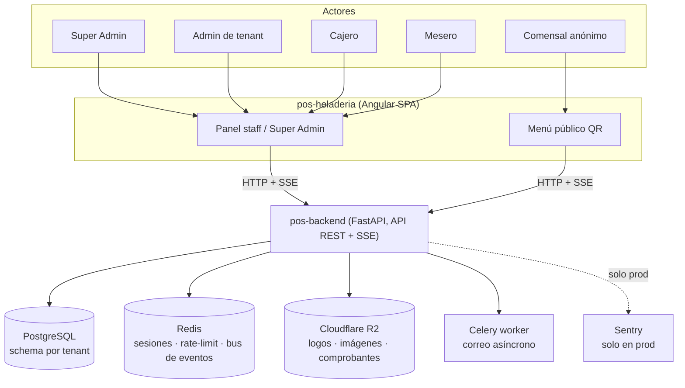
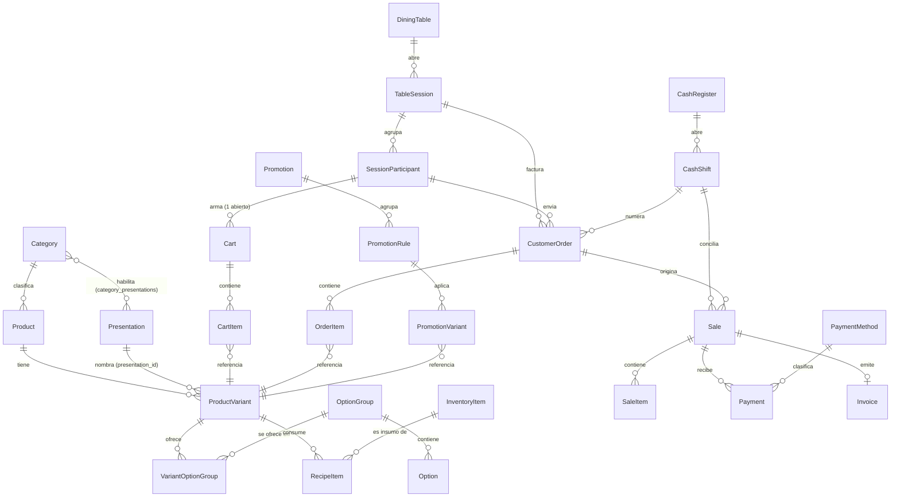

# Especificación de Requisitos de Software (SRS) — SkeiloPOS

**Formato**: IEEE 830-1998, con equivalencias a ISO/IEC/IEEE 29148:2018 (ver [Apéndice B](./apendices/b-equivalencia-normas.md)).

**Origen**: ingeniería inversa de solo lectura sobre los repositorios `pos-backend` y `pos-heladeria`, ejecutada desde la spec [104-documentacion-funciones-publica](../specs/104-documentacion-funciones-publica/spec.md) de `pos-specs`. Toda afirmación de este documento lleva una etiqueta de evidencia — `[CÓDIGO: ruta:línea]`, `[INFERIDO: motivo]` o `[PREGUNTA → C-xx]` — con la sintaxis exacta de [formato-etiqueta-evidencia.md](../specs/104-documentacion-funciones-publica/contracts/formato-etiqueta-evidencia.md).

## Índice

1. [Introducción](#1-introducción)
2. [Descripción general](#2-descripción-general)
3. Requisitos específicos
   - [3.1 Requisitos de interfaces externas](#31-requisitos-de-interfaces-externas)
   - [3.2 Requisitos funcionales](#32-requisitos-funcionales)
   - [3.3 Requisitos de rendimiento](#33-requisitos-de-rendimiento)
   - [3.4 Restricciones de diseño](#34-restricciones-de-diseño)
   - [3.5 Atributos del sistema](#35-atributos-del-sistema)
   - [3.6 Requisitos de datos](#36-requisitos-de-datos)
- Apéndices
   - [A — Matriz de trazabilidad](./apendices/a-trazabilidad.md)
   - [B — Equivalencia de normas](./apendices/b-equivalencia-normas.md)
   - [C — Preguntas abiertas](./apendices/c-preguntas-abiertas.md)
   - [D — Discrepancias y riesgos](./apendices/d-discrepancias.md)
   - [E — Cobertura real](./apendices/e-cobertura.md)

---

## 1. Introducción

### 1.1 Propósito

Este documento especifica, en formato IEEE 830-1998, el comportamiento real y verificado de SkeiloPOS — un sistema de punto de venta multi-tenant para negocios de comida (heladerías y similares) — tal como existe hoy en su código fuente. No es una especificación prospectiva: cada requisito describe una capacidad que ya está implementada y en funcionamiento (o, cuando no lo está del todo, lo declara explícitamente con su propia evidencia), obtenida por ingeniería inversa de solo lectura sobre los dos repositorios que componen el sistema [INFERIDO: el propósito se deriva de spec.md, que define esta función como documentación por ingeniería inversa, nunca como diseño de funcionalidad nueva].

### 1.2 Alcance

El documento cubre:
- **Backend** (`pos-backend`, FastAPI + SQLAlchemy + PostgreSQL): los 30 módulos de router bajo `app/api/v1/`, agrupados en 6 grupos (G1-G6) para su documentación — ver [inventario-backend.md](../specs/104-documentacion-funciones-publica/inventario-backend.md) [CÓDIGO: pos-backend/app/main.py:19-45,142-168].
- **Frontend** (`pos-heladeria`, Angular 21): los 20 módulos de feature bajo `src/app/modules/`, agrupados en 6 grupos (F1-F6) — ver [inventario-frontend.md](../specs/104-documentacion-funciones-publica/inventario-frontend.md).
- **El cruce entre ambos**: qué endpoint consume cada pantalla, y qué discrepancias existen — ver [cruce-front-back.md](../specs/104-documentacion-funciones-publica/cruce-front-back.md) y el [Apéndice D](./apendices/d-discrepancias.md).

Quedan explícitamente fuera de alcance: cualquier cambio de código (este documento es análisis, no implementación — FR-024), cualquier infraestructura de despliegue real (contenedores, CI/CD, variables de entorno con valores reales), y cualquier requisito no verificable desde el código disponible (esos casos se registran como pregunta abierta, nunca como suposición — ver [Apéndice C](./apendices/c-preguntas-abiertas.md)).

### 1.3 Definiciones, acrónimos y abreviaturas

- **Tenant**: un negocio registrado en la plataforma (p. ej. una heladería); cada tenant tiene su propio esquema de PostgreSQL, aislado de los demás [CÓDIGO: pos-backend/app/api/v1/auth/routes.py:160-187].
- **Super Admin**: usuario de la plataforma con `tenant_id IS NULL`, administra tenants/planes/catálogo de métodos de pago desde el dominio `admin.*` — ver `inventario-backend.md` § `super_admin`.
- **RF / RNF**: Requisito funcional / Requisito no funcional, con la estructura fija de [plantilla-requisito.md](../specs/104-documentacion-funciones-publica/contracts/plantilla-requisito.md).
- **QR_MENU**: canal de pedido del comensal anónimo, que escanea el código QR de su mesa y pide desde su propio teléfono sin autenticarse como usuario de staff — ver `inventario-backend.md` § `menu`/`cart`.
- **Mesero, Cajero, Admin**: los tres roles de staff de un tenant (`RoleName`), cada uno con su propio alcance de acceso — ver 3.5 (Seguridad) y `_MESERO_ALLOWED_ROUTES` [CÓDIGO: pos-backend/app/core/dependencies.py:139-191].
- **Hallazgo**: discrepancia o riesgo detectado durante el cruce front↔back, documentado solo en el Apéndice D, nunca como requisito (FR-016).
- Para el resto de siglas de dominio (SKU, QR, JWT, SSE, R2) se asume el significado estándar de la industria; no se listan aparte por no ser específicas de SkeiloPOS.

### 1.4 Referencias

- **Specs internas de `pos-specs` consultadas como contexto** (nunca como única evidencia — Decisión 7 de `research.md`): el código fuente cita explícitamente, en comentarios y nombres de test, numerosas specs anteriores (p. ej. 028, 033, 035, 063, 064, 065, 071, 073, 074, 075, 080, 083, 084, 088, 089, 091, 093, 099, 101) [INFERIDO: estas referencias aparecen repetidas como anotaciones `spec NNN` dentro de `inventario-backend.md`/`inventario-frontend.md`, siempre junto a su propia cita `[CÓDIGO]` del comportamiento verificado, no como fuente independiente].
- **Repositorios analizados y versión exacta**: `pos-backend`, rama `develop`, commit `7a356c920dedf4318cc3439d15930869f0a22948`; `pos-heladeria`, rama `develop`, commit `10794064d9eab27c0cb08a766b2d3fca6eced832`; checkout verificado el 2026-10-08 [CÓDIGO: specs/104-documentacion-funciones-publica/tasks.md:50 (T001)].
- **Fecha del análisis**: 2026-10-08 (inventarios de backend/frontend y cruce); redacción de este SRS, 2026-10-09.
- **Artefactos intermedios de este análisis**: `inventario-backend.md`, `inventario-frontend.md`, `cruce-front-back.md`, todos en `specs/104-documentacion-funciones-publica/` — fuente primaria de cada cita `[CÓDIGO]` de este documento.

### 1.5 Visión general del documento

La sección 2 resume el producto y sus roles sin citar evidencia oración por oración (sí la cita en cada número concreto, remitiendo a la sección 3). La sección 3 contiene el cuerpo verificable: interfaces externas (3.1), requisitos funcionales por grupo backend (3.2), rendimiento (3.3), restricciones de diseño (3.4), atributos de calidad/seguridad (3.5) y requisitos de datos (3.6). Los cinco apéndices son documentos independientes enlazados desde aquí: trazabilidad completa (A), equivalencia de normas (B), preguntas abiertas (C), discrepancias (D) y cobertura real (E).

## 2. Descripción general

### 2.1 Perspectiva del producto

SkeiloPOS es un sistema de punto de venta multi-tenant para negocios de comida (heladerías y similares), compuesto por dos repositorios independientes que se comunican exclusivamente por HTTP/SSE:

- `pos-backend`: API REST (FastAPI) multi-tenant por esquema de PostgreSQL, con WebSocket/SSE para tiempo real, Redis para sesiones/rate-limit/tickets/bus de eventos, Celery para correo asíncrono, y Cloudflare R2 para archivos (logos, imágenes de producto, comprobantes de pago) — ver 3.1 y 3.4 para el detalle verificado.
- `pos-heladeria`: SPA Angular que sirve tres superficies distintas bajo la misma aplicación: el panel de administración/operación del tenant (dashboard de staff), el panel de la plataforma (Super Admin, dominio `admin.*`) y el menú público del comensal (acceso anónimo por código QR, sin autenticación de usuario).

No existe un tercer cliente oficial de la API documentado en este análisis; cualquier otro consumidor queda fuera de alcance por falta de evidencia de código.

[INFERIDO: diagrama compuesto a partir de los mecanismos ya citados individualmente en `inventario-backend.md` — multi-tenant por esquema (§ Autenticación/tenant), Redis para sesiones de comensal/rate-limit/tickets de tiempo real/bus de eventos (§ `realtime`, `cart`, `auth`), R2 para archivos (§ `uploads`), Celery para correo (§ `auth`/`super_admin`/`invitations`), Sentry solo fuera de entorno local/test (§ `super_admin`, `main.py:104-105`) — no existe un único diagrama de arquitectura en el código, se deriva de la unión de esas piezas].

### 2.2 Funciones principales por grupo

| Grupo backend | Función principal | Grupo frontend equivalente |
|---|---|---|
| G1 — Identidad y acceso | Login multi-ámbito (plataforma/tenant), invitaciones de usuario, recuperación de contraseña, administración de tenants/planes/catálogo de pago desde la plataforma, perfil del negocio (logo, mensaje de recibo, prefijo de factura) | F1 |
| G2 — Catálogo | Productos, presentaciones/variantes con receta y grupos de opciones, categorías, unidades de medida, y el menú público que el comensal ve | F2 (+ consumido también por F3/F4) |
| G3 — Presentaciones, promociones e inventario | Tamaños de producto reutilizables, promociones automáticas por conjunto de variantes, insumos/compras/proveedores con kardex | F2 (inventario/proveedores), F3 (presentaciones/promociones) |
| G4 — Pedidos y mesas | El núcleo operativo: mesas, sesiones de mesa, carrito del comensal por QR, comandas de mostrador/mesero, cocina, cobro y cierre | F4 |
| G5 — Caja, ventas y facturación | Turnos de caja con arqueo, catálogo de métodos de pago por tenant, ventas y su factura asociada, reportes gerenciales, auditoría, resumen de plan/consumo | F5 (+ F6 para `plan`) |
| G6 — Infraestructura técnica | Liveness, notificaciones (in-app + push web), tiempo real (SSE), subida de archivos | transversal a F1-F5 |

### 2.3 Características de los roles de usuario

| Rol | Alcance | Evidencia |
|---|---|---|
| Super Admin | `tenant_id IS NULL`; administra tenants, planes, catálogo de métodos de pago y usuarios de la plataforma desde el dominio `admin.*` | [CÓDIGO: pos-backend/app/core/dependencies.py:330-363] |
| Admin (de tenant) | Rol más alto dentro de un tenant; única vía para operaciones de configuración (catálogo, inventario, promociones, usuarios, reportes, caja) | [CÓDIGO: pos-backend/app/core/dependencies.py:366-373] |
| Cajero | Opera caja y ventas; puede togglear disponibilidad de producto; sin acceso a configuración de catálogo/inventario/reportes | [CÓDIGO: pos-backend/app/api/v1/products/router.py:88] |
| Mesero | Acceso acotado por una allowlist explícita de rutas (`_MESERO_ALLOWED_ROUTES`), pensada para operar la Terminal de Mesas; default-deny fuera de esa lista — con una inconsistencia real documentada en H-09 | [CÓDIGO: pos-backend/app/core/dependencies.py:139-220] |
| Comensal anónimo | Sin cuenta de usuario; su identidad es un JWT de sesión de mesa emitido al escanear el QR, de alcance acotado a esa mesa/sesión | [CÓDIGO: pos-backend/app/core/qr_context.py:1-6] |

### 2.4 Restricciones generales

- Aislamiento multi-tenant por esquema de PostgreSQL (nunca por columna `tenant_id` filtrada en aplicación como único mecanismo): cada tenant tiene su propio `schema_translate_map` — ver 3.4.
- Todo endpoint multi-tenant exige la cabecera `x-tenant-host` salvo las rutas explícitamente públicas (`menu`, `cart`, el flujo de comensal, `health`) — ver 3.1.
- El acceso a varios módulos está condicionado al plan contratado por el tenant (`inventario`, `compras`, `promociones`) y a si el plan venció, verificado en tiempo real contra `app/core/plan_limits.py` — ver 3.4 y `inventario-backend.md` § `plan`.
- Límites de recursos por plan (mesas, cajas, usuarios, productos, métodos de pago activos) se hacen cumplir con bloqueo de fila (`SELECT ... FOR UPDATE`) para que dos altas concurrentes no excedan el cupo — ver 3.5.

### 2.5 Supuestos y dependencias

- Se asume disponibilidad de PostgreSQL, Redis, Cloudflare R2 (S3-compatible) y, en producción, Sentry; fuera de `prod`, los fallos de Sentry/push/correo son no-op o best-effort y nunca rompen la operación de negocio que los dispara — ver `inventario-backend.md` § `super_admin`/`notifications`/`uploads`.
- Se asume que `pos-heladeria` es el único cliente oficial de la API; cualquier otro consumidor (integración externa, app móvil) no está documentado ni contemplado en los contratos de error observados.
- El reloj de referencia para vigencia de promociones, turnos de caja, reportes y horario de negocio es siempre la zona horaria del tenant, nunca UTC crudo — ver 3.4.

## 3. Requisitos específicos

### 3.1 Requisitos de interfaces externas

#### 3.1.1 Interfaces de usuario

Toda interfaz de usuario de SkeiloPOS es la SPA Angular `pos-heladeria`, documentada pantalla por pantalla (ruta, guarda de rol, acciones, validaciones, estados y llamadas a la API) en [inventario-frontend.md](../specs/104-documentacion-funciones-publica/inventario-frontend.md) — no se repite aquí para no duplicar la única fuente de verdad. Tres superficies distintas, todas bajo el mismo `app.routes.ts`:

- **Panel de staff del tenant** (`/dashboard/*`): Admin, Cajero, Mesero — grupos F1-F6 del inventario de frontend.
- **Panel de plataforma** (`/super-admin/*`, dominio `admin.*`): Super Admin — grupo F1 (`super-admin`).
- **Menú público del comensal** (`/menu/t/:token`, `/menu/t/:token/checkout/*`): acceso anónimo vía QR, sin guarda de rol — grupo F4 (`tables`, rutas públicas).

#### 3.1.2 Interfaces de software

Toda interfaz de software es la API REST de `pos-backend` bajo el prefijo `/api/v1`, documentada endpoint por endpoint (método, ruta, esquema de entrada/salida, autenticación, roles, códigos de error) en [inventario-backend.md](../specs/104-documentacion-funciones-publica/inventario-backend.md). No se repite aquí; los Requisitos funcionales de 3.2 son la forma normativa de ese mismo contenido, trazada hacia cada endpoint en el [Apéndice A](./apendices/a-trazabilidad.md).

#### 3.1.3 Interfaces de comunicación

- **HTTP/1.1 + JSON**: protocolo de toda petición REST entre `pos-heladeria` y `pos-backend`, con `Content-Type: application/json` salvo la subida de archivos (presigned `PUT` directo a R2, fuera de la API propia) [CÓDIGO: pos-backend/app/api/v1/uploads/router.py:59-76].
- **Server-Sent Events (SSE)**, no WebSockets: `GET /api/v1/realtime/stream` es una decisión deliberada de transporte unidireccional servidor→cliente; el cliente nunca envía datos por ese canal, solo recibe eventos — toda escritura del comensal o del staff sigue yendo por REST [CÓDIGO: pos-backend/app/api/v1/realtime/router.py:1-10]. Reconexión automática con `Last-Event-ID`, heartbeat cada `REALTIME_HEARTBEAT_SECONDS` (default 20s) y vida máxima de conexión `REALTIME_MAX_CONNECTION_SECONDS` (default 1800s) — ver `inventario-backend.md` § `realtime` para el protocolo completo de frames.
- **Autenticación de transporte**: cabecera `Authorization: Bearer <JWT>` para usuarios de staff/plataforma, cabecera `x-tenant-host` para resolver el tenant en toda ruta multi-tenant, y para el comensal un JWT de sesión de mesa que viaja en query string únicamente en el stream SSE (`EventSource` no permite cabeceras personalizadas) — ver 3.5 (Seguridad).
- **Almacenamiento externo (Cloudflare R2, S3-compatible)**: el backend nunca recibe el binario de un archivo subido; firma una URL `PUT` de corta duración (`R2_PRESIGN_EXPIRE_SECONDS`, default 300s) que el cliente usa para subir directo al bucket, y luego persiste solo la referencia (`key`) vía el endpoint de negocio correspondiente [CÓDIGO: pos-backend/app/core/storage.py:76-85].

### 3.2 Requisitos funcionales

_Pendiente (T036-T041 — un bloque por grupo backend G1-G6)._

#### Grupo G1 — Identidad y acceso

> El módulo `admin` no tiene código fuente activo (fue reemplazado por `super_admin` en el commit `3c026080`) y no expone ningún endpoint — no genera ningún requisito [CÓDIGO: pos-backend/app/api/v1/admin/__pycache__/router.cpython-314.pyc] [INFERIDO: ver `inventario-backend.md` § `admin`].

##### `auth`

#### RF-auth-001: Iniciar sesión por ámbito resuelto por host

- **Enunciado**: El sistema deberá autenticar a un usuario (de plataforma o de un tenant) a partir de su correo, contraseña y el host de la petición, devolviendo un par de tokens JWT.
- **Actor**: Super Admin, Admin, Cajero, Mesero
- **Precondiciones**: cabecera `x-tenant-host` presente; `"admin"` exacto resuelve a la plataforma, cualquier otro slug registrado resuelve a ese tenant [CÓDIGO: pos-backend/app/api/v1/auth/routes.py:160-187]
- **Entradas**: `LoginRequest {email, password}` [CÓDIGO: pos-backend/app/api/v1/auth/schemas.py:4-6]
- **Salidas**: `{message, access_token, refresh_token, user}` [CÓDIGO: pos-backend/app/api/v1/auth/routes.py:158-249]
- **Reglas de negocio**:
  - Host ausente/vacío/desconocido devuelve el mismo `401` que credenciales inválidas, sin revelar el motivo [CÓDIGO: pos-backend/app/api/v1/auth/routes.py:184-187]
  - Si existe una `UserInvitation` pendiente con esa contraseña, el login crea la cuenta y consume la invitación en el mismo intento, con `WITH FOR UPDATE` para evitar doble consumo concurrente [CÓDIGO: pos-backend/app/api/v1/auth/routes.py:119-155,203-204]
- **Criterio de aceptación**: **Dado** un host que resuelve a un tenant activo, **cuando** se envían credenciales válidas de un usuario activo de ese tenant, **entonces** la respuesta es `200` con ambos tokens y el `user` correspondiente [CÓDIGO: pos-backend/app/characterization_tests/test_auth_login_platform_isolation.py:37].
- **Prioridad**: Alta — sin login no hay acceso a ninguna otra función.
- **Trazabilidad**: Endpoint(s): `POST /api/v1/auth/login`; Pantalla(s): `/login`; Entidad(es): `User`, `UserInvitation`.
- **Atributos IEEE 830**: Correcto ✅ · Inequívoco ✅ · Completo ✅ · Consistente ✅ · Jerarquizado ✅ · Verificable ✅ · Modificable ✅ · Trazable ✅

#### RF-auth-002: Solicitar enlace de restablecimiento de contraseña

- **Enunciado**: El sistema deberá aceptar una solicitud de restablecimiento de contraseña por correo, sin revelar si la cuenta existe.
- **Actor**: Admin, Cajero, Mesero (cualquier usuario de un tenant; no aplica a Super Admin — el ámbito de plataforma no pasa por este flujo según el enrutamiento por host)
- **Precondiciones**: `x-tenant-host` resuelve a un tenant [CÓDIGO: pos-backend/app/api/v1/auth/routes.py:253-257]
- **Entradas**: `ForgotPasswordRequest {email}` [CÓDIGO: pos-backend/app/api/v1/auth/schemas.py:16-17]
- **Salidas**: mensaje genérico fijo, idéntico exista o no la cuenta [CÓDIGO: pos-backend/app/api/v1/auth/routes.py:37-42,278-281]
- **Reglas de negocio**:
  - Límite de `PASSWORD_RESET_MAX_REQUESTS` (3) por `PASSWORD_RESET_WINDOW_SECONDS` (900s), por tenant+correo normalizado [CÓDIGO: pos-backend/app/api/v1/auth/routes.py:259-263; pos-backend/app/core/config.py:81-82]
  - Un enlace nuevo invalida de inmediato cualquier enlace vigente anterior de la misma cuenta [CÓDIGO: pos-backend/app/api/v1/auth/routes.py:285-295]
  - El token expira a los `PASSWORD_RESET_TOKEN_EXPIRY_MINUTES` (30) minutos [CÓDIGO: pos-backend/app/api/v1/auth/routes.py:297-306]
- **Criterio de aceptación**: **Dado** un correo que no existe en el tenant, **cuando** se solicita el restablecimiento, **entonces** la respuesta es idéntica a la de un correo que sí existe, y no se crea ninguna fila ni se envía correo [CÓDIGO: pos-backend/app/api/v1/auth/routes.py:37-42].
- **Prioridad**: Alta — único mecanismo de autorrecuperación de acceso.
- **Trazabilidad**: Endpoint(s): `POST /api/v1/auth/forgot-password`; Pantalla(s): `/forgot-password`; Entidad(es): `PasswordResetToken`.
- **Atributos IEEE 830**: Correcto ✅ · Inequívoco ✅ · Completo ✅ · Consistente ✅ · Jerarquizado ✅ · Verificable ✅ · Modificable ✅ · Trazable ✅

#### RF-auth-003: Validar un token de restablecimiento sin consumirlo

- **Enunciado**: El sistema deberá permitir verificar si un token de restablecimiento sigue vigente, sin efecto secundario.
- **Actor**: Admin, Cajero, Mesero (sin sesión — el enlace llega por correo)
- **Precondiciones**: ninguna sesión requerida
- **Entradas**: query `token` [CÓDIGO: pos-backend/app/api/v1/auth/routes.py:333-334]
- **Salidas**: `{valid: bool, reason?}` [CÓDIGO: pos-backend/app/api/v1/auth/routes.py:338-345]
- **Reglas de negocio**: no consume el token ni lo modifica; `POST /reset-password` vuelve a validar todo desde cero, sin confiar en esta llamada [CÓDIGO: pos-backend/app/api/v1/auth/routes.py:90-116,335-356]
- **Criterio de aceptación**: **Dado** un token vencido, **cuando** se valida dos veces seguidas, **entonces** ambas respuestas son idénticas (`valid:false`) — la validación no tiene efecto acumulativo [CÓDIGO: pos-backend/app/api/v1/auth/routes.py:340-345].
- **Prioridad**: Media — mejora de experiencia (evita que el formulario aparezca si el enlace ya no sirve).
- **Trazabilidad**: Endpoint(s): `GET /api/v1/auth/reset-password/validate`; Pantalla(s): `/reset-password`; Entidad(es): `PasswordResetToken`.
- **Atributos IEEE 830**: Correcto ✅ · Inequívoco ✅ · Completo ✅ · Consistente ✅ · Jerarquizado ✅ · Verificable ✅ · Modificable ✅ · Trazable ✅

#### RF-auth-004: Aplicar un restablecimiento de contraseña

- **Enunciado**: El sistema deberá permitir fijar una nueva contraseña a partir de un token de restablecimiento válido, cerrando todas las sesiones previas de la cuenta.
- **Actor**: Admin, Cajero, Mesero
- **Precondiciones**: token vigente, no usado, no invalidado [CÓDIGO: pos-backend/app/api/v1/auth/routes.py:352-356]
- **Entradas**: `ResetPasswordRequest {token, new_password (8-12 caracteres)}` [CÓDIGO: pos-backend/app/api/v1/auth/schemas.py:20-23]
- **Salidas**: mensaje de éxito [CÓDIGO: pos-backend/app/api/v1/auth/routes.py:373]
- **Reglas de negocio**:
  - Rechaza si la nueva contraseña es igual a la actual [CÓDIGO: pos-backend/app/api/v1/auth/routes.py:358-362]
  - Bloquea la fila (`FOR UPDATE`) para evitar doble consumo concurrente del mismo token [CÓDIGO: pos-backend/app/api/v1/auth/routes.py:90-116]
  - Éxito pone `must_change_password=False` y `tokens_valid_after=now`, revocando todas las sesiones emitidas antes de ese instante [CÓDIGO: pos-backend/app/api/v1/auth/routes.py:364-368; pos-backend/app/core/dependencies.py:105-129]
  - Encola un correo de aviso de forma asíncrona; su fallo nunca rompe la respuesta `200` [CÓDIGO: pos-backend/app/api/v1/auth/routes.py:57-81]
- **Criterio de aceptación**: **Dado** un token válido de un solo uso, **cuando** se envía dos veces con la misma contraseña nueva, **entonces** la segunda llamada falla porque el token ya fue consumido [CÓDIGO: pos-backend/app/api/v1/auth/routes.py:90-116].
- **Prioridad**: Alta.
- **Trazabilidad**: Endpoint(s): `POST /api/v1/auth/reset-password`; Pantalla(s): `/reset-password`; Entidad(es): `PasswordResetToken`, `User`.
- **Atributos IEEE 830**: Correcto ✅ · Inequívoco ✅ · Completo ✅ · Consistente ✅ · Jerarquizado ✅ · Verificable ✅ · Modificable ✅ · Trazable ✅

#### RF-auth-005: Cambiar contraseña autenticado

- **Enunciado**: El sistema deberá permitir a un usuario autenticado cambiar su propia contraseña, verificando la actual.
- **Actor**: Super Admin, Admin, Cajero, Mesero
- **Precondiciones**: JWT de acceso válido [CÓDIGO: pos-backend/app/api/v1/auth/routes.py:379]
- **Entradas**: `ChangePasswordRequest {current_password, new_password (8-12)}` [CÓDIGO: pos-backend/app/api/v1/auth/schemas.py:9-13]
- **Salidas**: mensaje de éxito [CÓDIGO: pos-backend/app/api/v1/auth/routes.py:406]
- **Reglas de negocio**:
  - Rechaza si la contraseña actual es incorrecta, o si la nueva es igual a la actual [CÓDIGO: pos-backend/app/api/v1/auth/routes.py:382-392]
  - Revoca todas las sesiones por corte de tiempo (`tokens_valid_after`), incluida la de origen: el cliente debe volver a loguearse tras el `200` [CÓDIGO: pos-backend/app/api/v1/auth/routes.py:397-401]
- **Criterio de aceptación**: **Dado** un usuario con `must_change_password=True`, **cuando** cambia su contraseña con éxito, **entonces** el siguiente login ya no exige cambiarla [CÓDIGO: pos-backend/app/characterization_tests/test_auth_session_revocation.py:24].
- **Prioridad**: Alta.
- **Trazabilidad**: Endpoint(s): `POST /api/v1/auth/change-password`; Pantalla(s): `/change-password`, `/dashboard/mi-cuenta`; Entidad(es): `User`.
- **Atributos IEEE 830**: Correcto ✅ · Inequívoco ✅ · Completo ✅ · Consistente ✅ · Jerarquizado ✅ · Verificable ✅ · Modificable ✅ · Trazable ✅

#### RF-auth-006: Refrescar token de acceso

- **Enunciado**: El sistema deberá emitir un nuevo token de acceso a partir de un refresh token válido, releyendo el estado actual del usuario.
- **Actor**: Super Admin, Admin, Cajero, Mesero
- **Precondiciones**: refresh token no revocado, usuario activo [CÓDIGO: pos-backend/app/api/v1/auth/routes.py:410-411]
- **Entradas**: `Authorization: Bearer <refresh_token>` [CÓDIGO: pos-backend/app/api/v1/auth/routes.py:409-411]
- **Salidas**: `{access_token}` [CÓDIGO: pos-backend/app/api/v1/auth/routes.py:450]
- **Reglas de negocio**: relee el usuario desde la base de datos en cada refresh — una cuenta desactivada o con rol cambiado deja de emitir access tokens válidos con datos obsoletos durante la vida del refresh [CÓDIGO: pos-backend/app/api/v1/auth/routes.py:424-437]
- **Criterio de aceptación**: **Dado** un usuario desactivado tras emitir su refresh token, **cuando** intenta refrescar, **entonces** recibe `401` [CÓDIGO: pos-backend/app/api/v1/auth/routes.py:433-437].
- **Prioridad**: Alta.
- **Trazabilidad**: Endpoint(s): `GET /api/v1/auth/refresh-token`; Pantalla(s): transversal (interceptor HTTP); Entidad(es): `User`.
- **Atributos IEEE 830**: Correcto ✅ · Inequívoco ✅ · Completo ✅ · Consistente ✅ · Jerarquizado ✅ · Verificable ✅ · Modificable ✅ · Trazable ✅

#### RF-auth-007: Cerrar sesión

- **Enunciado**: El sistema deberá revocar el token de acceso vigente al cerrar sesión.
- **Actor**: Super Admin, Admin, Cajero, Mesero
- **Precondiciones**: access token válido [CÓDIGO: pos-backend/app/api/v1/auth/routes.py:453]
- **Entradas**: `Authorization: Bearer <access_token>`
- **Salidas**: mensaje de éxito [CÓDIGO: pos-backend/app/api/v1/auth/routes.py:458-460]
- **Reglas de negocio**: añade el `jti` del token a una blocklist en Redis, revocando esa sesión concreta [CÓDIGO: pos-backend/app/api/v1/auth/routes.py:452-460]
- **Criterio de aceptación**: **Dado** un access token recién cerrado por logout, **cuando** se reutiliza en otra petición, **entonces** se rechaza con `401` [CÓDIGO: pos-backend/app/core/dependencies.py:38-57].
- **Prioridad**: Media.
- **Trazabilidad**: Endpoint(s): `GET /api/v1/auth/logout`; Pantalla(s): acción "Cerrar sesión" (transversal); Entidad(es): —.
- **Atributos IEEE 830**: Correcto ✅ · Inequívoco ✅ · Completo ✅ · Consistente ✅ · Jerarquizado ✅ · Verificable ✅ · Modificable ✅ · Trazable ✅

##### `bootstrap`

#### RF-bootstrap-001: Obtener el estado inicial agregado del panel

- **Enunciado**: El sistema deberá componer, en una sola respuesta, la información del tenant, el resumen de plan y las notificaciones recientes para quien acaba de autenticarse.
- **Actor**: Super Admin, Admin, Cajero, Mesero
- **Precondiciones**: JWT válido; tenant opcional (Super Admin recibe los 3 bloques en `null`) [CÓDIGO: pos-backend/app/api/v1/bootstrap/router.py:22-28]
- **Entradas**: ninguna propia
- **Salidas**: `BootstrapResponse {tenant?, plan?, notifications?}` [CÓDIGO: pos-backend/app/api/v1/bootstrap/schemas.py:10-18]
- **Reglas de negocio**: cada uno de los 3 bloques se resuelve en su propio `try/except` independiente — un fallo en uno no interrumpe a los otros, y la respuesta siempre es `200` [CÓDIGO: pos-backend/app/api/v1/bootstrap/service.py:26-51]
- **Criterio de aceptación**: **Dado** que el bloque `plan` falla internamente, **cuando** se pide el bootstrap, **entonces** la respuesta sigue siendo `200` con `plan:null` y los otros dos bloques poblados [CÓDIGO: pos-backend/app/characterization_tests/test_bootstrap.py:78].
- **Prioridad**: Alta — evita 3 peticiones secuenciales al montar el shell del dashboard.
- **Trazabilidad**: Endpoint(s): `GET /api/v1/bootstrap`; Pantalla(s): shell de `/dashboard/*` (`DashboardLayoutComponent`); Entidad(es): `Tenant`, `Plan`, `NotificationEvent`.
- **Atributos IEEE 830**: Correcto ✅ · Inequívoco ✅ · Completo ✅ · Consistente ✅ · Jerarquizado ✅ · Verificable ✅ · Modificable ✅ · Trazable ✅

##### `invitations`

#### RF-invitations-001: Listar invitaciones pendientes del tenant

- **Enunciado**: El sistema deberá listar, paginadas, las invitaciones de usuario con estado pendiente del tenant del administrador autenticado.
- **Actor**: Admin
- **Precondiciones**: rol ADMIN del tenant [CÓDIGO: pos-backend/app/core/dependencies.py:366-373]
- **Entradas**: `page`, `size` [CÓDIGO: pos-backend/app/api/v1/invitations/router.py:46-51]
- **Salidas**: `Page[InvitationResponse]` [CÓDIGO: pos-backend/app/api/v1/invitations/router.py:34]
- **Reglas de negocio**: solo invitaciones `pending` del propio tenant, ordenadas por `sent_at` descendente [CÓDIGO: pos-backend/app/api/v1/invitations/router.py:52-58]
- **Criterio de aceptación**: **Dado** un tenant con 2 invitaciones pendientes y 1 cancelada, **cuando** se listan, **entonces** solo aparecen las 2 pendientes [CÓDIGO: pos-backend/app/characterization_tests/test_invitations_list.py:26].
- **Prioridad**: Media.
- **Trazabilidad**: Endpoint(s): `GET /api/v1/invitations`; Pantalla(s): `/dashboard/users`; Entidad(es): `UserInvitation`.
- **Atributos IEEE 830**: Correcto ✅ · Inequívoco ✅ · Completo ✅ · Consistente ✅ · Jerarquizado ✅ · Verificable ✅ · Modificable ✅ · Trazable ✅

#### RF-invitations-002: Invitar un nuevo usuario del tenant

- **Enunciado**: El sistema deberá crear una invitación pendiente con contraseña temporal y enviarla por correo, nunca crear el `User` directamente.
- **Actor**: Admin
- **Precondiciones**: cupo de plan "usuarios" no agotado, plan no vencido [CÓDIGO: pos-backend/app/core/plan_limits.py:82-123]
- **Entradas**: `InvitationCreate {name, email, role}` [CÓDIGO: pos-backend/app/api/v1/invitations/schemas.py:11-33]
- **Salidas**: `InvitationResponse`, `201` [CÓDIGO: pos-backend/app/api/v1/invitations/router.py:61-64]
- **Reglas de negocio**:
  - Un correo ya usado por un `User` del tenant (activo o inactivo) bloquea la invitación [CÓDIGO: pos-backend/app/api/v1/invitations/router.py:93-102]
  - A lo sumo una invitación `pending` por correo+tenant, por índice único parcial [CÓDIGO: pos-backend/app/api/v1/invitations/router.py:123-133]
  - El envío del correo es síncrono y previo al `commit`: si falla, se revierte y la invitación nunca queda persistida [CÓDIGO: pos-backend/app/api/v1/invitations/router.py:135-168]
  - El nombre es obligatorio, normalizado a NFC, 2-100 caracteres, solo letras/espacios/apóstrofes/guiones [CÓDIGO: pos-backend/app/api/v1/invitations/schemas.py:15-38]
- **Criterio de aceptación**: **Dado** que ya existe un `User` activo con ese correo en el tenant, **cuando** se invita de nuevo a ese correo, **entonces** la respuesta es `409` [CÓDIGO: pos-backend/app/api/v1/invitations/router.py:95-102].
- **Prioridad**: Alta.
- **Trazabilidad**: Endpoint(s): `POST /api/v1/invitations`; Pantalla(s): `/dashboard/users` (formulario de invitación); Entidad(es): `UserInvitation`, `User`.
- **Atributos IEEE 830**: Correcto ✅ · Inequívoco ✅ · Completo ✅ · Consistente ✅ · Jerarquizado ✅ · Verificable ✅ · Modificable ✅ · Trazable ✅

#### RF-invitations-003: Reenviar invitación pendiente

- **Enunciado**: El sistema deberá reenviar el correo de una invitación aún pendiente sin invalidar la contraseña temporal si el reenvío falla.
- **Actor**: Admin
- **Precondiciones**: invitación existente, del tenant del admin, en estado `pending` [CÓDIGO: pos-backend/app/api/v1/invitations/router.py:177-186]
- **Entradas**: path `invitation_id`
- **Salidas**: `InvitationResponse` [CÓDIGO: pos-backend/app/api/v1/invitations/router.py:192]
- **Reglas de negocio**: el nuevo correo se despacha antes de sobrescribir la fila; si falla, la contraseña temporal anterior sigue intacta [CÓDIGO: pos-backend/app/api/v1/invitations/router.py:213-250]
- **Criterio de aceptación**: **Dado** una invitación ya `pending`, **cuando** se reenvía y el envío de correo falla, **entonces** la invitación sigue siendo válida con la misma contraseña temporal de antes [CÓDIGO: pos-backend/app/api/v1/invitations/router.py:213-250].
- **Prioridad**: Media.
- **Trazabilidad**: Endpoint(s): `POST /api/v1/invitations/{id}/resend`; Pantalla(s): `/dashboard/users` ("Reenviar"); Entidad(es): `UserInvitation`.
- **Atributos IEEE 830**: Correcto ✅ · Inequívoco ✅ · Completo ✅ · Consistente ✅ · Jerarquizado ✅ · Verificable ✅ · Modificable ✅ · Trazable ✅

#### RF-invitations-004: Cancelar invitación pendiente

- **Enunciado**: El sistema deberá permitir cancelar una invitación pendiente, invalidando de inmediato su contraseña temporal.
- **Actor**: Admin
- **Precondiciones**: invitación existente, del tenant, en estado `pending` [CÓDIGO: pos-backend/app/api/v1/invitations/router.py:171-187]
- **Entradas**: path `invitation_id`
- **Salidas**: `InvitationResponse` [CÓDIGO: pos-backend/app/api/v1/invitations/router.py:255]
- **Reglas de negocio**: tras cancelar, la contraseña temporal deja de poder usarse para login y la invitación deja de aparecer como pendiente [CÓDIGO: pos-backend/app/api/v1/invitations/router.py:171-187,266-277]
- **Criterio de aceptación**: **Dado** una invitación cancelada, **cuando** alguien intenta loguearse con su contraseña temporal, **entonces** el login falla [CÓDIGO: pos-backend/app/characterization_tests/test_invitations_resend_cancel.py:26].
- **Prioridad**: Media.
- **Trazabilidad**: Endpoint(s): `POST /api/v1/invitations/{id}/cancel`; Pantalla(s): `/dashboard/users` ("Cancelar"); Entidad(es): `UserInvitation`.
- **Atributos IEEE 830**: Correcto ✅ · Inequívoco ✅ · Completo ✅ · Consistente ✅ · Jerarquizado ✅ · Verificable ✅ · Modificable ✅ · Trazable ✅

##### `super_admin`

#### RF-super_admin-001: Listar usuarios de la plataforma

- **Enunciado**: El sistema deberá listar, paginados y filtrables por tenant, todos los usuarios de todos los tenants.
- **Actor**: Super Admin
- **Precondiciones**: `is_super_admin=True`, `tenant_id IS NULL`, `active=True` [CÓDIGO: pos-backend/app/core/dependencies.py:330-363]
- **Entradas**: `page`, `size`, `tenant_id?` [CÓDIGO: pos-backend/app/api/v1/super_admin/router.py:49-54]
- **Salidas**: `Page[UserResponse]` [CÓDIGO: pos-backend/app/api/v1/super_admin/router.py:40]
- **Reglas de negocio**: sin filtro adicional de rol más allá de ser Super Admin [CÓDIGO: pos-backend/app/core/dependencies.py:330-363]
- **Criterio de aceptación**: **Dado** `tenant_id` de un tenant con 3 usuarios, **cuando** se filtra por ese id, **entonces** la respuesta solo incluye esos 3 [CÓDIGO: pos-backend/app/api/v1/super_admin/router.py:49-54].
- **Prioridad**: Media.
- **Trazabilidad**: Endpoint(s): `GET /api/v1/super-admin/users`; Pantalla(s): `/super-admin/users`; Entidad(es): `User`.
- **Atributos IEEE 830**: Correcto ✅ · Inequívoco ✅ · Completo ✅ · Consistente ✅ · Jerarquizado ✅ · Verificable ✅ · Modificable ✅ · Trazable ✅ — la pantalla también ofrece crear/editar/activar usuarios desde aquí, pero esas acciones no tienen endpoint correspondiente (ver H-01, Apéndice D); este requisito cubre únicamente la capacidad que el backend sí implementa (listar).

#### RF-super_admin-002: Listar tenants

- **Enunciado**: El sistema deberá listar, paginados, todos los tenants registrados.
- **Actor**: Super Admin
- **Precondiciones**: igual que RF-super_admin-001
- **Entradas**: `page`, `size` [CÓDIGO: pos-backend/app/api/v1/super_admin/router.py:76-79]
- **Salidas**: `Page[TenantResponse]` [CÓDIGO: pos-backend/app/api/v1/super_admin/router.py:67]
- **Reglas de negocio**: ninguna adicional
- **Criterio de aceptación**: **Dado** 25 tenants, **cuando** se pide `page=2&size=20`, **entonces** la respuesta trae los 5 restantes [INFERIDO: comportamiento estándar de `Page[...]`, ya verificado en otros módulos paginados del mismo backend].
- **Prioridad**: Media.
- **Trazabilidad**: Endpoint(s): `GET /api/v1/super-admin/tenants`; Pantalla(s): `/super-admin/tenants`; Entidad(es): `Tenant`.
- **Atributos IEEE 830**: Correcto ✅ · Inequívoco ✅ · Completo ✅ · Consistente ✅ · Jerarquizado ✅ · Verificable ✅ · Modificable ✅ · Trazable ✅

#### RF-super_admin-003: Asignar, cambiar o renovar el plan de un tenant

- **Enunciado**: El sistema deberá permitir asignar un plan y ciclo de facturación a un tenant, recalculando siempre el período desde el momento de la petición.
- **Actor**: Super Admin
- **Precondiciones**: tenant y plan existentes [CÓDIGO: pos-backend/app/api/v1/super_admin/router.py:99,106-107]
- **Entradas**: `TenantPlanUpdate {plan_id, ciclo_facturacion?}` [CÓDIGO: pos-backend/app/api/v1/super_admin/schemas.py:108-117]
- **Salidas**: `TenantResponse` [CÓDIGO: pos-backend/app/api/v1/super_admin/router.py:91]
- **Reglas de negocio**:
  - `ciclo_facturacion=None` deja al tenant sin fecha de vencimiento [CÓDIGO: pos-backend/app/api/v1/super_admin/router.py:103-121]
  - Rechaza con `409` si el ciclo elegido no tiene precio definido en ese plan [CÓDIGO: pos-backend/app/core/plan_limits.py:177-189]
- **Criterio de aceptación**: **Dado** un plan sin `precio_anual` definido, **cuando** se asigna con `ciclo_facturacion="anual"`, **entonces** la respuesta es `409` [CÓDIGO: pos-backend/app/core/plan_limits.py:177-189].
- **Prioridad**: Alta — determina el acceso del tenant a módulos y límites.
- **Trazabilidad**: Endpoint(s): `PATCH /api/v1/super-admin/tenants/{id}`; Pantalla(s): `/super-admin/tenants` (modal "Cambiar/renovar plan"); Entidad(es): `Tenant`, `Plan`.
- **Atributos IEEE 830**: Correcto ✅ · Inequívoco ✅ · Completo ✅ · Consistente ✅ · Jerarquizado ✅ · Verificable ✅ · Modificable ✅ · Trazable ✅

#### RF-super_admin-004: Crear un tenant nuevo con su usuario administrador

- **Enunciado**: El sistema deberá crear el esquema de base de datos de un tenant nuevo, sus tablas, y su primer usuario `ADMIN`, enviándole credenciales temporales por correo.
- **Actor**: Super Admin
- **Precondiciones**: migraciones de Alembic al día; `plan_id` existente; host no reservado [CÓDIGO: pos-backend/app/core/db.py:56-81]
- **Entradas**: `TenantCreateWithUser {tenant_name, schema_name, host, name, email, plan_id, ciclo_facturacion}` [CÓDIGO: pos-backend/app/api/v1/super_admin/schemas.py:192-218]
- **Salidas**: `{status:"ok", tenant}` [CÓDIGO: pos-backend/app/api/v1/super_admin/router.py:125-173]
- **Reglas de negocio**:
  - `plan_id` y `ciclo_facturacion` son obligatorios, sin default — `null` es una elección válida de "sin vencimiento", no un valor implícito [CÓDIGO: pos-backend/app/api/v1/super_admin/schemas.py:212-217]
  - `host` rechaza subdominios reservados de la plataforma (`admin`, `assets`, `api`, `docs`, `www`, `app`) [CÓDIGO: pos-backend/app/api/v1/super_admin/schemas.py:200-210]
  - La contraseña del admin nuevo se genera aleatoriamente (12 caracteres) en el servidor, nunca la elige el Super Admin ni queda en la respuesta [CÓDIGO: pos-backend/app/api/v1/super_admin/router.py:127,144-153]
  - Un fallo al encolar el correo de bienvenida no revierte la creación ya comprometida [CÓDIGO: pos-backend/app/api/v1/super_admin/router.py:160-171]
- **Criterio de aceptación**: **Dado** un `host` que coincide con un subdominio reservado, **cuando** se crea el tenant, **entonces** la petición se rechaza por validación antes de tocar la base de datos [CÓDIGO: pos-backend/app/api/v1/super_admin/schemas.py:200-210].
- **Prioridad**: Alta — único mecanismo de alta de tenants nuevos.
- **Trazabilidad**: Endpoint(s): `POST /api/v1/super-admin/tenants`; Pantalla(s): `/super-admin/tenants` (modal "+ Nuevo Tenant"); Entidad(es): `Tenant`, `User`, `Plan`.
- **Atributos IEEE 830**: Correcto ✅ · Inequívoco ✅ · Completo ✅ · Consistente ✅ · Jerarquizado ✅ · Verificable ✅ · Modificable ✅ · Trazable ✅

#### RF-super_admin-005: Listar catálogo de métodos de pago de la plataforma

- **Enunciado**: El sistema deberá listar las entradas del catálogo de métodos de pago disponibles para que cualquier tenant las active.
- **Actor**: Super Admin
- **Precondiciones**: ninguna adicional
- **Salidas**: `list[PaymentMethodCatalogResponse]` [CÓDIGO: pos-backend/app/api/v1/super_admin/payment_methods_router.py:21]
- **Reglas de negocio**: ninguna adicional
- **Criterio de aceptación**: **Dado** un catálogo con 5 métodos, **cuando** se lista, **entonces** se devuelven los 5 sin paginar [CÓDIGO: pos-backend/app/api/v1/super_admin/payment_methods_router.py:19-28].
- **Prioridad**: Media.
- **Trazabilidad**: Endpoint(s): `GET /api/v1/super-admin/payment-methods-catalog`; Pantalla(s): `/super-admin/payment-methods-catalog`; Entidad(es): `PaymentMethodCatalog`.
- **Atributos IEEE 830**: Correcto ✅ · Inequívoco ✅ · Completo ✅ · Consistente ✅ · Jerarquizado ✅ · Verificable ✅ · Modificable ✅ · Trazable ✅

#### RF-super_admin-006: Crear entrada de catálogo de métodos de pago

- **Enunciado**: El sistema deberá permitir definir un nuevo método de pago de plataforma con sus campos de integración.
- **Actor**: Super Admin
- **Entradas**: `PaymentMethodCatalogCreate {name, type, fields}` [CÓDIGO: pos-backend/app/api/v1/super_admin/schemas.py:47-55]
- **Salidas**: `PaymentMethodCatalogResponse`, `201`
- **Reglas de negocio**:
  - Un campo con `format="image"` no puede declarar `length` [CÓDIGO: pos-backend/app/api/v1/super_admin/schemas.py:33-37]
  - Las claves (`key`) de los campos del mismo método deben ser únicas [CÓDIGO: pos-backend/app/api/v1/super_admin/schemas.py:40-44]
  - `409` si ya existe un método con ese nombre [CÓDIGO: pos-backend/app/api/v1/super_admin/payment_methods_router.py:37,42-45]
- **Criterio de aceptación**: **Dado** dos campos con la misma `key` en el mismo payload, **cuando** se crea el método, **entonces** se rechaza [CÓDIGO: pos-backend/app/characterization_tests/test_super_admin_payment_catalog.py:31].
- **Prioridad**: Media.
- **Trazabilidad**: Endpoint(s): `POST /api/v1/super-admin/payment-methods-catalog`; Pantalla(s): `/super-admin/payment-methods-catalog` (modal "+ Nuevo método"); Entidad(es): `PaymentMethodCatalog`.
- **Atributos IEEE 830**: Correcto ✅ · Inequívoco ✅ · Completo ✅ · Consistente ✅ · Jerarquizado ✅ · Verificable ✅ · Modificable ✅ · Trazable ✅

#### RF-super_admin-007: Editar entrada de catálogo de métodos de pago

- **Enunciado**: El sistema deberá permitir editar o activar/desactivar una entrada del catálogo de métodos de pago.
- **Actor**: Super Admin
- **Entradas**: `PaymentMethodCatalogUpdate` (todos opcionales) [CÓDIGO: pos-backend/app/api/v1/super_admin/schemas.py:58-68]
- **Salidas**: `PaymentMethodCatalogResponse`
- **Reglas de negocio**: `404` si no existe; `409` si el nuevo nombre colisiona con otra entrada [CÓDIGO: pos-backend/app/api/v1/super_admin/payment_methods_router.py:63-77]
- **Criterio de aceptación**: **Dado** una entrada activa, **cuando** se la desactiva (`active:false`), **entonces** los tenants ya no pueden activarla desde su catálogo disponible [INFERIDO: consistente con el patrón de `active` del resto del backend, sin un test directo de catálogo-plataforma-tenant encontrado].
- **Prioridad**: Media.
- **Trazabilidad**: Endpoint(s): `PATCH /api/v1/super-admin/payment-methods-catalog/{id}`; Pantalla(s): `/super-admin/payment-methods-catalog` ("Editar", toggle); Entidad(es): `PaymentMethodCatalog`.
- **Atributos IEEE 830**: Correcto ✅ · Inequívoco ✅ · Completo ✅ · Consistente ✅ · Jerarquizado ✅ · Verificable ✅ · Modificable ✅ · Trazable ✅

#### RF-super_admin-008: Listar planes

- **Enunciado**: El sistema deberá listar todos los planes de suscripción disponibles.
- **Actor**: Super Admin
- **Salidas**: `list[PlanResponse]` [CÓDIGO: pos-backend/app/api/v1/super_admin/plans_router.py:17]
- **Reglas de negocio**: ninguna adicional
- **Criterio de aceptación**: **Dado** 4 planes creados, **cuando** se listan, **entonces** se devuelven los 4 [CÓDIGO: pos-backend/app/api/v1/super_admin/plans_router.py:15-22].
- **Prioridad**: Media.
- **Trazabilidad**: Endpoint(s): `GET /api/v1/super-admin/plans`; Pantalla(s): `/super-admin/plans`, selectores de `TenantFormComponent`/`TenantPlanFormComponent`; Entidad(es): `Plan`.
- **Atributos IEEE 830**: Correcto ✅ · Inequívoco ✅ · Completo ✅ · Consistente ✅ · Jerarquizado ✅ · Verificable ✅ · Modificable ✅ · Trazable ✅

#### RF-super_admin-009: Crear plan

- **Enunciado**: El sistema deberá permitir definir un plan nuevo con sus límites de recursos, accesos a módulos y precios.
- **Actor**: Super Admin
- **Entradas**: `PlanCreate` (5 límites, 3 accesos, 2 precios, todos con default) [CÓDIGO: pos-backend/app/api/v1/super_admin/schemas.py:119-142]
- **Salidas**: `PlanResponse`, `201`
- **Reglas de negocio**:
  - Cualquier característica omitida queda en su default (límite `0`, acceso `False`); `null` explícito en un límite significa "ilimitado" [CÓDIGO: pos-backend/app/api/v1/super_admin/schemas.py:119-142]
  - `409` si ya existe un plan con ese nombre [CÓDIGO: pos-backend/app/api/v1/super_admin/plans_router.py:34,37]
- **Criterio de aceptación**: **Dado** un plan creado sin especificar `mesas_limit`, **cuando** se consulta, **entonces** `mesas_limit=0` (bloqueado), no "sin límite" [CÓDIGO: pos-backend/app/characterization_tests/test_super_admin_plans.py:28].
- **Prioridad**: Alta — gobierna el acceso a módulos de todos los tenants con ese plan.
- **Trazabilidad**: Endpoint(s): `POST /api/v1/super-admin/plans`; Pantalla(s): `/super-admin/plans` (modal "+ Nuevo plan"); Entidad(es): `Plan`.
- **Atributos IEEE 830**: Correcto ✅ · Inequívoco ✅ · Completo ✅ · Consistente ✅ · Jerarquizado ✅ · Verificable ✅ · Modificable ✅ · Trazable ✅

#### RF-super_admin-010: Editar plan

- **Enunciado**: El sistema deberá permitir editar parcialmente un plan existente, aplicando el cambio de inmediato a todos los tenants que lo usan.
- **Actor**: Super Admin
- **Entradas**: `PlanUpdate` (todos opcionales) [CÓDIGO: pos-backend/app/api/v1/super_admin/schemas.py:145-165]
- **Salidas**: `PlanResponse`
- **Reglas de negocio**: solo aplica los campos incluidos explícitamente (`exclude_unset=True`), distinguiendo "no lo toqué" de "lo puse en null" [CÓDIGO: pos-backend/app/api/v1/super_admin/plans_router.py:58-71]
- **Criterio de aceptación**: **Dado** un plan con 10 tenants activos, **cuando** se le sube el límite de `productos`, **entonces** los 10 tenants ven el nuevo límite de inmediato, sin ninguna acción adicional [INFERIDO: el límite se lee en caliente contra el plan vigente del tenant en cada `enforce_plan_limit`, no se congela por tenant].
- **Prioridad**: Alta.
- **Trazabilidad**: Endpoint(s): `PATCH /api/v1/super-admin/plans/{id}`; Pantalla(s): `/super-admin/plans` ("Editar"); Entidad(es): `Plan`.
- **Atributos IEEE 830**: Correcto ✅ · Inequívoco ✅ · Completo ✅ · Consistente ✅ · Jerarquizado ✅ · Verificable ✅ · Modificable ✅ · Trazable ✅

##### `tenant`

#### RF-tenant-001: Consultar información del tenant

- **Enunciado**: El sistema deberá exponer la información de perfil del tenant (logo, mensaje de recibo, prefijo de factura, zona horaria) a cualquier usuario autenticado de ese tenant.
- **Actor**: Admin, Cajero, Mesero
- **Entradas**: ninguna
- **Salidas**: `TenantInfoResponse` (incluye `logo_url` ensamblada contra `ASSETS_BASE_URL`) [CÓDIGO: pos-backend/app/api/v1/tenant/schemas.py:6-21]
- **Reglas de negocio**: `timezone` es de solo lectura — no existe en `TenantUpdate` [CÓDIGO: pos-backend/app/api/v1/tenant/schemas.py:17-19,24-36]
- **Criterio de aceptación**: **Dado** un tenant con logo guardado como `key` relativa, **cuando** se consulta, **entonces** `logo_url` llega como URL absoluta lista para `` [CÓDIGO: pos-backend/app/characterization_tests/test_tenant_logo_key.py:94].
- **Prioridad**: Media.
- **Trazabilidad**: Endpoint(s): `GET /api/v1/tenant`; Pantalla(s): `/dashboard/ajustes/*` (settings, tenant-info); Entidad(es): `Tenant`.
- **Atributos IEEE 830**: Correcto ✅ · Inequívoco ✅ · Completo ✅ · Consistente ✅ · Jerarquizado ✅ · Verificable ✅ · Modificable ✅ · Trazable ✅

#### RF-tenant-002: Editar información del tenant

- **Enunciado**: El sistema deberá permitir al Admin del tenant editar su logo, mensaje de recibo y prefijo de factura.
- **Actor**: Admin
- **Entradas**: `TenantUpdate {logo_url?, logo_url_base?, receipt_message?, invoice_prefix?}` [CÓDIGO: pos-backend/app/api/v1/tenant/schemas.py:24-36]
- **Salidas**: `TenantInfoResponse`
- **Reglas de negocio**:
  - Un logo enviado solo cuenta como cambio real si `logo_url_base` coincide con el valor vigente al abrir el formulario; si no coincide, el resto de los campos se guarda igual [CÓDIGO: pos-backend/app/api/v1/tenant/router.py:59-71]
  - El logo anterior solo se borra del almacenamiento tras confirmar el `commit`, y solo si nadie más lo referencia [CÓDIGO: pos-backend/app/api/v1/tenant/router.py:73-77,93-100]
  - Vaciar `receipt_message` lo borra (`NULL`); omitirlo lo deja como está [CÓDIGO: pos-backend/app/api/v1/tenant/router.py:84-86]
  - Cambiar `invoice_prefix` arranca una numeración de facturación nueva; el prefijo anterior conserva su consecutivo [CÓDIGO: pos-backend/app/api/v1/tenant/router.py:88-91]
- **Criterio de aceptación**: **Dado** un formulario abierto con el logo vigente A, **cuando** otro usuario cambia el logo a B antes de que el primero guarde, **entonces** el guardado del primero no sobrescribe el logo (queda en B), pero sí guarda `receipt_message`/`invoice_prefix` [CÓDIGO: pos-backend/app/characterization_tests/test_tenant_logo_integrity.py:76].
- **Prioridad**: Media.
- **Trazabilidad**: Endpoint(s): `PATCH /api/v1/tenant`; Pantalla(s): `/dashboard/ajustes/*` (tenant-info); Entidad(es): `Tenant`.
- **Atributos IEEE 830**: Correcto ✅ · Inequívoco ✅ · Completo ✅ · Consistente ✅ · Jerarquizado ✅ · Verificable ✅ · Modificable ✅ · Trazable ✅

##### `users`

#### RF-users-001: Listar usuarios del tenant

- **Enunciado**: El sistema deberá listar, paginados, los usuarios del tenant del administrador autenticado.
- **Actor**: Admin
- **Entradas**: `page`, `size` [CÓDIGO: pos-backend/app/api/v1/users/router.py:27-29]
- **Salidas**: `Page[UserResponse]`
- **Reglas de negocio**: acotado siempre al `tenant_id` del admin — nunca lista usuarios de otro tenant [CÓDIGO: pos-backend/app/api/v1/users/router.py:36]
- **Criterio de aceptación**: **Dado** dos tenants con usuarios distintos, **cuando** un Admin de uno lista usuarios, **entonces** nunca ve usuarios del otro [CÓDIGO: pos-backend/app/api/v1/users/router.py:36].
- **Prioridad**: Alta.
- **Trazabilidad**: Endpoint(s): `GET /api/v1/users`; Pantalla(s): `/dashboard/users`; Entidad(es): `User`.
- **Atributos IEEE 830**: Correcto ✅ · Inequívoco ✅ · Completo ✅ · Consistente ✅ · Jerarquizado ✅ · Verificable ✅ · Modificable ✅ · Trazable ✅

#### RF-users-002: Consultar un usuario del tenant por id

- **Enunciado**: El sistema deberá permitir consultar el detalle de un usuario específico del tenant.
- **Actor**: Admin
- **Entradas**: path `user_id`
- **Salidas**: `UserResponse`
- **Reglas de negocio**: `404` si el usuario no existe en el tenant del admin [CÓDIGO: pos-backend/app/api/v1/users/router.py:67-71]
- **Criterio de aceptación**: **Dado** un `user_id` de otro tenant, **cuando** se consulta, **entonces** la respuesta es `404`, no `403` [CÓDIGO: pos-backend/app/api/v1/users/router.py:65].
- **Prioridad**: Baja — capacidad del backend sin consumidor actual en la UI (ver H-02, Apéndice D).
- **Trazabilidad**: Endpoint(s): `GET /api/v1/users/{id}`; Pantalla(s): ninguna; Entidad(es): `User`.
- **Atributos IEEE 830**: Correcto ✅ · Inequívoco ✅ · Completo ✅ · Consistente ✅ · Jerarquizado ✅ · Verificable ✅ · Modificable ✅ · Trazable ✅

#### RF-users-003: Cambiar el rol de un usuario del tenant

- **Enunciado**: El sistema deberá permitir a un Admin cambiar el rol de otro usuario del tenant, nunca el propio.
- **Actor**: Admin
- **Entradas**: `UserRoleUpdate {role}` [CÓDIGO: pos-backend/app/api/v1/users/schemas.py:15-20]
- **Salidas**: `UserResponse`
- **Reglas de negocio**:
  - Un Admin no puede cambiar su propio rol [CÓDIGO: pos-backend/app/api/v1/users/router.py:97-101]
  - Solo acepta `ADMIN`/`CASHIER`/`MESERO`; `404` si ese rol no existe como fila [CÓDIGO: pos-backend/app/api/v1/users/schemas.py:8-12; pos-backend/app/api/v1/users/router.py:114-121]
- **Criterio de aceptación**: **Dado** un Admin autenticado, **cuando** intenta cambiar su propio rol, **entonces** la respuesta es `403` antes de buscar ningún usuario [CÓDIGO: pos-backend/app/api/v1/users/router.py:97-101].
- **Prioridad**: Alta.
- **Trazabilidad**: Endpoint(s): `PATCH /api/v1/users/{id}/role`; Pantalla(s): `/dashboard/users` (modal "Cambiar rol"); Entidad(es): `User`.
- **Atributos IEEE 830**: Correcto ✅ · Inequívoco ✅ · Completo ✅ · Consistente ✅ · Jerarquizado ✅ · Verificable ✅ · Modificable ✅ · Trazable ✅

#### RF-users-004: Activar o desactivar un usuario del tenant

- **Enunciado**: El sistema deberá permitir a un Admin activar o desactivar a otro usuario del tenant, nunca a sí mismo.
- **Actor**: Admin
- **Entradas**: `UserStatusUpdate {active}` [CÓDIGO: pos-backend/app/api/v1/users/schemas.py:23-28]
- **Salidas**: `UserResponse`
- **Reglas de negocio**: un Admin no puede desactivar su propia cuenta [CÓDIGO: pos-backend/app/api/v1/users/router.py:151-155]
- **Criterio de aceptación**: **Dado** un Admin autenticado, **cuando** intenta desactivarse a sí mismo, **entonces** la respuesta es `403` [CÓDIGO: pos-backend/app/api/v1/users/router.py:151-155].
- **Prioridad**: Alta.
- **Trazabilidad**: Endpoint(s): `PATCH /api/v1/users/{id}/status`; Pantalla(s): `/dashboard/users` (botón activar/desactivar); Entidad(es): `User`.
- **Atributos IEEE 830**: Correcto ✅ · Inequívoco ✅ · Completo ✅ · Consistente ✅ · Jerarquizado ✅ · Verificable ✅ · Modificable ✅ · Trazable ✅

#### Grupo G2 — Catálogo

##### `catalog` (variantes/presentaciones de producto, grupos de opciones)

#### RF-catalog-001: Consultar presentaciones de un producto

- **Enunciado**: El sistema deberá listar las presentaciones (variantes) de un producto, con filtro opcional por estado activo.
- **Actor**: Admin, Cajero, Mesero
- **Entradas**: path `product_id`, query `active?` [CÓDIGO: pos-backend/app/api/v1/catalog/router.py:71-76]
- **Salidas**: `list[VariantResponse]`
- **Reglas de negocio**: `404` si el producto no existe [CÓDIGO: pos-backend/app/api/v1/catalog/router.py:69,77]
- **Criterio de aceptación**: **Dado** un producto con 3 variantes, 1 inactiva, **cuando** se consulta con `active=true`, **entonces** solo se devuelven 2 [INFERIDO: filtro estándar por columna `active` aplicado antes de serializar].
- **Prioridad**: Alta.
- **Trazabilidad**: Endpoint(s): `GET /api/v1/products/{id}/variants`; Pantalla(s): `/dashboard/products/:id`; Entidad(es): `ProductVariant`.
- **Atributos IEEE 830**: Correcto ✅ · Inequívoco ✅ · Completo ✅ · Consistente ✅ · Jerarquizado ✅ · Verificable ✅ · Modificable ✅ · Trazable ✅

#### RF-catalog-002: Crear una presentación suelta de un producto

- **Enunciado**: El sistema deberá permitir dar de alta una presentación individual de un producto existente.
- **Actor**: Admin
- **Entradas**: `VariantCreate` [CÓDIGO: pos-backend/app/api/v1/catalog/router.py:97-99]
- **Salidas**: `VariantResponse`, `201`
- **Reglas de negocio**: `409` si la presentación ya está en uso (activa o desactivada) en ese producto, o si el SKU se repite [CÓDIGO: pos-backend/app/api/v1/catalog/router.py:91-95; pos-backend/app/api/v1/catalog/service.py:83-108]
- **Criterio de aceptación**: **Dado** un producto que ya tiene una variante desactivada con la presentación "Grande", **cuando** se intenta crear otra con la misma presentación, **entonces** la respuesta es `409` indicando que está desactivada, no activa [CÓDIGO: pos-backend/app/api/v1/catalog/service.py:149-160].
- **Prioridad**: Media — capacidad del backend sin consumidor actual en la UI, que usa el guardado consolidado de producto en su lugar (ver H-04, Apéndice D).
- **Trazabilidad**: Endpoint(s): `POST /api/v1/products/{id}/variants`; Pantalla(s): ninguna; Entidad(es): `ProductVariant`.
- **Atributos IEEE 830**: Correcto ✅ · Inequívoco ✅ · Completo ✅ · Consistente ✅ · Jerarquizado ✅ · Verificable ✅ · Modificable ✅ · Trazable ✅

#### RF-catalog-003: Editar una presentación (variante)

- **Enunciado**: El sistema deberá permitir editar una presentación existente, incluida su restauración si estaba desactivada.
- **Actor**: Admin
- **Entradas**: `VariantUpdate` [CÓDIGO: pos-backend/app/api/v1/catalog/router.py:137-139]
- **Salidas**: `VariantResponse`
- **Reglas de negocio**: un `IntegrityError` de choque de carrera en el commit se traduce a `409`, nunca a `500` [CÓDIGO: pos-backend/app/api/v1/catalog/router.py:48-62]
- **Criterio de aceptación**: **Dado** una variante desactivada, **cuando** se la edita con `{active:true}`, **entonces** vuelve a aparecer en los listados activos [CÓDIGO: pos-backend/app/api/v1/products/services/product.service.ts:364-366] (consumo real: restaurar presentación).
- **Prioridad**: Alta.
- **Trazabilidad**: Endpoint(s): `PATCH /api/v1/variants/{id}`; Pantalla(s): `/dashboard/products/:id` (botón "Restaurar"); Entidad(es): `ProductVariant`.
- **Atributos IEEE 830**: Correcto ✅ · Inequívoco ✅ · Completo ✅ · Consistente ✅ · Jerarquizado ✅ · Verificable ✅ · Modificable ✅ · Trazable ✅

#### RF-catalog-004: Eliminar (soft-delete) una presentación

- **Enunciado**: El sistema deberá permitir desactivar una presentación conservando su historial de ventas.
- **Actor**: Admin
- **Entradas**: path `variant_id`
- **Salidas**: `VariantResponse` con `active=False`
- **Reglas de negocio**: borrado lógico, nunca físico [CÓDIGO: pos-backend/app/api/v1/catalog/router.py:172-173,182]
- **Criterio de aceptación**: **Dado** una variante con ventas históricas, **cuando** se elimina, **entonces** sigue existiendo en la base de datos con `active=False`, y esas ventas conservan su referencia [INFERIDO: ningún `DELETE` físico se encontró en el handler, solo un `UPDATE active=False`].
- **Prioridad**: Media — capacidad del backend sin consumidor actual en la UI, que usa el toggle `PATCH {active:false}` en su lugar (ver H-04, Apéndice D).
- **Trazabilidad**: Endpoint(s): `DELETE /api/v1/variants/{id}`; Pantalla(s): ninguna; Entidad(es): `ProductVariant`.
- **Atributos IEEE 830**: Correcto ✅ · Inequívoco ✅ · Completo ✅ · Consistente ✅ · Jerarquizado ✅ · Verificable ✅ · Modificable ✅ · Trazable ✅

#### RF-catalog-005: Consultar la receta de una presentación

- **Enunciado**: El sistema deberá exponer la receta de insumos de una presentación, bloqueando el acceso al rol Cajero.
- **Actor**: Admin, Mesero (Cajero explícitamente bloqueado)
- **Entradas**: path `variant_id`
- **Salidas**: `list[RecipeItemResponse]`
- **Reglas de negocio**: `403` si el usuario es Cajero; cualquier otro rol autenticado pasa [CÓDIGO: pos-backend/app/core/dependencies.py:389-400]
- **Criterio de aceptación**: **Dado** un usuario Cajero, **cuando** pide la receta de una variante, **entonces** recibe `403` [CÓDIGO: pos-backend/app/characterization_tests/test_recipe_role_restriction.py:18-35].
- **Prioridad**: Media.
- **Trazabilidad**: Endpoint(s): `GET /api/v1/variants/{id}/recipe`; Pantalla(s): `/dashboard/products/:id`; Entidad(es): `RecipeItem`.
- **Atributos IEEE 830**: Correcto ✅ · Inequívoco ✅ · Completo ✅ · Consistente ✅ · Jerarquizado ✅ · Verificable ✅ · Modificable ✅ · Trazable ✅

#### RF-catalog-006: Consultar los grupos de opciones de una presentación

- **Enunciado**: El sistema deberá exponer los grupos de opciones que ofrece una presentación, accesible también al Cajero desde la Terminal.
- **Actor**: Admin, Cajero, Mesero
- **Entradas**: path `variant_id`
- **Salidas**: `list[VariantOptionGroupResponse]`
- **Reglas de negocio**: a diferencia de la receta, el Cajero sí puede usarlo desde la Terminal de mesas [CÓDIGO: pos-backend/app/core/dependencies.py:392-394]
- **Criterio de aceptación**: **Dado** un usuario Cajero, **cuando** pide los grupos de opciones de una variante, **entonces** recibe `200` (a diferencia de la receta) [CÓDIGO: pos-backend/app/core/dependencies.py:392-394].
- **Prioridad**: Alta.
- **Trazabilidad**: Endpoint(s): `GET /api/v1/variants/{id}/option-groups`; Pantalla(s): `/dashboard/products/:id`, Terminal de mesas; Entidad(es): `VariantOptionGroup`.
- **Atributos IEEE 830**: Correcto ✅ · Inequívoco ✅ · Completo ✅ · Consistente ✅ · Jerarquizado ✅ · Verificable ✅ · Modificable ✅ · Trazable ✅

#### RF-catalog-007: Listar grupos de opciones del tenant

- **Enunciado**: El sistema deberá listar los grupos de opciones del tenant, con sus opciones embebidas.
- **Actor**: Admin, Cajero, Mesero
- **Entradas**: query `active?`
- **Salidas**: `list[OptionGroupResponse]`
- **Reglas de negocio**: ninguna adicional
- **Criterio de aceptación**: **Dado** un grupo con 4 opciones, **cuando** se lista, **entonces** las 4 opciones vienen embebidas sin petición adicional [CÓDIGO: pos-backend/app/api/v1/catalog/router.py:261,269].
- **Prioridad**: Alta.
- **Trazabilidad**: Endpoint(s): `GET /api/v1/option-groups`; Pantalla(s): `/dashboard/ajustes/grupos-opciones`, formulario de producto; Entidad(es): `OptionGroup`, `Option`.
- **Atributos IEEE 830**: Correcto ✅ · Inequívoco ✅ · Completo ✅ · Consistente ✅ · Jerarquizado ✅ · Verificable ✅ · Modificable ✅ · Trazable ✅

#### RF-catalog-008: Crear grupo de opciones

- **Enunciado**: El sistema deberá permitir crear un grupo de opciones con su modo de selección y tipo de precio.
- **Actor**: Admin
- **Entradas**: `OptionGroupCreate` [CÓDIGO: pos-backend/app/api/v1/catalog/router.py:281-283]
- **Salidas**: `OptionGroupResponse`, `201`
- **Reglas de negocio**: `422` si `max_select < min_select`; `409` si el nombre ya existe [CÓDIGO: pos-backend/app/api/v1/catalog/router.py:286-288]
- **Criterio de aceptación**: **Dado** `min_select=3, max_select=1`, **cuando** se crea, **entonces** se rechaza con `422` [CÓDIGO: pos-backend/app/api/v1/catalog/router.py:286-288].
- **Prioridad**: Alta.
- **Trazabilidad**: Endpoint(s): `POST /api/v1/option-groups`; Pantalla(s): `/dashboard/ajustes/grupos-opciones` (modal); Entidad(es): `OptionGroup`.
- **Atributos IEEE 830**: Correcto ✅ · Inequívoco ✅ · Completo ✅ · Consistente ✅ · Jerarquizado ✅ · Verificable ✅ · Modificable ✅ · Trazable ✅

#### RF-catalog-009: Editar grupo de opciones

- **Enunciado**: El sistema deberá permitir editar un grupo de opciones, bloqueando su desactivación mientras esté en uso.
- **Actor**: Admin
- **Entradas**: `OptionGroupUpdate` [CÓDIGO: pos-backend/app/api/v1/catalog/router.py:309-311]
- **Salidas**: `OptionGroupResponse`
- **Reglas de negocio**: `409` si alguna variante activa sigue usándolo al intentar desactivarlo [CÓDIGO: pos-backend/app/api/v1/catalog/router.py:242-256,315-330]
- **Criterio de aceptación**: **Dado** un grupo usado por un producto activo, **cuando** se intenta desactivar, **entonces** se rechaza con `409` [CÓDIGO: pos-backend/app/api/v1/catalog/router.py:315-330].
- **Prioridad**: Alta.
- **Trazabilidad**: Endpoint(s): `PATCH /api/v1/option-groups/{id}`; Pantalla(s): `/dashboard/ajustes/grupos-opciones`; Entidad(es): `OptionGroup`.
- **Atributos IEEE 830**: Correcto ✅ · Inequívoco ✅ · Completo ✅ · Consistente ✅ · Jerarquizado ✅ · Verificable ✅ · Modificable ✅ · Trazable ✅

#### RF-catalog-010: Eliminar (soft-delete) grupo de opciones

- **Enunciado**: El sistema deberá bloquear la desactivación de un grupo de opciones si alguna variante activa lo sigue usando.
- **Actor**: Admin
- **Entradas**: path `group_id`
- **Salidas**: `OptionGroupResponse`
- **Reglas de negocio**: bloquea en vez de borrar en cascada [CÓDIGO: pos-backend/app/api/v1/catalog/router.py:364-365]
- **Criterio de aceptación**: igual que RF-catalog-009, aplicado al verbo `DELETE`.
- **Prioridad**: Media — capacidad del backend sin consumidor actual en la UI, que usa `PATCH` para el mismo efecto (ver H-04, Apéndice D).
- **Trazabilidad**: Endpoint(s): `DELETE /api/v1/option-groups/{id}`; Pantalla(s): ninguna; Entidad(es): `OptionGroup`.
- **Atributos IEEE 830**: Correcto ✅ · Inequívoco ✅ · Completo ✅ · Consistente ✅ · Jerarquizado ✅ · Verificable ✅ · Modificable ✅ · Trazable ✅

#### RF-catalog-011: Agregar opción a un grupo

- **Enunciado**: El sistema deberá permitir agregar una opción a un grupo, ligando opcionalmente un insumo si el plan incluye Inventario.
- **Actor**: Admin
- **Entradas**: `OptionCreate` [CÓDIGO: pos-backend/app/api/v1/catalog/router.py:378-381]
- **Salidas**: `OptionResponse`, `201`
- **Reglas de negocio**:
  - `422` si el grupo es `"incluido"` y llega `extra_price != 0` [CÓDIGO: pos-backend/app/api/v1/catalog/router.py:385-410]
  - `403` si se intenta ligar insumo/cantidad sin el módulo "inventario" del plan [CÓDIGO: pos-backend/app/api/v1/catalog/router.py:385-410]
  - `409` si el nombre de la opción ya existe en el grupo [CÓDIGO: pos-backend/app/api/v1/catalog/router.py:385-410]
- **Criterio de aceptación**: **Dado** un grupo `"incluido"`, **cuando** se agrega una opción con `extra_price=500`, **entonces** se rechaza con `422` [CÓDIGO: pos-backend/app/api/v1/catalog/router.py:385-410].
- **Prioridad**: Alta.
- **Trazabilidad**: Endpoint(s): `POST /api/v1/option-groups/{id}/options`; Pantalla(s): `/dashboard/ajustes/grupos-opciones` (modal "Nueva opción"); Entidad(es): `Option`.
- **Atributos IEEE 830**: Correcto ✅ · Inequívoco ✅ · Completo ✅ · Consistente ✅ · Jerarquizado ✅ · Verificable ✅ · Modificable ✅ · Trazable ✅

#### RF-catalog-012: Editar opción

- **Enunciado**: El sistema deberá permitir editar una opción, incluido activar/desactivarla.
- **Actor**: Admin
- **Entradas**: `OptionUpdate` [CÓDIGO: pos-backend/app/api/v1/catalog/router.py:422-425]
- **Salidas**: `OptionResponse`
- **Reglas de negocio**: mismas validaciones de precio/insumo/módulo que la creación [CÓDIGO: pos-backend/app/api/v1/catalog/router.py:429-477]
- **Criterio de aceptación**: **Dado** una opción de un grupo "con recargo", **cuando** se edita su `extra_price` a un valor negativo, **entonces** se rechaza [INFERIDO: mismo patrón de validación `>=0` que el resto de precios del backend].
- **Prioridad**: Alta.
- **Trazabilidad**: Endpoint(s): `PATCH /api/v1/options/{id}`; Pantalla(s): `/dashboard/ajustes/grupos-opciones`; Entidad(es): `Option`.
- **Atributos IEEE 830**: Correcto ✅ · Inequívoco ✅ · Completo ✅ · Consistente ✅ · Jerarquizado ✅ · Verificable ✅ · Modificable ✅ · Trazable ✅

#### RF-catalog-013: Eliminar (soft-delete) opción

- **Enunciado**: El sistema deberá permitir desactivar una opción conservando el histórico de ventas que la usaron.
- **Actor**: Admin
- **Entradas**: path `option_id`
- **Salidas**: `OptionResponse`
- **Reglas de negocio**: soft-delete [CÓDIGO: pos-backend/app/api/v1/catalog/router.py:484-485]
- **Criterio de aceptación**: igual patrón que RF-catalog-004, aplicado a `Option`.
- **Prioridad**: Media — capacidad del backend sin consumidor actual en la UI, que usa `PATCH` (ver H-04, Apéndice D).
- **Trazabilidad**: Endpoint(s): `DELETE /api/v1/options/{id}`; Pantalla(s): ninguna; Entidad(es): `Option`.
- **Atributos IEEE 830**: Correcto ✅ · Inequívoco ✅ · Completo ✅ · Consistente ✅ · Jerarquizado ✅ · Verificable ✅ · Modificable ✅ · Trazable ✅

> El cálculo de precio y consumo de inventario de una línea vendida (`catalog_engine/core.py`, `consumption.py`, `pricing.py`) no tiene endpoint propio — es lógica compartida consumida por `orders`/`cart`/`sales`. Sus reglas verificadas (precio = variante + extras, consumo de receta vs. opciones, validación de selección) se citan en los RF de esos tres módulos (G4/G5) cuando corresponde, no se repiten aquí.

##### `categories`

#### RF-categories-001: Listar categorías

- **Enunciado**: El sistema deberá listar, paginadas y filtrables por nombre/estado, las categorías del tenant.
- **Actor**: Admin, Cajero, Mesero
- **Entradas**: `page`, `size`, `active?`, `search?` [CÓDIGO: pos-backend/app/api/v1/categories/router.py:51-62]
- **Salidas**: `Page[CategoryResponse]`
- **Reglas de negocio**: ninguna adicional de rol — cualquier autenticado puede listar [CÓDIGO: pos-backend/app/api/v1/categories/router.py:58-60]
- **Criterio de aceptación**: **Dado** `search="Postre"`, **cuando** se listan, **entonces** solo aparecen categorías cuyo nombre contiene "Postre" [INFERIDO: patrón `ILIKE` estándar del backend para búsqueda de texto].
- **Prioridad**: Alta.
- **Trazabilidad**: Endpoint(s): `GET /api/v1/categories`; Pantalla(s): `/dashboard/categories`, selectores de producto/promoción; Entidad(es): `Category`.
- **Atributos IEEE 830**: Correcto ✅ · Inequívoco ✅ · Completo ✅ · Consistente ✅ · Jerarquizado ✅ · Verificable ✅ · Modificable ✅ · Trazable ✅ — ver H-03 (Apéndice D): el backend no exige rol `ADMIN` aquí, aunque la UI reserva la pantalla a Admin.

#### RF-categories-002: Consultar una categoría por id

- **Enunciado**: El sistema deberá permitir consultar una categoría específica.
- **Actor**: Admin, Cajero, Mesero
- **Entradas**: path `id`
- **Salidas**: `CategoryResponse`
- **Reglas de negocio**: `404` si no existe [CÓDIGO: pos-backend/app/api/v1/categories/router.py:77-80,87]
- **Criterio de aceptación**: **Dado** un id inexistente, **cuando** se consulta, **entonces** la respuesta es `404` [CÓDIGO: pos-backend/app/api/v1/categories/router.py:77-80].
- **Prioridad**: Baja — capacidad del backend sin consumidor actual en la UI (ver H-05, Apéndice D).
- **Trazabilidad**: Endpoint(s): `GET /api/v1/categories/{id}`; Pantalla(s): ninguna; Entidad(es): `Category`.
- **Atributos IEEE 830**: Correcto ✅ · Inequívoco ✅ · Completo ✅ · Consistente ✅ · Jerarquizado ✅ · Verificable ✅ · Modificable ✅ · Trazable ✅

#### RF-categories-003: Crear categoría

- **Enunciado**: El sistema deberá permitir crear una categoría con nombre único en el tenant.
- **Actor**: Admin, Cajero, Mesero (sin chequeo de rol propio — ver H-03)
- **Entradas**: `CategoryCreate`
- **Salidas**: `CategoryResponse`, `201`
- **Reglas de negocio**:
  - Nombre único por tenant [CÓDIGO: pos-backend/app/api/v1/categories/router.py:108,148-149]
  - `display_order` por defecto es `max(display_order)+1` [CÓDIGO: pos-backend/app/api/v1/categories/router.py:110-116]
  - `presentation_ids` asocia presentaciones a la categoría (spec 083) [CÓDIGO: pos-backend/app/api/v1/categories/schemas.py:58-61]
- **Criterio de aceptación**: **Dado** una categoría "Postres" ya existente, **cuando** se crea otra con el mismo nombre (otra capitalización), **entonces** se rechaza con `409` [CÓDIGO: pos-backend/app/api/v1/categories/router.py:108,148-149].
- **Prioridad**: Alta.
- **Trazabilidad**: Endpoint(s): `POST /api/v1/categories`; Pantalla(s): `/dashboard/categories` (modal "Nueva Categoría"); Entidad(es): `Category`.
- **Atributos IEEE 830**: Correcto ✅ · Inequívoco ✅ · Completo ✅ · Consistente ✅ · Jerarquizado ✅ · Verificable ✅ · Modificable ✅ · Trazable ✅ — ver H-03 (Apéndice D).

#### RF-categories-004: Editar categoría

- **Enunciado**: El sistema deberá permitir editar una categoría, incluido activarla/desactivarla y reemplazar sus presentaciones asociadas.
- **Actor**: Admin, Cajero, Mesero (sin chequeo de rol propio — ver H-03)
- **Entradas**: `CategoryUpdate`
- **Salidas**: `CategoryResponse`
- **Reglas de negocio**: `presentation_ids` ausente no toca nada; `[]` desasocia todas; una presentación inexistente da `404` (no `422`, pese a lo declarado en el decorador) [CÓDIGO: pos-backend/app/api/v1/categories/schemas.py:58-61; pos-backend/app/api/v1/categories/router.py:18-36,132-137]
- **Criterio de aceptación**: **Dado** `presentation_ids:[]`, **cuando** se edita, **entonces** la categoría queda sin ninguna presentación asociada [CÓDIGO: pos-backend/app/api/v1/categories/schemas.py:58-61].
- **Prioridad**: Alta.
- **Trazabilidad**: Endpoint(s): `PATCH /api/v1/categories/{id}`; Pantalla(s): `/dashboard/categories`; Entidad(es): `Category`, `CategoryPresentation`.
- **Atributos IEEE 830**: Correcto ❌ (el `responses=` del endpoint documenta `422` para presentación inexistente, pero el código real responde `404` — discrepancia de la propia documentación de la API, no de negocio; ver H-11) · Inequívoco ✅ · Completo ✅ · Consistente ✅ · Jerarquizado ✅ · Verificable ✅ · Modificable ✅ · Trazable ✅ — ver también H-03 (rol).

#### RF-categories-005: Eliminar (soft-delete) categoría

- **Enunciado**: El sistema deberá permitir desactivar una categoría.
- **Actor**: Admin, Cajero, Mesero (sin chequeo de rol propio — ver H-03)
- **Entradas**: path `id`
- **Salidas**: `CategoryResponse` con `active=False`
- **Reglas de negocio**: soft-delete [CÓDIGO: pos-backend/app/api/v1/categories/router.py:170-173]
- **Criterio de aceptación**: igual patrón que RF-catalog-004.
- **Prioridad**: Media — capacidad del backend sin consumidor actual en la UI, que usa `PATCH` (ver H-04, Apéndice D).
- **Trazabilidad**: Endpoint(s): `DELETE /api/v1/categories/{id}`; Pantalla(s): ninguna; Entidad(es): `Category`.
- **Atributos IEEE 830**: Correcto ✅ · Inequívoco ✅ · Completo ✅ · Consistente ✅ · Jerarquizado ✅ · Verificable ✅ · Modificable ✅ · Trazable ✅

##### `products`

#### RF-products-001: Listar productos

- **Enunciado**: El sistema deberá listar, paginados y filtrables, los productos del tenant.
- **Actor**: Admin, Cajero, Mesero
- **Entradas**: `page`, `size`, `active?`, `available?`, `search?` [CÓDIGO: pos-backend/app/api/v1/products/router.py:38-48]
- **Salidas**: `Page[ProductListResponse]`
- **Reglas de negocio**: ninguna adicional
- **Criterio de aceptación**: **Dado** `available=false`, **cuando** se listan, **entonces** solo aparecen productos marcados agotados [INFERIDO: filtro estándar por columna booleana, mismo patrón que `active`].
- **Prioridad**: Alta.
- **Trazabilidad**: Endpoint(s): `GET /api/v1/products`; Pantalla(s): `/dashboard/products`; Entidad(es): `Product`.
- **Atributos IEEE 830**: Correcto ✅ · Inequívoco ✅ · Completo ✅ · Consistente ✅ · Jerarquizado ✅ · Verificable ✅ · Modificable ✅ · Trazable ✅

#### RF-products-002: Consultar detalle de un producto

- **Enunciado**: El sistema deberá exponer el detalle de un producto con sus presentaciones activas y precio, excluyendo siempre receta/insumos/costos.
- **Actor**: Admin, Cajero, Mesero
- **Entradas**: path `id`
- **Salidas**: `ProductDetailResponse` [CÓDIGO: pos-backend/app/api/v1/products/schemas.py:114-120]
- **Reglas de negocio**: nunca expone receta/insumo/costos en este router (FR-018 de spec 093) [CÓDIGO: pos-backend/app/api/v1/products/schemas.py:114-120]
- **Criterio de aceptación**: **Dado** un producto con receta configurada, **cuando** se consulta su detalle, **entonces** la respuesta no incluye ningún campo de receta o costo [CÓDIGO: pos-backend/app/api/v1/products/schemas.py:114-120].
- **Prioridad**: Alta.
- **Trazabilidad**: Endpoint(s): `GET /api/v1/products/{id}`; Pantalla(s): `/dashboard/products/:id/detalle`; Entidad(es): `Product`, `ProductVariant`.
- **Atributos IEEE 830**: Correcto ✅ · Inequívoco ✅ · Completo ✅ · Consistente ✅ · Jerarquizado ✅ · Verificable ✅ · Modificable ✅ · Trazable ✅

#### RF-products-003: Marcar producto disponible/agotado

- **Enunciado**: El sistema deberá permitir a Admin o Cajero marcar un producto como agotado o disponible, registrando quién y cuándo.
- **Actor**: Admin, Cajero
- **Entradas**: `ProductAvailabilityUpdate {available}` [CÓDIGO: pos-backend/app/api/v1/products/schemas.py:76-81]
- **Salidas**: `ProductResponse`
- **Reglas de negocio**:
  - Único endpoint de escritura sobre `Product` que un Cajero puede alcanzar (spec 093) [CÓDIGO: pos-backend/app/core/dependencies.py:376-386]
  - Bloquea el cambio si el producto está inactivo [CÓDIGO: pos-backend/app/api/v1/products/service.py:99-128]
  - Registra `available_changed_at`/`available_changed_by_name` y una entrada de auditoría [CÓDIGO: pos-backend/app/api/v1/products/service.py:99-128]
- **Criterio de aceptación**: **Dado** un producto inactivo, **cuando** se intenta marcar disponible/agotado, **entonces** se rechaza con `409` [CÓDIGO: pos-backend/app/api/v1/products/service.py:108-113].
- **Prioridad**: Alta.
- **Trazabilidad**: Endpoint(s): `PATCH /api/v1/products/{id}/availability`; Pantalla(s): `/dashboard/products`, `/dashboard/products/:id/detalle`; Entidad(es): `Product`, `AuditLog`.
- **Atributos IEEE 830**: Correcto ✅ · Inequívoco ✅ · Completo ✅ · Consistente ✅ · Jerarquizado ✅ · Verificable ✅ · Modificable ✅ · Trazable ✅

#### RF-products-004: Crear producto con su árbol de presentaciones

- **Enunciado**: El sistema deberá permitir crear un producto completo (datos generales, presentaciones, receta y grupos de opciones por presentación) en una sola transacción.
- **Actor**: Admin
- **Entradas**: `ProductCreate` [CÓDIGO: pos-backend/app/api/v1/products/router.py:109-111]
- **Salidas**: `ProductSaveResponse`, `201`
- **Reglas de negocio**:
  - Sin `variants` explícitas, hereda una `ProductVariant` por cada presentación activa de su categoría, o la variante default si la categoría no tiene ninguna [CÓDIGO: pos-backend/app/api/v1/products/service.py:258-283]
  - Cuenta contra el límite de plan `"productos"`, con bloqueo de fila para altas concurrentes [CÓDIGO: pos-backend/app/api/v1/products/router.py:115; pos-backend/app/core/plan_limits.py:97-121]
  - Activar `tracks_inventory` exige el módulo "inventario" del plan [CÓDIGO: pos-backend/app/api/v1/products/service.py:135-136]
- **Criterio de aceptación**: **Dado** un tenant en el límite de plan de productos, **cuando** se crea uno más, **entonces** se rechaza con `403` [CÓDIGO: pos-backend/app/core/plan_limits.py:97-121].
- **Prioridad**: Alta.
- **Trazabilidad**: Endpoint(s): `POST /api/v1/products`; Pantalla(s): `/dashboard/products/new`; Entidad(es): `Product`, `ProductVariant`, `RecipeItem`, `VariantOptionGroup`.
- **Atributos IEEE 830**: Correcto ✅ · Inequívoco ✅ · Completo ✅ · Consistente ✅ · Jerarquizado ✅ · Verificable ✅ · Modificable ✅ · Trazable ✅

#### RF-products-005: Editar producto con reconciliación total de presentaciones

- **Enunciado**: El sistema deberá permitir editar un producto reconciliando su árbol completo de presentaciones: crear las nuevas, actualizar las existentes y desactivar las que ya no se mencionen.
- **Actor**: Admin
- **Entradas**: `ProductUpdate` [CÓDIGO: pos-backend/app/api/v1/products/router.py:136-138]
- **Salidas**: `ProductSaveResponse`
- **Reglas de negocio**:
  - `variants` ausente no toca ninguna presentación; presente (incluido `[]`) dispara reconciliación total [CÓDIGO: pos-backend/app/api/v1/products/service.py:228-233,296-320]
  - Una imagen nueva solo se aplica si `image_url_base` coincide con la vigente (spec 088) [CÓDIGO: pos-backend/app/api/v1/products/service.py:181-214]
  - Activar `tracks_inventory` de `False` a `True` exige el módulo "inventario" solo en ese cambio concreto [CÓDIGO: pos-backend/app/api/v1/products/service.py:219-225]
- **Criterio de aceptación**: **Dado** un producto con 3 presentaciones activas, **cuando** se edita enviando `variants` con solo 2 de ellas, **entonces** la tercera queda desactivada, no borrada [CÓDIGO: pos-backend/app/api/v1/products/service.py:296-320].
- **Prioridad**: Alta.
- **Trazabilidad**: Endpoint(s): `PATCH /api/v1/products/{id}`, `PUT /api/v1/products/{id}` (alias idéntico); Pantalla(s): `/dashboard/products/:id`; Entidad(es): `Product`, `ProductVariant`.
- **Atributos IEEE 830**: Correcto ✅ · Inequívoco ✅ · Completo ✅ · Consistente ✅ · Jerarquizado ✅ · Verificable ✅ · Modificable ✅ · Trazable ✅ — el alias `PUT` no tiene consumidor en la UI (ver H-04, Apéndice D), pero es la misma capacidad verificada.

#### RF-products-006: Activar o desactivar producto

- **Enunciado**: El sistema deberá permitir a un Admin activar o desactivar un producto completo.
- **Actor**: Admin
- **Entradas**: `ProductUpdate {active}` (mismo endpoint que RF-products-005, usado para el toggle)
- **Salidas**: `ProductResponse`
- **Reglas de negocio**: comparte handler con la edición completa [CÓDIGO: pos-backend/app/api/v1/products/router.py:122-141]
- **Criterio de aceptación**: **Dado** un producto activo, **cuando** se desactiva, **entonces** deja de aparecer en el menú público (`_build_menu` lo filtra) [INFERIDO: consistente con el patrón `active` aplicado al resto del catálogo].
- **Prioridad**: Alta.
- **Trazabilidad**: Endpoint(s): `PATCH /api/v1/products/{id}`; Pantalla(s): `/dashboard/products` (toggle activo/inactivo); Entidad(es): `Product`.
- **Atributos IEEE 830**: Correcto ✅ · Inequívoco ✅ · Completo ✅ · Consistente ✅ · Jerarquizado ✅ · Verificable ✅ · Modificable ✅ · Trazable ✅

#### RF-products-007: Eliminar (soft-delete) producto

- **Enunciado**: El sistema deberá permitir desactivar un producto de forma lógica.
- **Actor**: Admin
- **Entradas**: path `id`
- **Salidas**: `ProductResponse` con `active=False`
- **Reglas de negocio**: soft-delete [CÓDIGO: pos-backend/app/api/v1/products/router.py:171-173]
- **Criterio de aceptación**: igual patrón que RF-catalog-004.
- **Prioridad**: Media — capacidad del backend sin consumidor actual en la UI, que usa `PATCH` (ver H-04, Apéndice D).
- **Trazabilidad**: Endpoint(s): `DELETE /api/v1/products/{id}`; Pantalla(s): ninguna; Entidad(es): `Product`.
- **Atributos IEEE 830**: Correcto ✅ · Inequívoco ✅ · Completo ✅ · Consistente ✅ · Jerarquizado ✅ · Verificable ✅ · Modificable ✅ · Trazable ✅

##### `unit_measures`

#### RF-unit_measures-001: Listar unidades de medida

- **Enunciado**: El sistema deberá listar las unidades de medida del tenant, condicionado a que el plan incluya el módulo Inventario.
- **Actor**: Admin, Cajero, Mesero
- **Entradas**: query `active?`
- **Salidas**: `list[UnitMeasureResponse]`
- **Reglas de negocio**: gating por router completo (`require_module_access("inventario")`), sin chequeo de rol propio [CÓDIGO: pos-backend/app/api/v1/unit_measures/router.py:15-18]
- **Criterio de aceptación**: **Dado** un plan sin el módulo Inventario, **cuando** se listan, **entonces** la respuesta es `403` [CÓDIGO: pos-backend/app/core/plan_limits.py:126-144].
- **Prioridad**: Media.
- **Trazabilidad**: Endpoint(s): `GET /api/v1/unit-measures`; Pantalla(s): `/dashboard/ajustes/unidades`, selectores de insumo/producto; Entidad(es): `UnitMeasure`.
- **Atributos IEEE 830**: Correcto ✅ · Inequívoco ✅ · Completo ✅ · Consistente ✅ · Jerarquizado ✅ · Verificable ✅ · Modificable ✅ · Trazable ✅ — ver H-03 (Apéndice D): sin chequeo de rol, aunque la UI reserva la pantalla a Admin.

#### RF-unit_measures-002: Consultar unidad de medida por id

- **Enunciado**: El sistema deberá permitir consultar una unidad de medida específica.
- **Actor**: Admin, Cajero, Mesero
- **Entradas**: path `id`
- **Salidas**: `UnitMeasureResponse`
- **Reglas de negocio**: `404` si no existe [CÓDIGO: pos-backend/app/api/v1/unit_measures/router.py:51-53,60]
- **Criterio de aceptación**: igual patrón que RF-categories-002.
- **Prioridad**: Baja — sin consumidor actual (ver H-05, Apéndice D).
- **Trazabilidad**: Endpoint(s): `GET /api/v1/unit-measures/{id}`; Pantalla(s): ninguna; Entidad(es): `UnitMeasure`.
- **Atributos IEEE 830**: Correcto ✅ · Inequívoco ✅ · Completo ✅ · Consistente ✅ · Jerarquizado ✅ · Verificable ✅ · Modificable ✅ · Trazable ✅

#### RF-unit_measures-003: Crear unidad de medida

- **Enunciado**: El sistema deberá permitir crear una unidad de medida con abreviatura única en el tenant.
- **Actor**: Admin, Cajero, Mesero (sin chequeo de rol propio — ver H-03)
- **Entradas**: `UnitMeasureCreate`
- **Salidas**: `UnitMeasureResponse`, `201`
- **Reglas de negocio**: la abreviatura es única en el tenant; el nombre no [CÓDIGO: pos-backend/app/api/v1/unit_measures/router.py:81,114-116]
- **Criterio de aceptación**: **Dado** una unidad con abreviatura "kg", **cuando** se crea otra con la misma abreviatura, **entonces** se rechaza con `409` [CÓDIGO: pos-backend/app/api/v1/unit_measures/router.py:81].
- **Prioridad**: Media.
- **Trazabilidad**: Endpoint(s): `POST /api/v1/unit-measures`; Pantalla(s): `/dashboard/ajustes/unidades` (modal); Entidad(es): `UnitMeasure`.
- **Atributos IEEE 830**: Correcto ✅ · Inequívoco ✅ · Completo ✅ · Consistente ✅ · Jerarquizado ✅ · Verificable ✅ · Modificable ✅ · Trazable ✅ — ver H-03 (Apéndice D).

#### RF-unit_measures-004: Editar unidad de medida

- **Enunciado**: El sistema deberá permitir editar una unidad de medida, incluido activar/desactivarla.
- **Actor**: Admin, Cajero, Mesero (sin chequeo de rol propio — ver H-03)
- **Entradas**: `UnitMeasureUpdate`
- **Salidas**: `UnitMeasureResponse`
- **Reglas de negocio**: misma unicidad de abreviatura que la creación [CÓDIGO: pos-backend/app/api/v1/unit_measures/router.py:99-104,112]
- **Criterio de aceptación**: análogo a RF-unit_measures-003 sobre edición.
- **Prioridad**: Media.
- **Trazabilidad**: Endpoint(s): `PATCH /api/v1/unit-measures/{id}`; Pantalla(s): `/dashboard/ajustes/unidades`; Entidad(es): `UnitMeasure`.
- **Atributos IEEE 830**: Correcto ✅ · Inequívoco ✅ · Completo ✅ · Consistente ✅ · Jerarquizado ✅ · Verificable ✅ · Modificable ✅ · Trazable ✅ — ver H-03 (Apéndice D).

#### RF-unit_measures-005: Eliminar (soft-delete) unidad de medida

- **Enunciado**: El sistema deberá permitir desactivar una unidad de medida.
- **Actor**: Admin, Cajero, Mesero (sin chequeo de rol propio — ver H-03)
- **Entradas**: path `id`
- **Salidas**: `UnitMeasureResponse` con `active=False`
- **Reglas de negocio**: soft-delete [CÓDIGO: pos-backend/app/api/v1/unit_measures/router.py:131-133]
- **Criterio de aceptación**: igual patrón que RF-catalog-004.
- **Prioridad**: Media — capacidad del backend sin consumidor actual en la UI, que usa `PATCH` (ver H-04, Apéndice D).
- **Trazabilidad**: Endpoint(s): `DELETE /api/v1/unit-measures/{id}`; Pantalla(s): ninguna; Entidad(es): `UnitMeasure`.
- **Atributos IEEE 830**: Correcto ✅ · Inequívoco ✅ · Completo ✅ · Consistente ✅ · Jerarquizado ✅ · Verificable ✅ · Modificable ✅ · Trazable ✅

##### `menu` (público, sin autenticación de usuario)

#### RF-menu-001: Consultar el menú público del negocio

- **Enunciado**: El sistema deberá exponer el catálogo de productos disponibles para un comensal, resuelto por el host del tenant, sin exigir autenticación de usuario.
- **Actor**: Comensal anónimo (y, en la práctica, la Terminal de staff como consumidor interno del mismo catálogo)
- **Precondiciones**: cabecera `x-tenant-host` presente
- **Salidas**: `list[MenuCategoryResponse]`
- **Reglas de negocio**:
  - Un producto "Agotado" se sigue devolviendo con `sold_out=True`, que manda sobre `available` al agregar al pedido (spec 093) [CÓDIGO: pos-backend/app/api/v1/menu/router.py:200-213]
  - La disponibilidad de una opción se calcula contra el peor caso del catálogo, como aproximación [CÓDIGO: pos-backend/app/api/v1/menu/router.py:39-80]
- **Criterio de aceptación**: **Dado** un producto marcado "Agotado" pero `active=True`, **cuando** se consulta el menú, **entonces** sigue apareciendo, con `sold_out=true` [CÓDIGO: pos-backend/app/characterization_tests/test_menu_sold_out.py:18].
- **Prioridad**: Alta.
- **Trazabilidad**: Endpoint(s): `GET /api/v1/menu`; Pantalla(s): Terminal de mesas (catálogo), `/dashboard/orders/:id` (nombres), `/dashboard/promotions` (selector); Entidad(es): `Product`, `ProductVariant`.
- **Atributos IEEE 830**: Correcto ✅ · Inequívoco ✅ · Completo ✅ · Consistente ✅ · Jerarquizado ✅ · Verificable ✅ · Modificable ✅ · Trazable ✅

#### RF-menu-002: Consultar anuncios de promoción del menú

- **Enunciado**: El sistema deberá exponer, por separado del catálogo completo, los anuncios de promociones vigentes con descuento visible.
- **Actor**: consumidor externo no implementado hoy en `pos-heladeria`
- **Salidas**: `list[MenuPromotionAnnouncement]`
- **Reglas de negocio**: solo refleja precio rebajado para reglas con `min_qty==1` [CÓDIGO: pos-backend/app/api/v1/promotions/service.py:326-362]
- **Criterio de aceptación**: **Dado** una regla con `min_qty=2`, **cuando** se consultan los anuncios, **entonces** esa regla no aparece con descuento (el menú sin carrito no puede saber cuántas unidades combinadas habrá) [CÓDIGO: pos-backend/app/api/v1/promotions/service.py:326-362].
- **Prioridad**: Baja — sin consumidor actual en `pos-heladeria` (ver H-05, Apéndice D).
- **Trazabilidad**: Endpoint(s): `GET /api/v1/menu/promotions`; Pantalla(s): ninguna; Entidad(es): `Promotion`.
- **Atributos IEEE 830**: Correcto ✅ · Inequívoco ✅ · Completo ✅ · Consistente ✅ · Jerarquizado ✅ · Verificable ✅ · Modificable ✅ · Trazable ✅

#### RF-menu-003: Resolver mesa y menú a partir de un token QR firmado

- **Enunciado**: El sistema deberá resolver, a partir de un token QR firmado, la mesa, el negocio, el menú y las promociones en una sola respuesta, sin exponer el id de la mesa en texto plano.
- **Actor**: Comensal anónimo
- **Precondiciones**: token QR válido y no manipulado
- **Entradas**: path `token`
- **Salidas**: `{table, business, menu, promotions}` [CÓDIGO: pos-backend/app/api/v1/menu/router.py:291,307-313]
- **Reglas de negocio**:
  - Rate limit por IP antes de verificar la firma, y luego por mesa [CÓDIGO: pos-backend/app/api/v1/menu/router.py:296-299]
  - El formato anterior (`GET /menu/qr/{qr_token}`, UUID plano + header) ya no existe — fue retirado por exponer un `table_id` editable por el cliente [CÓDIGO: pos-backend/app/api/v1/menu/router.py:285-289]
- **Criterio de aceptación**: **Dado** un token QR manipulado, **cuando** se resuelve, **entonces** la respuesta es `401` antes de consultar la base de datos [CÓDIGO: pos-backend/app/core/qr_context.py:42-48].
- **Prioridad**: Alta — único punto de entrada del comensal al pedido QR.
- **Trazabilidad**: Endpoint(s): `GET /api/v1/menu/qr-token/{token}`; Pantalla(s): `/menu/t/:token`; Entidad(es): `DiningTable`, `Tenant`.
- **Atributos IEEE 830**: Correcto ✅ · Inequívoco ✅ · Completo ✅ · Consistente ✅ · Jerarquizado ✅ · Verificable ✅ · Modificable ✅ · Trazable ✅

#### Grupo G3 — Presentaciones, promociones e inventario

##### `presentations`

#### RF-presentations-001: Listar presentaciones

- **Enunciado**: El sistema deberá listar, paginadas y filtrables, las presentaciones (tamaños) reutilizables del catálogo del tenant.
- **Actor**: Admin, Cajero, Mesero
- **Entradas**: `page`, `size`, `active?`, `search?` [CÓDIGO: pos-backend/app/api/v1/presentations/router.py:33-39]
- **Salidas**: `Page[PresentationResponse]`
- **Reglas de negocio**: ordenado siempre por `name` [CÓDIGO: pos-backend/app/api/v1/presentations/router.py:44]
- **Criterio de aceptación**: **Dado** 3 presentaciones "Pequeña", "Mediana", "Grande", **cuando** se listan, **entonces** vienen en orden alfabético, no de creación [CÓDIGO: pos-backend/app/api/v1/presentations/router.py:44].
- **Prioridad**: Alta.
- **Trazabilidad**: Endpoint(s): `GET /api/v1/presentations`; Pantalla(s): `/dashboard/presentations`, selectores de `categories`/`products`/`promotions`; Entidad(es): `Presentation`.
- **Atributos IEEE 830**: Correcto ✅ · Inequívoco ✅ · Completo ✅ · Consistente ✅ · Jerarquizado ✅ · Verificable ✅ · Modificable ✅ · Trazable ✅ — ver H-03 (Apéndice D): sin chequeo de rol, aunque la UI reserva la pantalla a Admin.

#### RF-presentations-002: Consultar presentación por id

- **Enunciado**: El sistema deberá permitir consultar una presentación específica.
- **Actor**: Admin, Cajero, Mesero
- **Entradas**: path `id`
- **Salidas**: `PresentationResponse`
- **Reglas de negocio**: `404` si no existe [CÓDIGO: pos-backend/app/api/v1/presentations/router.py:58-61,68]
- **Criterio de aceptación**: igual patrón que RF-categories-002.
- **Prioridad**: Baja — sin consumidor actual (ver H-05, Apéndice D).
- **Trazabilidad**: Endpoint(s): `GET /api/v1/presentations/{id}`; Pantalla(s): ninguna; Entidad(es): `Presentation`.
- **Atributos IEEE 830**: Correcto ✅ · Inequívoco ✅ · Completo ✅ · Consistente ✅ · Jerarquizado ✅ · Verificable ✅ · Modificable ✅ · Trazable ✅

#### RF-presentations-003: Crear presentación

- **Enunciado**: El sistema deberá permitir crear una presentación con nombre único de catálogo, siempre activa.
- **Actor**: Admin, Cajero, Mesero (sin chequeo de rol propio — ver H-03)
- **Entradas**: `PresentationCreate {name}` [CÓDIGO: pos-backend/app/api/v1/presentations/schemas.py:6-11]
- **Salidas**: `PresentationResponse`, `201`
- **Reglas de negocio**: nace siempre `active=True`; no hay forma de crearla inactiva [CÓDIGO: pos-backend/app/api/v1/presentations/router.py:91]
- **Criterio de aceptación**: **Dado** el nombre "Grande" ya en uso, **cuando** se crea otra con ese nombre, **entonces** se rechaza con `409` [CÓDIGO: pos-backend/app/api/v1/presentations/router.py:89].
- **Prioridad**: Alta.
- **Trazabilidad**: Endpoint(s): `POST /api/v1/presentations`; Pantalla(s): `/dashboard/presentations` (modal); Entidad(es): `Presentation`.
- **Atributos IEEE 830**: Correcto ✅ · Inequívoco ✅ · Completo ✅ · Consistente ✅ · Jerarquizado ✅ · Verificable ✅ · Modificable ✅ · Trazable ✅ — ver H-03.

#### RF-presentations-004: Editar presentación (renombrar / activar / desactivar)

- **Enunciado**: El sistema deberá permitir renombrar una presentación y/o alternar su estado activo en cualquier sentido.
- **Actor**: Admin, Cajero, Mesero (sin chequeo de rol propio — ver H-03)
- **Entradas**: `PresentationUpdate {name?, active?}` [CÓDIGO: pos-backend/app/api/v1/presentations/schemas.py:14-24]
- **Salidas**: `PresentationResponse`
- **Reglas de negocio**:
  - Las variantes leen el nombre de esta fila en vivo: renombrar se refleja de inmediato en todas las variantes que la usan, sin cascada de escritura (spec 084) [CÓDIGO: pos-backend/app/api/v1/presentations/router.py:119-127]
  - Renombrar al mismo nombre que ya tiene es un no-op que no dispara la validación de unicidad [CÓDIGO: pos-backend/app/api/v1/presentations/router.py:119]
  - No hay borrado físico: el único ciclo de vida es renombrar/alternar `active` [CÓDIGO: pos-backend/app/api/v1/presentations/router.py:98-134]
- **Criterio de aceptación**: **Dado** una presentación "Mediana" usada por 10 variantes, **cuando** se renombra a "Regular", **entonces** las 10 variantes muestran "Regular" de inmediato sin ninguna otra escritura [CÓDIGO: pos-backend/app/api/v1/presentations/router.py:119-127].
- **Prioridad**: Alta.
- **Trazabilidad**: Endpoint(s): `PATCH /api/v1/presentations/{id}`; Pantalla(s): `/dashboard/presentations` (editar, toggle); Entidad(es): `Presentation`.
- **Atributos IEEE 830**: Correcto ✅ · Inequívoco ✅ · Completo ✅ · Consistente ✅ · Jerarquizado ✅ · Verificable ✅ · Modificable ✅ · Trazable ✅ — ver H-03.

##### `promotions` (router completo exige el módulo "promociones" del plan)

#### RF-promotions-001: Listar promociones

- **Enunciado**: El sistema deberá listar, paginadas y filtrables por estado/nombre, las promociones del tenant, con la hora del servidor en la cabecera de respuesta.
- **Actor**: Admin, Cajero, Mesero
- **Precondiciones**: plan con módulo "promociones", no vencido [CÓDIGO: pos-backend/app/api/v1/promotions/router.py:27-30]
- **Entradas**: `page`, `size`, `status?`, `search?`, `closed_by_refactor?` [CÓDIGO: pos-backend/app/api/v1/promotions/router.py:34-49]
- **Salidas**: `Page[PromotionResponse]` + cabecera `X-Server-Time` [CÓDIGO: pos-backend/app/api/v1/promotions/router.py:50-62]
- **Reglas de negocio**: la cabecera expone la hora UTC del servidor para que el POS de staff previsualice vigencia sin depender del reloj del dispositivo [CÓDIGO: pos-backend/app/characterization_tests/test_promotions_router.py:37]
- **Criterio de aceptación**: **Dado** un plan sin el módulo "promociones", **cuando** se listan, **entonces** la respuesta es `403` [CÓDIGO: pos-backend/app/core/plan_limits.py:140-143].
- **Prioridad**: Alta.
- **Trazabilidad**: Endpoint(s): `GET /api/v1/promotions`; Pantalla(s): `/dashboard/promotions`, Terminal de mesas (vigentes); Entidad(es): `Promotion`.
- **Atributos IEEE 830**: Correcto ✅ · Inequívoco ✅ · Completo ✅ · Consistente ✅ · Jerarquizado ✅ · Verificable ✅ · Modificable ✅ · Trazable ✅

#### RF-promotions-002: Crear promoción

- **Enunciado**: El sistema deberá permitir crear una promoción (borrador o activa) con sus reglas de descuento por conjunto de variantes, validando que no haya solapes con otras promociones vigentes.
- **Actor**: Admin
- **Entradas**: `PromotionCreate {name, starts_at, ends_at?, days_of_week?, start_time?, end_time?, rules}` [CÓDIGO: pos-backend/app/api/v1/promotions/schemas.py:135-161]
- **Salidas**: `PromotionResponse`, `201`
- **Reglas de negocio**:
  - Una promoción `draft` puede crearse sin reglas; `active` exige al menos una regla con al menos una variante [CÓDIGO: pos-backend/app/api/v1/promotions/schemas.py:146-161]
  - Ninguna variante puede repetirse entre dos reglas de la misma promoción (FR-001a) [CÓDIGO: pos-backend/app/api/v1/promotions/service.py:571-601]
  - El conjunto de variantes no puede compartir ninguna con otra promoción `draft`/`active`/`paused` cuya vigencia se intersecte (FR-014) [CÓDIGO: pos-backend/app/api/v1/promotions/service.py:604-657]
  - Un producto completo no puede quedar cubierto por dos promociones `active` a la vez (FR-021 a FR-025, spec 084) [CÓDIGO: pos-backend/app/api/v1/promotions/service.py:660-709]
  - En `package_price`, `value` debe ser menor que `min_qty × precio regular de la variante más barata` (FR-016/FR-026) [CÓDIGO: pos-backend/app/api/v1/promotions/service.py:712-749]
  - Se registra auditoría de la creación [CÓDIGO: pos-backend/app/api/v1/promotions/router.py:70-76]
- **Criterio de aceptación**: **Dado** una regla `package_price` con `value` mayor o igual a la suma de precios regulares, **cuando** se crea, **entonces** se rechaza con `409` indicando ambos montos [CÓDIGO: pos-backend/app/api/v1/promotions/service.py:712-749].
- **Prioridad**: Alta.
- **Trazabilidad**: Endpoint(s): `POST /api/v1/promotions`; Pantalla(s): `/dashboard/promotions` (pantalla "create"); Entidad(es): `Promotion`, `PromotionRule`, `PromotionVariant`.
- **Atributos IEEE 830**: Correcto ✅ · Inequívoco ✅ · Completo ✅ · Consistente ✅ · Jerarquizado ✅ · Verificable ✅ · Modificable ✅ · Trazable ✅

#### RF-promotions-003: Editar campos escalares de una promoción

- **Enunciado**: El sistema deberá permitir editar nombre, descripción y vigencia de una promoción que no esté `active`.
- **Actor**: Admin
- **Entradas**: `PromotionUpdate {name?, description?, ends_at?, days_of_week?, start_time?, end_time?}` [CÓDIGO: pos-backend/app/api/v1/promotions/schemas.py:164-179]
- **Salidas**: `PromotionResponse`
- **Reglas de negocio**:
  - `starts_at` no es editable tras crear [CÓDIGO: pos-backend/app/api/v1/promotions/schemas.py:141,164-179]
  - Bloquea con `409` si la promoción está `active` — debe pausarse primero (spec 084, A-76) [CÓDIGO: pos-backend/app/api/v1/promotions/service.py:840-855]
  - Registra auditoría `update` con `before`/`after` [CÓDIGO: pos-backend/app/api/v1/promotions/router.py:90-94]
- **Criterio de aceptación**: **Dado** una promoción `active`, **cuando** se intenta editar su nombre, **entonces** se rechaza con `409` hasta pausarla [CÓDIGO: pos-backend/app/api/v1/promotions/service.py:840-855].
- **Prioridad**: Media.
- **Trazabilidad**: Endpoint(s): `PATCH /api/v1/promotions/{id}`; Pantalla(s): `/dashboard/promotions` (pantalla "configure"); Entidad(es): `Promotion`.
- **Atributos IEEE 830**: Correcto ✅ · Inequívoco ✅ · Completo ✅ · Consistente ✅ · Jerarquizado ✅ · Verificable ✅ · Modificable ✅ · Trazable ✅

#### RF-promotions-004: Reemplazar las reglas de una promoción

- **Enunciado**: El sistema deberá permitir reemplazar por completo las reglas de descuento de una promoción en `draft` o `paused`.
- **Actor**: Admin
- **Entradas**: `PromotionShapeUpdate {rules}` (mínimo 1) [CÓDIGO: pos-backend/app/api/v1/promotions/schemas.py:115-132,182-189]
- **Salidas**: `PromotionResponse`
- **Reglas de negocio**:
  - Solo permitido en `draft`/`paused` (desde spec 071); en `active`/`finished` da `409` sugiriendo pausar o duplicar [CÓDIGO: pos-backend/app/api/v1/promotions/service.py:871-881]
  - Mismas validaciones de solape/paquete que la creación [CÓDIGO: pos-backend/app/api/v1/promotions/service.py:871-894]
  - Registra auditoría `update_shape` con conteo y tipos de reglas resultantes [CÓDIGO: pos-backend/app/api/v1/promotions/router.py:107-111]
- **Criterio de aceptación**: **Dado** una promoción `finished`, **cuando** se intenta reemplazar sus reglas, **entonces** se rechaza con `409` [CÓDIGO: pos-backend/app/api/v1/promotions/service.py:871-881].
- **Prioridad**: Alta.
- **Trazabilidad**: Endpoint(s): `PATCH /api/v1/promotions/{id}/shape`; Pantalla(s): `/dashboard/promotions` (Paso 2 de "configure", "Guardar y sincronizar"); Entidad(es): `PromotionRule`, `PromotionVariant`.
- **Atributos IEEE 830**: Correcto ✅ · Inequívoco ✅ · Completo ✅ · Consistente ✅ · Jerarquizado ✅ · Verificable ✅ · Modificable ✅ · Trazable ✅

#### RF-promotions-005: Cambiar el estado de una promoción

- **Enunciado**: El sistema deberá permitir transicionar el estado de una promoción según su máquina de estados fija, afectando a todas sus reglas a la vez.
- **Actor**: Admin
- **Entradas**: `PromotionStatusUpdate {status}` [CÓDIGO: pos-backend/app/api/v1/promotions/schemas.py:192-193]
- **Salidas**: `PromotionResponse`
- **Reglas de negocio**:
  - Transiciones válidas: `draft → {active, finished}`, `active → {paused, finished}`, `paused → {active, finished}`; `finished` es terminal [CÓDIGO: pos-backend/app/models/promotion.py:24-29]
  - Activar exige al menos una regla con variantes [CÓDIGO: pos-backend/app/api/v1/promotions/service.py:905-918]
  - Dos activaciones casi simultáneas: la primera gana, la segunda se rechaza (FR-023) [CÓDIGO: pos-backend/app/characterization_tests/test_promotions_product_overlap.py:107]
  - Registra auditoría `status` con `from`/`to` [CÓDIGO: pos-backend/app/api/v1/promotions/router.py:124-126]
- **Criterio de aceptación**: **Dado** una promoción `finished`, **cuando** se intenta reactivar, **entonces** se rechaza con `409` [CÓDIGO: pos-backend/app/characterization_tests/test_promotions_rules_admin.py:353].
- **Prioridad**: Alta.
- **Trazabilidad**: Endpoint(s): `PATCH /api/v1/promotions/{id}/status`; Pantalla(s): `/dashboard/promotions` (Activar/Pausar/Finalizar); Entidad(es): `Promotion`.
- **Atributos IEEE 830**: Correcto ✅ · Inequívoco ✅ · Completo ✅ · Consistente ✅ · Jerarquizado ✅ · Verificable ✅ · Modificable ✅ · Trazable ✅

#### RF-promotions-006: Duplicar promoción

- **Enunciado**: El sistema deberá permitir duplicar una promoción completa (reglas, conjuntos de variantes, vigencia) como un nuevo borrador, con opción de reemplazar una existente con el mismo nombre.
- **Actor**: Admin
- **Entradas**: `PromotionDuplicate {name, replace_existing=false}` [CÓDIGO: pos-backend/app/api/v1/promotions/schemas.py:196-201]
- **Salidas**: `PromotionResponse`, `201`
- **Reglas de negocio**:
  - La copia nace siempre `draft`; el solape (FR-014) se revalida solo al activarla, no al duplicar [CÓDIGO: pos-backend/app/api/v1/promotions/service.py:930-958]
  - Nunca reemplaza una promoción `active` con ese nombre — debe pausarse antes [CÓDIGO: pos-backend/app/api/v1/promotions/service.py:972-977]
- **Criterio de aceptación**: **Dado** `replace_existing=true` sobre una promoción `active` con ese nombre, **cuando** se duplica, **entonces** se rechaza con `409` [CÓDIGO: pos-backend/app/api/v1/promotions/service.py:972-977].
- **Prioridad**: Media.
- **Trazabilidad**: Endpoint(s): `POST /api/v1/promotions/{id}/duplicate`; Pantalla(s): `/dashboard/promotions` ("Duplicar"); Entidad(es): `Promotion`.
- **Atributos IEEE 830**: Correcto ✅ · Inequívoco ✅ · Completo ✅ · Consistente ✅ · Jerarquizado ✅ · Verificable ✅ · Modificable ✅ · Trazable ✅

#### RF-promotions-007: Eliminar promoción

- **Enunciado**: El sistema deberá permitir eliminar físicamente una promoción y todas sus reglas/conjuntos de variantes, sin importar su estado.
- **Actor**: Admin
- **Entradas**: path `promotion_id`
- **Salidas**: `204 No Content`
- **Reglas de negocio**:
  - Borrado físico con cascada ORM, incluso sobre una promoción `active` (sin guarda de estado) [CÓDIGO: pos-backend/app/api/v1/promotions/router.py:160-167; pos-backend/app/models/promotion.py:82-84]
  - Registra auditoría `delete` con el nombre [CÓDIGO: pos-backend/app/api/v1/promotions/router.py:164-167]
- **Criterio de aceptación**: **Dado** una promoción `active` con 50 ventas ya aplicadas, **cuando** se elimina, **entonces** la promoción y sus reglas desaparecen, pero las ventas ya registradas conservan su descuento aplicado (snapshot en `sale_items`/`invoices`) [INFERIDO: la factura/venta copia su snapshot en el momento de emisión y no referencia la promoción por FK obligatoria — ver 3.6].
- **Prioridad**: Media — único endpoint del grupo sin guarda de estado, a diferencia del resto de mutaciones de `promotions`.
- **Trazabilidad**: Endpoint(s): `DELETE /api/v1/promotions/{id}`; Pantalla(s): `/dashboard/promotions` ("Eliminar", solo visible si no está `active`); Entidad(es): `Promotion`, `PromotionRule`, `PromotionVariant`.
- **Atributos IEEE 830**: Correcto ✅ · Inequívoco ✅ · Completo ✅ · Consistente ❌ (es la única mutación del módulo que permite actuar sobre una promoción `active` sin guarda de estado, inconsistente con `update`/`update_shape`/`status`, aunque la UI nunca ofrece el botón en ese caso) · Jerarquizado ✅ · Verificable ✅ · Modificable ✅ · Trazable ✅

##### `inventory` (router completo exige el módulo "inventario"; `/purchases` exige además "compras")

#### RF-inventory-001: Listar insumos

- **Enunciado**: El sistema deberá listar, paginados y filtrables por tipo/estado/stock bajo, los insumos del tenant.
- **Actor**: Admin, Cajero, Mesero
- **Entradas**: `page`, `size`, `search?`, `type?`, `active?`, `low_stock?` [CÓDIGO: pos-backend/app/api/v1/inventory/router.py:38-47]
- **Salidas**: `Page[InventoryItemResponse]`
- **Reglas de negocio**: ninguna adicional de rol — ver H-06 (Apéndice D)
- **Criterio de aceptación**: **Dado** `low_stock=true`, **cuando** se listan, **entonces** solo aparecen insumos con `current_stock <= min_stock` [CÓDIGO: pos-backend/app/api/v1/inventory/router.py:64-65].
- **Prioridad**: Alta.
- **Trazabilidad**: Endpoint(s): `GET /api/v1/inventory/items`; Pantalla(s): `/dashboard/inventario` (pestaña "Insumos"); Entidad(es): `InventoryItem`.
- **Atributos IEEE 830**: Correcto ✅ · Inequívoco ✅ · Completo ✅ · Consistente ❌ (lectura sin rol, mientras la UI reserva todo el módulo a Admin — ver H-06) · Jerarquizado ✅ · Verificable ✅ · Modificable ✅ · Trazable ✅

#### RF-inventory-002: Consultar insumos bajo mínimo

- **Enunciado**: El sistema deberá exponer, sin paginar, los insumos activos en o bajo su stock mínimo.
- **Actor**: Admin, Cajero, Mesero
- **Salidas**: `list[LowStockResponse]`, ordenado por nombre [CÓDIGO: pos-backend/app/api/v1/inventory/router.py:62-67]
- **Reglas de negocio**: mismo criterio `<=` que el filtro `low_stock` del listado [CÓDIGO: pos-backend/app/api/v1/inventory/service.py:41-42]
- **Criterio de aceptación**: **Dado** un insumo con `current_stock == min_stock`, **cuando** se consulta, **entonces** aparece en la alerta (el operador es `<=`, no `<`) [CÓDIGO: pos-backend/app/api/v1/inventory/router.py:64-65].
- **Prioridad**: Alta.
- **Trazabilidad**: Endpoint(s): `GET /api/v1/inventory/items/low-stock`; Pantalla(s): `/dashboard/inventario` (alerta), `/dashboard/reports` (tarjeta); Entidad(es): `InventoryItem`.
- **Atributos IEEE 830**: Correcto ✅ · Inequívoco ✅ · Completo ✅ · Consistente ❌ (ver H-06) · Jerarquizado ✅ · Verificable ✅ · Modificable ✅ · Trazable ✅

#### RF-inventory-003: Exportar inventario a Excel

- **Enunciado**: El sistema deberá permitir exportar, en un archivo `.xlsx` generado íntegramente en memoria, todos los insumos del tenant (activos e inactivos).
- **Actor**: Admin
- **Salidas**: binario `.xlsx` con `Content-Disposition: attachment` [CÓDIGO: pos-backend/app/api/v1/inventory/router.py:75-83]
- **Reglas de negocio**:
  - El workbook se construye completo en memoria antes de responder: un error a mitad de generación nunca deja un archivo parcial [CÓDIGO: pos-backend/app/api/v1/inventory/export.py:1-6]
  - Columna "Estado": `"Bajo mínimo"` solo si el insumo está activo y bajo su mínimo; uno inactivo siempre exporta "OK" [CÓDIGO: pos-backend/app/characterization_tests/test_inventory_export.py:216]
- **Criterio de aceptación**: **Dado** un insumo inactivo con `current_stock` muy por debajo de `min_stock`, **cuando** se exporta, **entonces** su fila dice "OK", no "Bajo mínimo" [CÓDIGO: pos-backend/app/characterization_tests/test_inventory_export.py:216].
- **Prioridad**: Media.
- **Trazabilidad**: Endpoint(s): `GET /api/v1/inventory/items/export`; Pantalla(s): `/dashboard/inventario` (botón "Exportar"); Entidad(es): `InventoryItem`.
- **Atributos IEEE 830**: Correcto ✅ · Inequívoco ✅ · Completo ✅ · Consistente ✅ · Jerarquizado ✅ · Verificable ✅ · Modificable ✅ · Trazable ✅

#### RF-inventory-004: Consultar un insumo por id

- **Enunciado**: El sistema deberá permitir consultar el detalle de un insumo específico.
- **Actor**: Admin, Cajero, Mesero
- **Entradas**: path `item_id`
- **Salidas**: `InventoryItemResponse`
- **Reglas de negocio**: `404` si no existe [CÓDIGO: pos-backend/app/api/v1/inventory/router.py:88]
- **Criterio de aceptación**: igual patrón que RF-categories-002.
- **Prioridad**: Baja — sin consumidor actual (ver H-05, Apéndice D).
- **Trazabilidad**: Endpoint(s): `GET /api/v1/inventory/items/{id}`; Pantalla(s): ninguna; Entidad(es): `InventoryItem`.
- **Atributos IEEE 830**: Correcto ✅ · Inequívoco ✅ · Completo ✅ · Consistente ❌ (ver H-06) · Jerarquizado ✅ · Verificable ✅ · Modificable ✅ · Trazable ✅

#### RF-inventory-005: Crear insumo

- **Enunciado**: El sistema deberá permitir crear un insumo con nombre único, unidad de medida, tipo, stock y costo iniciales.
- **Actor**: Admin
- **Entradas**: `InventoryItemCreate {name, unit_measure_id, type, current_stock=0, min_stock=0, unit_cost=0}` [CÓDIGO: pos-backend/app/api/v1/inventory/schemas.py:16-22]
- **Salidas**: `InventoryItemResponse`, `201`
- **Reglas de negocio**: `404` si `unit_measure_id` no existe; `409` nombre duplicado [CÓDIGO: pos-backend/app/api/v1/inventory/router.py:97-98]
- **Criterio de aceptación**: **Dado** un `unit_measure_id` inexistente, **cuando** se crea el insumo, **entonces** se rechaza con `404` [CÓDIGO: pos-backend/app/api/v1/inventory/router.py:97-98].
- **Prioridad**: Alta.
- **Trazabilidad**: Endpoint(s): `POST /api/v1/inventory/items`; Pantalla(s): `/dashboard/inventario` (modal "Nuevo insumo"); Entidad(es): `InventoryItem`.
- **Atributos IEEE 830**: Correcto ✅ · Inequívoco ✅ · Completo ✅ · Consistente ✅ · Jerarquizado ✅ · Verificable ✅ · Modificable ✅ · Trazable ✅

#### RF-inventory-006: Editar insumo

- **Enunciado**: El sistema deberá permitir editar un insumo (nombre, unidad, tipo, mínimo, costo, estado) sin tocar nunca el stock directamente.
- **Actor**: Admin
- **Entradas**: `InventoryItemUpdate` (sin `current_stock`) [CÓDIGO: pos-backend/app/api/v1/inventory/schemas.py:25-32]
- **Salidas**: `InventoryItemResponse`
- **Reglas de negocio**: el stock solo se mueve por ajustes o compras, nunca por sobrescritura directa en esta edición [INFERIDO: ausencia de `current_stock` en el schema de update, junto con la existencia de `/adjust`]
- **Criterio de aceptación**: **Dado** un payload que intenta incluir `current_stock`, **cuando** se envía, **entonces** Pydantic lo ignora silenciosamente (no está en el schema) — el stock permanece igual [CÓDIGO: pos-backend/app/api/v1/inventory/schemas.py:25-32].
- **Prioridad**: Alta.
- **Trazabilidad**: Endpoint(s): `PATCH /api/v1/inventory/items/{id}`; Pantalla(s): `/dashboard/inventario` (editar, activar/desactivar); Entidad(es): `InventoryItem`.
- **Atributos IEEE 830**: Correcto ✅ · Inequívoco ✅ · Completo ✅ · Consistente ✅ · Jerarquizado ✅ · Verificable ✅ · Modificable ✅ · Trazable ✅

#### RF-inventory-007: Ajustar stock de un insumo

- **Enunciado**: El sistema deberá permitir registrar un ajuste manual de stock (entrada o salida) con motivo opcional, bloqueando la fila del insumo durante la operación.
- **Actor**: Admin
- **Entradas**: `AdjustmentIn {signed_delta≠0, reason?}` [CÓDIGO: pos-backend/app/api/v1/inventory/schemas.py:48-54]
- **Salidas**: `MovementResponse`
- **Reglas de negocio**:
  - Bloquea la fila (`FOR UPDATE`) antes de leer/escribir `current_stock` [CÓDIGO: pos-backend/app/inventory_engine/stock.py:93-107]
  - Un ajuste que dejaría el stock negativo siempre se rechaza, sin bandera para forzarlo [CÓDIGO: pos-backend/app/characterization_tests/test_inventory_stock.py:86]
  - El kardex guarda siempre la magnitud positiva (`abs(signed_delta)`), con `type="adjustment"` fijo [CÓDIGO: pos-backend/app/characterization_tests/test_inventory_stock.py:73]
  - `signed_delta=0` propaga un `ValueError` de Python, no un `HTTPException` controlado [CÓDIGO: pos-backend/app/characterization_tests/test_inventory_stock.py:97]
- **Criterio de aceptación**: **Dado** un insumo con `current_stock=5`, **cuando** se ajusta con `signed_delta=-10`, **entonces** se rechaza (dejaría el stock en -5) [CÓDIGO: pos-backend/app/characterization_tests/test_inventory_stock.py:86].
- **Prioridad**: Alta.
- **Trazabilidad**: Endpoint(s): `POST /api/v1/inventory/items/{id}/adjust`; Pantalla(s): `/dashboard/inventario` (modal "Ajustar stock"); Entidad(es): `InventoryItem`, `InventoryMovement`.
- **Atributos IEEE 830**: Correcto ✅ · Inequívoco ✅ · Completo ✅ · Consistente ✅ · Jerarquizado ✅ · Verificable ❌ (el caso `signed_delta=0` no tiene un contrato de error documentado — no hay manejador global encontrado para `ValueError`; ver [PREGUNTA → C-01]) · Modificable ✅ · Trazable ✅

#### RF-inventory-008: Consultar historial de movimientos (kardex) de un insumo

- **Enunciado**: El sistema deberá exponer, paginado, el historial completo de movimientos de stock de un insumo, más recientes primero.
- **Actor**: Admin, Cajero, Mesero
- **Entradas**: path `item_id`, `page`, `size`
- **Salidas**: `Page[MovementResponse]`
- **Reglas de negocio**: `404` si el insumo no existe [CÓDIGO: pos-backend/app/api/v1/inventory/router.py:162]
- **Criterio de aceptación**: **Dado** un insumo con 50 movimientos, **cuando** se consulta su kardex, **entonces** el más reciente aparece primero [CÓDIGO: pos-backend/app/api/v1/inventory/router.py:163-168].
- **Prioridad**: Media.
- **Trazabilidad**: Endpoint(s): `GET /api/v1/inventory/items/{id}/movements`; Pantalla(s): `/dashboard/inventario` (pestaña "Movimientos"); Entidad(es): `InventoryMovement`.
- **Atributos IEEE 830**: Correcto ✅ · Inequívoco ✅ · Completo ✅ · Consistente ❌ (ver H-06) · Jerarquizado ✅ · Verificable ✅ · Modificable ✅ · Trazable ✅

#### RF-inventory-009: Listar proveedores

- **Enunciado**: El sistema deberá listar, sin paginar, los proveedores del tenant, filtrables por estado.
- **Actor**: Admin, Cajero, Mesero
- **Salidas**: `list[SupplierResponse]`, ordenado por nombre [CÓDIGO: pos-backend/app/api/v1/inventory/router.py:173-174]
- **Reglas de negocio**: ninguna adicional de rol — ver H-06
- **Criterio de aceptación**: **Dado** 3 proveedores, **cuando** se listan, **entonces** se devuelven sin paginar, ordenados alfabéticamente [CÓDIGO: pos-backend/app/api/v1/inventory/router.py:173-174].
- **Prioridad**: Media.
- **Trazabilidad**: Endpoint(s): `GET /api/v1/inventory/suppliers`; Pantalla(s): `/dashboard/proveedores`; Entidad(es): `Supplier`.
- **Atributos IEEE 830**: Correcto ✅ · Inequívoco ✅ · Completo ✅ · Consistente ❌ (ver H-06) · Jerarquizado ✅ · Verificable ✅ · Modificable ✅ · Trazable ✅

#### RF-inventory-010: Crear proveedor

- **Enunciado**: El sistema deberá permitir crear un proveedor con datos de contacto opcionales, sin exigir unicidad de nombre.
- **Actor**: Admin
- **Entradas**: `SupplierCreate {name, tax_id?, phone?, email?}` (`email` sin validación de formato) [CÓDIGO: pos-backend/app/api/v1/inventory/schemas.py:71-75]
- **Salidas**: `SupplierResponse`, `201`
- **Reglas de negocio**: a diferencia de `InventoryItem`/`Presentation`/`Promotion`, no hay `ensure_unique` sobre el nombre [INFERIDO: ausencia de `ensure_unique(...)` en `create_supplier`]
- **Criterio de aceptación**: **Dado** un proveedor "Lácteos SAS" ya existente, **cuando** se crea otro con el mismo nombre, **entonces** la creación tiene éxito (no hay unicidad de nombre) [INFERIDO: ausencia de validación, confirmada por lectura directa del handler].
- **Prioridad**: Media.
- **Trazabilidad**: Endpoint(s): `POST /api/v1/inventory/suppliers`; Pantalla(s): `/dashboard/proveedores` (modal); Entidad(es): `Supplier`.
- **Atributos IEEE 830**: Correcto ✅ · Inequívoco ✅ · Completo ✅ · Consistente ❌ (es el único `create_*` de todo el grupo G3 sin `ensure_unique`, inconsistente con el patrón repetido en `InventoryItem`/`Presentation`/`Promotion`; no hay evidencia de que sea intencional — ver [PREGUNTA → C-02]) · Jerarquizado ✅ · Verificable ✅ · Modificable ✅ · Trazable ✅

#### RF-inventory-011: Editar proveedor

- **Enunciado**: El sistema deberá permitir editar parcialmente los datos de un proveedor, incluido activarlo/desactivarlo.
- **Actor**: Admin
- **Entradas**: `SupplierUpdate` (`exclude_unset=True`) [CÓDIGO: pos-backend/app/api/v1/inventory/schemas.py:78-83]
- **Salidas**: `SupplierResponse`
- **Reglas de negocio**: `404` si no existe [CÓDIGO: pos-backend/app/api/v1/inventory/router.py:193]
- **Criterio de aceptación**: **Dado** un proveedor con `phone` ya guardado, **cuando** se edita solo `email`, **entonces** `phone` permanece intacto [CÓDIGO: pos-backend/app/api/v1/inventory/router.py:194].
- **Prioridad**: Media.
- **Trazabilidad**: Endpoint(s): `PATCH /api/v1/inventory/suppliers/{id}`; Pantalla(s): `/dashboard/proveedores`; Entidad(es): `Supplier`.
- **Atributos IEEE 830**: Correcto ✅ · Inequívoco ✅ · Completo ✅ · Consistente ✅ · Jerarquizado ✅ · Verificable ✅ · Modificable ✅ · Trazable ✅

#### RF-inventory-012: Listar compras

- **Enunciado**: El sistema deberá listar, paginadas, las compras registradas (directas y órdenes de compra) del tenant.
- **Actor**: Admin, Cajero, Mesero
- **Precondiciones**: plan con módulos "inventario" **y** "compras" [CÓDIGO: pos-backend/app/api/v1/inventory/router.py:202-205]
- **Salidas**: `Page[PurchaseResponse]`, con `items` anidados, ordenado por `purchased_at desc` [CÓDIGO: pos-backend/app/api/v1/inventory/router.py:212-213]
- **Reglas de negocio**: ninguna adicional de rol — ver H-06
- **Criterio de aceptación**: **Dado** un plan sin el módulo "compras", **cuando** se listan, **entonces** la respuesta es `403` aunque el tenant sí tenga "inventario" [CÓDIGO: pos-backend/app/api/v1/inventory/router.py:202-205].
- **Prioridad**: Alta.
- **Trazabilidad**: Endpoint(s): `GET /api/v1/inventory/purchases`; Pantalla(s): `/dashboard/inventario` (pestaña "Compras"); Entidad(es): `Purchase`, `PurchaseItem`.
- **Atributos IEEE 830**: Correcto ✅ · Inequívoco ✅ · Completo ✅ · Consistente ❌ (ver H-06) · Jerarquizado ✅ · Verificable ✅ · Modificable ✅ · Trazable ✅

#### RF-inventory-013: Registrar compra directa

- **Enunciado**: El sistema deberá permitir registrar una compra que da de alta el stock de inmediato y completo, actualizando el costo unitario de cada insumo.
- **Actor**: Admin
- **Entradas**: `PurchaseCreate {supplier_id?, invoice_number?, items≥1}` [CÓDIGO: pos-backend/app/api/v1/inventory/schemas.py:98-107]
- **Salidas**: `PurchaseResponse`, `201`
- **Reglas de negocio**:
  - Cada ítem crea un movimiento `"in"` inmediato y sobrescribe `unit_cost` sin promediar con el anterior [CÓDIGO: pos-backend/app/api/v1/inventory/service.py:55-99]
  - `404` si el proveedor o algún insumo no existen [CÓDIGO: pos-backend/app/api/v1/inventory/router.py:216-219]
- **Criterio de aceptación**: **Dado** un insumo con `unit_cost=1000`, **cuando** se compra a `unit_cost=1200`, **entonces** el nuevo costo del insumo queda en `1200`, no en un promedio [CÓDIGO: pos-backend/app/api/v1/inventory/service.py:55-99].
- **Prioridad**: Alta.
- **Trazabilidad**: Endpoint(s): `POST /api/v1/inventory/purchases`; Pantalla(s): `/dashboard/inventario` (modal "Nueva compra", compra directa); Entidad(es): `Purchase`, `PurchaseItem`, `InventoryMovement`.
- **Atributos IEEE 830**: Correcto ✅ · Inequívoco ✅ · Completo ✅ · Consistente ✅ · Jerarquizado ✅ · Verificable ✅ · Modificable ✅ · Trazable ✅

#### RF-inventory-014: Registrar orden de compra (sin alta de stock)

- **Enunciado**: El sistema deberá permitir crear una orden de compra en borrador que no mueve stock hasta que se reciba.
- **Actor**: Admin
- **Entradas**: `PurchaseCreate` (mismo esquema que la compra directa) [CÓDIGO: pos-backend/app/api/v1/inventory/schemas.py:104-107]
- **Salidas**: `PurchaseResponse`, `201` (RF-022)
- **Reglas de negocio**: nace `status="draft"` con `received_quantity=0` en cada ítem [CÓDIGO: pos-backend/app/api/v1/inventory/service.py:102-129]
- **Criterio de aceptación**: **Dado** una orden de compra recién creada, **cuando** se consulta el stock de sus insumos, **entonces** no cambió respecto a antes de crearla [CÓDIGO: pos-backend/app/api/v1/inventory/service.py:102-129].
- **Prioridad**: Alta.
- **Trazabilidad**: Endpoint(s): `POST /api/v1/inventory/purchases/order`; Pantalla(s): `/dashboard/inventario` (checkbox "Crear como orden de compra"); Entidad(es): `Purchase`, `PurchaseItem`.
- **Atributos IEEE 830**: Correcto ✅ · Inequívoco ✅ · Completo ✅ · Consistente ✅ · Jerarquizado ✅ · Verificable ✅ · Modificable ✅ · Trazable ✅

#### RF-inventory-015: Recibir una compra (parcial o total)

- **Enunciado**: El sistema deberá permitir recibir, parcial o totalmente, los ítems pendientes de una compra/orden, dando de alta el stock solo de lo efectivamente recibido.
- **Actor**: Admin
- **Entradas**: `PurchaseReceiveIn {items≥1}`, cada ítem `{purchase_item_id, quantity>0}` [CÓDIGO: pos-backend/app/api/v1/inventory/schemas.py:133-139]
- **Salidas**: `PurchaseResponse`
- **Reglas de negocio**:
  - Rechaza con `422` si `quantity` excede lo pendiente del ítem; con `409` si la compra ya está `"received"` por completo [CÓDIGO: pos-backend/app/api/v1/inventory/service.py:132-151]
  - El estado se deriva automáticamente: `"received"` si todo se recibió, `"partial"` si algo sin completar, `"draft"` si nada [CÓDIGO: pos-backend/app/api/v1/inventory/service.py:162-164]
  - También actualiza `unit_cost` del insumo recibido, sin promediar [CÓDIGO: pos-backend/app/api/v1/inventory/service.py:158-160]
- **Criterio de aceptación**: **Dado** una orden con 10 unidades pendientes de un ítem, **cuando** se recibe `quantity=15`, **entonces** se rechaza con `422` [CÓDIGO: pos-backend/app/api/v1/inventory/service.py:132-151].
- **Prioridad**: Alta.
- **Trazabilidad**: Endpoint(s): `POST /api/v1/inventory/purchases/{id}/receive`; Pantalla(s): `/dashboard/inventario` (modal "Recibir compra"); Entidad(es): `Purchase`, `PurchaseItem`, `InventoryMovement`.
- **Atributos IEEE 830**: Correcto ✅ · Inequívoco ✅ · Completo ✅ · Consistente ✅ · Jerarquizado ✅ · Verificable ✅ · Modificable ✅ · Trazable ✅

#### Grupo G4 — Pedidos y mesas

> `tables` y `business_hours` no tienen código fuente activo (su funcionalidad real vive en `orders`, o nunca se expuso) — no generan ningún requisito propio [CÓDIGO: pos-backend/app/api/v1/tables (solo `__pycache__`)] [CÓDIGO: pos-backend/app/api/v1/business_hours (solo `__pycache__`)].

##### `orders` — Mesas

#### RF-orders-001: Listar mesas

- **Enunciado**: El sistema deberá listar las mesas del tenant, en array completo o paginado según se pidan parámetros de página.
- **Actor**: Admin, Cajero, Mesero
- **Entradas**: `page?`, `size?` [CÓDIGO: pos-backend/app/api/v1/orders/router.py:81-85]
- **Salidas**: `list[TableResponse]` sin paginar, o `Page[TableResponse]` si se pide [CÓDIGO: pos-backend/app/api/v1/orders/router.py:76-97]
- **Reglas de negocio**: `TableResponse` incluye `status` calculado, no solo `active` [CÓDIGO: pos-backend/app/api/v1/orders/schemas.py:63-71]
- **Criterio de aceptación**: **Dado** una petición sin `page`/`size`, **cuando** se listan las mesas, **entonces** se devuelve el array completo ordenado por `number`, no una página [CÓDIGO: pos-backend/app/api/v1/orders/router.py:76-97].
- **Prioridad**: Alta.
- **Trazabilidad**: Endpoint(s): `GET /api/v1/orders/tables`; Pantalla(s): `/dashboard/mesas`, `/dashboard/mesas/qr`, Terminal, `/dashboard/orders`; Entidad(es): `DiningTable`.
- **Atributos IEEE 830**: Correcto ✅ · Inequívoco ✅ · Completo ✅ · Consistente ✅ · Jerarquizado ✅ · Verificable ✅ · Modificable ✅ · Trazable ✅

#### RF-orders-002: Crear mesa

- **Enunciado**: El sistema deberá permitir a un Admin crear una mesa con número único, sujeta al límite de plan.
- **Actor**: Admin
- **Entradas**: `TableCreate {number≥1, name?}` [CÓDIGO: pos-backend/app/api/v1/orders/schemas.py:53-55]
- **Salidas**: `TableResponse`, `201`
- **Reglas de negocio**: `409` si el número ya existe; `403` si el plan venció o alcanzó su límite de mesas [CÓDIGO: pos-backend/app/api/v1/orders/router.py:107-109,110]
- **Criterio de aceptación**: **Dado** una mesa con `number=5` ya existente, **cuando** se crea otra con ese número, **entonces** se rechaza con `409` [CÓDIGO: pos-backend/app/api/v1/orders/router.py:107-109].
- **Prioridad**: Alta.
- **Trazabilidad**: Endpoint(s): `POST /api/v1/orders/tables`; Pantalla(s): `/dashboard/mesas` (modal "Nueva mesa"); Entidad(es): `DiningTable`.
- **Atributos IEEE 830**: Correcto ✅ · Inequívoco ✅ · Completo ✅ · Consistente ✅ · Jerarquizado ✅ · Verificable ✅ · Modificable ✅ · Trazable ✅

#### RF-orders-003: Editar mesa

- **Enunciado**: El sistema deberá permitir a un Admin renombrar una mesa y/o activarla/desactivarla.
- **Actor**: Admin
- **Entradas**: `TableUpdate {name?, active?}` [CÓDIGO: pos-backend/app/api/v1/orders/schemas.py:58-60]
- **Salidas**: `TableResponse`
- **Reglas de negocio**: `404` si la mesa no existe [CÓDIGO: pos-backend/app/api/v1/orders/router.py:123]
- **Criterio de aceptación**: **Dado** una mesa inexistente, **cuando** se edita, **entonces** se rechaza con `404` [CÓDIGO: pos-backend/app/api/v1/orders/router.py:123].
- **Prioridad**: Media.
- **Trazabilidad**: Endpoint(s): `PATCH /api/v1/orders/tables/{id}`; Pantalla(s): `/dashboard/mesas` (editar); Entidad(es): `DiningTable`.
- **Atributos IEEE 830**: Correcto ✅ · Inequívoco ✅ · Completo ✅ · Consistente ✅ · Jerarquizado ✅ · Verificable ✅ · Modificable ✅ · Trazable ✅

#### RF-orders-004: Cambiar estado de una mesa

- **Enunciado**: El sistema deberá permitir cambiar manualmente el estado de una mesa, bloqueando la liberación/reserva mientras tenga órdenes activas.
- **Actor**: Admin, Cajero, Mesero
- **Entradas**: `TableStatusUpdate {status}` [CÓDIGO: pos-backend/app/api/v1/orders/schemas.py:75-76]
- **Salidas**: `TableResponse`
- **Reglas de negocio**: `409` si se intenta pasar a `"libre"`/`"reservada"` con órdenes activas (una `"pagada"` deja de ocupar solo si ya no tiene ítems en curso de cocina — spec 035, A-52) [CÓDIGO: pos-backend/app/api/v1/orders/tables_advanced.py:27-42,45-58]
- **Criterio de aceptación**: **Dado** una mesa con una orden `"abierta"`, **cuando** se intenta marcar `"libre"`, **entonces** se rechaza con `409` [CÓDIGO: pos-backend/app/characterization_tests/test_orders_tables_advanced.py:56].
- **Prioridad**: Alta.
- **Trazabilidad**: Endpoint(s): `PATCH /api/v1/orders/tables/{id}/status` (RF-051); Pantalla(s): `/dashboard/mesas` (`<select>` de estado); Entidad(es): `DiningTable`.
- **Atributos IEEE 830**: Correcto ✅ · Inequívoco ✅ · Completo ✅ · Consistente ✅ · Jerarquizado ✅ · Verificable ✅ · Modificable ✅ · Trazable ✅

#### RF-orders-005: Mover una orden a otra mesa

- **Enunciado**: El sistema deberá permitir mover una orden abierta de una mesa a otra, liberando la mesa de origen si queda sin órdenes activas.
- **Actor**: Admin, Cajero, Mesero (habilitado en el backend; sin punto de entrada en la UI — ver H-07)
- **Entradas**: `MoveOrderIn {dining_table_id}` [CÓDIGO: pos-backend/app/api/v1/orders/schemas.py:79-80]
- **Salidas**: `OrderResponse`
- **Reglas de negocio**:
  - Bloqueado si la orden está `"cancelada"`, o `"pagada"` con ítems todavía en curso [CÓDIGO: pos-backend/app/api/v1/orders/tables_advanced.py:45-58]
  - `409` si la mesa destino ya tiene una orden activa [CÓDIGO: pos-backend/app/api/v1/orders/tables_advanced.py:93-94]
  - Un `IntegrityError` de carrera entre dos movimientos simultáneos se traduce a `409` [CÓDIGO: pos-backend/app/api/v1/orders/tables_advanced.py:99-103]
- **Criterio de aceptación**: **Dado** una mesa destino con una orden activa, **cuando** se intenta mover otra orden hacia ella, **entonces** se rechaza con `409` [CÓDIGO: pos-backend/app/characterization_tests/test_orders_tables_advanced.py:75].
- **Prioridad**: Baja — sin consumidor actual en la UI (ver H-07, Apéndice D).
- **Trazabilidad**: Endpoint(s): `POST /api/v1/orders/{id}/move` (RF-052); Pantalla(s): ninguna; Entidad(es): `CustomerOrder`, `DiningTable`.
- **Atributos IEEE 830**: Correcto ✅ · Inequívoco ✅ · Completo ✅ · Consistente ✅ · Jerarquizado ✅ · Verificable ✅ · Modificable ✅ · Trazable ✅

#### RF-orders-006: Fusionar órdenes en un grupo de cuenta compartida

- **Enunciado**: El sistema deberá permitir fusionar dos o más órdenes abiertas en un mismo grupo de cuenta, reutilizando el grupo existente si alguna ya pertenecía a uno.
- **Actor**: Admin, Cajero, Mesero (habilitado en el backend; sin punto de entrada en la UI — ver H-07)
- **Entradas**: `MergeOrdersIn {order_ids≥2}` [CÓDIGO: pos-backend/app/api/v1/orders/schemas.py:83-84]
- **Salidas**: `MergeResponse {merged_group_id, order_ids}` [CÓDIGO: pos-backend/app/api/v1/orders/schemas.py:87-89]
- **Reglas de negocio**: `404` si alguna orden no existe; `409` si alguna ya está cerrada [CÓDIGO: pos-backend/app/api/v1/orders/tables_advanced.py:119-122]
- **Criterio de aceptación**: **Dado** dos órdenes, una ya en un grupo `G1`, **cuando** se fusionan con una tercera, **entonces** las tres quedan en `G1`, no en un grupo nuevo [CÓDIGO: pos-backend/app/api/v1/orders/tables_advanced.py:124-128].
- **Prioridad**: Baja — sin consumidor actual en la UI (ver H-07, Apéndice D).
- **Trazabilidad**: Endpoint(s): `POST /api/v1/orders/merge` (RF-053); Pantalla(s): ninguna; Entidad(es): `CustomerOrder`.
- **Atributos IEEE 830**: Correcto ✅ · Inequívoco ✅ · Completo ✅ · Consistente ✅ · Jerarquizado ✅ · Verificable ✅ · Modificable ✅ · Trazable ✅

#### RF-orders-007: Consultar la cuenta consolidada de un grupo de mesas fusionadas

- **Enunciado**: El sistema deberá exponer el total y el detalle por orden de un grupo de mesas fusionadas, excluyendo las órdenes ya pagadas/canceladas.
- **Actor**: Admin, Cajero, Mesero (habilitado en el backend; sin punto de entrada en la UI — ver H-07)
- **Entradas**: path `group_id`
- **Salidas**: `GroupBillResponse {merged_group_id, total, orders}` [CÓDIGO: pos-backend/app/api/v1/orders/schemas.py:92-102]
- **Reglas de negocio**: cada orden evalúa su descuento contra su propio instante congelado de vigencia, nunca contra un mínimo del grupo [CÓDIGO: pos-backend/app/characterization_tests/test_orders_tables_advanced.py:406]
- **Criterio de aceptación**: **Dado** un grupo con una orden pagada y dos abiertas, **cuando** se consulta la cuenta, **entonces** el total excluye la pagada [CÓDIGO: pos-backend/app/characterization_tests/test_orders_tables_advanced.py:131].
- **Prioridad**: Baja — sin consumidor actual en la UI (ver H-07, Apéndice D).
- **Trazabilidad**: Endpoint(s): `GET /api/v1/orders/group/{id}/bill` (RF-053); Pantalla(s): ninguna; Entidad(es): `CustomerOrder`.
- **Atributos IEEE 830**: Correcto ✅ · Inequívoco ✅ · Completo ✅ · Consistente ✅ · Jerarquizado ✅ · Verificable ✅ · Modificable ✅ · Trazable ✅

#### RF-orders-008: Obtener el token QR de una mesa

- **Enunciado**: El sistema deberá permitir obtener el token QR firmado de una mesa para generar su código imprimible.
- **Actor**: Admin
- **Entradas**: path `table_id`
- **Salidas**: `TableQrTokenResponse {table_id, number, qr_token, menu_path}` [CÓDIGO: pos-backend/app/api/v1/orders/schemas.py:105-111]
- **Reglas de negocio**: `404` si la mesa no existe [CÓDIGO: pos-backend/app/api/v1/orders/router.py:195]
- **Criterio de aceptación**: **Dado** una mesa activa, **cuando** se pide su token, **entonces** `menu_path` apunta a la ruta pública del comensal para esa mesa [CÓDIGO: pos-backend/app/api/v1/orders/schemas.py:105-111].
- **Prioridad**: Alta.
- **Trazabilidad**: Endpoint(s): `GET /api/v1/orders/tables/{id}/qr-token`; Pantalla(s): `/dashboard/mesas` (modal "Ver QR"), `/dashboard/mesas/qr`; Entidad(es): `DiningTable`.
- **Atributos IEEE 830**: Correcto ✅ · Inequívoco ✅ · Completo ✅ · Consistente ✅ · Jerarquizado ✅ · Verificable ✅ · Modificable ✅ · Trazable ✅

#### RF-orders-009: Liberar una mesa a nivel de `orders`

- **Enunciado**: El sistema deberá permitir liberar una mesa exigiendo cero órdenes no-terminales, cerrando en cascada sus sesiones activas.
- **Actor**: Admin, Cajero, Mesero (habilitado en el backend; la UI usa en su lugar la vía de `table_sessions` — ver H-07)
- **Entradas**: path `table_id`
- **Salidas**: `TableResponse`
- **Reglas de negocio**:
  - Exige cero órdenes con `status not in (pagada, cancelada)`; si hay alguna, `409` con el detalle de cada una [CÓDIGO: pos-backend/app/api/v1/orders/checkout.py:1036-1058]
  - Cierra en cascada las `TableSession` activas, cierra sus comensales, abandona sus carritos y elimina los huérfanos [CÓDIGO: pos-backend/app/api/v1/orders/checkout.py:947-1023,1060-1064]
  - El aviso al comensal se emite siempre después del commit [CÓDIGO: pos-backend/app/api/v1/orders/router.py:579-587]
- **Criterio de aceptación**: **Dado** una mesa con una orden `"bloqueada"` (en proceso de cobro), **cuando** se intenta liberar, **entonces** se rechaza con `409` nombrando esa orden [CÓDIGO: pos-backend/app/api/v1/orders/checkout.py:1036-1058].
- **Prioridad**: Baja — sin consumidor actual en la UI, que usa `POST /table-sessions/{id}/release` para el mismo efecto práctico (ver H-07, Apéndice D).
- **Trazabilidad**: Endpoint(s): `POST /api/v1/orders/tables/{id}/release`; Pantalla(s): ninguna; Entidad(es): `DiningTable`, `TableSession`.
- **Atributos IEEE 830**: Correcto ✅ · Inequívoco ✅ · Completo ✅ · Consistente ✅ · Jerarquizado ✅ · Verificable ✅ · Modificable ✅ · Trazable ✅

##### `orders` — Comandas

#### RF-orders-010: Crear comanda de staff

- **Enunciado**: El sistema deberá permitir a un usuario de staff crear una comanda (mesa, mostrador o domicilio), descontando inventario de inmediato salvo que se marque para cobro diferido.
- **Actor**: Admin, Cajero, Mesero
- **Entradas**: `OrderCreate {channel, order_type, items≥1, hold_for_payment=False, ...}` [CÓDIGO: pos-backend/app/api/v1/orders/schemas.py:125-148]
- **Salidas**: `OrderResponse`, `201`
- **Reglas de negocio**:
  - Nace `"abierta"` y descuenta inventario de inmediato, salvo `hold_for_payment=True` (nace `"recibida"` sin tocar stock) [CÓDIGO: pos-backend/app/api/v1/orders/service.py:1-16,588-649]
  - Una mesa no mezcla orígenes: si ya hay un pedido QR activo, no se puede abrir encima una comanda de staff, y viceversa [CÓDIGO: pos-backend/app/api/v1/orders/service.py:548-565]
  - El nombre del cliente es obligatorio salvo canal `POS` sin nombre escrito (usa "Consumidor final", spec 091) [CÓDIGO: pos-backend/app/api/v1/orders/service.py:85-88,516-535]
- **Criterio de aceptación**: **Dado** una mesa con un pedido QR activo, **cuando** un mesero intenta crear una comanda de mostrador sobre esa mesa, **entonces** se rechaza con `409` [CÓDIGO: pos-backend/app/api/v1/orders/service.py:552-565].
- **Prioridad**: Alta — punto de entrada central de todo pedido no-QR.
- **Trazabilidad**: Endpoint(s): `POST /api/v1/orders`; Pantalla(s): `/dashboard/mesas-sesiones/*/orden-manual`; Entidad(es): `CustomerOrder`, `OrderItem`.
- **Atributos IEEE 830**: Correcto ✅ · Inequívoco ✅ · Completo ✅ · Consistente ✅ · Jerarquizado ✅ · Verificable ✅ · Modificable ✅ · Trazable ✅

#### RF-orders-011: Listar comandas

- **Enunciado**: El sistema deberá listar las comandas del tenant, en modo navegación (paginado, con el estado "que ve la persona") o en modo histórico crudo.
- **Actor**: Admin, Cajero, Mesero
- **Entradas**: `status?`, `order_type?`, `active_sessions_only=False`, `page?`, `size?` [CÓDIGO: pos-backend/app/api/v1/orders/router.py:638-646]
- **Salidas**: `list[OrderResponse]` con `ETag` (sin paginar) o `Page[OrderResponse]` (paginado) [CÓDIGO: pos-backend/app/api/v1/orders/router.py:662-682]
- **Reglas de negocio**: en modo paginado, una orden cuenta como `"pagada"` si tiene una `Sale` asociada **o** si su columna lo dice, lo que ocurra primero [CÓDIGO: pos-backend/app/api/v1/orders/service.py:371-423]
- **Criterio de aceptación**: **Dado** una orden QR ya aprobada (con `Sale` emitida) pero cuyo `status` de columna sigue en `"abierta"` mientras cocina termina, **cuando** se lista en modo paginado, **entonces** aparece como `"pagada"` [CÓDIGO: pos-backend/app/api/v1/orders/service.py:371-423].
- **Prioridad**: Alta.
- **Trazabilidad**: Endpoint(s): `GET /api/v1/orders`; Pantalla(s): `/dashboard/orders`, Terminal, detalle de orden; Entidad(es): `CustomerOrder`.
- **Atributos IEEE 830**: Correcto ✅ · Inequívoco ✅ · Completo ✅ · Consistente ✅ · Jerarquizado ✅ · Verificable ✅ · Modificable ✅ · Trazable ✅

#### RF-orders-012: Consultar una comanda con su desglose económico

- **Enunciado**: El sistema deberá exponer el detalle completo de una comanda, incluido su desglose económico (`billing`), solo en esta consulta individual.
- **Actor**: Admin, Cajero, Mesero
- **Entradas**: path `order_id`
- **Salidas**: `OrderResponse` con `billing` poblado [CÓDIGO: pos-backend/app/api/v1/orders/router.py:65-72,685-687]
- **Reglas de negocio**: el desglose se resuelve en orden fijo: factura propia → factura agrupada de la sesión → `"sin_factura"` con descuento `0` [CÓDIGO: pos-backend/app/api/v1/orders/service.py:192-284]
- **Criterio de aceptación**: **Dado** una orden sin factura propia pero cuya sesión de mesa ya facturó otras órdenes, **cuando** se consulta, **entonces** su `billing` se etiqueta `"factura_agrupada"` [CÓDIGO: pos-backend/app/api/v1/orders/service.py:192-284].
- **Prioridad**: Alta.
- **Trazabilidad**: Endpoint(s): `GET /api/v1/orders/{id}`; Pantalla(s): `/dashboard/orders/:id`; Entidad(es): `CustomerOrder`.
- **Atributos IEEE 830**: Correcto ✅ · Inequívoco ✅ · Completo ✅ · Consistente ✅ · Jerarquizado ✅ · Verificable ✅ · Modificable ✅ · Trazable ✅

#### RF-orders-013: Consolidar los carritos de una mesa en una sola comanda

- **Enunciado**: El sistema deberá permitir al mesero consolidar todos los carritos abiertos de los comensales de una mesa en una única comanda, trazando cada línea por comensal.
- **Actor**: Mesero, Admin, Cajero (habilitado en el backend; sin punto de entrada en la UI — ver H-07)
- **Entradas**: path `table_id`
- **Salidas**: `OrderResponse`, `201`
- **Reglas de negocio**:
  - `409` si no hay carritos con ítems para consolidar [CÓDIGO: pos-backend/app/api/v1/orders/consolidation.py:128-131]
  - Inserta todas las líneas antes de descontar inventario en bloque, con locks en orden canónico [CÓDIGO: pos-backend/app/api/v1/orders/consolidation.py:113-189]
- **Criterio de aceptación**: **Dado** una mesa con 3 comensales, cada uno con su carrito, **cuando** se consolida, **entonces** nace una sola comanda con las líneas de los 3, cada una trazada a su `participant_id` [CÓDIGO: pos-backend/app/api/v1/orders/consolidation.py:113-189].
- **Prioridad**: Baja — sin consumidor actual en la UI (ver H-07, Apéndice D).
- **Trazabilidad**: Endpoint(s): `POST /api/v1/orders/tables/{id}/consolidate`; Pantalla(s): ninguna; Entidad(es): `CustomerOrder`, `Cart`.
- **Atributos IEEE 830**: Correcto ✅ · Inequívoco ✅ · Completo ✅ · Consistente ✅ · Jerarquizado ✅ · Verificable ✅ · Modificable ✅ · Trazable ✅

#### RF-orders-014: Agregar un ítem directo a una orden existente

- **Enunciado**: El sistema deberá permitir agregar una línea a una orden abierta, descontando inventario de inmediato.
- **Actor**: Admin, Cajero, Mesero (intencionado, pero bloqueado en la práctica para Mesero — ver H-09)
- **Entradas**: `OrderItemIn {product_variant_id, quantity≥1, options, notes?}` [CÓDIGO: pos-backend/app/api/v1/orders/schemas.py:115-122]
- **Salidas**: `OrderResponse`, `201`
- **Reglas de negocio**: `409` si la orden ya está `"pagada"`/`"cancelada"`; error de stock nombrando el producto agotado [CÓDIGO: pos-backend/app/api/v1/orders/consolidation.py:213-221,247-248]
- **Criterio de aceptación**: **Dado** un Admin o Cajero, **cuando** agrega un ítem a una orden `"abierta"`, **entonces** la operación tiene éxito. **Dado** un Mesero, **cuando** intenta lo mismo, **entonces** recibe `403` por un error de transcripción de ruta en su allowlist, no por una regla de negocio — ver H-09 [CÓDIGO: pos-backend/app/core/dependencies.py:166].
- **Prioridad**: Alta — bloqueado para un rol entero en producción (H-09).
- **Trazabilidad**: Endpoint(s): `POST /api/v1/orders/{id}/items`; Pantalla(s): Terminal de mesas (Panel de pedido, "＋ Agregar producto"); Entidad(es): `OrderItem`.
- **Atributos IEEE 830**: Correcto ❌ (funciona para Admin/Cajero; falla con `403` para Mesero por el bug de ruta de H-09, pese a que el propio backend documenta la intención de permitirlo) · Inequívoco ✅ · Completo ✅ · Consistente ❌ (la UI no distingue por rol, el backend sí falla para uno — ver H-09) · Jerarquizado ✅ · Verificable ✅ · Modificable ✅ · Trazable ✅

#### RF-orders-015: Confirmar un pedido QR y descontar inventario

- **Enunciado**: El sistema deberá permitir a staff confirmar un pedido de origen QR, descontando su inventario en ese momento.
- **Actor**: Admin, Cajero, Mesero (capacidad del backend; sin consumidor real — ver H-08)
- **Entradas**: path `order_id`
- **Salidas**: `OrderResponse`
- **Reglas de negocio**: `409` si no está `"recibida"`, o si no hay ningún intento de pago `"confirmado"` [CÓDIGO: pos-backend/app/api/v1/orders/checkout.py:582-601]
- **Criterio de aceptación**: **Dado** un pedido QR `"recibida"` sin ningún pago confirmado, **cuando** se intenta confirmar directamente, **entonces** se rechaza con `409` [CÓDIGO: pos-backend/app/api/v1/orders/checkout.py:592-601].
- **Prioridad**: Baja — en la práctica, la confirmación real ocurre como efecto colateral de aprobar/confirmar el pago (ver H-08, Apéndice D).
- **Trazabilidad**: Endpoint(s): `POST /api/v1/orders/{id}/confirm`; Pantalla(s): ninguna; Entidad(es): `CustomerOrder`.
- **Atributos IEEE 830**: Correcto ✅ · Inequívoco ✅ · Completo ✅ · Consistente ✅ · Jerarquizado ✅ · Verificable ✅ · Modificable ✅ · Trazable ✅

##### `orders` — Intentos de pago del cajero

#### RF-orders-016: Listar intentos de pago de una orden

- **Enunciado**: El sistema deberá exponer, al cajero, todos los intentos de pago de una orden con su motivo de rechazo si aplica.
- **Actor**: Admin, Cajero, Mesero
- **Entradas**: path `order_id`
- **Salidas**: `list[PaymentAttemptResponse]` (incluye `rejection_reason`) [CÓDIGO: pos-backend/app/api/v1/orders/schemas.py:316-336]
- **Reglas de negocio**: `rejection_reason` nunca se serializa en la vista del comensal — solo aquí [CÓDIGO: pos-backend/app/api/v1/orders/schemas.py:198-209,316-336]
- **Criterio de aceptación**: **Dado** un intento rechazado con motivo "comprobante ilegible", **cuando** el cajero lo consulta, **entonces** ve ese motivo; el comensal nunca lo ve en su propia vista [CÓDIGO: pos-backend/app/api/v1/orders/schemas.py:198-209].
- **Prioridad**: Alta.
- **Trazabilidad**: Endpoint(s): `GET /api/v1/orders/{id}/payment-attempts`; Pantalla(s): Terminal ("Pagos por confirmar"); Entidad(es): `OrderPaymentAttempt`.
- **Atributos IEEE 830**: Correcto ✅ · Inequívoco ✅ · Completo ✅ · Consistente ✅ · Jerarquizado ✅ · Verificable ✅ · Modificable ✅ · Trazable ✅

#### RF-orders-017: Aprobar un intento de pago por transferencia

- **Enunciado**: El sistema deberá permitir aprobar un comprobante de transferencia, confirmando en la misma transacción el pedido y generando su venta/factura.
- **Actor**: Admin, Cajero, Mesero
- **Entradas**: `PaymentAttemptApproveIn {cash_shift_id}` [CÓDIGO: pos-backend/app/api/v1/orders/schemas.py:342-346]
- **Salidas**: `PaymentAttemptResponse`
- **Reglas de negocio**:
  - `409` si el método es efectivo (debe ir por `confirm-cash`), o si aún no tiene comprobante [CÓDIGO: pos-backend/app/api/v1/orders/checkout.py:1139-1145]
  - Lock pesimista sobre el intento: una segunda resolución casi simultánea no tiene efecto [CÓDIGO: pos-backend/app/api/v1/orders/checkout.py:1082-1099]
  - La orden queda directamente `"pagada"` dentro de la misma transacción donde nace la `Sale` [CÓDIGO: pos-backend/app/api/v1/orders/checkout.py:1199-1203]
- **Criterio de aceptación**: **Dado** un intento de pago en efectivo, **cuando** se intenta aprobar por esta vía (en vez de `confirm-cash`), **entonces** se rechaza con `409` [CÓDIGO: pos-backend/app/api/v1/orders/checkout.py:1139-1143].
- **Prioridad**: Alta.
- **Trazabilidad**: Endpoint(s): `POST /api/v1/orders/payment-attempts/{id}/approve`; Pantalla(s): Terminal ("Pagos por confirmar", botón "Aprobar"); Entidad(es): `OrderPaymentAttempt`, `Sale`, `Invoice`.
- **Atributos IEEE 830**: Correcto ✅ · Inequívoco ✅ · Completo ✅ · Consistente ✅ · Jerarquizado ✅ · Verificable ✅ · Modificable ✅ · Trazable ✅

#### RF-orders-018: Rechazar un intento de pago

- **Enunciado**: El sistema deberá permitir rechazar un intento de pago pendiente con un motivo obligatorio.
- **Actor**: Admin, Cajero, Mesero
- **Entradas**: `PaymentAttemptRejectIn {reason, 1-500 chars}` [CÓDIGO: pos-backend/app/api/v1/orders/schemas.py:338-339]
- **Salidas**: `PaymentAttemptResponse`
- **Reglas de negocio**: `409` si el método es efectivo o si ya no está pendiente [CÓDIGO: pos-backend/app/api/v1/orders/checkout.py:1245-1249]
- **Criterio de aceptación**: **Dado** un intento ya aprobado, **cuando** se intenta rechazar, **entonces** se rechaza con `409` [CÓDIGO: pos-backend/app/api/v1/orders/checkout.py:1245-1249].
- **Prioridad**: Alta.
- **Trazabilidad**: Endpoint(s): `POST /api/v1/orders/payment-attempts/{id}/reject`; Pantalla(s): Terminal ("Rechazar"); Entidad(es): `OrderPaymentAttempt`.
- **Atributos IEEE 830**: Correcto ✅ · Inequívoco ✅ · Completo ✅ · Consistente ✅ · Jerarquizado ✅ · Verificable ✅ · Modificable ✅ · Trazable ✅

#### RF-orders-019: Confirmar un pago en efectivo

- **Enunciado**: El sistema deberá permitir confirmar un intento de pago en efectivo, validando el monto recibido contra el total autoritativo.
- **Actor**: Admin, Cajero, Mesero
- **Entradas**: `PaymentAttemptConfirmCashIn {amount_received>0, cash_shift_id}` [CÓDIGO: pos-backend/app/api/v1/orders/schemas.py:349-352]
- **Salidas**: `PaymentAttemptResponse`
- **Reglas de negocio**: `422` si `amount_received < total`, calculado con el mismo motor autoritativo del preview de cobro [CÓDIGO: pos-backend/app/api/v1/orders/checkout.py:1326-1334]
- **Criterio de aceptación**: **Dado** un total de $20.000, **cuando** se confirma efectivo con `amount_received=15000`, **entonces** se rechaza con `422` [CÓDIGO: pos-backend/app/api/v1/orders/checkout.py:1326-1334].
- **Prioridad**: Alta.
- **Trazabilidad**: Endpoint(s): `POST /api/v1/orders/payment-attempts/{id}/confirm-cash`; Pantalla(s): Terminal ("Confirmar efectivo"); Entidad(es): `OrderPaymentAttempt`, `Sale`.
- **Atributos IEEE 830**: Correcto ✅ · Inequívoco ✅ · Completo ✅ · Consistente ✅ · Jerarquizado ✅ · Verificable ✅ · Modificable ✅ · Trazable ✅

##### `orders` — Preparación / cocina

#### RF-orders-020: Transicionar el estado de cocina de un ítem

- **Enunciado**: El sistema deberá permitir avanzar el estado de preparación de un ítem según transiciones fijas, independientes del estado de pago de la orden.
- **Actor**: Admin, Cajero, Mesero
- **Entradas**: `KitchenTransitionIn {estado_cocina}` [CÓDIGO: pos-backend/app/api/v1/orders/schemas.py:44-49,356-357]
- **Salidas**: `OrderItemResponse` con `rt_v` (versión del evento) [CÓDIGO: pos-backend/app/api/v1/orders/router.py:329,346-358]
- **Reglas de negocio**: solo `pendiente→en_preparacion`, `pendiente→listo` (salto directo) y `en_preparacion→listo` son legales; cualquier otra es `409` [CÓDIGO: pos-backend/app/api/v1/orders/kitchen.py:30-52]
- **Criterio de aceptación**: **Dado** un ítem `"listo"`, **cuando** se intenta pasar a `"en_preparacion"`, **entonces** se rechaza con `409` (no hay transición hacia atrás) [CÓDIGO: pos-backend/app/api/v1/orders/kitchen.py:30-52].
- **Prioridad**: Alta.
- **Trazabilidad**: Endpoint(s): `PATCH /api/v1/orders/items/{id}/kitchen`; Pantalla(s): Terminal (Panel de pedido, "Marcar listo"); Entidad(es): `OrderItem`.
- **Atributos IEEE 830**: Correcto ✅ · Inequívoco ✅ · Completo ✅ · Consistente ✅ · Jerarquizado ✅ · Verificable ✅ · Modificable ✅ · Trazable ✅

#### RF-orders-021: Marcar una orden completa como lista

- **Enunciado**: El sistema deberá permitir marcar una orden como lista en bloque.
- **Actor**: Admin, Cajero, Mesero
- **Entradas**: path `order_id`
- **Salidas**: `OrderResponse`
- **Reglas de negocio**: `409` si la orden ya es terminal [CÓDIGO: pos-backend/app/api/v1/orders/kitchen.py:72-76]
- **Criterio de aceptación**: **Dado** una orden `"cancelada"`, **cuando** se intenta marcar lista, **entonces** se rechaza con `409` [CÓDIGO: pos-backend/app/api/v1/orders/kitchen.py:72-76].
- **Prioridad**: Media.
- **Trazabilidad**: Endpoint(s): `POST /api/v1/orders/{id}/ready`; Pantalla(s): Terminal (consolidación); Entidad(es): `CustomerOrder`.
- **Atributos IEEE 830**: Correcto ✅ · Inequívoco ✅ · Completo ✅ · Consistente ✅ · Jerarquizado ✅ · Verificable ✅ · Modificable ✅ · Trazable ✅

#### RF-orders-022: Anular un ítem de una orden

- **Enunciado**: El sistema deberá permitir anular un ítem con motivo obligatorio, revirtiendo su inventario solo si cocina no lo había empezado, y permitiendo un reemplazo en la misma operación.
- **Actor**: Admin, Cajero, Mesero
- **Entradas**: `VoidItemIn {motivo 1-500, replacement?}` [CÓDIGO: pos-backend/app/api/v1/orders/schemas.py:361-363]
- **Salidas**: `OrderResponse`
- **Reglas de negocio**:
  - Un ítem `"pendiente"` revierte su inventario; `"en_preparacion"`/`"listo"` no lo revierte (ya es pérdida física) [CÓDIGO: pos-backend/app/api/v1/orders/kitchen.py:116-141]
  - Un pedido ya pagado no admite anular ítems [CÓDIGO: pos-backend/app/api/v1/orders/kitchen.py:105-114]
  - Editar un ítem en curso no es un `UPDATE`: se anula y se crea uno nuevo enlazado por `void_de` [CÓDIGO: pos-backend/app/api/v1/orders/kitchen.py:147-168]
- **Criterio de aceptación**: **Dado** un ítem `"en_preparacion"`, **cuando** se anula, **entonces** su inventario ya consumido no vuelve al stock [CÓDIGO: pos-backend/app/api/v1/orders/kitchen.py:116-141].
- **Prioridad**: Alta.
- **Trazabilidad**: Endpoint(s): `POST /api/v1/orders/items/{id}/void`; Pantalla(s): Terminal (Panel de pedido, "Anular"); Entidad(es): `OrderItem`, `OrderItemVoidLog`.
- **Atributos IEEE 830**: Correcto ✅ · Inequívoco ✅ · Completo ✅ · Consistente ✅ · Jerarquizado ✅ · Verificable ✅ · Modificable ✅ · Trazable ✅

##### `orders` — Cobro y cierre

#### RF-orders-023: Consultar la cuenta de una mesa (nivel `orders`)

- **Enunciado**: El sistema deberá exponer el total y el desglose de las órdenes de una mesa, con su reparto por sesión.
- **Actor**: Admin, Cajero, Mesero (habilitado en el backend; la UI usa en su lugar la cuenta de `table_sessions` — ver H-07)
- **Entradas**: path `table_id`
- **Salidas**: `BillResponse {dining_table_id, total, orders, split}` [CÓDIGO: pos-backend/app/api/v1/orders/schemas.py:406-433]
- **Reglas de negocio**: `404` si la mesa no existe [CÓDIGO: pos-backend/app/api/v1/orders/checkout.py:201]
- **Criterio de aceptación**: **Dado** una mesa inexistente, **cuando** se consulta su cuenta, **entonces** se rechaza con `404` [CÓDIGO: pos-backend/app/api/v1/orders/checkout.py:201].
- **Prioridad**: Baja — sin consumidor actual en la UI, que usa `GET /table-sessions/{id}/bill` para el mismo propósito (ver H-07, Apéndice D).
- **Trazabilidad**: Endpoint(s): `GET /api/v1/orders/tables/{id}/bill`; Pantalla(s): ninguna; Entidad(es): `CustomerOrder`, `DiningTable`.
- **Atributos IEEE 830**: Correcto ✅ · Inequívoco ✅ · Completo ✅ · Consistente ✅ · Jerarquizado ✅ · Verificable ✅ · Modificable ✅ · Trazable ✅

#### RF-orders-024: Previsualizar el cobro de una orden existente

- **Enunciado**: El sistema deberá exponer, de solo lectura, el desglose autoritativo (subtotal, descuento, domicilio, total) de una orden antes de cobrarla.
- **Actor**: Admin, Cajero, Mesero
- **Entradas**: path `order_id`
- **Salidas**: `CheckoutPreviewResponse {subtotal, discount, delivery_fee, total, promotion_evaluated_at}` [CÓDIGO: pos-backend/app/api/v1/orders/schemas.py:437-457]
- **Reglas de negocio**: sin `commit`, sin lock, sin exigir turno de caja — es solo lectura [CÓDIGO: pos-backend/app/api/v1/orders/checkout.py:379-384]
- **Criterio de aceptación**: **Dado** una orden ya pagada, **cuando** se pide su preview, **entonces** se rechaza con `409` [CÓDIGO: pos-backend/app/api/v1/orders/checkout.py:390-395].
- **Prioridad**: Alta.
- **Trazabilidad**: Endpoint(s): `GET /api/v1/orders/{id}/checkout-preview`; Pantalla(s): Terminal (Panel de cobro); Entidad(es): `CustomerOrder`.
- **Atributos IEEE 830**: Correcto ✅ · Inequívoco ✅ · Completo ✅ · Consistente ✅ · Jerarquizado ✅ · Verificable ✅ · Modificable ✅ · Trazable ✅

#### RF-orders-025: Previsualizar el cobro de un borrador (sin orden persistida)

- **Enunciado**: El sistema deberá permitir previsualizar el desglose de un pedido que todavía no existe, a partir de una lista de ítems en memoria.
- **Actor**: Admin, Cajero, Mesero
- **Entradas**: `DraftPreviewIn {items, delivery_fee?}` [CÓDIGO: pos-backend/app/api/v1/orders/schemas.py:460-467]
- **Salidas**: `CheckoutPreviewResponse`
- **Reglas de negocio**: nunca da `404`/`409` — no hay recurso persistido que pueda faltar o estar en conflicto [CÓDIGO: pos-backend/app/api/v1/orders/checkout.py:449-452]
- **Criterio de aceptación**: **Dado** una variante inactiva en el borrador, **cuando** se previsualiza, **entonces** se rechaza con `422` [CÓDIGO: pos-backend/app/api/v1/orders/checkout.py:434-438].
- **Prioridad**: Alta.
- **Trazabilidad**: Endpoint(s): `POST /api/v1/orders/draft-preview`; Pantalla(s): `/dashboard/mesas-sesiones/*/orden-manual`; Entidad(es): —.
- **Atributos IEEE 830**: Correcto ✅ · Inequívoco ✅ · Completo ✅ · Consistente ✅ · Jerarquizado ✅ · Verificable ✅ · Modificable ✅ · Trazable ✅

#### RF-orders-026: Bloquear una orden para cobro (lock optimista)

- **Enunciado**: El sistema deberá permitir bloquear una orden abierta para iniciar su cobro, con control de versión optimista y exigiendo que cocina haya terminado.
- **Actor**: Admin, Cajero, Mesero (capacidad del backend, superada por `checkout-and-send` — ver H-08)
- **Entradas**: `BlockIn {version≥0}` [CÓDIGO: pos-backend/app/api/v1/orders/schemas.py:367-368]
- **Salidas**: `OrderResponse`
- **Reglas de negocio**: `409` si no está `"abierta"`, si hay conflicto de versión, o si quedan ítems sin terminar en cocina [CÓDIGO: pos-backend/app/api/v1/orders/checkout.py:151-182]
- **Criterio de aceptación**: **Dado** una orden con un ítem `"en_preparacion"`, **cuando** se intenta bloquear, **entonces** se rechaza con `409` detallando ese ítem [CÓDIGO: pos-backend/app/api/v1/orders/checkout.py:161-182].
- **Prioridad**: Baja — sin consumidor actual en la UI, reemplazado por `checkout-and-send` (ver H-08, Apéndice D).
- **Trazabilidad**: Endpoint(s): `POST /api/v1/orders/{id}/block`; Pantalla(s): ninguna; Entidad(es): `CustomerOrder`.
- **Atributos IEEE 830**: Correcto ✅ · Inequívoco ✅ · Completo ✅ · Consistente ✅ · Jerarquizado ✅ · Verificable ✅ · Modificable ✅ · Trazable ✅

#### RF-orders-027: Cobrar una orden bloqueada

- **Enunciado**: El sistema deberá permitir cobrar una orden ya bloqueada, generando su venta.
- **Actor**: Admin, Cajero, Mesero (capacidad del backend, superada por `checkout-and-send` — ver H-08)
- **Entradas**: `PayIn {cash_shift_id, discount=0, tax=0, tip=0, payments≥1}` [CÓDIGO: pos-backend/app/api/v1/orders/schemas.py:375-380]
- **Salidas**: `SaleResponse`, `201`
- **Reglas de negocio**: `409` si la orden no está `"bloqueada"`; exige turno de caja abierto [CÓDIGO: pos-backend/app/api/v1/orders/checkout.py:474-478]
- **Criterio de aceptación**: **Dado** una orden `"abierta"` (nunca bloqueada), **cuando** se intenta pagar directamente, **entonces** se rechaza con `409` [CÓDIGO: pos-backend/app/api/v1/orders/checkout.py:474-478].
- **Prioridad**: Baja — sin consumidor actual en la UI (ver H-08, Apéndice D).
- **Trazabilidad**: Endpoint(s): `POST /api/v1/orders/{id}/pay`; Pantalla(s): ninguna; Entidad(es): `CustomerOrder`, `Sale`.
- **Atributos IEEE 830**: Correcto ✅ · Inequívoco ✅ · Completo ✅ · Consistente ✅ · Jerarquizado ✅ · Verificable ✅ · Modificable ✅ · Trazable ✅

#### RF-orders-028: Cobrar y enviar una orden en espera de pago

- **Enunciado**: El sistema deberá permitir cobrar de un solo paso una orden creada con cobro diferido (`hold_for_payment`), generando su venta y enviándola a cocina en la misma transacción.
- **Actor**: Admin, Cajero, Mesero
- **Entradas**: `CheckoutAndSendIn {version, cash_shift_id, discount=0 (fijo), tax=0, tip=0, payments, billing_customer_name?}` [CÓDIGO: pos-backend/app/api/v1/orders/schemas.py:383-403]
- **Salidas**: `SaleResponse`, `201`
- **Reglas de negocio**:
  - Solo aplica a órdenes `"recibida"` con `hold_for_payment=True` [CÓDIGO: pos-backend/app/api/v1/orders/checkout.py:651-667]
  - `409` conflicto de versión; error de stock al enviar a cocina revierte también la venta ya construida [CÓDIGO: pos-backend/app/api/v1/orders/checkout.py:682-686,719-723]
  - Queda `"pagada"` dentro de la misma transacción donde nace la `Sale` [CÓDIGO: pos-backend/app/api/v1/orders/checkout.py:725-733]
- **Criterio de aceptación**: **Dado** que falta stock para completar la venta, **cuando** se cobra y envía, **entonces** ni la venta ni el envío a cocina quedan registrados — todo se revierte [CÓDIGO: pos-backend/app/api/v1/orders/checkout.py:719-723].
- **Prioridad**: Alta — único camino real de cobro de mostrador/mesa en la UI actual.
- **Trazabilidad**: Endpoint(s): `POST /api/v1/orders/{id}/checkout-and-send`; Pantalla(s): Terminal (botón "Cobrar", mostrador/mesa sin cobrar); Entidad(es): `CustomerOrder`, `Sale`, `Invoice`.
- **Atributos IEEE 830**: Correcto ✅ · Inequívoco ✅ · Completo ✅ · Consistente ✅ · Jerarquizado ✅ · Verificable ✅ · Modificable ✅ · Trazable ✅

#### RF-orders-029: Cancelar una orden

- **Enunciado**: El sistema deberá permitir cancelar una orden no terminal con motivo obligatorio, revirtiendo inventario de forma asimétrica según el avance de cocina y resolviendo cualquier intento de pago pendiente.
- **Actor**: Admin, Cajero, Mesero
- **Entradas**: `CancelIn {motivo 1-500}` [CÓDIGO: pos-backend/app/api/v1/orders/schemas.py:371-372]
- **Salidas**: `OrderResponse`
- **Reglas de negocio**:
  - Reversa no simétrica: `"recibida"` no revierte nada (nunca descontó); ítem `"pendiente"` revierte; `"en_preparacion"`/`"listo"` no revierte (se registra como pérdida en `audit_logs`) [CÓDIGO: pos-backend/app/api/v1/orders/checkout.py:1-7,57-67,789-909]
  - `409` si ya es terminal o si ya tiene una `Sale` emitida [CÓDIGO: pos-backend/app/api/v1/orders/checkout.py:819-829]
  - Un intento de pago `"pendiente"` se resuelve a `"rechazado"` con el mismo motivo [CÓDIGO: pos-backend/app/api/v1/orders/checkout.py:866-887]
- **Criterio de aceptación**: **Dado** una orden con un ítem `"listo"` (ya preparado), **cuando** se cancela, **entonces** ese consumo queda registrado como pérdida, no vuelve al stock [CÓDIGO: pos-backend/app/api/v1/orders/checkout.py:789-909].
- **Prioridad**: Alta.
- **Trazabilidad**: Endpoint(s): `POST /api/v1/orders/{id}/cancel`; Pantalla(s): Terminal ("Rechazar pedido"), "Mis pedidos" (cancelar pedido propio, vía `cart`); Entidad(es): `CustomerOrder`, `OrderCancelLog`, `AuditLog`.
- **Atributos IEEE 830**: Correcto ✅ · Inequívoco ✅ · Completo ✅ · Consistente ✅ · Jerarquizado ✅ · Verificable ✅ · Modificable ✅ · Trazable ✅

##### `table_sessions`

#### RF-table_sessions-001: Listar sesiones de mesa activas

- **Enunciado**: El sistema deberá listar las sesiones de mesa, por defecto solo las activas.
- **Actor**: Admin, Cajero, Mesero
- **Entradas**: `only_active=True` [CÓDIGO: pos-backend/app/api/v1/table_sessions/router.py:32]
- **Salidas**: `list[TableSessionResponse]`
- **Reglas de negocio**: ninguna adicional
- **Criterio de aceptación**: **Dado** 5 mesas ocupadas y 3 libres, **cuando** se listan sesiones activas, **entonces** se devuelven 5 [INFERIDO: una sesión existe mientras la mesa está ocupada por un comensal/pedido en curso].
- **Prioridad**: Alta.
- **Trazabilidad**: Endpoint(s): `GET /api/v1/table-sessions`; Pantalla(s): Terminal (resolver sesión al abrir el panel de cobro); Entidad(es): `TableSession`.
- **Atributos IEEE 830**: Correcto ✅ · Inequívoco ✅ · Completo ✅ · Consistente ✅ · Jerarquizado ✅ · Verificable ✅ · Modificable ✅ · Trazable ✅

#### RF-table_sessions-002: Consultar una sesión de mesa con sus comensales

- **Enunciado**: El sistema deberá exponer el detalle de una sesión de mesa con la lista de sus comensales.
- **Actor**: Admin, Cajero, Mesero
- **Entradas**: path `table_session_id`
- **Salidas**: `TableSessionResponse` (incluye `participants`)
- **Reglas de negocio**: `404` si la sesión no existe [CÓDIGO: pos-backend/app/api/v1/table_sessions/service.py:54-56]
- **Criterio de aceptación**: igual patrón que RF-categories-002.
- **Prioridad**: Baja — sin consumidor actual en la UI, que resuelve la sesión con la lista completa (ver H-05, Apéndice D).
- **Trazabilidad**: Endpoint(s): `GET /api/v1/table-sessions/{id}`; Pantalla(s): ninguna; Entidad(es): `TableSession`, `SessionParticipant`.
- **Atributos IEEE 830**: Correcto ✅ · Inequívoco ✅ · Completo ✅ · Consistente ✅ · Jerarquizado ✅ · Verificable ✅ · Modificable ✅ · Trazable ✅

#### RF-table_sessions-003: Agregar un comensal a una sesión (desde staff)

- **Enunciado**: El sistema deberá permitir a staff agregar un comensal a una sesión activa.
- **Actor**: Mesero, Admin, Cajero (capacidad del backend; sin punto de entrada en la UI — ver H-07)
- **Entradas**: `ParticipantCreateIn {display_name 1-255}` [CÓDIGO: pos-backend/app/api/v1/table_sessions/schemas.py:46-53]
- **Salidas**: `ParticipantResponse`, `201`
- **Reglas de negocio**: `409` si la sesión ya no está `"active"`; `422` si el nombre queda vacío tras recortar espacios [CÓDIGO: pos-backend/app/api/v1/table_sessions/service.py:489-497]
- **Criterio de aceptación**: **Dado** una sesión ya cerrada, **cuando** se intenta agregar un comensal, **entonces** se rechaza con `409` [CÓDIGO: pos-backend/app/api/v1/table_sessions/service.py:489-493].
- **Prioridad**: Baja — sin consumidor actual en la UI (ver H-07, Apéndice D); el comensal se agrega a sí mismo vía `POST /cart/sessions`.
- **Trazabilidad**: Endpoint(s): `POST /api/v1/table-sessions/{id}/participants`; Pantalla(s): ninguna; Entidad(es): `SessionParticipant`.
- **Atributos IEEE 830**: Correcto ✅ · Inequívoco ✅ · Completo ✅ · Consistente ✅ · Jerarquizado ✅ · Verificable ✅ · Modificable ✅ · Trazable ✅

#### RF-table_sessions-004: Quitar un comensal de una sesión (desde staff)

- **Enunciado**: El sistema deberá permitir a staff retirar un comensal de una sesión, bloqueando la operación si tiene productos asignados.
- **Actor**: Mesero, Admin, Cajero (capacidad del backend; sin punto de entrada en la UI — ver H-07)
- **Entradas**: path `participant_id`
- **Salidas**: `204 No Content`
- **Reglas de negocio**: `409` con detalle si tiene productos asignados — exige reasignarlos primero [CÓDIGO: pos-backend/app/api/v1/table_sessions/service.py:528-541]
- **Criterio de aceptación**: **Dado** un comensal con 2 líneas asignadas, **cuando** se intenta quitarlo, **entonces** se rechaza con `409` nombrando esas líneas [CÓDIGO: pos-backend/app/api/v1/table_sessions/service.py:528-541].
- **Prioridad**: Baja — sin consumidor actual en la UI (ver H-07, Apéndice D).
- **Trazabilidad**: Endpoint(s): `DELETE /api/v1/table-sessions/{id}/participants/{pid}`; Pantalla(s): ninguna; Entidad(es): `SessionParticipant`.
- **Atributos IEEE 830**: Correcto ✅ · Inequívoco ✅ · Completo ✅ · Consistente ✅ · Jerarquizado ✅ · Verificable ✅ · Modificable ✅ · Trazable ✅

#### RF-table_sessions-005: Reasignar ítems de la cuenta entre comensales

- **Enunciado**: El sistema deberá permitir reasignar o repartir por cantidad los ítems de una sesión entre sus comensales, para dividir la cuenta.
- **Actor**: Mesero no incluido (ver nota) — capacidad del backend sin punto de entrada en la UI (ver H-07)
- **Entradas**: `AssignmentsIn {assignments≥1}`, cada una `{order_item_id, participant_id?, quantity?}` [CÓDIGO: pos-backend/app/api/v1/table_sessions/schemas.py:56-76]
- **Salidas**: `SessionBillResponse` (cuenta recalculada) [CÓDIGO: pos-backend/app/api/v1/table_sessions/router.py:90,100-103]
- **Reglas de negocio**:
  - Repartir una línea de cantidad N debe sumar exactamente N entre los comensales [CÓDIGO: pos-backend/app/api/v1/table_sessions/service.py:600-613]
  - Un ítem con cocina `EN_CURSO` no se puede partir en varias filas, solo reasignar completo [CÓDIGO: pos-backend/app/api/v1/table_sessions/service.py:619-626]
  - **Mesero no está en el allowlist de esta ruta** — a diferencia de casi todo el resto de `table_sessions`, recibe `403` por diseño, no por descuido [CÓDIGO: pos-backend/app/core/dependencies.py:141-191]
- **Criterio de aceptación**: **Dado** una línea de cantidad 3, **cuando** se reparte en `2+2`, **entonces** se rechaza con `422` (suma 4, no 3) [CÓDIGO: pos-backend/app/api/v1/table_sessions/service.py:608-613].
- **Prioridad**: Baja — sin consumidor actual en la UI (ver H-07, Apéndice D).
- **Trazabilidad**: Endpoint(s): `PUT /api/v1/table-sessions/{id}/assignments`; Pantalla(s): ninguna; Entidad(es): `OrderItem`, `SessionParticipant`.
- **Atributos IEEE 830**: Correcto ✅ · Inequívoco ✅ · Completo ✅ · Consistente ✅ · Jerarquizado ✅ · Verificable ✅ · Modificable ✅ · Trazable ✅

#### RF-table_sessions-006: Consultar la cuenta de una sesión de mesa

- **Enunciado**: El sistema deberá exponer el total de una sesión de mesa con su reparto por comensal.
- **Actor**: Admin, Cajero, Mesero
- **Entradas**: path `table_session_id`
- **Salidas**: `SessionBillResponse {table_session_id, dining_table_id, total, order_ids, split}` [CÓDIGO: pos-backend/app/api/v1/table_sessions/schemas.py:102-107]
- **Reglas de negocio**: excluye del total las órdenes `"cancelada"`/`"pagada"` y cualquiera con `Sale` ya asociada [CÓDIGO: pos-backend/app/api/v1/table_sessions/service.py:65-85,168-184]
- **Criterio de aceptación**: **Dado** una sesión con un pedido QR ya aprobado (con `Sale`) pero aún en cocina, **cuando** se consulta la cuenta, **entonces** ese pedido no cuenta en "lo que falta cobrar" [CÓDIGO: pos-backend/app/api/v1/table_sessions/service.py:65-85].
- **Prioridad**: Alta.
- **Trazabilidad**: Endpoint(s): `GET /api/v1/table-sessions/{id}/bill`; Pantalla(s): Terminal (Panel de cobro); Entidad(es): `TableSession`.
- **Atributos IEEE 830**: Correcto ✅ · Inequívoco ✅ · Completo ✅ · Consistente ✅ · Jerarquizado ✅ · Verificable ✅ · Modificable ✅ · Trazable ✅

#### RF-table_sessions-007: Cobrar y cerrar una sesión de mesa completa

- **Enunciado**: El sistema deberá permitir cobrar, en un solo paso, todos los pedidos de una sesión de mesa (en modo unificado o dividido por comensal), cerrando a todos los comensales y liberando la mesa.
- **Actor**: Admin, Cajero, Mesero
- **Entradas**: `CloseSessionIn {cash_shift_id, billing_mode, ...}` [CÓDIGO: pos-backend/app/api/v1/table_sessions/schemas.py:110-149]
- **Salidas**: `CloseSessionResponse {table_session, sale_ids}` [CÓDIGO: pos-backend/app/api/v1/table_sessions/schemas.py:151-154]
- **Reglas de negocio**:
  - Lock `FOR UPDATE` sobre la sesión antes de revisar su estado, para que dos cierres concurrentes no cobren la mesa dos veces [CÓDIGO: pos-backend/app/api/v1/table_sessions/service.py:39-56,291-297]
  - `409` si no hay pedidos que cobrar, o si hay pedidos sin confirmar/ítems en curso de cocina [CÓDIGO: pos-backend/app/api/v1/table_sessions/service.py:249-275,301-304]
  - El modo `split` exige exactamente un bloque de pago por comensal con consumo — ni de más ni de menos [CÓDIGO: pos-backend/app/api/v1/table_sessions/service.py:748-848]
  - En `split`, cada comensal evalúa promociones solo sobre sus propias líneas [CÓDIGO: pos-backend/app/api/v1/table_sessions/service.py:822-830]
  - Nunca escribe en `cash_movements` — las ventas del turno se derivan de `Payment` [CÓDIGO: pos-backend/app/api/v1/table_sessions/service.py:277-290]
- **Criterio de aceptación**: **Dado** un modo `split` con un comensal sin bloque de pago, **cuando** se cierra, **entonces** se rechaza con `422` [CÓDIGO: pos-backend/app/api/v1/table_sessions/service.py:783-802].
- **Prioridad**: Alta — único camino real de cobro de mesa en la UI actual.
- **Trazabilidad**: Endpoint(s): `POST /api/v1/table-sessions/{id}/close`; Pantalla(s): Terminal ("Cobrar y cerrar mesa"); Entidad(es): `TableSession`, `Sale`.
- **Atributos IEEE 830**: Correcto ✅ · Inequívoco ✅ · Completo ✅ · Consistente ✅ · Jerarquizado ✅ · Verificable ✅ · Modificable ✅ · Trazable ✅

#### RF-table_sessions-008: Liberar una mesa ya cobrada por completo

- **Enunciado**: El sistema deberá permitir liberar una sesión de mesa cuyos pedidos ya se cobraron por separado, sin generar ninguna venta nueva.
- **Actor**: Admin, Cajero, Mesero
- **Entradas**: path `table_session_id`
- **Salidas**: `ReleaseSessionResponse {dining_table_id, status}` [CÓDIGO: pos-backend/app/api/v1/table_sessions/schemas.py:156-163]
- **Reglas de negocio**: inversa de `close_session` — se rechaza con `409` si queda algo por cobrar o pedidos sin confirmar/en curso, en vez de exigirlo [CÓDIGO: pos-backend/app/api/v1/table_sessions/service.py:379-424]
- **Criterio de aceptación**: **Dado** una sesión con todos sus pedidos ya cobrados vía `checkout-and-send` individual, **cuando** se libera, **entonces** la mesa queda `"libre"` sin generar ninguna venta adicional [CÓDIGO: pos-backend/app/api/v1/table_sessions/service.py:379-424].
- **Prioridad**: Alta — único camino real de liberación de mesa en la UI actual.
- **Trazabilidad**: Endpoint(s): `POST /api/v1/table-sessions/{id}/release`; Pantalla(s): Terminal ("Liberar Mesa"); Entidad(es): `TableSession`, `DiningTable`.
- **Atributos IEEE 830**: Correcto ✅ · Inequívoco ✅ · Completo ✅ · Consistente ✅ · Jerarquizado ✅ · Verificable ✅ · Modificable ✅ · Trazable ✅

##### `cart` (flujo público del comensal, sin autenticación de usuario de staff)

#### RF-cart-001: Abrir o unirse a una sesión de mesa escaneando el QR

- **Enunciado**: El sistema deberá permitir a un comensal anónimo abrir o unirse a la sesión activa de una mesa escaneando su QR, identificándose solo con un nombre para mostrar.
- **Actor**: Comensal anónimo
- **Entradas**: `SessionOpenIn {qr_token, display_name 1-255}` [CÓDIGO: pos-backend/app/api/v1/cart/schemas.py:13-19]
- **Salidas**: `SessionOpenResponse {participant_id, table_session_id, display_label, cart_id, session_token, ...}`, `201` [CÓDIGO: pos-backend/app/api/v1/cart/schemas.py:30-40]
- **Reglas de negocio**:
  - Escanear una mesa ya ocupada une al comensal a la sesión activa, nunca abre una segunda sesión (índice parcial `idx_active_session_per_table`) [CÓDIGO: pos-backend/app/api/v1/cart/service.py:88-106]
  - El nombre no es único: una segunda "Ana" se etiqueta "Ana (2)" para cocina/staff [CÓDIGO: pos-backend/app/api/v1/cart/service.py:109-122]
  - Rate limit por IP y luego por mesa antes de verificar el token [CÓDIGO: pos-backend/app/api/v1/cart/router.py:59-64]
- **Criterio de aceptación**: **Dado** una mesa ya ocupada por "Ana", **cuando** otro comensal se identifica también como "Ana", **entonces** su `display_label` es "Ana (2)" [CÓDIGO: pos-backend/app/api/v1/cart/service.py:109-122].
- **Prioridad**: Alta — único punto de entrada del comensal.
- **Trazabilidad**: Endpoint(s): `POST /api/v1/cart/sessions`; Pantalla(s): `/menu/t/:token` (formulario de nombre); Entidad(es): `TableSession`, `SessionParticipant`, `Cart`.
- **Atributos IEEE 830**: Correcto ✅ · Inequívoco ✅ · Completo ✅ · Consistente ✅ · Jerarquizado ✅ · Verificable ✅ · Modificable ✅ · Trazable ✅

#### RF-cart-002: Consultar el carrito propio

- **Enunciado**: El sistema deberá exponer el carrito abierto del comensal identificado por su token de sesión.
- **Actor**: Comensal anónimo
- **Entradas**: header `x-session-token`
- **Salidas**: `CartResponse` [CÓDIGO: pos-backend/app/api/v1/cart/schemas.py:92-107]
- **Reglas de negocio**: `401` si el token de sesión está vencido o la mesa ya cerró [CÓDIGO: pos-backend/app/core/qr_context.py:159-208]
- **Criterio de aceptación**: **Dado** una sesión cuya mesa ya se cobró y cerró, **cuando** el comensal consulta su carrito con el token viejo, **entonces** recibe `401` con `X-Session-State: closed` [CÓDIGO: pos-backend/app/core/qr_context.py:159-208].
- **Prioridad**: Alta.
- **Trazabilidad**: Endpoint(s): `GET /api/v1/cart`; Pantalla(s): `/menu/t/:token`; Entidad(es): `Cart`, `CartItem`.
- **Atributos IEEE 830**: Correcto ✅ · Inequívoco ✅ · Completo ✅ · Consistente ✅ · Jerarquizado ✅ · Verificable ✅ · Modificable ✅ · Trazable ✅

#### RF-cart-003: Agregar un producto al carrito

- **Enunciado**: El sistema deberá permitir agregar una línea al carrito, verificando disponibilidad sin reservar inventario.
- **Actor**: Comensal anónimo
- **Entradas**: `CartItemIn {product_variant_id, quantity≥1, options, notes?}` [CÓDIGO: pos-backend/app/api/v1/cart/schemas.py:44-51]
- **Salidas**: `CartResponse`, `201`
- **Reglas de negocio**: el carrito nunca descuenta inventario — el chequeo es preventivo, sin lock [CÓDIGO: pos-backend/app/api/v1/cart/service.py:1-4,584-587]
- **Criterio de aceptación**: **Dado** una variante inactiva, **cuando** se agrega al carrito, **entonces** se rechaza con `422` [CÓDIGO: pos-backend/app/api/v1/cart/service.py:388-389].
- **Prioridad**: Alta.
- **Trazabilidad**: Endpoint(s): `POST /api/v1/cart/items`; Pantalla(s): `/menu/t/:token` (agregar al carrito); Entidad(es): `CartItem`.
- **Atributos IEEE 830**: Correcto ✅ · Inequívoco ✅ · Completo ✅ · Consistente ✅ · Jerarquizado ✅ · Verificable ✅ · Modificable ✅ · Trazable ✅

#### RF-cart-004: Editar una línea del carrito

- **Enunciado**: El sistema deberá permitir editar cantidad, opciones o nota de una línea del carrito propio.
- **Actor**: Comensal anónimo
- **Entradas**: `CartItemUpdate {quantity?, options?, notes?}` [CÓDIGO: pos-backend/app/api/v1/cart/schemas.py:54-57]
- **Salidas**: `CartResponse`
- **Reglas de negocio**: `404` si la línea no es del carrito propio [CÓDIGO: pos-backend/app/api/v1/cart/service.py:431-432]
- **Criterio de aceptación**: **Dado** una línea de otro comensal, **cuando** se intenta editar con el propio token, **entonces** se rechaza con `404` [CÓDIGO: pos-backend/app/api/v1/cart/service.py:431-432].
- **Prioridad**: Alta.
- **Trazabilidad**: Endpoint(s): `PATCH /api/v1/cart/items/{id}`; Pantalla(s): `/menu/t/:token` (±/nota); Entidad(es): `CartItem`.
- **Atributos IEEE 830**: Correcto ✅ · Inequívoco ✅ · Completo ✅ · Consistente ✅ · Jerarquizado ✅ · Verificable ✅ · Modificable ✅ · Trazable ✅

#### RF-cart-005: Eliminar una línea del carrito

- **Enunciado**: El sistema deberá permitir eliminar una línea del carrito propio.
- **Actor**: Comensal anónimo
- **Entradas**: path `item_id`
- **Salidas**: `CartResponse`
- **Reglas de negocio**: `404` si la línea no existe [CÓDIGO: pos-backend/app/api/v1/cart/service.py:830-832]
- **Criterio de aceptación**: análogo a RF-cart-004.
- **Prioridad**: Alta.
- **Trazabilidad**: Endpoint(s): `DELETE /api/v1/cart/items/{id}`; Pantalla(s): `/menu/t/:token` (eliminar línea); Entidad(es): `CartItem`.
- **Atributos IEEE 830**: Correcto ✅ · Inequívoco ✅ · Completo ✅ · Consistente ✅ · Jerarquizado ✅ · Verificable ✅ · Modificable ✅ · Trazable ✅

#### RF-cart-006: Salir de la sesión

- **Enunciado**: El sistema deberá permitir al comensal salir de la mesa de forma idempotente, liberando la mesa de inmediato si era el último sin nada por cobrar.
- **Actor**: Comensal anónimo
- **Entradas**: header opcional `x-session-token` [CÓDIGO: pos-backend/app/api/v1/cart/router.py:116]
- **Salidas**: `204 No Content`
- **Reglas de negocio**: nunca falla con `401` — si el token ya venció o la mesa se cobró, el resultado deseado ya se cumplió [CÓDIGO: pos-backend/app/api/v1/cart/router.py:117-134]
- **Criterio de aceptación**: **Dado** un token ya expirado, **cuando** se llama a "Salir", **entonces** la respuesta es `204`, no `401` [CÓDIGO: pos-backend/app/api/v1/cart/router.py:117-134].
- **Prioridad**: Media.
- **Trazabilidad**: Endpoint(s): `POST /api/v1/cart/leave`; Pantalla(s): `/menu/t/:token` ("Salir"); Entidad(es): `SessionParticipant`.
- **Atributos IEEE 830**: Correcto ✅ · Inequívoco ✅ · Completo ✅ · Consistente ✅ · Jerarquizado ✅ · Verificable ✅ · Modificable ✅ · Trazable ✅

#### RF-cart-007: Enviar el carrito como pedido con su primer intento de pago

- **Enunciado**: El sistema deberá permitir enviar el carrito del comensal como un pedido en `"recibida"`, creando en la misma transacción su primer intento de pago.
- **Actor**: Comensal anónimo
- **Entradas**: `SubmitCartIn {payment_method_id, receipt_file_url?}` [CÓDIGO: pos-backend/app/api/v1/cart/schemas.py:186-190]
- **Salidas**: `OrderResponse`, `201`
- **Reglas de negocio**:
  - Un comensal no puede tener dos órdenes activas a la vez [CÓDIGO: pos-backend/app/api/v1/cart/service.py:75-79,604-660]
  - `422` si efectivo trae comprobante, o si no-efectivo no trae comprobante [CÓDIGO: pos-backend/app/api/v1/cart/service.py:665-675]
  - Si todos los productos del carrito quedaron agotados después de agregarlos, rechaza nombrando todos a la vez, sin tocar el carrito [CÓDIGO: pos-backend/app/characterization_tests/test_cart_sold_out.py:85,113]
  - Un `IntegrityError` de carrera de doble envío casi simultáneo se traduce a `409` [CÓDIGO: pos-backend/app/api/v1/cart/service.py:768-777]
- **Criterio de aceptación**: **Dado** un comensal con una orden activa ya enviada, **cuando** intenta enviar otra, **entonces** se rechaza con `409` [CÓDIGO: pos-backend/app/api/v1/cart/service.py:637-641].
- **Prioridad**: Alta — único punto de conversión de carrito a pedido.
- **Trazabilidad**: Endpoint(s): `POST /api/v1/cart/submit`; Pantalla(s): checkout del comensal (Paso 2 efectivo, Paso 3 transferencia); Entidad(es): `CustomerOrder`, `OrderPaymentAttempt`.
- **Atributos IEEE 830**: Correcto ✅ · Inequívoco ✅ · Completo ✅ · Consistente ✅ · Jerarquizado ✅ · Verificable ✅ · Modificable ✅ · Trazable ✅

#### RF-cart-008: Listar pedidos propios del comensal

- **Enunciado**: El sistema deberá listar los pedidos del comensal identificado por su token de sesión.
- **Actor**: Comensal anónimo
- **Salidas**: `list[OrderResponse]` con `ETag` [CÓDIGO: pos-backend/app/api/v1/cart/router.py:188-198]
- **Reglas de negocio**: ninguna adicional
- **Criterio de aceptación**: **Dado** un comensal con 2 pedidos en la sesión, **cuando** los lista, **entonces** ve ambos, nunca los de otro comensal [INFERIDO: acotado por el `participant_id` del token de sesión, mismo patrón que el resto de `cart`].
- **Prioridad**: Media.
- **Trazabilidad**: Endpoint(s): `GET /api/v1/cart/orders`; Pantalla(s): `/menu/t/:token` ("Mis pedidos"), `ConfirmationStepComponent` (fallback); Entidad(es): `CustomerOrder`.
- **Atributos IEEE 830**: Correcto ✅ · Inequívoco ✅ · Completo ✅ · Consistente ✅ · Jerarquizado ✅ · Verificable ✅ · Modificable ✅ · Trazable ✅

#### RF-cart-009: Cancelar un pedido propio

- **Enunciado**: El sistema deberá permitir al comensal cancelar su propio pedido mientras cocina no lo haya empezado.
- **Actor**: Comensal anónimo
- **Entradas**: `MyOrderCancelIn {motivo 1-500}` [CÓDIGO: pos-backend/app/api/v1/cart/schemas.py:111-113]
- **Salidas**: `OrderResponse`
- **Reglas de negocio**: siempre permitido en `"recibida"`; en `"abierta"` solo si todos los ítems siguen `"pendiente"` — desde `"en_preparacion"` es decisión del staff [CÓDIGO: pos-backend/app/api/v1/cart/service.py:499-534]
- **Criterio de aceptación**: **Dado** un pedido con un ítem ya `"en_preparacion"`, **cuando** el comensal intenta cancelarlo, **entonces** se rechaza con `409` [CÓDIGO: pos-backend/app/api/v1/cart/service.py:525-534].
- **Prioridad**: Alta.
- **Trazabilidad**: Endpoint(s): `POST /api/v1/cart/orders/{id}/cancel`; Pantalla(s): "Mis pedidos" (cancelar); Entidad(es): `CustomerOrder`.
- **Atributos IEEE 830**: Correcto ✅ · Inequívoco ✅ · Completo ✅ · Consistente ✅ · Jerarquizado ✅ · Verificable ✅ · Modificable ✅ · Trazable ✅

#### RF-cart-010: Consultar métodos de pago disponibles para el comensal

- **Enunciado**: El sistema deberá listar los métodos de pago activos y completos disponibles para el comensal, sin exponer datos de integración.
- **Actor**: Comensal anónimo
- **Salidas**: `list[DinerPaymentMethod]` [CÓDIGO: pos-backend/app/api/v1/cart/schemas.py:117-148]
- **Reglas de negocio**: comparte el criterio `outerjoin` de `sales.list_available_payment_methods` (ver RF-sales-002) [CÓDIGO: pos-backend/app/api/v1/sales/service.py:276-296]
- **Criterio de aceptación**: **Dado** un método inactivo, **cuando** el comensal consulta métodos disponibles, **entonces** no aparece en la lista [INFERIDO: mismo filtro `active`/`is_complete` que el checkout de staff].
- **Prioridad**: Alta.
- **Trazabilidad**: Endpoint(s): `GET /api/v1/cart/payment-methods`; Pantalla(s): checkout del comensal (Paso 2); Entidad(es): `PaymentMethod`.
- **Atributos IEEE 830**: Correcto ✅ · Inequívoco ✅ · Completo ✅ · Consistente ✅ · Jerarquizado ✅ · Verificable ✅ · Modificable ✅ · Trazable ✅

#### RF-cart-011: Obtener URL firmada para subir comprobante (general)

- **Enunciado**: El sistema deberá permitir al comensal obtener una URL firmada para subir un comprobante de pago antes de tener un intento de pago creado.
- **Actor**: Comensal anónimo
- **Entradas**: `PaymentReceiptPresignIn {content_type}` [CÓDIGO: pos-backend/app/api/v1/cart/schemas.py:193-197]
- **Salidas**: `ReceiptPresignOut {upload_url, key, public_url, expires_in}` [CÓDIGO: pos-backend/app/api/v1/cart/schemas.py:174-178]
- **Reglas de negocio**: `422` si `content_type` no es soportado [CÓDIGO: pos-backend/app/api/v1/cart/service.py:863-868]
- **Criterio de aceptación**: **Dado** `content_type="application/pdf"`, **cuando** se pide el presign, **entonces** se rechaza con `422` [CÓDIGO: pos-backend/app/api/v1/cart/service.py:863-868].
- **Prioridad**: Alta.
- **Trazabilidad**: Endpoint(s): `POST /api/v1/cart/payment-receipt/presign`; Pantalla(s): checkout del comensal (Paso 3, transferencia); Entidad(es): —.
- **Atributos IEEE 830**: Correcto ✅ · Inequívoco ✅ · Completo ✅ · Consistente ✅ · Jerarquizado ✅ · Verificable ✅ · Modificable ✅ · Trazable ✅

#### RF-cart-012: Crear un intento de pago para un pedido propio ya enviado

- **Enunciado**: El sistema deberá permitir al comensal abrir un nuevo intento de pago sobre un pedido propio que aún no tiene uno pendiente.
- **Actor**: Comensal anónimo
- **Entradas**: `PaymentAttemptCreateIn {payment_method_id}` [CÓDIGO: pos-backend/app/api/v1/cart/schemas.py:151-152]
- **Salidas**: `DinerPaymentAttempt`, `201` (sin `rejection_reason`) [CÓDIGO: pos-backend/app/api/v1/cart/schemas.py:155-167]
- **Reglas de negocio**: `404`/`409` si el pedido no es propio o no está `"recibida"`; `409` si ya hay un intento `"pendiente"` [CÓDIGO: pos-backend/app/api/v1/cart/service.py:896-914]
- **Criterio de aceptación**: **Dado** un pedido con un intento ya pendiente, **cuando** se intenta abrir otro, **entonces** se rechaza con `409` [CÓDIGO: pos-backend/app/api/v1/cart/service.py:904-914].
- **Prioridad**: Alta — permite reintentar el pago de un pedido propio desde "Mis pedidos".
- **Trazabilidad**: Endpoint(s): `POST /api/v1/cart/orders/{id}/payment-attempts`; Pantalla(s): "Mis pedidos" (abrir pago); Entidad(es): `OrderPaymentAttempt`.
- **Atributos IEEE 830**: Correcto ✅ · Inequívoco ✅ · Completo ✅ · Consistente ✅ · Jerarquizado ✅ · Verificable ✅ · Modificable ✅ · Trazable ✅

#### RF-cart-013: Obtener URL firmada para el comprobante de un intento de pago

- **Enunciado**: El sistema deberá permitir obtener una URL firmada para subir el comprobante de un intento de pago específico, solo si el método no es efectivo.
- **Actor**: Comensal anónimo
- **Entradas**: `ReceiptPresignIn {content_type}` [CÓDIGO: pos-backend/app/api/v1/cart/schemas.py:170-171]
- **Salidas**: `ReceiptPresignOut`
- **Reglas de negocio**: `404`/`409` si el intento no es propio o no está pendiente; `409` si el método es efectivo [CÓDIGO: pos-backend/app/api/v1/cart/service.py:945-973]
- **Criterio de aceptación**: **Dado** un intento de pago en efectivo, **cuando** se pide presign de comprobante, **entonces** se rechaza con `409` [CÓDIGO: pos-backend/app/api/v1/cart/service.py:972-973].
- **Prioridad**: Alta.
- **Trazabilidad**: Endpoint(s): `POST /api/v1/cart/payment-attempts/{id}/receipt/presign`; Pantalla(s): "Mis pedidos" (subir comprobante); Entidad(es): `OrderPaymentAttempt`.
- **Atributos IEEE 830**: Correcto ✅ · Inequívoco ✅ · Completo ✅ · Consistente ✅ · Jerarquizado ✅ · Verificable ✅ · Modificable ✅ · Trazable ✅

#### RF-cart-014: Adjuntar comprobante a un intento de pago

- **Enunciado**: El sistema deberá permitir adjuntar la referencia de un comprobante ya subido a un intento de pago pendiente, una sola vez.
- **Actor**: Comensal anónimo
- **Entradas**: `ReceiptAttachIn {file_url 1-500}` [CÓDIGO: pos-backend/app/api/v1/cart/schemas.py:181-182]
- **Salidas**: `DinerPaymentAttempt`
- **Reglas de negocio**: `409` si el método es efectivo o si ya tiene comprobante adjunto [CÓDIGO: pos-backend/app/api/v1/cart/service.py:1012-1015]
- **Criterio de aceptación**: **Dado** un intento que ya tiene comprobante, **cuando** se intenta adjuntar otro, **entonces** se rechaza con `409` [CÓDIGO: pos-backend/app/api/v1/cart/service.py:1014-1015].
- **Prioridad**: Alta.
- **Trazabilidad**: Endpoint(s): `POST /api/v1/cart/payment-attempts/{id}/receipt`; Pantalla(s): checkout del comensal (Paso 3), "Mis pedidos"; Entidad(es): `OrderPaymentAttempt`.
- **Atributos IEEE 830**: Correcto ✅ · Inequívoco ✅ · Completo ✅ · Consistente ✅ · Jerarquizado ✅ · Verificable ✅ · Modificable ✅ · Trazable ✅

#### Grupo G5 — Caja, ventas y facturación

##### `cash`

#### RF-cash-001: Listar cajas

- **Enunciado**: El sistema deberá listar las cajas registradoras del tenant.
- **Actor**: Admin, Cajero, Mesero
- **Salidas**: `list[RegisterResponse]`, ordenada por nombre [CÓDIGO: pos-backend/app/api/v1/cash/router.py:34-35]
- **Reglas de negocio**: ninguna adicional
- **Criterio de aceptación**: **Dado** 3 cajas, **cuando** se listan, **entonces** vienen ordenadas alfabéticamente [CÓDIGO: pos-backend/app/api/v1/cash/router.py:34-35].
- **Prioridad**: Alta.
- **Trazabilidad**: Endpoint(s): `GET /api/v1/cash/registers`; Pantalla(s): `/dashboard/caja` (apertura/gestión); Entidad(es): `CashRegister`.
- **Atributos IEEE 830**: Correcto ✅ · Inequívoco ✅ · Completo ✅ · Consistente ✅ · Jerarquizado ✅ · Verificable ✅ · Modificable ✅ · Trazable ✅

#### RF-cash-002: Crear caja

- **Enunciado**: El sistema deberá permitir a un Admin crear una caja registradora con nombre único, sujeta al límite de plan.
- **Actor**: Admin
- **Entradas**: `RegisterCreate {name 1-255}` [CÓDIGO: pos-backend/app/api/v1/cash/schemas.py:17-18]
- **Salidas**: `RegisterResponse`, `201`
- **Reglas de negocio**: `409` nombre duplicado; `403` si el plan alcanzó el límite de cajas o venció [CÓDIGO: pos-backend/app/api/v1/cash/router.py:45-46]
- **Criterio de aceptación**: **Dado** un tenant en el límite de cajas de su plan, **cuando** crea una más, **entonces** se rechaza con `403` [CÓDIGO: pos-backend/app/core/plan_limits.py:97-123].
- **Prioridad**: Alta.
- **Trazabilidad**: Endpoint(s): `POST /api/v1/cash/registers`; Pantalla(s): `/dashboard/caja` ("Crear caja"); Entidad(es): `CashRegister`.
- **Atributos IEEE 830**: Correcto ✅ · Inequívoco ✅ · Completo ✅ · Consistente ❌ (no existe `PATCH`/`DELETE` para editar o desactivar una caja ya creada — una vez creada, su nombre es inmutable por API; no hay evidencia de que sea intencional, ver [PREGUNTA → C-03]) · Jerarquizado ✅ · Verificable ✅ · Modificable ✅ · Trazable ✅

#### RF-cash-003: Listar historial de turnos de caja

- **Enunciado**: El sistema deberá listar, paginados, los turnos de caja del tenant, por defecto solo los cerrados.
- **Actor**: Admin
- **Entradas**: `status="closed"`, `cash_register_id?`, `page`, `size` [CÓDIGO: pos-backend/app/api/v1/cash/router.py:57-61]
- **Salidas**: `Page[ShiftSummaryResponse]` (incluye `expected`/`difference` ya calculados) [CÓDIGO: pos-backend/app/api/v1/cash/schemas.py:127-141]
- **Reglas de negocio**: ordenado por `closed_at desc` (nulos al final), luego `opened_at desc` [CÓDIGO: pos-backend/app/api/v1/cash/service.py:71-79]
- **Criterio de aceptación**: **Dado** 2 turnos cerrados en fechas distintas, **cuando** se lista el historial, **entonces** el más reciente aparece primero [CÓDIGO: pos-backend/app/api/v1/cash/service.py:71-79].
- **Prioridad**: Media.
- **Trazabilidad**: Endpoint(s): `GET /api/v1/cash/shifts`; Pantalla(s): `/dashboard/caja` (pantalla "Historial"); Entidad(es): `CashShift`.
- **Atributos IEEE 830**: Correcto ✅ · Inequívoco ✅ · Completo ✅ · Consistente ✅ · Jerarquizado ✅ · Verificable ✅ · Modificable ✅ · Trazable ✅

#### RF-cash-004: Abrir turno de caja

- **Enunciado**: El sistema deberá permitir abrir un turno con un fondo inicial, garantizando un único turno abierto por caja.
- **Actor**: Admin, Cajero, Mesero
- **Entradas**: `ShiftOpen {cash_register_id, opening_amount≥0 = 0}` [CÓDIGO: pos-backend/app/api/v1/cash/schemas.py:30-32]
- **Salidas**: `ShiftResponse`, `201`
- **Reglas de negocio**: `409` "La caja ya tiene un turno abierto" por índice único parcial `idx_open_shift_per_register` [CÓDIGO: pos-backend/app/models/cash_shift.py:50-56]
- **Criterio de aceptación**: **Dado** una caja con un turno ya abierto, **cuando** se intenta abrir otro, **entonces** se rechaza con `409` [CÓDIGO: pos-backend/app/api/v1/cash/router.py:79-83].
- **Prioridad**: Alta.
- **Trazabilidad**: Endpoint(s): `POST /api/v1/cash/shifts/open`; Pantalla(s): `/dashboard/caja` ("Abrir caja y comenzar turno"); Entidad(es): `CashShift`.
- **Atributos IEEE 830**: Correcto ✅ · Inequívoco ✅ · Completo ✅ · Consistente ✅ · Jerarquizado ✅ · Verificable ✅ · Modificable ✅ · Trazable ✅

#### RF-cash-005: Consultar el turno abierto de una caja

- **Enunciado**: El sistema deberá permitir consultar si una caja específica tiene un turno abierto.
- **Actor**: Admin, Cajero, Mesero
- **Entradas**: query `cash_register_id` (obligatorio) [CÓDIGO: pos-backend/app/api/v1/cash/router.py:89]
- **Salidas**: `ShiftResponse`
- **Reglas de negocio**: `404` "La caja no tiene un turno abierto" [CÓDIGO: pos-backend/app/api/v1/cash/router.py:90-93]
- **Criterio de aceptación**: **Dado** una caja sin turno abierto, **cuando** se consulta, **entonces** se recibe `404`, que el frontend trata como caso normal (no error de UI) [CÓDIGO: pos-heladeria/src/app/modules/cash-register/services/cash.service.ts:64-94].
- **Prioridad**: Alta.
- **Trazabilidad**: Endpoint(s): `GET /api/v1/cash/shifts/current`; Pantalla(s): `/dashboard/caja` (`discoverOpenShift()` al montar); Entidad(es): `CashShift`.
- **Atributos IEEE 830**: Correcto ✅ · Inequívoco ✅ · Completo ✅ · Consistente ✅ · Jerarquizado ✅ · Verificable ✅ · Modificable ✅ · Trazable ✅

#### RF-cash-006: Cerrar turno de caja con arqueo

- **Enunciado**: El sistema deberá permitir cerrar un turno exigiendo una observación cuando el arqueo no cuadra.
- **Actor**: Admin, Cajero, Mesero
- **Entradas**: `ShiftClose {counted_amount?, denominations, close_note?≤500}` [CÓDIGO: pos-backend/app/api/v1/cash/schemas.py:40-44]
- **Salidas**: `ShiftResponse`
- **Reglas de negocio**:
  - `409` si el turno ya está cerrado [CÓDIGO: pos-backend/app/api/v1/cash/router.py:99-100]
  - `422` "El arqueo no cuadra" si `difference≠0` y no se envía `close_note` no vacío — única validación de negocio explícita del cierre [CÓDIGO: pos-backend/app/api/v1/cash/router.py:110-117]
  - `counted_amount` se calcula de las denominaciones si existen, o se usa el valor recibido directamente [CÓDIGO: pos-backend/app/api/v1/cash/router.py:102-106]
- **Criterio de aceptación**: **Dado** un arqueo con `difference=-5000` y sin `close_note`, **cuando** se intenta cerrar, **entonces** se rechaza con `422` [CÓDIGO: pos-backend/app/api/v1/cash/router.py:110-117].
- **Prioridad**: Alta.
- **Trazabilidad**: Endpoint(s): `POST /api/v1/cash/shifts/{id}/close`; Pantalla(s): `/dashboard/caja` (modal de arqueo, "Confirmar arqueo y cerrar caja"); Entidad(es): `CashShift`, `CashCountDenomination`.
- **Atributos IEEE 830**: Correcto ✅ · Inequívoco ✅ · Completo ✅ · Consistente ✅ · Jerarquizado ✅ · Verificable ✅ · Modificable ✅ · Trazable ✅

#### RF-cash-007: Consultar la reconciliación de un turno

- **Enunciado**: El sistema deberá exponer el desglose por método de pago, el efectivo esperado y la diferencia de un turno.
- **Actor**: Admin, Cajero, Mesero
- **Entradas**: path `shift_id`
- **Salidas**: `ReconciliationResponse` [CÓDIGO: pos-backend/app/api/v1/cash/schemas.py:92-115]
- **Reglas de negocio**:
  - Las ventas no se guardan en `cash_movements`: el efectivo esperado se deriva en caliente de `Sale→Payment→PaymentMethod` [CÓDIGO: pos-backend/app/api/v1/cash/service.py:1-7,106-124]
  - Solo el método tipo `cash` suma al efectivo esperado; `change_given` se descuenta [CÓDIGO: pos-backend/app/api/v1/cash/service.py:126-171]
  - `expected = opening_amount + ventas_efectivo + ingresos − egresos − retiros` [CÓDIGO: pos-backend/app/api/v1/cash/service.py:184-190]
- **Criterio de aceptación**: **Dado** un turno con 2 ventas en tarjeta y 1 en efectivo, **cuando** se reconcilia, **entonces** `expected` solo incluye la de efectivo (menos el cambio entregado) [CÓDIGO: pos-backend/app/api/v1/cash/service.py:161-171].
- **Prioridad**: Alta.
- **Trazabilidad**: Endpoint(s): `GET /api/v1/cash/shifts/{id}/reconciliation`; Pantalla(s): `/dashboard/caja` (modal de arqueo, desglose en vivo); Entidad(es): `CashShift`, `Sale`, `Payment`.
- **Atributos IEEE 830**: Correcto ✅ · Inequívoco ✅ · Completo ✅ · Consistente ✅ · Jerarquizado ✅ · Verificable ✅ · Modificable ✅ · Trazable ✅

#### RF-cash-008: Consultar el reporte completo de un turno

- **Enunciado**: El sistema deberá exponer el reporte completo de un turno (turno, reconciliación, movimientos, denominaciones, nota de cierre) para impresión/exportación.
- **Actor**: Admin, Cajero, Mesero
- **Entradas**: path `shift_id`
- **Salidas**: `ShiftReportResponse` [CÓDIGO: pos-backend/app/api/v1/cash/router.py:152-161]
- **Reglas de negocio**: `404` si el turno no existe [CÓDIGO: pos-backend/app/api/v1/cash/router.py:141]
- **Criterio de aceptación**: **Dado** un turno cerrado, **cuando** se consulta su reporte, **entonces** incluye los movimientos y denominaciones registrados al cierre [CÓDIGO: pos-backend/app/api/v1/cash/router.py:152-161].
- **Prioridad**: Media.
- **Trazabilidad**: Endpoint(s): `GET /api/v1/cash/shifts/{id}/report`; Pantalla(s): `/dashboard/caja` (pantalla "Reporte", "Ver reporte" del historial); Entidad(es): `CashShift`.
- **Atributos IEEE 830**: Correcto ✅ · Inequívoco ✅ · Completo ✅ · Consistente ✅ · Jerarquizado ✅ · Verificable ✅ · Modificable ✅ · Trazable ✅

#### RF-cash-009: Consultar movimientos de un turno

- **Enunciado**: El sistema deberá listar los movimientos manuales (ingreso/egreso/retiro) de un turno, más recientes primero.
- **Actor**: Admin, Cajero, Mesero
- **Entradas**: path `shift_id`
- **Salidas**: `list[CashMovementResponse]` [CÓDIGO: pos-backend/app/api/v1/cash/router.py:165,170-172]
- **Reglas de negocio**: `404` si el turno no existe [CÓDIGO: pos-backend/app/api/v1/cash/router.py:167]
- **Criterio de aceptación**: **Dado** un turno con 3 movimientos en orden cronológico, **cuando** se consultan, **entonces** el más reciente aparece primero [CÓDIGO: pos-backend/app/api/v1/cash/router.py:165,170-172].
- **Prioridad**: Media.
- **Trazabilidad**: Endpoint(s): `GET /api/v1/cash/shifts/{id}/movements`; Pantalla(s): `/dashboard/caja` (línea de tiempo/tabla); Entidad(es): `CashMovement`.
- **Atributos IEEE 830**: Correcto ✅ · Inequívoco ✅ · Completo ✅ · Consistente ✅ · Jerarquizado ✅ · Verificable ✅ · Modificable ✅ · Trazable ✅

#### RF-cash-010: Registrar movimiento manual de caja

- **Enunciado**: El sistema deberá permitir registrar un ingreso, egreso o retiro manual sobre un turno abierto.
- **Actor**: Admin, Cajero, Mesero
- **Entradas**: `CashMovementIn {kind, amount>0, category 1-100, description?≤255}` [CÓDIGO: pos-backend/app/api/v1/cash/schemas.py:10-13,63-67]
- **Salidas**: `CashMovementResponse`, `201`
- **Reglas de negocio**: `409` "El turno está cerrado" si `shift.status != "open"` [CÓDIGO: pos-backend/app/api/v1/cash/router.py:178-179]
- **Criterio de aceptación**: **Dado** un turno ya cerrado, **cuando** se intenta registrar un movimiento, **entonces** se rechaza con `409` [CÓDIGO: pos-backend/app/api/v1/cash/router.py:178-179].
- **Prioridad**: Alta.
- **Trazabilidad**: Endpoint(s): `POST /api/v1/cash/shifts/{id}/movements`; Pantalla(s): `/dashboard/caja` (modal "+ Ingreso"/"− Egreso"/"↓ Retiro"); Entidad(es): `CashMovement`.
- **Atributos IEEE 830**: Correcto ✅ · Inequívoco ✅ · Completo ✅ · Consistente ✅ · Jerarquizado ✅ · Verificable ✅ · Modificable ✅ · Trazable ✅

##### `sales`

#### RF-sales-001: Consultar catálogo de métodos de pago disponibles para activar

- **Enunciado**: El sistema deberá listar las entradas del catálogo de plataforma, señalando cuáles ya activó el tenant.
- **Actor**: Admin
- **Salidas**: `list[CatalogPaymentMethodOption] {id, name, fields, active, already_activated}` [CÓDIGO: pos-backend/app/api/v1/sales/schemas.py:76-88]
- **Reglas de negocio**: ninguna adicional
- **Criterio de aceptación**: **Dado** un tenant que ya activó "Nequi", **cuando** consulta el catálogo, **entonces** "Nequi" aparece con `already_activated=true` [CÓDIGO: pos-backend/app/api/v1/sales/schemas.py:76-88].
- **Prioridad**: Media.
- **Trazabilidad**: Endpoint(s): `GET /api/v1/sales/payment-methods/catalog`; Pantalla(s): `/dashboard/ajustes/metodos-pago` (modal "+ Activar método"); Entidad(es): `PaymentMethodCatalog`, `PaymentMethod`.
- **Atributos IEEE 830**: Correcto ✅ · Inequívoco ✅ · Completo ✅ · Consistente ✅ · Jerarquizado ✅ · Verificable ✅ · Modificable ✅ · Trazable ✅

#### RF-sales-002: Listar métodos de pago del tenant

- **Enunciado**: El sistema deberá listar los métodos de pago del tenant, en vista administrativa completa o en vista de caja sin datos de integración.
- **Actor**: Admin (vista completa), Cajero/Mesero (vista de caja vía `available=true`)
- **Entradas**: query `available=False`
- **Salidas**: `list[PaymentMethodResponse]` (admin) o `list[PaymentMethodCheckoutOption]` sin `payment_info` (`available=true`) [CÓDIGO: pos-backend/app/api/v1/sales/router.py:27-46,59-82]
- **Reglas de negocio**:
  - La vista de caja nunca expone `payment_info` al cajero (spec 032, FR-012a) [CÓDIGO: pos-backend/app/api/v1/sales/schemas.py:91-103]
  - Usa `outerjoin` contra el catálogo: un método sin `catalog_id` todavía (backfill) sigue disponible si es `active`/`is_complete` [CÓDIGO: pos-backend/app/api/v1/sales/service.py:276-296]
- **Criterio de aceptación**: **Dado** un método con datos de cuenta bancaria, **cuando** un Cajero lo consulta con `available=true`, **entonces** la respuesta no incluye esos datos [CÓDIGO: pos-backend/app/api/v1/sales/schemas.py:91-103].
- **Prioridad**: Alta.
- **Trazabilidad**: Endpoint(s): `GET /api/v1/sales/payment-methods`; Pantalla(s): `/dashboard/ajustes/metodos-pago`, Terminal (cobro); Entidad(es): `PaymentMethod`.
- **Atributos IEEE 830**: Correcto ✅ · Inequívoco ✅ · Completo ✅ · Consistente ✅ · Jerarquizado ✅ · Verificable ✅ · Modificable ✅ · Trazable ✅

#### RF-sales-003: Activar un método de pago del catálogo

- **Enunciado**: El sistema deberá permitir a un Admin activar un método de pago del catálogo de plataforma para su tenant, validando sus campos de integración.
- **Actor**: Admin
- **Entradas**: `PaymentMethodCreate {catalog_id, payment_info?}` [CÓDIGO: pos-backend/app/api/v1/sales/schemas.py:31-46]
- **Salidas**: `PaymentMethodResponse`, `201`
- **Reglas de negocio**:
  - `name`/`type`/`is_cash` siempre se copian del catálogo, nunca del body [CÓDIGO: pos-backend/app/api/v1/sales/service.py:148-195]
  - `409` si el catálogo está inactivo o el tenant ya tiene una fila para ese `catalog_id` [CÓDIGO: pos-backend/app/api/v1/sales/service.py:165-179]
  - `403` si el plan alcanzó el límite de métodos activos o venció [CÓDIGO: pos-backend/app/core/plan_limits.py:97-123]
  - `422`/`503` si la clave `format:"image"` no resuelve a un archivo válido del propio tenant en R2 [CÓDIGO: pos-backend/app/api/v1/sales/service.py:87-100]
- **Criterio de aceptación**: **Dado** un tenant que ya tiene "Nequi" activo, **cuando** intenta activarlo de nuevo con `POST` (en vez de reactivarlo con `PATCH`), **entonces** se rechaza con `409` [CÓDIGO: pos-backend/app/api/v1/sales/service.py:171-179].
- **Prioridad**: Alta.
- **Trazabilidad**: Endpoint(s): `POST /api/v1/sales/payment-methods`; Pantalla(s): `/dashboard/ajustes/metodos-pago` (activar método); Entidad(es): `PaymentMethod`.
- **Atributos IEEE 830**: Correcto ✅ · Inequívoco ✅ · Completo ✅ · Consistente ✅ · Jerarquizado ✅ · Verificable ✅ · Modificable ✅ · Trazable ✅

#### RF-sales-004: Editar un método de pago del tenant

- **Enunciado**: El sistema deberá permitir editar los campos de integración de un método de pago, o activarlo/desactivarlo, exigiendo que quede al menos uno activo.
- **Actor**: Admin
- **Entradas**: `PaymentMethodUpdate {payment_info?, payment_info_base?, active?}` [CÓDIGO: pos-backend/app/api/v1/sales/schemas.py:49-60]
- **Salidas**: `PaymentMethodResponse`
- **Reglas de negocio**:
  - `409` "Debe quedar al menos un método de pago activo" al desactivar el único activo restante [CÓDIGO: pos-backend/app/api/v1/sales/service.py:230-243]
  - `catalog_id` es único por tenant para siempre: reactivar un método desactivado es un `PATCH` sobre la misma fila, nunca una fila nueva [CÓDIGO: pos-backend/app/api/v1/sales/service.py:156-179]
- **Criterio de aceptación**: **Dado** un tenant con un solo método activo ("Efectivo"), **cuando** intenta desactivarlo, **entonces** se rechaza con `409` [CÓDIGO: pos-backend/app/api/v1/sales/service.py:230-243].
- **Prioridad**: Alta.
- **Trazabilidad**: Endpoint(s): `PATCH /api/v1/sales/payment-methods/{id}`; Pantalla(s): `/dashboard/ajustes/metodos-pago` ("Completar"/"Editar", toggle); Entidad(es): `PaymentMethod`.
- **Atributos IEEE 830**: Correcto ✅ · Inequívoco ✅ · Completo ✅ · Consistente ✅ · Jerarquizado ✅ · Verificable ✅ · Modificable ✅ · Trazable ✅

#### RF-sales-005: Cobrar una venta de mostrador independiente

- **Enunciado**: El sistema deberá permitir construir y cobrar una venta directamente a partir de ítems sueltos, sin pedido previo, descontando inventario y facturando en la misma transacción.
- **Actor**: Cajero (capacidad del backend; sin consumidor actual en la UI — ver H-10)
- **Entradas**: `SaleCreate {cash_shift_id, items≥1, payments≥1, discount, tax, tip, ...}` [CÓDIGO: pos-backend/app/api/v1/sales/schemas.py:122-132]
- **Salidas**: `SaleResponse`, `201` (ya cobrada y facturada) [CÓDIGO: pos-backend/app/api/v1/sales/schemas.py:175-202]
- **Reglas de negocio**:
  - `409` "El turno de caja está cerrado"; `422` "El total no puede ser negativo"; `422` si el pago no cubre el total o si los pagos no-efectivo superan el total [CÓDIGO: pos-backend/app/api/v1/sales/builder.py:88-92,200-231]
  - Antes de descontar, exige que cada línea realmente consuma inventario (`ensure_lines_consume_inventory`) [CÓDIGO: pos-backend/app/api/v1/sales/consumption.py:50-56]
  - La facturación ocurre en la misma transacción del cobro, nunca como paso separado [CÓDIGO: pos-backend/app/api/v1/sales/builder.py:242-247]
- **Criterio de aceptación**: **Dado** un total de $10.000 con pagos por $8.000, **cuando** se intenta cobrar, **entonces** se rechaza con `422` [CÓDIGO: pos-backend/app/api/v1/sales/builder.py:217-221].
- **Prioridad**: Baja — sin consumidor actual en la UI, que cobra siempre a través de un pedido (`checkout-and-send`/`close` de sesión — ver H-10, Apéndice D).
- **Trazabilidad**: Endpoint(s): `POST /api/v1/sales`; Pantalla(s): ninguna; Entidad(es): `Sale`, `SaleItem`, `Payment`, `Invoice`.
- **Atributos IEEE 830**: Correcto ✅ · Inequívoco ✅ · Completo ✅ · Consistente ✅ · Jerarquizado ✅ · Verificable ✅ · Modificable ✅ · Trazable ✅

#### RF-sales-006: Listar ventas

- **Enunciado**: El sistema deberá listar, paginadas y filtrables por estado/fecha/referencia de factura, las ventas del tenant.
- **Actor**: Admin, Cajero, Mesero
- **Entradas**: `page`, `size`, `status?`, `date_from?`, `date_to?`, `invoice_reference?` [CÓDIGO: pos-backend/app/api/v1/sales/router.py:131-137]
- **Salidas**: `Page[SaleResponse]`, ordenada por `sold_at desc` [CÓDIGO: pos-backend/app/api/v1/sales/service.py:396-405]
- **Reglas de negocio**: `date_from`/`date_to` se interpretan como día calendario en la zona horaria del tenant [CÓDIGO: pos-backend/app/characterization_tests/test_sales_timezone.py:57-84]
- **Criterio de aceptación**: **Dado** `invoice_reference="A-000004"`, **cuando** se filtra, **entonces** se normaliza a `"A000004"` antes de buscar [CÓDIGO: pos-backend/app/api/v1/sales/service.py:416-422].
- **Prioridad**: Alta.
- **Trazabilidad**: Endpoint(s): `GET /api/v1/sales`; Pantalla(s): `/dashboard/ventas`; Entidad(es): `Sale`.
- **Atributos IEEE 830**: Correcto ✅ · Inequívoco ✅ · Completo ✅ · Consistente ✅ · Jerarquizado ✅ · Verificable ✅ · Modificable ✅ · Trazable ✅

#### RF-sales-007: Consultar el detalle de una venta

- **Enunciado**: El sistema deberá exponer el detalle completo de una venta (líneas, pagos, factura, mesa) para reimpresión de recibo.
- **Actor**: Admin, Cajero, Mesero
- **Entradas**: path `sale_id`
- **Salidas**: `SaleResponse` con `items`/`payments`/`invoice`/`dining_table` precargados [CÓDIGO: pos-backend/app/api/v1/sales/router.py:157-166]
- **Reglas de negocio**: `404` "Sale not found" [CÓDIGO: pos-backend/app/api/v1/sales/router.py:168-169]
- **Criterio de aceptación**: **Dado** un pedido ya cobrado en otra sesión/pestaña, **cuando** se busca su venta para reimprimir, **entonces** se obtiene el detalle completo sin depender de ninguna caché local [CÓDIGO: pos-heladeria/src/app/modules/tables/services/dining-session.service.ts:111-120].
- **Prioridad**: Alta.
- **Trazabilidad**: Endpoint(s): `GET /api/v1/sales/{id}`; Pantalla(s): Terminal ("Reimprimir Factura POS", vía `findSaleForOrder()`); Entidad(es): `Sale`.
- **Atributos IEEE 830**: Correcto ✅ · Inequívoco ✅ · Completo ✅ · Consistente ✅ · Jerarquizado ✅ · Verificable ✅ · Modificable ✅ · Trazable ✅

##### `invoices`

#### RF-invoices-001: Consultar una factura por id

- **Enunciado**: El sistema deberá exponer el detalle de una factura con su número completo formateado.
- **Actor**: Admin, Cajero, Mesero
- **Entradas**: path `invoice_id`
- **Salidas**: `InvoiceResponse` (incluye `full_number`) [CÓDIGO: pos-backend/app/api/v1/invoices/schemas.py:20-44]
- **Reglas de negocio**: `404` "Invoice not found" [CÓDIGO: pos-backend/app/api/v1/invoices/service.py:91-93]
- **Criterio de aceptación**: igual patrón que RF-categories-002.
- **Prioridad**: Baja — sin consumidor actual en la UI (ver H-05, Apéndice D).
- **Trazabilidad**: Endpoint(s): `GET /api/v1/invoices/{id}`; Pantalla(s): ninguna; Entidad(es): `Invoice`.
- **Atributos IEEE 830**: Correcto ✅ · Inequívoco ✅ · Completo ✅ · Consistente ✅ · Jerarquizado ✅ · Verificable ✅ · Modificable ✅ · Trazable ✅

#### RF-invoices-002: Buscar facturas por mesa o por pedido

- **Enunciado**: El sistema deberá permitir buscar facturas filtrando por mesa o por pedido, sin paginar.
- **Actor**: Admin, Cajero, Mesero
- **Entradas**: query `table_id?`, `order_id?` [CÓDIGO: pos-backend/app/api/v1/invoices/router.py:21-23]
- **Salidas**: `list[InvoiceResponse]`, ordenada por `number` [CÓDIGO: pos-backend/app/api/v1/invoices/service.py:96-108]
- **Reglas de negocio**:
  - Sin resultados devuelve lista vacía, no `404` [CÓDIGO: pos-backend/app/api/v1/invoices/service.py:96-108]
  - No existe ningún endpoint para crear/editar/anular una factura directamente — nace solo como efecto colateral del cobro [INFERIDO: `invoices/router.py` solo declara dos rutas `GET`]
- **Criterio de aceptación**: **Dado** un `order_id` de un pedido QR ya aprobado, **cuando** se buscan sus facturas por ese `order_id`, **entonces** se obtiene la factura asociada a la `Sale` que generó la aprobación [CÓDIGO: pos-heladeria/src/app/modules/tables/services/dining-session.service.ts:111-120].
- **Prioridad**: Alta — único mecanismo real de localizar la venta de un pedido para reimpresión.
- **Trazabilidad**: Endpoint(s): `GET /api/v1/invoices`; Pantalla(s): Terminal (`findSaleForOrder()`, previo a `GET /sales/{id}`); Entidad(es): `Invoice`.
- **Atributos IEEE 830**: Correcto ✅ · Inequívoco ✅ · Completo ✅ · Consistente ✅ · Jerarquizado ✅ · Verificable ✅ · Modificable ✅ · Trazable ✅

##### `reports` (requieren rol `ADMIN`; `inventory`/`profitability` exigen además el módulo "inventario")

#### RF-reports-001: Reporte de ventas por día o mes

- **Enunciado**: El sistema deberá reportar el total de ventas, cantidad de tickets y ticket promedio, agrupado por día o por mes en la zona horaria del tenant.
- **Actor**: Admin
- **Entradas**: `date_from?`, `date_to?`, `group_by="day"` [CÓDIGO: pos-backend/app/api/v1/reports/router.py:21-25]
- **Salidas**: `SalesReport {total_sales, ticket_count, avg_ticket, by_day}` [CÓDIGO: pos-backend/app/api/v1/reports/schemas.py:8-20]
- **Reglas de negocio**:
  - Solo `Sale.status=='paid'` — ventas `issued`/`void` quedan fuera [CÓDIGO: pos-backend/app/api/v1/reports/service.py:1-3,24-33]
  - El bucket diario/mensual usa doble `AT TIME ZONE` de Postgres para agrupar por día de negocio, no por día UTC [CÓDIGO: pos-backend/app/characterization_tests/test_reports_timezone.py:69-81]
  - `avg_ticket = total_sales/ticket_count`, o `0` si no hubo ventas [CÓDIGO: pos-backend/app/api/v1/reports/service.py:63-68]
- **Criterio de aceptación**: **Dado** una venta a las 11pm hora local que corresponde a las 4am UTC del día siguiente, **cuando** se agrupa por día, **entonces** cuenta para el día local, no el día UTC [CÓDIGO: pos-backend/app/characterization_tests/test_reports_timezone.py:46-66].
- **Prioridad**: Alta.
- **Trazabilidad**: Endpoint(s): `GET /api/v1/reports/sales`; Pantalla(s): `/dashboard/reports` (gráfica de ventas); Entidad(es): `Sale`.
- **Atributos IEEE 830**: Correcto ✅ · Inequívoco ✅ · Completo ✅ · Consistente ✅ · Jerarquizado ✅ · Verificable ✅ · Modificable ✅ · Trazable ✅

#### RF-reports-002: Reporte de ventas por producto

- **Enunciado**: El sistema deberá reportar, sin límite, las ventas por producto en un rango de fechas.
- **Actor**: Admin (capacidad del backend; la pantalla real usa `top-products` — ver H-05)
- **Entradas**: `date_from?`, `date_to?` [CÓDIGO: pos-backend/app/api/v1/reports/router.py:36-37]
- **Salidas**: `list[ProductRow]` sin límite [CÓDIGO: pos-backend/app/api/v1/reports/router.py:41]
- **Reglas de negocio**: mismo filtro `paid` y de zona horaria que RF-reports-001
- **Criterio de aceptación**: **Dado** 200 productos vendidos en el rango, **cuando** se reporta, **entonces** se devuelven los 200, sin paginar ni truncar [CÓDIGO: pos-backend/app/api/v1/reports/router.py:41].
- **Prioridad**: Baja — sin consumidor actual en la UI (ver H-05, Apéndice D).
- **Trazabilidad**: Endpoint(s): `GET /api/v1/reports/products`; Pantalla(s): ninguna; Entidad(es): `SaleItem`, `Product`.
- **Atributos IEEE 830**: Correcto ✅ · Inequívoco ✅ · Completo ✅ · Consistente ✅ · Jerarquizado ✅ · Verificable ✅ · Modificable ✅ · Trazable ✅

#### RF-reports-003: Reporte de productos más vendidos

- **Enunciado**: El sistema deberá reportar los N productos más vendidos por ingreso, en un rango de fechas.
- **Actor**: Admin
- **Entradas**: `limit=10 (1-100)`, `date_from?`, `date_to?` [CÓDIGO: pos-backend/app/api/v1/reports/router.py:45-47]
- **Salidas**: `list[ProductRow]` limitada y ordenada por ingreso descendente [CÓDIGO: pos-backend/app/api/v1/reports/service.py:71-89]
- **Reglas de negocio**: mismo filtro `paid` y de zona horaria que RF-reports-001
- **Criterio de aceptación**: **Dado** `limit=5`, **cuando** se reporta, **entonces** se devuelven como máximo 5 filas, las de mayor ingreso [CÓDIGO: pos-backend/app/api/v1/reports/service.py:71-89].
- **Prioridad**: Alta.
- **Trazabilidad**: Endpoint(s): `GET /api/v1/reports/top-products`; Pantalla(s): `/dashboard/reports` (gráfica "Productos más vendidos"); Entidad(es): `SaleItem`, `Product`.
- **Atributos IEEE 830**: Correcto ✅ · Inequívoco ✅ · Completo ✅ · Consistente ✅ · Jerarquizado ✅ · Verificable ✅ · Modificable ✅ · Trazable ✅

#### RF-reports-004: Reporte de ventas por categoría

- **Enunciado**: El sistema deberá reportar las ventas agrupadas por categoría, en un rango de fechas.
- **Actor**: Admin
- **Entradas**: `date_from?`, `date_to?` [CÓDIGO: pos-backend/app/api/v1/reports/router.py:55-56]
- **Salidas**: `list[CategoryRow]` [CÓDIGO: pos-backend/app/api/v1/reports/schemas.py:30-34]
- **Reglas de negocio**: mismo filtro `paid` y de zona horaria que RF-reports-001
- **Criterio de aceptación**: **Dado** un producto sin categoría (eliminada), **cuando** se reporta, **entonces** su venta se agrupa bajo una fila propia sin categoría [INFERIDO: comportamiento estándar de un `LEFT JOIN`/`GROUP BY` sobre una FK opcional, no verificado por un test directo de este caso límite].
- **Prioridad**: Alta.
- **Trazabilidad**: Endpoint(s): `GET /api/v1/reports/categories`; Pantalla(s): `/dashboard/reports` (gráfica por categoría); Entidad(es): `SaleItem`, `Category`.
- **Atributos IEEE 830**: Correcto ✅ · Inequívoco ✅ · Completo ✅ · Consistente ✅ · Jerarquizado ✅ · Verificable ✅ · Modificable ✅ · Trazable ✅

#### RF-reports-005: Reporte de ventas por cajero

- **Enunciado**: El sistema deberá reportar las ventas agrupadas por el usuario que las cobró, en un rango de fechas.
- **Actor**: Admin
- **Entradas**: `date_from?`, `date_to?` [CÓDIGO: pos-backend/app/api/v1/reports/router.py:64-65]
- **Salidas**: `list[CashierRow]` [CÓDIGO: pos-backend/app/api/v1/reports/schemas.py:37-41]
- **Reglas de negocio**: mismo filtro `paid` y de zona horaria que RF-reports-001
- **Criterio de aceptación**: **Dado** 3 cajeros con ventas en el rango, **cuando** se reporta, **entonces** aparecen 3 filas, una por cajero [CÓDIGO: pos-backend/app/api/v1/reports/schemas.py:37-41].
- **Prioridad**: Alta.
- **Trazabilidad**: Endpoint(s): `GET /api/v1/reports/cashiers`; Pantalla(s): `/dashboard/reports` (gráfica por cajero); Entidad(es): `Sale`, `User`.
- **Atributos IEEE 830**: Correcto ✅ · Inequívoco ✅ · Completo ✅ · Consistente ✅ · Jerarquizado ✅ · Verificable ✅ · Modificable ✅ · Trazable ✅

#### RF-reports-006: Reporte de inventario (stock y valor)

- **Enunciado**: El sistema deberá reportar el stock, mínimo, costo y valor de inventario de cada insumo, condicionado al módulo "inventario".
- **Actor**: Admin
- **Precondiciones**: plan con módulo "inventario" [CÓDIGO: pos-backend/app/api/v1/reports/router.py:72-76]
- **Salidas**: `list[InventoryRow] {inventory_item_id, name, current_stock, min_stock, unit_cost, stock_value, below_min}` [CÓDIGO: pos-backend/app/api/v1/reports/schemas.py:44-51]
- **Reglas de negocio**: ninguna adicional más allá del gating por módulo
- **Criterio de aceptación**: **Dado** un plan sin "inventario", **cuando** se pide el reporte, **entonces** se rechaza con `403` [CÓDIGO: pos-backend/app/core/plan_limits.py:126-144].
- **Prioridad**: Alta.
- **Trazabilidad**: Endpoint(s): `GET /api/v1/reports/inventory`; Pantalla(s): `/dashboard/reports` (tarjeta "Insumos con stock bajo"); Entidad(es): `InventoryItem`.
- **Atributos IEEE 830**: Correcto ✅ · Inequívoco ✅ · Completo ✅ · Consistente ✅ · Jerarquizado ✅ · Verificable ✅ · Modificable ✅ · Trazable ✅

#### RF-reports-007: Reporte de rentabilidad por categoría

- **Enunciado**: El sistema deberá estimar el margen (ingreso menos costo estimado) por categoría, condicionado al módulo "inventario".
- **Actor**: Admin
- **Precondiciones**: plan con módulo "inventario" [CÓDIGO: pos-backend/app/api/v1/reports/router.py:80-89]
- **Entradas**: `date_from?`, `date_to?`
- **Salidas**: `ProfitabilityReport {revenue, cogs, margin, by_category}` [CÓDIGO: pos-backend/app/api/v1/reports/schemas.py:54-68]
- **Reglas de negocio**: el costo (COGS) de una variante es una estimación — suma los insumos fijos de su receta más el costo promedio de las opciones activas de cada grupo que ofrece, multiplicado por la cantidad propia o del tamaño, nunca el costo exacto de lo que el cliente eligió [CÓDIGO: pos-backend/app/api/v1/reports/service.py:143-213]
- **Criterio de aceptación**: **Dado** un grupo de opciones opcional (`min_select=0`), **cuando** se estima el costo de la variante, **entonces** ese grupo no suma nada, aunque en una venta concreta el cliente sí haya elegido una opción de él [CÓDIGO: pos-backend/app/api/v1/reports/service.py:174-181].
- **Prioridad**: Media.
- **Trazabilidad**: Endpoint(s): `GET /api/v1/reports/profitability`; Pantalla(s): `/dashboard/reports` (datos de margen); Entidad(es): `Sale`, `RecipeItem`.
- **Atributos IEEE 830**: Correcto ✅ · Inequívoco ✅ · Completo ✅ · Consistente ✅ · Jerarquizado ✅ · Verificable ✅ · Modificable ✅ · Trazable ✅ — el costo es deliberadamente una estimación, declarado así en el propio enunciado, no una medición exacta.

##### `audit`

#### RF-audit-001: Consultar el registro de auditoría del tenant

- **Enunciado**: El sistema deberá exponer, paginado y filtrable por entidad, el registro de auditoría del tenant.
- **Actor**: Admin
- **Entradas**: `entity?`, `page=1`, `size=20` [CÓDIGO: pos-backend/app/api/v1/audit/router.py:32-35]
- **Salidas**: `Page[AuditLogResponse] {action, entity, entity_id?, user_id?, user_name?, payload?, at}`, ordenada por `at desc` [CÓDIGO: pos-backend/app/api/v1/audit/router.py:19-37]
- **Reglas de negocio**:
  - Módulo exclusivamente de lectura: `record_audit` vive fuera de este paquete, en `app/core/audit.py` [CÓDIGO: pos-backend/app/core/audit.py:1-27]
  - Los únicos emisores de hoy son `products` (`availability_changed`), `promotions` (`create`/`update`/`update_shape`/`status`/`delete`/`duplicate`) y `orders` (`order.cancel.loss`) [CÓDIGO: pos-backend/app/api/v1/products/service.py:118-124] [CÓDIGO: pos-backend/app/api/v1/promotions/router.py:71-166] [CÓDIGO: pos-backend/app/api/v1/orders/checkout.py:895-901]
  - Es un mecanismo completamente distinto del `order_audit` que emite a Sentry Logs (spec 074), aunque comparten nombre [CÓDIGO: pos-backend/app/characterization_tests/test_order_audit_log.py:1-21]
- **Criterio de aceptación**: **Dado** un cambio de disponibilidad de producto, **cuando** se consulta la auditoría filtrando `entity="Product"`, **entonces** aparece esa entrada con el usuario que lo hizo [CÓDIGO: pos-backend/app/api/v1/products/service.py:118-124].
- **Prioridad**: Media — sin consumidor actual en la UI: no existe ninguna pantalla de auditoría en `pos-heladeria` (ver H-05, Apéndice D).
- **Trazabilidad**: Endpoint(s): `GET /api/v1/audit-logs`; Pantalla(s): ninguna; Entidad(es): `AuditLog`.
- **Atributos IEEE 830**: Correcto ✅ · Inequívoco ✅ · Completo ✅ · Consistente ✅ · Jerarquizado ✅ · Verificable ✅ · Modificable ✅ · Trazable ✅

##### `plan`

#### RF-plan-001: Consultar el resumen de plan y consumo del tenant

- **Enunciado**: El sistema deberá exponer, a cualquier usuario autenticado del tenant, el plan vigente, su consumo de recursos y sus módulos habilitados.
- **Actor**: Admin, Cajero, Mesero
- **Salidas**: `PlanSummaryResponse {plan_name, ciclo_facturacion?, plan_vence_en?, vencido, resources, modules}` [CÓDIGO: pos-backend/app/api/v1/plan/schemas.py:8-31]
- **Reglas de negocio**:
  - Deliberadamente sin `require_tenant_admin` — cualquier rol del tenant puede consultarlo [CÓDIGO: pos-backend/app/characterization_tests/test_plan_summary.py:96-107]
  - Reutiliza la misma configuración de recursos que `enforce_plan_limit`, para que el consumo mostrado sea exactamente el que bloquea la creación [CÓDIGO: pos-backend/app/api/v1/plan/service.py:9-22]
  - `limit:null` significa cupo ilimitado; `vencido` es siempre `False` si `plan_vence_en` es nulo [CÓDIGO: pos-backend/app/characterization_tests/test_plan_summary.py:40-49,67-92]
  - Es una lectura sin bloqueo de fila — no participa en la garantía de concurrencia de `enforce_plan_limit` [CÓDIGO: pos-backend/app/api/v1/plan/service.py:9-14]
- **Criterio de aceptación**: **Dado** un tenant con 8 de 10 mesas usadas, **cuando** cualquier rol consulta el resumen, **entonces** ve `resources.mesas = {used:8, limit:10}`, el mismo número que bloquearía la creación de una mesa 11 [CÓDIGO: pos-backend/app/api/v1/plan/service.py:9-22].
- **Prioridad**: Alta.
- **Trazabilidad**: Endpoint(s): `GET /api/v1/plan`; Pantalla(s): `/dashboard/plan`, `/dashboard/ajustes` (settings), hidratado también por `GET /bootstrap`; Entidad(es): `Plan`, `Tenant`.
- **Atributos IEEE 830**: Correcto ✅ · Inequívoco ✅ · Completo ✅ · Consistente ✅ · Jerarquizado ✅ · Verificable ✅ · Modificable ✅ · Trazable ✅

#### Grupo G6 — Infraestructura técnica

##### `health`

#### RF-health-001: Verificar disponibilidad de la API

- **Enunciado**: El sistema deberá exponer un endpoint de liveness trivial, sin autenticación ni dependencia de tenant, para infraestructura (balanceador/orquestador).
- **Actor**: ninguno (consumidor de infraestructura, no un rol de negocio)
- **Salidas**: `{"status": "ok"}` [CÓDIGO: pos-backend/app/api/v1/health/router.py:7-8]
- **Reglas de negocio**:
  - No verifica base de datos, Redis ni R2 — siempre `200` si el proceso FastAPI responde [INFERIDO: el handler no llama a `get_db`/`get_tenant`/Redis/storage]
  - `include_in_schema=False`: no aparece en el OpenAPI público [CÓDIGO: pos-backend/app/api/v1/health/router.py:6]
  - No exige `x-tenant-host`, a diferencia de casi todo el resto del backend [INFERIDO: ausencia de `Depends(get_tenant)`]
- **Criterio de aceptación**: **Dado** que PostgreSQL está caído pero el proceso FastAPI sigue vivo, **cuando** se consulta, **entonces** la respuesta sigue siendo `200` (no verifica la base de datos) [INFERIDO: ausencia de cualquier dependencia de base de datos en el handler].
- **Prioridad**: Alta — infraestructura depende de este endpoint para decidir si reinicia la instancia.
- **Trazabilidad**: Endpoint(s): `GET /api/v1/health`; Pantalla(s): ninguna (no es un endpoint de `pos-heladeria` — ver nota en `cruce-front-back.md`); Entidad(es): —.
- **Atributos IEEE 830**: Correcto ✅ · Inequívoco ✅ · Completo ✅ · Consistente ✅ · Jerarquizado ✅ · Verificable ✅ · Modificable ✅ · Trazable ✅

##### `notifications`

#### RF-notifications-001: Consultar notificaciones del staff

- **Enunciado**: El sistema deberá listar las notificaciones del tenant, en modo navegación (paginado) o en modo recuperación (eventos posteriores a un id dado).
- **Actor**: Admin, Cajero, Mesero
- **Entradas**: `page=1`, `size=20`, `after_id?`, `limit=100`, `only_pending=False` [CÓDIGO: pos-backend/app/api/v1/notifications/router.py:33-38]
- **Salidas**: `NotificationListResponse {items, total?, page?, size?}` [CÓDIGO: pos-backend/app/api/v1/notifications/schemas.py:21-30]
- **Reglas de negocio**:
  - Con `after_id`, modo recuperación: eventos posteriores en orden ascendente, sin `total`/`page`/`size` (RF-008) [CÓDIGO: pos-backend/app/api/v1/notifications/router.py:42-61]
  - `only_pending=True` solo aplica al modo navegación, filtra `attended_at IS NULL` [CÓDIGO: pos-backend/app/api/v1/notifications/router.py:43-44]
  - Solo dos disparadores generan notificaciones hoy: `order.created` y `payment.completed` [CÓDIGO: pos-backend/app/core/notifications/dispatch.py:1-14,93-147]
- **Criterio de aceptación**: **Dado** `after_id` de un evento ya visto, **cuando** se consulta, **entonces** solo llegan los eventos posteriores a ese id, en orden ascendente [CÓDIGO: pos-backend/app/api/v1/notifications/router.py:42-61].
- **Prioridad**: Alta.
- **Trazabilidad**: Endpoint(s): `GET /api/v1/notifications`; Pantalla(s): campanita del header (transversal a `/dashboard/*`); Entidad(es): `NotificationEvent`.
- **Atributos IEEE 830**: Correcto ✅ · Inequívoco ✅ · Completo ✅ · Consistente ✅ · Jerarquizado ✅ · Verificable ✅ · Modificable ✅ · Trazable ✅

#### RF-notifications-002: Obtener la clave pública VAPID para push

- **Enunciado**: El sistema deberá exponer la clave pública VAPID necesaria para que el navegador registre una suscripción push.
- **Actor**: Admin, Cajero, Mesero
- **Salidas**: `PublicKeyResponse {public_key}` [CÓDIGO: pos-backend/app/api/v1/notifications/schemas.py:40-41]
- **Reglas de negocio**:
  - `503` "Push no configurado" si `VAPID_PUBLIC_KEY` no está en `settings` [CÓDIGO: pos-backend/app/api/v1/notifications/router.py:70-72]
  - La clave es global al backend, no por tenant [CÓDIGO: pos-backend/app/core/config.py:126]
- **Criterio de aceptación**: **Dado** un despliegue sin `VAPID_PUBLIC_KEY` configurada, **cuando** se consulta, **entonces** se rechaza con `503` [CÓDIGO: pos-backend/app/api/v1/notifications/router.py:70-72].
- **Prioridad**: Media.
- **Trazabilidad**: Endpoint(s): `GET /api/v1/notifications/push/public-key`; Pantalla(s): registro de push al habilitar notificaciones; Entidad(es): —.
- **Atributos IEEE 830**: Correcto ✅ · Inequívoco ✅ · Completo ✅ · Consistente ✅ · Jerarquizado ✅ · Verificable ✅ · Modificable ✅ · Trazable ✅

#### RF-notifications-003: Registrar suscripción push del navegador

- **Enunciado**: El sistema deberá registrar o actualizar (upsert) una suscripción push por su `endpoint`, reasignándola al usuario/tenant actual si ya existía.
- **Actor**: Admin, Cajero, Mesero
- **Entradas**: `PushSubscriptionIn {endpoint, keys, user_agent?}` [CÓDIGO: pos-backend/app/api/v1/notifications/schemas.py:44-52]
- **Salidas**: `200` (upsert) o `201` (nueva) sin cuerpo [CÓDIGO: pos-backend/app/api/v1/notifications/router.py:79-113]
- **Reglas de negocio**: un `endpoint` de push es del dispositivo/navegador, no del usuario — si ya existe, se reasigna, refrescando claves/`user_agent`/`active=True`/`last_seen_at` [CÓDIGO: pos-backend/app/api/v1/notifications/router.py:84-113]
- **Criterio de aceptación**: **Dado** un navegador compartido donde el usuario B inicia sesión tras el usuario A, **cuando** B registra su push, **entonces** la suscripción pasa a pertenecer a B, no queda duplicada [CÓDIGO: pos-backend/app/api/v1/notifications/router.py:84-113].
- **Prioridad**: Media.
- **Trazabilidad**: Endpoint(s): `POST /api/v1/notifications/push/subscriptions`; Pantalla(s): registro de push; Entidad(es): `PushSubscription`.
- **Atributos IEEE 830**: Correcto ✅ · Inequívoco ✅ · Completo ✅ · Consistente ✅ · Jerarquizado ✅ · Verificable ✅ · Modificable ✅ · Trazable ✅

#### RF-notifications-004: Desregistrar suscripción push

- **Enunciado**: El sistema deberá permitir desactivar una suscripción push por su `endpoint`, de forma idempotente.
- **Actor**: Admin, Cajero, Mesero
- **Entradas**: `PushSubscriptionDeleteIn {endpoint}` [CÓDIGO: pos-backend/app/api/v1/notifications/schemas.py:55-57]
- **Salidas**: `204 No Content`
- **Reglas de negocio**: `UPDATE ... SET active=False` que no falla si el endpoint no existe, ni distingue "no encontrada" de "ya desactivada" [CÓDIGO: pos-backend/app/api/v1/notifications/router.py:119-131]
- **Criterio de aceptación**: **Dado** un `endpoint` que nunca existió, **cuando** se desregistra, **entonces** la respuesta sigue siendo `204`, no `404` [CÓDIGO: pos-backend/app/api/v1/notifications/router.py:119-131].
- **Prioridad**: Media.
- **Trazabilidad**: Endpoint(s): `DELETE /api/v1/notifications/push/subscriptions`; Pantalla(s): `logout()` (desregistro automático); Entidad(es): `PushSubscription`.
- **Atributos IEEE 830**: Correcto ✅ · Inequívoco ✅ · Completo ✅ · Consistente ✅ · Jerarquizado ✅ · Verificable ✅ · Modificable ✅ · Trazable ✅

#### RF-notifications-005: Marcar notificación como atendida

- **Enunciado**: El sistema deberá permitir marcar una notificación como atendida, de forma idempotente y compartida por todo el tenant.
- **Actor**: Admin, Cajero, Mesero
- **Entradas**: path `notification_id`
- **Salidas**: `AttendResponse {id, attended_at, attended_by_user_id}` [CÓDIGO: pos-backend/app/api/v1/notifications/schemas.py:33-37]
- **Reglas de negocio**:
  - "Atendida" es compartida por tenant, no por usuario: si otro cajero ya la marcó, la petición responde `200` igual sin modificar nada [CÓDIGO: pos-backend/app/api/v1/notifications/router.py:148-156]
  - El intento de un tenant B de atender una notificación de un tenant A responde `404` indistinguible de "no existe" [CÓDIGO: pos-backend/app/characterization_tests/test_notifications.py:240-254]
- **Criterio de aceptación**: **Dado** una notificación ya atendida por otro cajero, **cuando** un segundo cajero la marca, **entonces** la respuesta es `200` con los datos del primero, sin sobrescribir [CÓDIGO: pos-backend/app/api/v1/notifications/router.py:148-156].
- **Prioridad**: Media.
- **Trazabilidad**: Endpoint(s): `POST /api/v1/notifications/{id}/attend`; Pantalla(s): campanita del header; Entidad(es): `NotificationEvent`.
- **Atributos IEEE 830**: Correcto ✅ · Inequívoco ✅ · Completo ✅ · Consistente ✅ · Jerarquizado ✅ · Verificable ✅ · Modificable ✅ · Trazable ✅

##### `realtime`

#### RF-realtime-001: Obtener ticket de un solo uso para abrir el stream de staff

- **Enunciado**: El sistema deberá emitir un ticket de un solo uso y vida corta para que el staff abra el stream de tiempo real sin exponer su Bearer token en la URL.
- **Actor**: Admin, Cajero, Mesero
- **Salidas**: `TicketResponse {ticket, expires_in}` [CÓDIGO: pos-backend/app/api/v1/realtime/schemas.py:4-9]
- **Reglas de negocio**:
  - `503` si `REALTIME_ENABLED` es falso; `429` si se excede el rate limit del bucket `realtime_ticket` [CÓDIGO: pos-backend/app/api/v1/realtime/router.py:173-177]
  - El ticket vive en Redis bajo `rt:ticket:<token>` con TTL `REALTIME_TICKET_TTL_SECONDS` (default 30s) [CÓDIGO: pos-backend/app/api/v1/realtime/auth.py:77-85]
- **Criterio de aceptación**: **Dado** un ticket ya canjeado, **cuando** se intenta usar de nuevo para abrir el stream, **entonces** se rechaza con `401` (canje atómico `GETDEL`) [CÓDIGO: pos-backend/app/api/v1/realtime/auth.py:88-107].
- **Prioridad**: Alta.
- **Trazabilidad**: Endpoint(s): `POST /api/v1/realtime/ticket`; Pantalla(s): transversal (antes de abrir el stream de staff); Entidad(es): —.
- **Atributos IEEE 830**: Correcto ✅ · Inequívoco ✅ · Completo ✅ · Consistente ✅ · Jerarquizado ✅ · Verificable ✅ · Modificable ✅ · Trazable ✅

#### RF-realtime-002: Abrir el stream de eventos en tiempo real (SSE)

- **Enunciado**: El sistema deberá abrir una conexión SSE unidireccional, suscrita al canal `staff` (ticket) o a una sesión de mesa específica (token de comensal), con reconexión y replay por `Last-Event-ID`.
- **Actor**: Admin, Cajero, Mesero, Comensal anónimo
- **Entradas**: query `token?` (comensal), `ticket?` (staff), `last_event_id?` [CÓDIGO: pos-backend/app/api/v1/realtime/router.py:181-187,208-211]
- **Salidas**: `StreamingResponse text/event-stream` [CÓDIGO: pos-backend/app/api/v1/realtime/router.py:180-231]
- **Reglas de negocio**:
  - Exige exactamente una credencial: `400` si se mandan ambas o ninguna [CÓDIGO: pos-backend/app/api/v1/realtime/auth.py:110-119]
  - `429` con `Retry-After:30` si la mesa ya tiene `REALTIME_MAX_CONN_PER_SESSION` conexiones abiertas [CÓDIGO: pos-backend/app/api/v1/realtime/router.py:192-206]
  - Vida máxima de conexión `REALTIME_MAX_CONNECTION_SECONDS` (default 1800s); heartbeat cada 20s; backpressure cierra el stream con `resync` si el cliente no consume [CÓDIGO: pos-backend/app/api/v1/realtime/router.py:96,126-146]
  - Token de comensal validado con `touch=False` — abrir el stream no refresca la ventana de sesión [CÓDIGO: pos-backend/app/api/v1/realtime/auth.py:48-57]
- **Criterio de aceptación**: **Dado** una mesa con ya 8 conexiones SSE abiertas (el tope), **cuando** se abre una novena, **entonces** se rechaza con `429` [CÓDIGO: pos-backend/app/api/v1/realtime/router.py:192-206].
- **Prioridad**: Alta — sostiene la actualización en vivo de cocina, cobro y pedidos del comensal.
- **Trazabilidad**: Endpoint(s): `GET /api/v1/realtime/stream`; Pantalla(s): Terminal (staff), shell del comensal (`DinerShellComponent`); Entidad(es): —.
- **Atributos IEEE 830**: Correcto ✅ · Inequívoco ✅ · Completo ✅ · Consistente ✅ · Jerarquizado ✅ · Verificable ✅ · Modificable ✅ · Trazable ✅

##### `uploads`

#### RF-uploads-001: Obtener URL firmada para subir un archivo (staff)

- **Enunciado**: El sistema deberá permitir a un Admin obtener una URL `PUT` firmada de corta vida para subir un archivo directo a R2, sin que el backend reciba el binario.
- **Actor**: Admin
- **Entradas**: `PresignRequest {filename 1-255, content_type 1-100, folder="products"|"logo"|"payment-methods"}` [CÓDIGO: pos-backend/app/api/v1/uploads/schemas.py:6-14]
- **Salidas**: `PresignResponse {upload_url, key, public_url, expires_in}` [CÓDIGO: pos-backend/app/api/v1/uploads/schemas.py:16-29]
- **Reglas de negocio**:
  - `422` si `content_type` no es `image/jpeg|png|webp|gif` [CÓDIGO: pos-backend/app/api/v1/uploads/router.py:41-57]
  - La `key` nunca usa el `filename` del cliente: se genera como `{tenant.schema}/{folder}/{uuid4().hex}.{extension}`, evitando path traversal [CÓDIGO: pos-backend/app/api/v1/uploads/router.py:59-66]
  - Solo se persiste la `key`; `public_url` se ensambla contra `ASSETS_BASE_URL` solo para visualización inmediata [CÓDIGO: pos-backend/app/api/v1/uploads/router.py:69-76]
  - `R2_PRESIGN_EXPIRE_SECONDS` (default 300s) de vigencia de la URL [CÓDIGO: pos-backend/app/core/storage.py:76-85]
- **Criterio de aceptación**: **Dado** `content_type="application/pdf"`, **cuando** se pide el presign, **entonces** se rechaza con `422` [CÓDIGO: pos-backend/app/api/v1/uploads/router.py:41-57].
- **Prioridad**: Alta — único mecanismo de subida de logo, imagen de producto y QR de método de pago.
- **Trazabilidad**: Endpoint(s): `POST /api/v1/uploads/presign`; Pantalla(s): `/dashboard/ajustes/*` (logo), `/dashboard/products/new`/`:id` (imagen), `/dashboard/ajustes/metodos-pago` (QR); Entidad(es): —.
- **Atributos IEEE 830**: Correcto ✅ · Inequívoco ✅ · Completo ✅ · Consistente ✅ · Jerarquizado ✅ · Verificable ✅ · Modificable ✅ · Trazable ✅

### 3.3 Requisitos de rendimiento

Solo se listan valores con evidencia verificable en el código. Donde no hay evidencia (p. ej. tiempos de respuesta objetivo, throughput esperado, índices de base de datos optimizados para consultas específicas), se declara explícitamente y la pregunta correspondiente queda en el [Apéndice C](./apendices/c-preguntas-abiertas.md).

#### RNF-rendimiento-001: Paginación por defecto y máxima

- **Enunciado**: El sistema deberá paginar todo listado multi-fila con un tamaño de página por defecto de 20 y un máximo de 100, salvo los listados explícitamente declarados "sin paginar" (p. ej. `GET /presentations?size=100` como lista completa, `GET /inventory/suppliers`, `GET /unit-measures`).
- **Evidencia**: `page: int=1 (≥1)`, `size: int=20 (1-100)` es el patrón repetido en `categories`, `products`, `invitations`, `users`, `super-admin/users`, `super-admin/tenants`, `presentations`, `promotions`, `inventory/items`, `inventory/purchases`, `cash/shifts`, `sales` [CÓDIGO: pos-backend/app/api/v1/categories/router.py:51-62] (patrón verificado también en los demás routers citados en 3.2).
- **Prioridad**: Media.
- **Trazabilidad**: transversal a G1-G5.

#### RNF-rendimiento-002: Timeouts cortos de almacenamiento externo (R2)

- **Enunciado**: El sistema deberá fallar rápido (no colgar la petición) ante una falla de Cloudflare R2.
- **Evidencia**: `connect_timeout=3s`, `read_timeout=5s`, máximo 2 intentos (`total_max_attempts=2`) en el cliente `boto3` [CÓDIGO: pos-backend/app/core/storage.py:1-17,49-67]. La URL `PUT` prefirmada expira en `R2_PRESIGN_EXPIRE_SECONDS` (default 300s) [CÓDIGO: pos-backend/app/core/config.py:167].
- **Prioridad**: Alta.
- **Trazabilidad**: Endpoint(s): `POST /api/v1/uploads/presign` y todo flujo de imagen/comprobante (G2, G6).

#### RNF-rendimiento-003: Tiempo real (SSE) — parámetros de transporte

- **Enunciado**: El sistema deberá mantener conexiones de tiempo real acotadas en vida y en volumen de eventos, con heartbeat para detectar conexiones muertas.
- **Evidencia**: heartbeat cada `REALTIME_HEARTBEAT_SECONDS` (default 20s); vida máxima de conexión `REALTIME_MAX_CONNECTION_SECONDS` (default 1800s); cola de suscriptor `REALTIME_QUEUE_SIZE` (default 100, backpressure cierra el stream si se llena); retención del stream `REALTIME_STREAM_MAXLEN` (default 1000 eventos); tope de replay `REALTIME_REPLAY_MAX` (default 200); tope de conexiones por mesa `REALTIME_MAX_CONN_PER_SESSION` (default 8) [CÓDIGO: pos-backend/app/core/config.py:86-118] [CÓDIGO: pos-backend/app/core/event_bus.py:228-275].
- **Prioridad**: Alta.
- **Trazabilidad**: Endpoint(s): `GET /api/v1/realtime/stream` (G6).

#### RNF-rendimiento-004: Límites de tasa (rate limiting) en superficies públicas/sensibles

- **Enunciado**: El sistema deberá limitar la tasa de peticiones en los puntos de entrada expuestos a abuso (anónimos o repetibles sin costo).
- **Evidencia**: `forgot-password` 3 peticiones / 900s por `(tenant, email)` [CÓDIGO: pos-backend/app/core/config.py:81-82]; `POST /cart/sessions`/`POST /cart/items`/`POST /cart/submit` y `GET /menu/qr-token/{token}`, limitados por IP y luego por mesa vía `RATE_LIMIT_PER_IP`/`RATE_LIMIT_PER_TABLE`/`RATE_LIMIT_WINDOW_SECONDS` [CÓDIGO: pos-backend/.env.example:62-66]; `POST /realtime/ticket` y `GET /realtime/stream`, buckets `realtime_ticket`/`realtime_connect` [CÓDIGO: pos-backend/app/api/v1/realtime/router.py:173-177,192-206].
- **Prioridad**: Alta — mitigación de abuso, no solo de carga.
- **Trazabilidad**: Endpoint(s): `POST /api/v1/auth/forgot-password` (G1), `POST /api/v1/cart/*`, `GET /api/v1/menu/qr-token/{token}` (G2/G4), `POST`/`GET /api/v1/realtime/*` (G6).

#### RNF-rendimiento-005: Sin evidencia — tiempos de respuesta objetivo y throughput

- **Enunciado**: no se encontró ningún SLA, timeout de aplicación (fuera de R2) ni objetivo de throughput documentado en el código para los endpoints CRUD del dominio de negocio.
- **Evidencia**: [PREGUNTA → C-05]
- **Prioridad**: — (pregunta abierta, no un requisito verificado).

#### RNF-rendimiento-006: Sin evidencia — índices de base de datos para consultas frecuentes

- **Enunciado**: no se encontró, en el código revisado, una declaración explícita de índices de PostgreSQL optimizados para las consultas paginadas más frecuentes (listados de `orders`/`sales` filtrados por fecha/estado); solo se verificaron índices **únicos** usados como guarda de concurrencia (p. ej. `idx_open_shift_per_register`, `idx_active_session_per_table`, `idx_pending_payment_attempt_per_order` — ver 3.4), que resuelven un problema de corrección, no de rendimiento de consulta.
- **Evidencia**: [PREGUNTA → C-06]
- **Prioridad**: — (pregunta abierta, no un requisito verificado).

### 3.4 Restricciones de diseño

#### 3.4.1 Versiones de framework (verificadas, no una elección de este SRS)

- **Backend**: Python 3.12, FastAPI 0.136.3, SQLAlchemy 2.0.50 (drivers `psycopg` 3.3.4/`psycopg2-binary` 2.9.12), Pydantic 2.13.4, Alembic 1.18.4, Uvicorn 0.48.0, Celery 5.6.3 + Redis 8.0.0 (broker/backend), APScheduler 3.11.3, PyJWT 2.13.0, `bcrypt` 5.0.0, `boto3` 1.43.48, `pywebpush` 2.5.0, `sentry-sdk` 2.61.0, PostgreSQL [CÓDIGO: pos-backend/requirements.txt (ver cita completa en `inventario-backend.md` § Stack verificado)].
- **Frontend**: Angular 21.1, TypeScript 5.9.2, `@tanstack/angular-query-experimental` 5.101.4, RxJS 7.8, Tailwind CSS 4.1.12, `chart.js` 4.5.1 + `ng2-charts` 10.0.0, `qrcode` 1.5.4, Vitest 4.0.8 (unitario), Playwright 1.60.0 (E2E) [CÓDIGO: pos-heladeria/package.json (ver cita completa en `inventario-frontend.md` § Stack verificado)].

#### 3.4.2 Arquitectura multi-tenant (restricción estructural, no negociable)

- **Aislamiento por schema Postgres completo**, no por columna `tenant_id` filtrada en cada query: cada tenant tiene su propio schema (`schema_translate_map={tenant: tenant.schema}` sobre el mismo engine); `Tenant`/`User`/`Role` viven en el schema `shared`, compartido entre todos [CÓDIGO: pos-backend/app/core/db.py:41-53,232-235] [CÓDIGO: pos-backend/app/core/models.py:22-23,46,106,116,125,128,166].
- **Dos mecanismos de resolución de tenant distintos según la superficie**: por cabecera `x-tenant-host` para staff/plataforma [CÓDIGO: pos-backend/app/core/db.py:190-219], y por claim firmado dentro del propio token (`t`) para el flujo público del comensal, que nunca podría enviar esa cabecera desde `EventSource`/formularios anónimos [CÓDIGO: pos-backend/app/core/db.py:221-229] [CÓDIGO: pos-backend/app/core/qr_context.py:1-6,39-58].
- Subdominios de plataforma reservados (`www`, `app`, `admin`, `assets`, `api`, `docs`) — ningún tenant puede registrarse con ellos como host [CÓDIGO: pos-backend/app/core/reserved_hosts.py:8-15].

#### 3.4.3 Convenciones repetidas entre módulos (patrones de implementación verificados)

- **Soft-delete universal sobre catálogo**: `categories`, `products`, `presentations`, `unit_measures`, `option_groups`/`options`, `variants` nunca borran físicamente — alternan `active` vía `PATCH`; el verbo `DELETE` existe en paralelo en varios de ellos pero el frontend oficial no lo usa (ver H-04, Apéndice D) [CÓDIGO: pos-backend/app/api/v1/categories/router.py:170-184] (patrón repetido, ver cada módulo en 3.2).
- **`ensure_unique`/`get_or_404` como helpers compartidos** para unicidad de nombre y 404 estándar, reutilizados en `catalog`, `categories`, `presentations`, `promotions`, `inventory`, `cash`, `super_admin` [CÓDIGO: pos-backend/app/core/crud.py:9-33] — con la única excepción documentada de `inventory.suppliers`, que no aplica `ensure_unique` (ver [PREGUNTA → C-02]).
- **`enforce_plan_limit`/`require_module_access`/`ensure_plan_not_expired` como gating transversal por plan**, consumido por `orders` (mesas), `products`, `cash` (registros), `sales` (métodos de pago), `invitations` (usuarios), `unit_measures`/`inventory`/`reports` (módulo "inventario"), `promotions`/`reports` (módulo "promociones") [CÓDIGO: pos-backend/app/core/plan_limits.py:1-11,82-161].
- **Bloqueo de fila (`SELECT ... FOR UPDATE`) como mecanismo único de concurrencia**, repetido en: consumo de inventario (`orders`/`cart`/`sales`, en orden canónico de id para evitar deadlocks), ajuste manual de stock, cierre de turno de caja, cierre de sesión de mesa, consumo de invitación, consumo de token de restablecimiento, conteo de recursos de plan [CÓDIGO: pos-backend/app/inventory_engine/stock.py:17-68,93-107] [CÓDIGO: pos-backend/app/api/v1/table_sessions/service.py:39-56] [CÓDIGO: pos-backend/app/core/plan_limits.py:97-123] — nunca se usa un `SELECT` optimista sin lock para una escritura que compita por un recurso finito.
- **Fail-open deliberado para integraciones no críticas**: Sentry (no-op fuera de `prod`), push web (canal se omite si no hay claves VAPID, fallo de entrega solo se loguea), correo (encolado, su fallo nunca bloquea la respuesta HTTP que lo dispara), `POST /cart/leave` (nunca falla con 401) [CÓDIGO: pos-backend/app/main.py:100-105] [CÓDIGO: pos-backend/app/core/notifications/channels/browser_push.py:32-88] [CÓDIGO: pos-backend/app/api/v1/auth/routes.py:57-82].
- **Fail-closed deliberado donde "no saber" no es seguro asumir que "no existe"**: verificación de existencia de un objeto en R2 (`object_exists`) lanza `StorageUnavailable` ante cualquier respuesta que no sea un 404 explícito, en vez de asumir que no existe [CÓDIGO: pos-backend/app/core/storage.py:229-248].

#### 3.4.4 Despliegue (verificado, no una decisión de este SRS)

- **Contenedores**: imagen Docker `python:3.12-slim`, usuario sin privilegios, entrypoint que corre `initialize_database()` + `alembic upgrade head` antes de ceder el control al proceso [CÓDIGO: pos-backend/Dockerfile:1-36] [CÓDIGO: pos-backend/docker/api-entrypoint.sh:1-10].
- **Orquestación local/producción**: `docker-compose.yml` (desarrollo: `postgres`, `redis`, `api`, `worker`) y `docker-compose.prod.yml` (misma topología, imagen publicada en `ghcr.io`, healthchecks, puerto de `api` solo en loopback, logging JSON rotado) [CÓDIGO: pos-backend/docker-compose.yml:1-49] [CÓDIGO: pos-backend/docker-compose.prod.yml:1-157].
- **CI/CD**: GitHub Actions (`deploy.yml`) en cada push a `main` — test (characterization tests) → build (imagen a `ghcr.io`) → deploy (SSH al VPS, `docker compose pull`+`up -d`) [CÓDIGO: pos-backend/.github/workflows/deploy.yml:1-100].
- **Tareas programadas**: APScheduler con lock distribuido en Redis (`SET NX EX`) para que un solo worker ejecute cada job por ciclo — barrido de sesiones huérfanas (cada 15 min), expiración diaria de promociones (medianoche), purga diaria de notificaciones (00:30) [CÓDIGO: pos-backend/app/core/scheduler.py:43-45,249-331].

### 3.5 Atributos del sistema

#### Seguridad

#### RNF-seguridad-001: Sesión basada en JWT con revocación activa

- **Enunciado**: El sistema deberá emitir tokens JWT firmados (HS256) para usuarios de staff/plataforma, con expiración y dos mecanismos de revocación independientes.
- **Reglas de negocio**:
  - Access token expira en `ACCESS_TOKEN_EXPIRY` (1440 min/24h default); refresh en `REFRESH_TOKEN_EXPIRY_MINUTES` (10080 min/7 días default) [CÓDIGO: pos-backend/app/core/config.py:10-14]
  - `logout` añade el `jti` a una blocklist en Redis con TTL = tiempo restante hasta el `exp` real [CÓDIGO: pos-backend/app/core/redis.py:11-21]
  - `User.tokens_valid_after` revoca por corte de tiempo: cualquier JWT con `iat` anterior a un cambio de contraseña se rechaza aunque no esté en la blocklist y no haya expirado [CÓDIGO: pos-backend/app/core/dependencies.py:105-129]
- **Criterio de aceptación**: **Dado** un token con `jti` en la blocklist, **cuando** se usa en cualquier endpoint autenticado, **entonces** se rechaza con `401` [CÓDIGO: pos-backend/app/core/dependencies.py:52-57].
- **Prioridad**: Alta.
- **Trazabilidad**: Endpoint(s): `POST/GET /api/v1/auth/*` (G1); Entidad(es): `User`.
- **Atributos IEEE 830**: Correcto ✅ · Inequívoco ✅ · Completo ✅ · Consistente ✅ · Jerarquizado ✅ · Verificable ✅ · Modificable ✅ · Trazable ✅

#### RNF-seguridad-002: Separación de credenciales por superficie (usuario vs. QR/sesión)

- **Enunciado**: El sistema deberá usar un esquema de token completamente separado para el comensal anónimo, que no pueda confundirse ni reutilizarse como credencial de staff.
- **Reglas de negocio**: el token de QR/sesión lleva un claim obligatorio `typ` (`"qr"` sin expiración, o `"sess"` con `exp=SESSION_TTL_MINUTES`) que impide que un token de usuario se use como token de mesa o viceversa, aunque ambos puedan compartir el mismo secreto base [CÓDIGO: pos-backend/app/core/qr_token.py:1-16,27-93]. Viaja en headers dedicados (`x-qr-token`/`x-session-token`), nunca en `Authorization` [CÓDIGO: pos-backend/app/core/qr_context.py:54,226].
- **Criterio de aceptación**: **Dado** un JWT de usuario de staff válido, **cuando** se envía como `x-session-token` a un endpoint de `cart`, **entonces** se rechaza (el claim `typ` no coincide con lo esperado) [CÓDIGO: pos-backend/app/core/qr_token.py:27-93].
- **Prioridad**: Alta.
- **Trazabilidad**: Endpoint(s): todo `/api/v1/cart/*`, `/api/v1/menu/qr-token/{token}` (G2/G4); Entidad(es): `TableSession`, `SessionParticipant`.
- **Atributos IEEE 830**: Correcto ✅ · Inequívoco ✅ · Completo ✅ · Consistente ✅ · Jerarquizado ✅ · Verificable ✅ · Modificable ✅ · Trazable ✅

#### RNF-seguridad-003: Control de acceso por rol (RBAC) con alcance acotado para Mesero

- **Enunciado**: El sistema deberá restringir cada endpoint de staff según el rol del usuario — `ADMIN` para configuración, `ADMIN`/`CASHIER` para algunas escrituras puntuales de catálogo, y una lista blanca explícita default-deny para `MESERO`.
- **Reglas de negocio**:
  - `require_tenant_admin`, `require_tenant_admin_or_cashier`, `forbid_cashier` como dependencias reutilizables [CÓDIGO: pos-backend/app/core/dependencies.py:366-400]
  - `_MESERO_ALLOWED_ROUTES`: default-deny por `(método, ruta)` exacto — cualquier combinación no listada da `403`, sin importar el router al que pertenezca [CÓDIGO: pos-backend/app/core/dependencies.py:139-220]
- **Criterio de aceptación**: **Dado** un endpoint nuevo que no se agregue a `_MESERO_ALLOWED_ROUTES`, **cuando** un Mesero lo invoca, **entonces** se rechaza con `403` por defecto, sin necesidad de bloquearlo explícitamente [CÓDIGO: pos-backend/app/core/dependencies.py:139-144].
- **Prioridad**: Alta.
- **Trazabilidad**: Endpoint(s): transversal a G1-G5.
- **Atributos IEEE 830**: Correcto ❌ (el propio mecanismo tiene una entrada con ruta mal transcrita que bloquea una acción destinada al Mesero — ver H-09, Apéndice D) · Inequívoco ✅ · Completo ✅ · Consistente ❌ (`categories`/`unit_measures`/`presentations`/lecturas de `inventory` no aplican ningún chequeo de rol pese a que la UI los reserva a Admin — ver H-03/H-06, Apéndice D) · Jerarquizado ✅ · Verificable ✅ · Modificable ✅ · Trazable ✅

#### RNF-seguridad-004: Aislamiento multi-tenant verificado en lectura y escritura

- **Enunciado**: El sistema deberá garantizar que ningún usuario de un tenant pueda leer ni modificar datos de otro tenant, sea cual sea la superficie de acceso.
- **Reglas de negocio**: aislamiento por schema Postgres completo (ver 3.4.2); para recursos compartidos (`notifications`, `audit`), el intento de acceso cruzado responde `404` indistinguible de "no existe", nunca `403` (no revela que el recurso existe en otro tenant) [CÓDIGO: pos-backend/app/characterization_tests/test_notifications.py:240-254].
- **Criterio de aceptación**: **Dado** el id de una notificación del tenant A, **cuando** un usuario del tenant B intenta atenderla, **entonces** recibe `404`, no `403` [CÓDIGO: pos-backend/app/characterization_tests/test_notifications.py:240-254].
- **Prioridad**: Alta.
- **Trazabilidad**: Endpoint(s): transversal; Entidad(es): `Tenant`.
- **Atributos IEEE 830**: Correcto ✅ · Inequívoco ✅ · Completo ✅ · Consistente ✅ · Jerarquizado ✅ · Verificable ✅ · Modificable ✅ · Trazable ✅

#### RNF-seguridad-005: Política de contraseñas

- **Enunciado**: El sistema deberá exigir contraseñas de 8 a 12 caracteres, hasheadas con bcrypt, sin aceptar que la nueva coincida con la actual.
- **Reglas de negocio**:
  - `min_length=8, max_length=12` en cambio y restablecimiento, documentado en el propio código como "cambio de comportamiento explícito" frente a un rango 6-128 anterior [CÓDIGO: pos-backend/app/api/v1/auth/schemas.py:9-13,20-22]
  - Sin validación de complejidad (mayúsculas/números/símbolos) más allá de la longitud [INFERIDO: únicos constraints de Pydantic son `min_length`/`max_length`]
  - Hash `bcrypt`, truncado a 72 bytes antes de hashear (límite propio del algoritmo) [CÓDIGO: pos-backend/app/core/utils.py:14-15,24-25]
- **Criterio de aceptación**: **Dado** una contraseña de 13 caracteres, **cuando** se intenta usar en cualquier flujo de cambio/restablecimiento, **entonces** la validación de Pydantic la rechaza antes de llegar al hashing [CÓDIGO: pos-backend/app/api/v1/auth/schemas.py:9-13,20-22].
- **Prioridad**: Alta.
- **Trazabilidad**: Endpoint(s): `POST /api/v1/auth/change-password`, `POST /api/v1/auth/reset-password` (G1); Entidad(es): `User`.
- **Atributos IEEE 830**: Correcto ✅ (implementa exactamente lo que el código declara, de forma consistente en ambos endpoints) · Inequívoco ✅ · Completo ✅ · Consistente ✅ · Jerarquizado ✅ · Verificable ✅ · Modificable ✅ · Trazable ✅ — el máximo de 12 caracteres y la ausencia de regla de complejidad son hechos verificados, no una recomendación de este documento; si el máximo debe ampliarse es una decisión de negocio fuera del alcance de este SRS.

#### RNF-seguridad-006: Prevención de path traversal y de tipos de archivo no soportados en subida

- **Enunciado**: El sistema deberá generar siempre la `key` de un archivo subido en el servidor (nunca a partir del nombre de archivo del cliente) y restringir los `content_type` aceptados.
- **Reglas de negocio**: `key = {tenant.schema}/{folder}/{uuid4().hex}.{extension}`; `content_type` restringido a `image/jpeg|png|webp|gif` [CÓDIGO: pos-backend/app/api/v1/uploads/router.py:41-66].
- **Criterio de aceptación**: **Dado** un `filename` con `../../etc/passwd`, **cuando** se pide el presign, **entonces** ese valor nunca llega a formar parte de la `key` real [CÓDIGO: pos-backend/app/characterization_tests/test_uploads_presign_key.py:34-40].
- **Prioridad**: Alta.
- **Trazabilidad**: Endpoint(s): `POST /api/v1/uploads/presign` (G6); Entidad(es): —.
- **Atributos IEEE 830**: Correcto ✅ · Inequívoco ✅ · Completo ✅ · Consistente ✅ · Jerarquizado ✅ · Verificable ✅ · Modificable ✅ · Trazable ✅

#### RNF-seguridad-007: Ocultamiento de datos sensibles según el actor que consulta

- **Enunciado**: El sistema deberá ocultar, según quién consulta, datos que no le corresponden ver: motivo de rechazo de pago al comensal, datos de integración de método de pago al cajero, hash/contraseña a cualquier respuesta de `User`.
- **Reglas de negocio**: `rejection_reason` nunca se serializa en `CurrentPaymentAttemptSummary` [CÓDIGO: pos-backend/app/api/v1/orders/schemas.py:198-209,316-336]; `PaymentMethodCheckoutOption` nunca incluye `payment_info` [CÓDIGO: pos-backend/app/api/v1/sales/schemas.py:91-103]; `UserResponse` no declara ningún campo de contraseña [CÓDIGO: pos-backend/app/api/v1/users/schemas.py:31-43].
- **Criterio de aceptación**: ver criterios de RF-orders-016 y RF-sales-002.
- **Prioridad**: Alta.
- **Trazabilidad**: Endpoint(s): `GET /api/v1/orders/{id}/payment-attempts`, `GET /api/v1/sales/payment-methods?available=true`, `GET /api/v1/users*` (G1/G4/G5); Entidad(es): `OrderPaymentAttempt`, `PaymentMethod`, `User`.
- **Atributos IEEE 830**: Correcto ✅ · Inequívoco ✅ · Completo ✅ · Consistente ✅ · Jerarquizado ✅ · Verificable ✅ · Modificable ✅ · Trazable ✅

#### Fiabilidad

#### RNF-fiabilidad-001: Atomicidad de operaciones de cobro/inventario

- **Enunciado**: El sistema deberá revertir por completo una operación de cobro si falta stock a mitad de camino, sin dejar una venta parcial, un pedido a medio enviar ni inventario descontado sin su venta correspondiente.
- **Reglas de negocio**: `checkout_and_send`/`build_sale` arman venta+factura+descuento de inventario en una sola transacción; un error de stock revierte todo, incluida la venta ya construida en memoria [CÓDIGO: pos-backend/app/api/v1/orders/checkout.py:719-723] [CÓDIGO: pos-backend/app/api/v1/sales/builder.py:242-247].
- **Criterio de aceptación**: ver criterio de RF-orders-028.
- **Prioridad**: Alta.
- **Trazabilidad**: Endpoint(s): `POST /api/v1/orders/{id}/checkout-and-send`, `POST /api/v1/sales`, `POST /api/v1/table-sessions/{id}/close` (G4/G5).
- **Atributos IEEE 830**: Correcto ✅ · Inequívoco ✅ · Completo ✅ · Consistente ✅ · Jerarquizado ✅ · Verificable ✅ · Modificable ✅ · Trazable ✅

#### RNF-fiabilidad-002: Idempotencia de operaciones repetibles por el cliente

- **Enunciado**: El sistema deberá tratar como no-op una repetición de una operación ya completada, en vez de fallar o duplicar su efecto.
- **Reglas de negocio**: `POST /cart/leave` nunca falla con `401` [CÓDIGO: pos-backend/app/api/v1/cart/router.py:117-134]; `POST /notifications/{id}/attend` no sobrescribe si ya fue atendida por otro usuario [CÓDIGO: pos-backend/app/api/v1/notifications/router.py:148-156]; `issue_for_sale` devuelve la factura existente si la venta ya tiene una, en vez de violar la unicidad [CÓDIGO: pos-backend/app/api/v1/invoices/service.py:54-58]; `DELETE /notifications/push/subscriptions` no falla si el `endpoint` no existe [CÓDIGO: pos-backend/app/api/v1/notifications/router.py:119-131].
- **Criterio de aceptación**: ver criterios de RF-cart-006, RF-notifications-004/005, RF-invoices-002.
- **Prioridad**: Media.
- **Trazabilidad**: Endpoint(s): los citados arriba (G1/G4/G5/G6).
- **Atributos IEEE 830**: Correcto ✅ · Inequívoco ✅ · Completo ✅ · Consistente ✅ · Jerarquizado ✅ · Verificable ✅ · Modificable ✅ · Trazable ✅

#### RNF-fiabilidad-003: Degradación controlada de integraciones no críticas

- **Enunciado**: El sistema deberá seguir respondiendo `200`/completar la operación de negocio aunque Sentry, el envío de correo o las notificaciones push fallen.
- **Reglas de negocio**: ver 3.4.3 "Fail-open deliberado" — aplica a `super_admin` (correo de bienvenida), `auth`/`invitations` (correo de aviso/invitación), `bootstrap` (cada bloque en su propio try/except), `notifications` (canal push).
- **Criterio de aceptación**: ver criterio de RF-bootstrap-001.
- **Prioridad**: Alta.
- **Trazabilidad**: Endpoint(s): `GET /api/v1/bootstrap` y los citados arriba (G1/G6).
- **Atributos IEEE 830**: Correcto ✅ · Inequívoco ✅ · Completo ✅ · Consistente ✅ · Jerarquizado ✅ · Verificable ✅ · Modificable ✅ · Trazable ✅

#### Disponibilidad

#### RNF-disponibilidad-001: Verificación de liveness para infraestructura

- **Enunciado**: El sistema deberá exponer un endpoint de liveness que la infraestructura pueda sondear sin autenticación ni dependencia de tenant.
- **Reglas de negocio**: ver RF-health-001; usado explícitamente como `healthcheck` del contenedor `api` en producción [CÓDIGO: pos-backend/docker-compose.prod.yml:1-157].
- **Prioridad**: Alta.
- **Trazabilidad**: Endpoint(s): `GET /api/v1/health` (G6).
- **Atributos IEEE 830**: Correcto ✅ · Inequívoco ✅ · Completo ✅ · Consistente ✅ · Jerarquizado ✅ · Verificable ✅ · Modificable ✅ · Trazable ✅

#### RNF-disponibilidad-002: Sin evidencia — objetivo de disponibilidad (SLA/uptime)

- **Enunciado**: no se encontró ningún objetivo de disponibilidad (p. ej. "99.9% mensual"), ni redundancia documentada de PostgreSQL/Redis fuera de los `healthcheck` de Docker Compose ya citados.
- **Evidencia**: [PREGUNTA → C-07]

#### Mantenibilidad

#### RNF-mantenibilidad-001: Lógica de dominio compartida en motores dedicados

- **Enunciado**: El sistema deberá concentrar el cálculo de precio/consumo de inventario en módulos compartidos (`catalog_engine`, `inventory_engine`) en vez de duplicarlo en cada router que vende o descuenta stock.
- **Reglas de negocio**: `catalog_engine/{core,consumption,pricing}.py` es consumido por `orders`, `cart`, `sales`, `menu`; `inventory_engine/stock.py` es la única vía de movimiento de stock, consumida por `inventory`, `orders`, `cart`, `sales` [CÓDIGO: pos-backend/app/catalog_engine/__init__.py] [CÓDIGO: pos-backend/app/inventory_engine/__init__.py:1-10].
- **Criterio de aceptación**: **Dado** una corrección en la fórmula de precio de un adicional, **cuando** se aplica en `catalog_engine/core.py`, **entonces** se refleja igual en `orders`, `cart` y `sales` sin tocar esos tres módulos [INFERIDO: los tres importan las mismas funciones del motor compartido, no reimplementan el cálculo].
- **Prioridad**: Media.
- **Trazabilidad**: transversal a G2/G4/G5.
- **Atributos IEEE 830**: Correcto ✅ · Inequívoco ✅ · Completo ✅ · Consistente ✅ · Jerarquizado ✅ · Verificable ✅ · Modificable ✅ · Trazable ✅

#### RNF-mantenibilidad-002: Red de seguridad de characterization tests

- **Enunciado**: El sistema deberá contar con tests de caracterización que congelen el comportamiento verificado, ejecutados en cada push a `main` antes de construir/desplegar la imagen.
- **Reglas de negocio**: suite `app/characterization_tests/` corrida por `unittest discover` en el job `test` del workflow de despliegue, bloqueante para `build`/`deploy` [CÓDIGO: pos-backend/.github/workflows/deploy.yml:16-29].
- **Prioridad**: Alta — es la garantía de que este mismo SRS, basado en esos tests como evidencia (FR-007), sigue siendo válido tras cada cambio.
- **Trazabilidad**: transversal; Entidad(es): —.
- **Atributos IEEE 830**: Correcto ✅ · Inequívoco ✅ · Completo ✅ · Consistente ✅ · Jerarquizado ✅ · Verificable ✅ · Modificable ✅ · Trazable ✅

#### Portabilidad

#### RNF-portabilidad-001: Almacenamiento de objetos S3-compatible, no atado a un proveedor

- **Enunciado**: El sistema deberá acceder al almacenamiento de archivos a través de una API S3-compatible, configurable por variables de entorno, sin código específico de Cloudflare.
- **Reglas de negocio**: cliente `boto3` apuntando a `R2_ENDPOINT_URL` en vez de a un SDK propietario [CÓDIGO: pos-backend/app/core/storage.py:1-17]; migrable a cualquier otro backend S3-compatible cambiando solo variables de entorno [INFERIDO: ninguna llamada específica de la API de Cloudflare más allá del endpoint configurado].
- **Prioridad**: Media.
- **Trazabilidad**: Endpoint(s): `POST /api/v1/uploads/presign` (G6).
- **Atributos IEEE 830**: Correcto ✅ · Inequívoco ✅ · Completo ✅ · Consistente ✅ · Jerarquizado ✅ · Verificable ✅ · Modificable ✅ · Trazable ✅

#### RNF-portabilidad-002: Despliegue containerizado reproducible

- **Enunciado**: El sistema deberá poder levantarse en cualquier entorno compatible con Docker/Docker Compose, con la misma imagen para desarrollo y producción salvo la fuente de build.
- **Reglas de negocio**: ver 3.4.4; `api`/`worker` comparten la misma imagen, diferenciados solo por `ENTRYPOINT`/comando [CÓDIGO: pos-backend/docker-compose.yml:1-49].
- **Prioridad**: Media.
- **Trazabilidad**: transversal; Entidad(es): —.
- **Atributos IEEE 830**: Correcto ✅ · Inequívoco ✅ · Completo ✅ · Consistente ✅ · Jerarquizado ✅ · Verificable ✅ · Modificable ✅ · Trazable ✅

### 3.6 Requisitos de datos

El detalle completo por entidad (atributos con tipo/nulabilidad/default, relaciones, restricciones, migraciones relevantes) vive en [inventario-backend.md § Modelo de datos](../specs/104-documentacion-funciones-publica/inventario-backend.md#modelo-de-datos) — 47 clases de modelo en `pos-backend/app/models/` (39 módulos), más `Tenant`/`Role`/`User`/`PasswordResetToken`/`UserInvitation` en `app/core/models.py`, documentadas por separado por estar fuera del directorio de alcance de ese inventario. No se duplica aquí columna por columna; esta sección remite a esa fuente y presenta el panorama completo.

#### Diagrama entidad-relación (núcleo de negocio)

El diagrama cubre las relaciones más centrales: catálogo → mesas/QR → cobro → facturación, más promociones. Quedan fuera por legibilidad `CartItemOption`/`OrderItemOption`, los registros de auditoría/anulación, el detalle secundario de inventario/caja, administración/plataforma, notificaciones y las entidades de identidad/tenant — todas documentadas igual en la fuente remitida arriba, y resumidas en la tabla de la sección siguiente.

[CÓDIGO: diagrama tomado de `inventario-backend.md` § "Diagrama entidad-relación (núcleo de negocio)", construido por lectura directa de las 47 clases de `pos-backend/app/models/`]

#### Entidades por dominio (remisión completa)

| Dominio | Entidades | Remisión |
|---|---|---|
| Catálogo / menú | `Category`, `UnitMeasure`, `Product`, `ProductVariant`, `OptionGroup`, `Option`, `VariantOptionGroup`, `RecipeItem`, `Presentation`, `CategoryPresentation` | `inventario-backend.md` § Catálogo / menú |
| Inventario | `InventoryItem`, `InventoryMovement`, `Supplier`, `Purchase`, `PurchaseItem` | `inventario-backend.md` § Inventario |
| Caja y conciliación | `CashRegister`, `CashShift`, `CashMovement`, `CashCountDenomination` | `inventario-backend.md` § Caja y conciliación |
| Mesas y órdenes (QR) | `DiningTable`, `TableSession`, `SessionParticipant`, `Cart`, `CartItem`, `CartItemOption`, `CustomerOrder`, `OrderItem`, `OrderItemOption`, `OrderCancelLog`, `OrderItemVoidLog`, `OrderPaymentAttempt` | `inventario-backend.md` § Mesas y órdenes (QR) |
| Ventas, pagos y facturación | `Sale`, `SaleItem`, `PaymentMethod`, `Payment`, `PaymentMethodCatalog`, `Invoice`, `InvoiceCounter` | `inventario-backend.md` § Ventas, pagos y facturación |
| Promociones | `Promotion`, `PromotionRule`, `PromotionVariant` | `inventario-backend.md` § Promociones |
| Administración (horarios, auditoría, planes) | `BusinessHours` (huérfana, sin código que la use — ver `inventario-backend.md` § `business_hours`), `AuditLog`, `Plan` | `inventario-backend.md` § Administración |
| Notificaciones en tiempo real | `NotificationEvent`, `PushSubscription`, `NotificationChannelPreference` | `inventario-backend.md` § Notificaciones en tiempo real |
| Identidad / tenant (fuera de `app/models/`) | `Tenant`, `Role`, `User`, `PasswordResetToken`, `UserInvitation` | `app/core/models.py:46-267` — mencionadas en `inventario-backend.md` como destino de las referencias blandas `user_id`/`tenant_id` |

#### Patrones transversales del modelo de datos (verificados, no específicos de una sola entidad)

- **Multi-tenancy por esquema**: toda tabla de negocio declara `schema="tenant"` como default, traducido en runtime al schema real del tenant vía `schema_translate_map`; `Tenant`/`User`/`Role`/`PaymentMethodCatalog`/`Plan` viven en el schema `shared`, compartido por todos los tenants [CÓDIGO: pos-backend/app/core/models.py:22-23,46,106,116,125,128,166] (ver 3.4.2).
- **Referencias blandas a `shared.users.id` sin FK cross-schema**: repetido en al menos una decena de modelos (`InventoryMovement.user_id`, `CashShift.user_id`, `Sale.user_id`, `Invoice.user_id`, `OrderCancelLog.user_id`, `PushSubscription.user_id`, entre otros) — evitar la FK cross-schema es intencional, no un olvido, porque el schema `shared` y el del tenant son esquemas Postgres distintos [CÓDIGO: pos-backend/app/models/inventory_movement.py:34] [CÓDIGO: pos-backend/app/models/cash_shift.py:22] [CÓDIGO: pos-backend/app/models/sale.py:48] [CÓDIGO: pos-backend/app/models/invoice.py:53] [CÓDIGO: pos-backend/app/models/order_cancel_log.py:28].
- **Snapshots inmutables en JSONB para preservar el histórico**: `Sale.applied_promotions`/`Invoice.applied_promotions`/`CustomerOrder.applied_promotions`, `SaleItem.description`/`SaleItem.options`, `CartItemOption.per_line`/`OrderItemOption.per_line` — todos copian un valor vigente al momento de la operación para que un cambio posterior en catálogo/promociones no altere silenciosamente un registro histórico [CÓDIGO: pos-backend/app/models/sale.py:80-82,148-150] [CÓDIGO: pos-backend/app/models/cart_item.py:79-85].
- **Soft-delete universal vía `active: bool`** en toda entidad de catálogo/configuración (ver 3.4.3), nunca borrado físico, con la única excepción verificada de `Promotion` (`DELETE` físico con cascada ORM, ver RF-promotions-007) y de la ausencia total de borrado en `Presentation` (ni físico ni lógico vía endpoint, aunque la columna `active` existe).
- **Índices únicos parciales como mecanismo de concurrencia, no solo de integridad**: `idx_open_shift_per_register` (un turno abierto por caja), `idx_active_session_per_table` (una sesión activa por mesa), `idx_pending_payment_attempt_per_order` (un intento pendiente por orden), un carrito `abierto` por comensal, una orden activa por comensal, un número de pedido único por turno [CÓDIGO: pos-backend/app/models/cash_shift.py:50-56] [CÓDIGO: pos-backend/app/models/table_session.py:59-71] [CÓDIGO: pos-backend/app/models/order_payment_attempt.py:90-106] [CÓDIGO: pos-backend/app/models/cart.py:35-46] [CÓDIGO: pos-backend/app/models/customer_order.py:181-206].
- **Decimales exactos, nunca `float`**, para todo monto de dinero o cantidad de inventario (`Decimal(12,2)` para dinero, `Decimal(12,3)` para cantidades de insumo) — consistente en las 47 entidades revisadas [INFERIDO: ningún modelo de `app/models/` declara una columna monetaria o de cantidad como `Float`].
